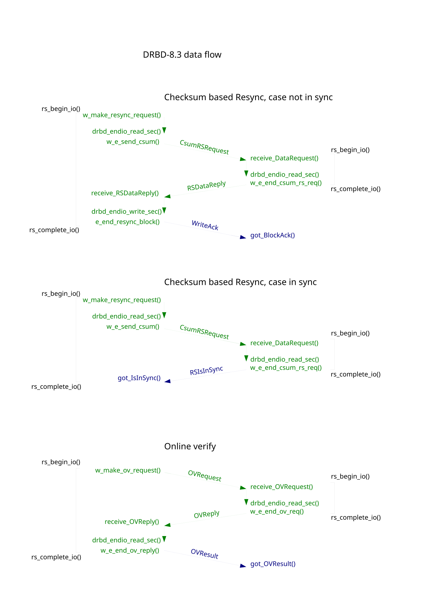
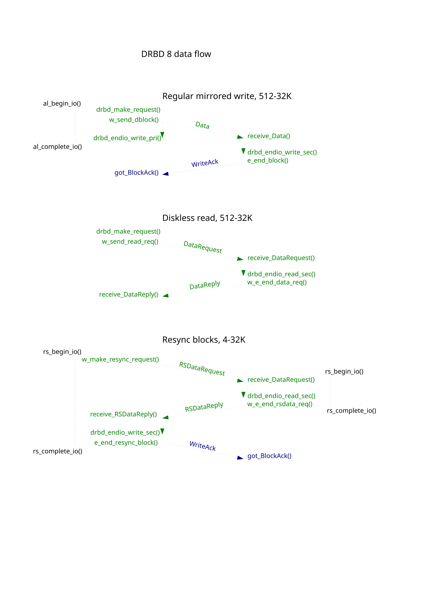
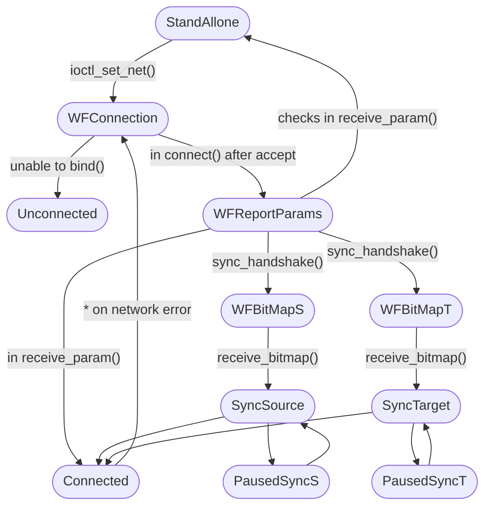
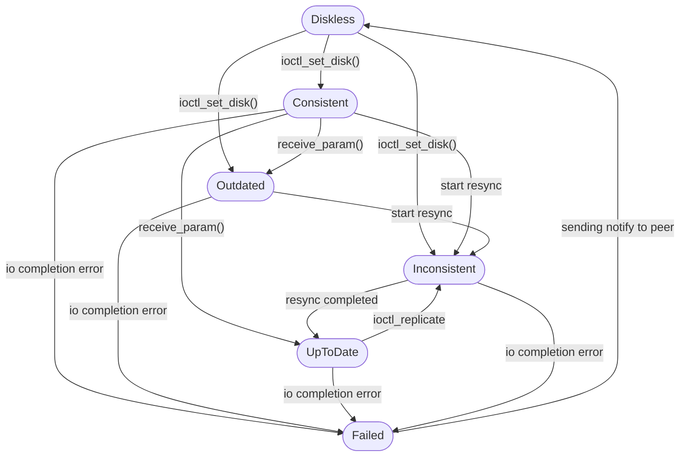
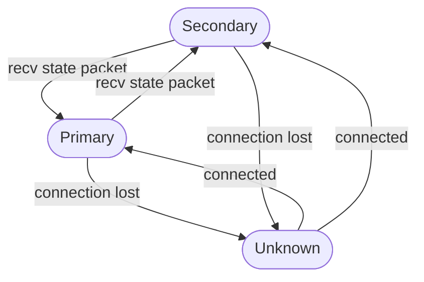

<!-- SPDX-License-Identifier: GPL-2.0 -->

<!-- The here included files are intended to help understand the implementation -->

## Data flows that Relate some functions, and write packets

## Sub graphs of DRBD's state transitions

conn-states-8.dot

disk-states-8.dot

peer-states-8.dot
