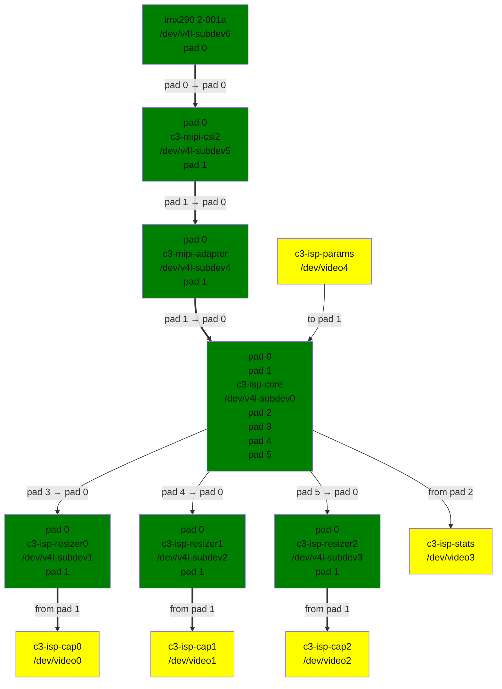

<a id="rst-amlogic-c3-image-signal-processing-c3isp-driver"></a>

<!-- SPDX-License-Identifier: (GPL-2.0-only OR MIT) -->

<!-- This data file has been placed in the public domain. -->

<!-- Derived from the Unicode character mappings available from
<http://www.w3.org/2003/entities/xml/>.
Processed by unicode2rstsubs.py, part of Docutils:
<https://docutils.sourceforge.io>. -->

<a id="rst-introduction"></a>

## Introduction

This file documents the Amlogic C3ISP driver located under drivers/media/platform/amlogic/c3/isp.

The current version of the driver supports the C3ISP found on Amlogic C308L processor.

The driver implements V4L2, Media controller and V4L2 subdev interfaces. Camera sensor using V4L2 subdev interface in the kernel is supported.

The driver has been tested on AW419-C308L-Socket platform.

<a id="rst-amlogic-c3-isp"></a>

## Amlogic C3 ISP

The Camera hardware found on C308L processors and supported by the driver consists of:

- 1 MIPI-CSI-2 module: handles the physical layer of the MIPI CSI-2 receiver and receives data from the connected camera sensor.

- 1 MIPI-ADAPTER module: organizes MIPI data to meet ISP input requirements and send MIPI data to ISP.

- 1 ISP (Image Signal Processing) module: contains a pipeline of image processing hardware blocks. The ISP pipeline contains three resizers at the end each of them connected to a DMA interface which writes the output data to memory.

A high-level functional view of the C3 ISP is presented below.:


```text
                                                                 +----------+    +-------+
                                                                 | Resizer  |--->| WRMIF |
+---------+    +------------+    +--------------+    +-------+   |----------+    +-------+
| Sensor  |--->| MIPI CSI-2 |--->| MIPI ADAPTER |--->|  ISP  |---|----------+    +-------+
+---------+    +------------+    +--------------+    +-------+   | Resizer  |--->| WRMIF |
                                                                 +----------+    +-------+
                                                                 |----------+    +-------+
                                                                 | Resizer  |--->| WRMIF |
                                                                 +----------+    +-------+
```

<a id="rst-driver-architecture-and-design"></a>

## Driver architecture and design

With the goal to model the hardware links between the modules and to expose a clean, logical and usable interface, the driver registers the following V4L2 sub-devices:

- 1 `c3-mipi-csi2` sub-device - the MIPI CSI-2 receiver

- 1 `c3-mipi-adapter` sub-device - the MIPI adapter

- 1 `c3-isp-core` sub-device - the ISP core

- 3 `c3-isp-resizer` sub-devices - the ISP resizers

The `c3-isp-core` sub-device is linked to 2 video device nodes for statistics capture and parameters programming:

- the `c3-isp-stats` capture video device node for statistics capture

- the `c3-isp-params` output video device for parameters programming

Each `c3-isp-resizer` sub-device is linked to a capture video device node where frames are captured from:

- `c3-isp-resizer0` is linked to the `c3-isp-cap0` capture video device

- `c3-isp-resizer1` is linked to the `c3-isp-cap1` capture video device

- `c3-isp-resizer2` is linked to the `c3-isp-cap2` capture video device

The media controller pipeline graph is as follows (with connected a IMX290 camera sensor):

<a id="rst-isp-topology-graph"></a>



c3-isp.dot

Media pipeline topology

<a id="rst-implementation"></a>

## Implementation

Runtime configuration of the ISP hardware is performed on the `c3-isp-params` video device node using the [V4L2_META_FMT_C3ISP_PARAMS](<~kernel/userspace/userspace-api/media-v4l/metafmt-c3-isp#rst-v4l2-meta-fmt-c3isp-params>) as data format. The buffer structure is defined by `c3_isp_params_cfg`.

Statistics are captured from the `c3-isp-stats` video device node using the [V4L2_META_FMT_C3ISP_STATS](<~kernel/userspace/userspace-api/media-v4l/metafmt-c3-isp#rst-v4l2-meta-fmt-c3isp-stats>) data format.

The final picture size and format is configured using the V4L2 video capture interface on the `c3-isp-cap[0, 2]` video device nodes.

The Amlogic C3 ISP is supported by [libcamera](<https://libcamera.org>)<a id="rst-libcamera"></a> with a dedicated pipeline handler and algorithms that perform run-time image correction and enhancement.
