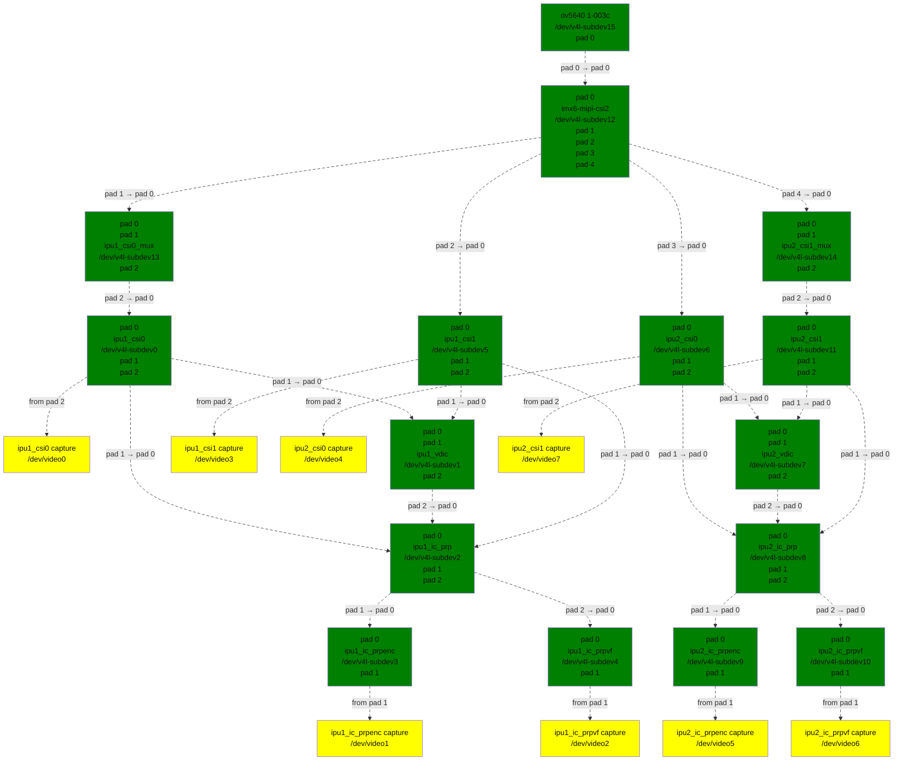
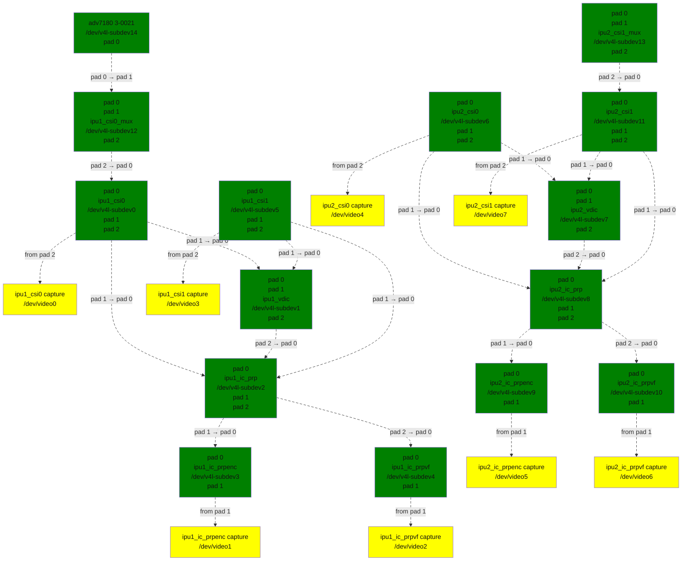

<a id="rst-i-mx-video-capture-driver"></a>

<!-- SPDX-License-Identifier: GPL-2.0 -->

<a id="rst-introduction"></a>

## Introduction

The Freescale i.MX5/6 contains an Image Processing Unit (IPU), which handles the flow of image frames to and from capture devices and display devices.

For image capture, the IPU contains the following internal subunits:

- Image DMA Controller (IDMAC)

- Camera Serial Interface (CSI)

- Image Converter (IC)

- Sensor Multi-FIFO Controller (SMFC)

- Image Rotator (IRT)

- Video De-Interlacing or Combining Block (VDIC)

The IDMAC is the DMA controller for transfer of image frames to and from memory. Various dedicated DMA channels exist for both video capture and display paths. During transfer, the IDMAC is also capable of vertical image flip, 8x8 block transfer (see IRT description), pixel component re-ordering (for example UYVY to YUYV) within the same colorspace, and packed &lt;--&gt; planar conversion. The IDMAC can also perform a simple de-interlacing by interweaving even and odd lines during transfer (without motion compensation which requires the VDIC).

The CSI is the backend capture unit that interfaces directly with camera sensors over Parallel, BT.656/1120, and MIPI CSI-2 buses.

The IC handles color-space conversion, resizing (downscaling and upscaling), horizontal flip, and 90/270 degree rotation operations.

There are three independent "tasks" within the IC that can carry out conversions concurrently: pre-process encoding, pre-process viewfinder, and post-processing. Within each task, conversions are split into three sections: downsizing section, main section (upsizing, flip, colorspace conversion, and graphics plane combining), and rotation section.

The IPU time-shares the IC task operations. The time-slice granularity is one burst of eight pixels in the downsizing section, one image line in the main processing section, one image frame in the rotation section.

The SMFC is composed of four independent FIFOs that each can transfer captured frames from sensors directly to memory concurrently via four IDMAC channels.

The IRT carries out 90 and 270 degree image rotation operations. The rotation operation is carried out on 8x8 pixel blocks at a time. This operation is supported by the IDMAC which handles the 8x8 block transfer along with block reordering, in coordination with vertical flip.

The VDIC handles the conversion of interlaced video to progressive, with support for different motion compensation modes (low, medium, and high motion). The deinterlaced output frames from the VDIC can be sent to the IC pre-process viewfinder task for further conversions. The VDIC also contains a Combiner that combines two image planes, with alpha blending and color keying.

In addition to the IPU internal subunits, there are also two units outside the IPU that are also involved in video capture on i.MX:

- MIPI CSI-2 Receiver for camera sensors with the MIPI CSI-2 bus interface. This is a Synopsys DesignWare core.

- Two video multiplexers for selecting among multiple sensor inputs to send to a CSI.

For more info, refer to the latest versions of the i.MX5/6 reference manuals <a id="rst-footnote-reference-1"></a>[1](#rst-f1) and <a id="rst-footnote-reference-2"></a>[2](#rst-f2).

<a id="rst-features"></a>

## Features

Some of the features of this driver include:

- Many different pipelines can be configured via media controller API, that correspond to the hardware video capture pipelines supported in the i.MX.

- Supports parallel, BT.565, and MIPI CSI-2 interfaces.

- Concurrent independent streams, by configuring pipelines to multiple video capture interfaces using independent entities.

- Scaling, color-space conversion, horizontal and vertical flip, and image rotation via IC task subdevs.

- Many pixel formats supported (RGB, packed and planar YUV, partial planar YUV).

- The VDIC subdev supports motion compensated de-interlacing, with three motion compensation modes: low, medium, and high motion. Pipelines are defined that allow sending frames to the VDIC subdev directly from the CSI. There is also support in the future for sending frames to the VDIC from memory buffers via output/mem2mem devices.

- Includes a Frame Interval Monitor (FIM) that can correct vertical sync problems with the ADV718x video decoders.

<a id="rst-topology"></a>

## Topology

The following shows the media topologies for the i.MX6Q SabreSD and i.MX6Q SabreAuto. Refer to these diagrams in the entity descriptions in the next section.

The i.MX5/6 topologies can differ upstream from the IPUv3 CSI video multiplexers, but the internal IPUv3 topology downstream from there is common to all i.MX5/6 platforms. For example, the SabreSD, with the MIPI CSI-2 OV5640 sensor, requires the i.MX6 MIPI CSI-2 receiver. But the SabreAuto has only the ADV7180 decoder on a parallel bt.656 bus, and therefore does not require the MIPI CSI-2 receiver, so it is missing in its graph.

<a id="rst-imx6q-topology-graph"></a>



Diagram of the i.MX6Q SabreSD media pipeline topology

Media pipeline graph on i.MX6Q SabreSD



Diagram of the i.MX6Q SabreAuto media pipeline topology

Media pipeline graph on i.MX6Q SabreAuto

<a id="rst-entities"></a>

## Entities

<a id="rst-imx6-mipi-csi2"></a>

## imx6-mipi-csi2

This is the MIPI CSI-2 receiver entity. It has one sink pad to receive the MIPI CSI-2 stream (usually from a MIPI CSI-2 camera sensor). It has four source pads, corresponding to the four MIPI CSI-2 demuxed virtual channel outputs. Multiple source pads can be enabled to independently stream from multiple virtual channels.

This entity actually consists of two sub-blocks. One is the MIPI CSI-2 core. This is a Synopsys Designware MIPI CSI-2 core. The other sub-block is a "CSI-2 to IPU gasket". The gasket acts as a demultiplexer of the four virtual channels streams, providing four separate parallel buses containing each virtual channel that are routed to CSIs or video multiplexers as described below.

On i.MX6 solo/dual-lite, all four virtual channel buses are routed to two video multiplexers. Both CSI0 and CSI1 can receive any virtual channel, as selected by the video multiplexers.

On i.MX6 Quad, virtual channel 0 is routed to IPU1-CSI0 (after selected by a video mux), virtual channels 1 and 2 are hard-wired to IPU1-CSI1 and IPU2-CSI0, respectively, and virtual channel 3 is routed to IPU2-CSI1 (again selected by a video mux).

<a id="rst-ipux-csiy-mux"></a>

## ipuX_csiY_mux

These are the video multiplexers. They have two or more sink pads to select from either camera sensors with a parallel interface, or from MIPI CSI-2 virtual channels from imx6-mipi-csi2 entity. They have a single source pad that routes to a CSI (ipuX_csiY entities).

On i.MX6 solo/dual-lite, there are two video mux entities. One sits in front of IPU1-CSI0 to select between a parallel sensor and any of the four MIPI CSI-2 virtual channels (a total of five sink pads). The other mux sits in front of IPU1-CSI1, and again has five sink pads to select between a parallel sensor and any of the four MIPI CSI-2 virtual channels.

On i.MX6 Quad, there are two video mux entities. One sits in front of IPU1-CSI0 to select between a parallel sensor and MIPI CSI-2 virtual channel 0 (two sink pads). The other mux sits in front of IPU2-CSI1 to select between a parallel sensor and MIPI CSI-2 virtual channel 3 (two sink pads).

<a id="rst-ipux-csiy"></a>

## ipuX_csiY

These are the CSI entities. They have a single sink pad receiving from either a video mux or from a MIPI CSI-2 virtual channel as described above.

This entity has two source pads. The first source pad can link directly to the ipuX_vdic entity or the ipuX_ic_prp entity, using hardware links that require no IDMAC memory buffer transfer.

When the direct source pad is routed to the ipuX_ic_prp entity, frames from the CSI can be processed by one or both of the IC pre-processing tasks.

When the direct source pad is routed to the ipuX_vdic entity, the VDIC will carry out motion-compensated de-interlace using "high motion" mode (see description of ipuX_vdic entity).

The second source pad sends video frames directly to memory buffers via the SMFC and an IDMAC channel, bypassing IC pre-processing. This source pad is routed to a capture device node, with a node name of the format "ipuX_csiY capture".

Note that since the IDMAC source pad makes use of an IDMAC channel, pixel reordering within the same colorspace can be carried out by the IDMAC channel. For example, if the CSI sink pad is receiving in UYVY order, the capture device linked to the IDMAC source pad can capture in YUYV order. Also, if the CSI sink pad is receiving a packed YUV format, the capture device can capture a planar YUV format such as YUV420.

The IDMAC channel at the IDMAC source pad also supports simple interweave without motion compensation, which is activated if the source pad's field type is sequential top-bottom or bottom-top, and the requested capture interface field type is set to interlaced (t-b, b-t, or unqualified interlaced). The capture interface will enforce the same field order as the source pad field order (interlaced-bt if source pad is seq-bt, interlaced-tb if source pad is seq-tb).

For events produced by ipuX_csiY, see ref:`imx_api_ipuX_csiY`.

<a id="rst-cropping-in-ipux-csiy"></a>

## Cropping in ipuX_csiY

The CSI supports cropping the incoming raw sensor frames. This is implemented in the ipuX_csiY entities at the sink pad, using the crop selection subdev API.

The CSI also supports fixed divide-by-two downscaling independently in width and height. This is implemented in the ipuX_csiY entities at the sink pad, using the compose selection subdev API.

The output rectangle at the ipuX_csiY source pad is the same as the compose rectangle at the sink pad. So the source pad rectangle cannot be negotiated, it must be set using the compose selection API at sink pad (if /2 downscale is desired, otherwise source pad rectangle is equal to incoming rectangle).

To give an example of crop and /2 downscale, this will crop a 1280x960 input frame to 640x480, and then /2 downscale in both dimensions to 320x240 (assumes ipu1_csi0 is linked to ipu1_csi0_mux):


```none
media-ctl -V "'ipu1_csi0_mux':2[fmt:UYVY2X8/1280x960]"
media-ctl -V "'ipu1_csi0':0[crop:(0,0)/640x480]"
media-ctl -V "'ipu1_csi0':0[compose:(0,0)/320x240]"
```

<a id="rst-frame-skipping-in-ipux-csiy"></a>

## Frame Skipping in ipuX_csiY

The CSI supports frame rate decimation, via frame skipping. Frame rate decimation is specified by setting the frame intervals at sink and source pads. The ipuX_csiY entity then applies the best frame skip setting to the CSI to achieve the desired frame rate at the source pad.

The following example reduces an assumed incoming 60 Hz frame rate by half at the IDMAC output source pad:


```none
media-ctl -V "'ipu1_csi0':0[fmt:UYVY2X8/640x480@1/60]"
media-ctl -V "'ipu1_csi0':2[fmt:UYVY2X8/640x480@1/30]"
```

<a id="rst-frame-interval-monitor-in-ipux-csiy"></a>

## Frame Interval Monitor in ipuX_csiY

See ref:`imx_api_FIM`.

<a id="rst-ipux-vdic"></a>

## ipuX_vdic

The VDIC carries out motion compensated de-interlacing, with three motion compensation modes: low, medium, and high motion. The mode is specified with the menu control V4L2_CID_DEINTERLACING_MODE. The VDIC has two sink pads and a single source pad.

The direct sink pad receives from an ipuX_csiY direct pad. With this link the VDIC can only operate in high motion mode.

When the IDMAC sink pad is activated, it receives from an output or mem2mem device node. With this pipeline, the VDIC can also operate in low and medium modes, because these modes require receiving frames from memory buffers. Note that an output or mem2mem device is not implemented yet, so this sink pad currently has no links.

The source pad routes to the IC pre-processing entity ipuX_ic_prp.

<a id="rst-ipux-ic-prp"></a>

## ipuX_ic_prp

This is the IC pre-processing entity. It acts as a router, routing data from its sink pad to one or both of its source pads.

This entity has a single sink pad. The sink pad can receive from the ipuX_csiY direct pad, or from ipuX_vdic.

This entity has two source pads. One source pad routes to the pre-process encode task entity (ipuX_ic_prpenc), the other to the pre-process viewfinder task entity (ipuX_ic_prpvf). Both source pads can be activated at the same time if the sink pad is receiving from ipuX_csiY. Only the source pad to the pre-process viewfinder task entity can be activated if the sink pad is receiving from ipuX_vdic (frames from the VDIC can only be processed by the pre-process viewfinder task).

<a id="rst-ipux-ic-prpenc"></a>

## ipuX_ic_prpenc

This is the IC pre-processing encode entity. It has a single sink pad from ipuX_ic_prp, and a single source pad. The source pad is routed to a capture device node, with a node name of the format "ipuX_ic_prpenc capture".

This entity performs the IC pre-process encode task operations: color-space conversion, resizing (downscaling and upscaling), horizontal and vertical flip, and 90/270 degree rotation. Flip and rotation are provided via standard V4L2 controls.

Like the ipuX_csiY IDMAC source, this entity also supports simple de-interlace without motion compensation, and pixel reordering.

<a id="rst-ipux-ic-prpvf"></a>

## ipuX_ic_prpvf

This is the IC pre-processing viewfinder entity. It has a single sink pad from ipuX_ic_prp, and a single source pad. The source pad is routed to a capture device node, with a node name of the format "ipuX_ic_prpvf capture".

This entity is identical in operation to ipuX_ic_prpenc, with the same resizing and CSC operations and flip/rotation controls. It will receive and process de-interlaced frames from the ipuX_vdic if ipuX_ic_prp is receiving from ipuX_vdic.

Like the ipuX_csiY IDMAC source, this entity supports simple interweaving without motion compensation. However, note that if the ipuX_vdic is included in the pipeline (ipuX_ic_prp is receiving from ipuX_vdic), it's not possible to use interweave in ipuX_ic_prpvf, since the ipuX_vdic has already carried out de-interlacing (with motion compensation) and therefore the field type output from ipuX_vdic can only be none (progressive).

<a id="rst-capture-pipelines"></a>

## Capture Pipelines

The following describe the various use-cases supported by the pipelines.

The links shown do not include the backend sensor, video mux, or mipi csi-2 receiver links. This depends on the type of sensor interface (parallel or mipi csi-2). So these pipelines begin with:

sensor -&gt; ipuX_csiY_mux -&gt; ...

for parallel sensors, or:

sensor -&gt; imx6-mipi-csi2 -&gt; (ipuX_csiY_mux) -&gt; ...

for mipi csi-2 sensors. The imx6-mipi-csi2 receiver may need to route to the video mux (ipuX_csiY_mux) before sending to the CSI, depending on the mipi csi-2 virtual channel, hence ipuX_csiY_mux is shown in parenthesis.

<a id="rst-unprocessed-video-capture"></a>

## Unprocessed Video Capture:

Send frames directly from sensor to camera device interface node, with no conversions, via ipuX_csiY IDMAC source pad:

-&gt; ipuX_csiY:2 -&gt; ipuX_csiY capture

<a id="rst-ic-direct-conversions"></a>

## IC Direct Conversions:

This pipeline uses the preprocess encode entity to route frames directly from the CSI to the IC, to carry out scaling up to 1024x1024 resolution, CSC, flipping, and image rotation:

-&gt; ipuX_csiY:1 -&gt; 0:ipuX_ic_prp:1 -&gt; 0:ipuX_ic_prpenc:1 -&gt; ipuX_ic_prpenc capture

<a id="rst-motion-compensated-de-interlace"></a>

## Motion Compensated De-interlace:

This pipeline routes frames from the CSI direct pad to the VDIC entity to support motion-compensated de-interlacing (high motion mode only), scaling up to 1024x1024, CSC, flip, and rotation:

-&gt; ipuX_csiY:1 -&gt; 0:ipuX_vdic:2 -&gt; 0:ipuX_ic_prp:2 -&gt; 0:ipuX_ic_prpvf:1 -&gt; ipuX_ic_prpvf capture

<a id="rst-usage-notes"></a>

## Usage Notes

To aid in configuration and for backward compatibility with V4L2 applications that access controls only from video device nodes, the capture device interfaces inherit controls from the active entities in the current pipeline, so controls can be accessed either directly from the subdev or from the active capture device interface. For example, the FIM controls are available either from the ipuX_csiY subdevs or from the active capture device.

The following are specific usage notes for the Sabre\* reference boards:

<a id="rst-i-mx6q-sabrelite-with-ov5642-and-ov5640"></a>

## i.MX6Q SabreLite with OV5642 and OV5640

This platform requires the OmniVision OV5642 module with a parallel camera interface, and the OV5640 module with a MIPI CSI-2 interface. Both modules are available from Boundary Devices:

- [https://boundarydevices.com/product/nit6x_5mp](<https://boundarydevices.com/product/nit6x_5mp>)

- [https://boundarydevices.com/product/nit6x_5mp_mipi](<https://boundarydevices.com/product/nit6x_5mp_mipi>)

Note that if only one camera module is available, the other sensor node can be disabled in the device tree.

The OV5642 module is connected to the parallel bus input on the i.MX internal video mux to IPU1 CSI0. It's i2c bus connects to i2c bus 2.

The MIPI CSI-2 OV5640 module is connected to the i.MX internal MIPI CSI-2 receiver, and the four virtual channel outputs from the receiver are routed as follows: vc0 to the IPU1 CSI0 mux, vc1 directly to IPU1 CSI1, vc2 directly to IPU2 CSI0, and vc3 to the IPU2 CSI1 mux. The OV5640 is also connected to i2c bus 2 on the SabreLite, therefore the OV5642 and OV5640 must not share the same i2c slave address.

The following basic example configures unprocessed video capture pipelines for both sensors. The OV5642 is routed to ipu1_csi0, and the OV5640, transmitting on MIPI CSI-2 virtual channel 1 (which is imx6-mipi-csi2 pad 2), is routed to ipu1_csi1. Both sensors are configured to output 640x480, and the OV5642 outputs YUYV2X8, the OV5640 UYVY2X8:


```none
# Setup links for OV5642
media-ctl -l "'ov5642 1-0042':0 -> 'ipu1_csi0_mux':1[1]"
media-ctl -l "'ipu1_csi0_mux':2 -> 'ipu1_csi0':0[1]"
media-ctl -l "'ipu1_csi0':2 -> 'ipu1_csi0 capture':0[1]"
# Setup links for OV5640
media-ctl -l "'ov5640 1-0040':0 -> 'imx6-mipi-csi2':0[1]"
media-ctl -l "'imx6-mipi-csi2':2 -> 'ipu1_csi1':0[1]"
media-ctl -l "'ipu1_csi1':2 -> 'ipu1_csi1 capture':0[1]"
# Configure pads for OV5642 pipeline
media-ctl -V "'ov5642 1-0042':0 [fmt:YUYV2X8/640x480 field:none]"
media-ctl -V "'ipu1_csi0_mux':2 [fmt:YUYV2X8/640x480 field:none]"
media-ctl -V "'ipu1_csi0':2 [fmt:AYUV32/640x480 field:none]"
# Configure pads for OV5640 pipeline
media-ctl -V "'ov5640 1-0040':0 [fmt:UYVY2X8/640x480 field:none]"
media-ctl -V "'imx6-mipi-csi2':2 [fmt:UYVY2X8/640x480 field:none]"
media-ctl -V "'ipu1_csi1':2 [fmt:AYUV32/640x480 field:none]"
```

Streaming can then begin independently on the capture device nodes "ipu1_csi0 capture" and "ipu1_csi1 capture". The v4l2-ctl tool can be used to select any supported YUV pixelformat on the capture device nodes, including planar.

<a id="rst-i-mx6q-sabreauto-with-adv7180-decoder"></a>

## i.MX6Q SabreAuto with ADV7180 decoder

On the i.MX6Q SabreAuto, an on-board ADV7180 SD decoder is connected to the parallel bus input on the internal video mux to IPU1 CSI0.

The following example configures a pipeline to capture from the ADV7180 video decoder, assuming NTSC 720x480 input signals, using simple interweave (unconverted and without motion compensation). The adv7180 must output sequential or alternating fields (field type 'seq-bt' for NTSC, or 'alternate'):


```none
# Setup links
media-ctl -l "'adv7180 3-0021':0 -> 'ipu1_csi0_mux':1[1]"
media-ctl -l "'ipu1_csi0_mux':2 -> 'ipu1_csi0':0[1]"
media-ctl -l "'ipu1_csi0':2 -> 'ipu1_csi0 capture':0[1]"
# Configure pads
media-ctl -V "'adv7180 3-0021':0 [fmt:UYVY2X8/720x480 field:seq-bt]"
media-ctl -V "'ipu1_csi0_mux':2 [fmt:UYVY2X8/720x480]"
media-ctl -V "'ipu1_csi0':2 [fmt:AYUV32/720x480]"
# Configure "ipu1_csi0 capture" interface (assumed at /dev/video4)
v4l2-ctl -d4 --set-fmt-video=field=interlaced_bt
```

Streaming can then begin on /dev/video4. The v4l2-ctl tool can also be used to select any supported YUV pixelformat on /dev/video4.

This example configures a pipeline to capture from the ADV7180 video decoder, assuming PAL 720x576 input signals, with Motion Compensated de-interlacing. The adv7180 must output sequential or alternating fields (field type 'seq-tb' for PAL, or 'alternate').


```none
# Setup links
media-ctl -l "'adv7180 3-0021':0 -> 'ipu1_csi0_mux':1[1]"
media-ctl -l "'ipu1_csi0_mux':2 -> 'ipu1_csi0':0[1]"
media-ctl -l "'ipu1_csi0':1 -> 'ipu1_vdic':0[1]"
media-ctl -l "'ipu1_vdic':2 -> 'ipu1_ic_prp':0[1]"
media-ctl -l "'ipu1_ic_prp':2 -> 'ipu1_ic_prpvf':0[1]"
media-ctl -l "'ipu1_ic_prpvf':1 -> 'ipu1_ic_prpvf capture':0[1]"
# Configure pads
media-ctl -V "'adv7180 3-0021':0 [fmt:UYVY2X8/720x576 field:seq-tb]"
media-ctl -V "'ipu1_csi0_mux':2 [fmt:UYVY2X8/720x576]"
media-ctl -V "'ipu1_csi0':1 [fmt:AYUV32/720x576]"
media-ctl -V "'ipu1_vdic':2 [fmt:AYUV32/720x576 field:none]"
media-ctl -V "'ipu1_ic_prp':2 [fmt:AYUV32/720x576 field:none]"
media-ctl -V "'ipu1_ic_prpvf':1 [fmt:AYUV32/720x576 field:none]"
# Configure "ipu1_ic_prpvf capture" interface (assumed at /dev/video2)
v4l2-ctl -d2 --set-fmt-video=field=none
```

Streaming can then begin on /dev/video2. The v4l2-ctl tool can also be used to select any supported YUV pixelformat on /dev/video2.

This platform accepts Composite Video analog inputs to the ADV7180 on Ain1 (connector J42).

<a id="rst-i-mx6dl-sabreauto-with-adv7180-decoder"></a>

## i.MX6DL SabreAuto with ADV7180 decoder

On the i.MX6DL SabreAuto, an on-board ADV7180 SD decoder is connected to the parallel bus input on the internal video mux to IPU1 CSI0.

The following example configures a pipeline to capture from the ADV7180 video decoder, assuming NTSC 720x480 input signals, using simple interweave (unconverted and without motion compensation). The adv7180 must output sequential or alternating fields (field type 'seq-bt' for NTSC, or 'alternate'):


```none
# Setup links
media-ctl -l "'adv7180 4-0021':0 -> 'ipu1_csi0_mux':4[1]"
media-ctl -l "'ipu1_csi0_mux':5 -> 'ipu1_csi0':0[1]"
media-ctl -l "'ipu1_csi0':2 -> 'ipu1_csi0 capture':0[1]"
# Configure pads
media-ctl -V "'adv7180 4-0021':0 [fmt:UYVY2X8/720x480 field:seq-bt]"
media-ctl -V "'ipu1_csi0_mux':5 [fmt:UYVY2X8/720x480]"
media-ctl -V "'ipu1_csi0':2 [fmt:AYUV32/720x480]"
# Configure "ipu1_csi0 capture" interface (assumed at /dev/video0)
v4l2-ctl -d0 --set-fmt-video=field=interlaced_bt
```

Streaming can then begin on /dev/video0. The v4l2-ctl tool can also be used to select any supported YUV pixelformat on /dev/video0.

This example configures a pipeline to capture from the ADV7180 video decoder, assuming PAL 720x576 input signals, with Motion Compensated de-interlacing. The adv7180 must output sequential or alternating fields (field type 'seq-tb' for PAL, or 'alternate').


```none
# Setup links
media-ctl -l "'adv7180 4-0021':0 -> 'ipu1_csi0_mux':4[1]"
media-ctl -l "'ipu1_csi0_mux':5 -> 'ipu1_csi0':0[1]"
media-ctl -l "'ipu1_csi0':1 -> 'ipu1_vdic':0[1]"
media-ctl -l "'ipu1_vdic':2 -> 'ipu1_ic_prp':0[1]"
media-ctl -l "'ipu1_ic_prp':2 -> 'ipu1_ic_prpvf':0[1]"
media-ctl -l "'ipu1_ic_prpvf':1 -> 'ipu1_ic_prpvf capture':0[1]"
# Configure pads
media-ctl -V "'adv7180 4-0021':0 [fmt:UYVY2X8/720x576 field:seq-tb]"
media-ctl -V "'ipu1_csi0_mux':5 [fmt:UYVY2X8/720x576]"
media-ctl -V "'ipu1_csi0':1 [fmt:AYUV32/720x576]"
media-ctl -V "'ipu1_vdic':2 [fmt:AYUV32/720x576 field:none]"
media-ctl -V "'ipu1_ic_prp':2 [fmt:AYUV32/720x576 field:none]"
media-ctl -V "'ipu1_ic_prpvf':1 [fmt:AYUV32/720x576 field:none]"
# Configure "ipu1_ic_prpvf capture" interface (assumed at /dev/video2)
v4l2-ctl -d2 --set-fmt-video=field=none
```

Streaming can then begin on /dev/video2. The v4l2-ctl tool can also be used to select any supported YUV pixelformat on /dev/video2.

This platform accepts Composite Video analog inputs to the ADV7180 on Ain1 (connector J42).

<a id="rst-i-mx6q-sabresd-with-mipi-csi-2-ov5640"></a>

## i.MX6Q SabreSD with MIPI CSI-2 OV5640

Similarly to i.MX6Q SabreLite, the i.MX6Q SabreSD supports a parallel interface OV5642 module on IPU1 CSI0, and a MIPI CSI-2 OV5640 module. The OV5642 connects to i2c bus 1 and the OV5640 to i2c bus 2.

The device tree for SabreSD includes OF graphs for both the parallel OV5642 and the MIPI CSI-2 OV5640, but as of this writing only the MIPI CSI-2 OV5640 has been tested, so the OV5642 node is currently disabled. The OV5640 module connects to MIPI connector J5. The NXP part number for the OV5640 module that connects to the SabreSD board is H120729.

The following example configures unprocessed video capture pipeline to capture from the OV5640, transmitting on MIPI CSI-2 virtual channel 0:


```none
# Setup links
media-ctl -l "'ov5640 1-003c':0 -> 'imx6-mipi-csi2':0[1]"
media-ctl -l "'imx6-mipi-csi2':1 -> 'ipu1_csi0_mux':0[1]"
media-ctl -l "'ipu1_csi0_mux':2 -> 'ipu1_csi0':0[1]"
media-ctl -l "'ipu1_csi0':2 -> 'ipu1_csi0 capture':0[1]"
# Configure pads
media-ctl -V "'ov5640 1-003c':0 [fmt:UYVY2X8/640x480]"
media-ctl -V "'imx6-mipi-csi2':1 [fmt:UYVY2X8/640x480]"
media-ctl -V "'ipu1_csi0_mux':0 [fmt:UYVY2X8/640x480]"
media-ctl -V "'ipu1_csi0':0 [fmt:AYUV32/640x480]"
```

Streaming can then begin on "ipu1_csi0 capture" node. The v4l2-ctl tool can be used to select any supported pixelformat on the capture device node.

To determine what is the /dev/video node correspondent to "ipu1_csi0 capture":


```none
media-ctl -e "ipu1_csi0 capture"
/dev/video0
```

/dev/video0 is the streaming element in this case.

Starting the streaming via v4l2-ctl:


```none
v4l2-ctl --stream-mmap -d /dev/video0
```

Starting the streaming via Gstreamer and sending the content to the display:


```none
gst-launch-1.0 v4l2src device=/dev/video0 ! kmssink
```

The following example configures a direct conversion pipeline to capture from the OV5640, transmitting on MIPI CSI-2 virtual channel 0. It also shows colorspace conversion and scaling at IC output.


```none
# Setup links
media-ctl -l "'ov5640 1-003c':0 -> 'imx6-mipi-csi2':0[1]"
media-ctl -l "'imx6-mipi-csi2':1 -> 'ipu1_csi0_mux':0[1]"
media-ctl -l "'ipu1_csi0_mux':2 -> 'ipu1_csi0':0[1]"
media-ctl -l "'ipu1_csi0':1 -> 'ipu1_ic_prp':0[1]"
media-ctl -l "'ipu1_ic_prp':1 -> 'ipu1_ic_prpenc':0[1]"
media-ctl -l "'ipu1_ic_prpenc':1 -> 'ipu1_ic_prpenc capture':0[1]"
# Configure pads
media-ctl -V "'ov5640 1-003c':0 [fmt:UYVY2X8/640x480]"
media-ctl -V "'imx6-mipi-csi2':1 [fmt:UYVY2X8/640x480]"
media-ctl -V "'ipu1_csi0_mux':2 [fmt:UYVY2X8/640x480]"
media-ctl -V "'ipu1_csi0':1 [fmt:AYUV32/640x480]"
media-ctl -V "'ipu1_ic_prp':1 [fmt:AYUV32/640x480]"
media-ctl -V "'ipu1_ic_prpenc':1 [fmt:ARGB8888_1X32/800x600]"
# Set a format at the capture interface
v4l2-ctl -d /dev/video1 --set-fmt-video=pixelformat=RGB3
```

Streaming can then begin on "ipu1_ic_prpenc capture" node.

To determine what is the /dev/video node correspondent to "ipu1_ic_prpenc capture":


```none
media-ctl -e "ipu1_ic_prpenc capture"
/dev/video1
```

/dev/video1 is the streaming element in this case.

Starting the streaming via v4l2-ctl:


```none
v4l2-ctl --stream-mmap -d /dev/video1
```

Starting the streaming via Gstreamer and sending the content to the display:


```none
gst-launch-1.0 v4l2src device=/dev/video1 ! kmssink
```

<a id="rst-known-issues"></a>

## Known Issues

1. When using 90 or 270 degree rotation control at capture resolutions near the IC resizer limit of 1024x1024, and combined with planar pixel formats (YUV420, YUV422p), frame capture will often fail with no end-of-frame interrupts from the IDMAC channel. To work around this, use lower resolution and/or packed formats (YUYV, RGB3, etc.) when 90 or 270 rotations are needed.

<a id="rst-file-list"></a>

## File list

drivers/staging/media/imx/ include/media/imx.h include/linux/imx-media.h

<a id="rst-references"></a>

## References

<a id="rst-f1"></a>


**[1]** [http://www.nxp.com/assets/documents/data/en/reference-manuals/IMX6DQRM.pdf](<http://www.nxp.com/assets/documents/data/en/reference-manuals/IMX6DQRM.pdf>)

<a id="rst-f2"></a>


**[2]** [http://www.nxp.com/assets/documents/data/en/reference-manuals/IMX6SDLRM.pdf](<http://www.nxp.com/assets/documents/data/en/reference-manuals/IMX6SDLRM.pdf>)

<a id="rst-authors"></a>

## Authors

- Steve Longerbeam &lt;[steve_longerbeam@mentor.com](<mailto:steve_longerbeam@mentor.com>)&gt;

- Philipp Zabel &lt;[kernel@pengutronix.de](<mailto:kernel@pengutronix.de>)&gt;

- Russell King &lt;[linux@armlinux.org.uk](<mailto:linux@armlinux.org.uk>)&gt;

Copyright (C) 2012-2017 Mentor Graphics Inc.
