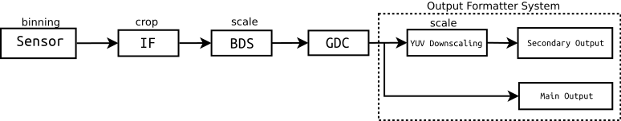

<a id="rst-intel-image-processing-unit-3-ipu3-imaging-unit-imgu-driver"></a>

<!-- SPDX-License-Identifier: GPL-2.0 -->

<!-- This data file has been placed in the public domain. -->

<!-- Derived from the Unicode character mappings available from
<http://www.w3.org/2003/entities/xml/>.
Processed by unicode2rstsubs.py, part of Docutils:
<https://docutils.sourceforge.io>. -->

Copyright © 2018 Intel Corporation

<a id="rst-introduction"></a>

## Introduction

This file documents the Intel IPU3 (3rd generation Image Processing Unit) Imaging Unit drivers located under drivers/media/pci/intel/ipu3 (CIO2) as well as under drivers/staging/media/ipu3 (ImgU).

The Intel IPU3 found in certain Kaby Lake (as well as certain Sky Lake) platforms (U/Y processor lines) is made up of two parts namely the Imaging Unit (ImgU) and the CIO2 device (MIPI CSI2 receiver).

The CIO2 device receives the raw Bayer data from the sensors and outputs the frames in a format that is specific to the IPU3 (for consumption by the IPU3 ImgU). The CIO2 driver is available as drivers/media/pci/intel/ipu3/ipu3-cio2\* and is enabled through the CONFIG\_VIDEO\_IPU3\_CIO2 config option.

The Imaging Unit (ImgU) is responsible for processing images captured by the IPU3 CIO2 device. The ImgU driver sources can be found under drivers/staging/media/ipu3 directory. The driver is enabled through the CONFIG\_VIDEO\_IPU3\_IMGU config option.

The two driver modules are named ipu3\_csi2 and ipu3\_imgu, respectively.

The drivers has been tested on Kaby Lake platforms (U/Y processor lines).

Both of the drivers implement V4L2, Media Controller and V4L2 sub-device interfaces. The IPU3 CIO2 driver supports camera sensors connected to the CIO2 MIPI CSI-2 interfaces through V4L2 sub-device sensor drivers.

<a id="rst-cio2"></a>

## CIO2

The CIO2 is represented as a single V4L2 subdev, which provides a V4L2 subdev interface to the user space. There is a video node for each CSI-2 receiver, with a single media controller interface for the entire device.

The CIO2 contains four independent capture channel, each with its own MIPI CSI-2 receiver and DMA engine. Each channel is modelled as a V4L2 sub-device exposed to userspace as a V4L2 sub-device node and has two pads:

<!-- tabularcolumns: |p{0.8cm}|p{4.0cm}|p{4.0cm}| -->


<table>
<thead>
<tr>
<th>


Pad

</th>
<th>


Direction

</th>
<th>


Purpose

</th>
</tr>
</thead>
<tbody>
<tr>
<td>


0

</td>
<td>


sink

</td>
<td>


MIPI CSI-2 input, connected to the sensor subdev

</td>
</tr>
<tr>
<td>


1

</td>
<td>


source

</td>
<td>


Raw video capture, connected to the V4L2 video interface

</td>
</tr>
</tbody>
</table>

The V4L2 video interfaces model the DMA engines. They are exposed to userspace as V4L2 video device nodes.

<a id="rst-capturing-frames-in-raw-bayer-format"></a>

### Capturing frames in raw Bayer format

CIO2 MIPI CSI2 receiver is used to capture frames (in packed raw Bayer format) from the raw sensors connected to the CSI2 ports. The captured frames are used as input to the ImgU driver.

Image processing using IPU3 ImgU requires tools such as raw2pnm <a id="rst-footnote-reference-1"></a>[1](#rst-f1), and yavta <a id="rst-footnote-reference-2"></a>[2](#rst-f2) due to the following unique requirements and / or features specific to IPU3.

\-- The IPU3 CSI2 receiver outputs the captured frames from the sensor in packed raw Bayer format that is specific to IPU3.

\-- Multiple video nodes have to be operated simultaneously.

Let us take the example of ov5670 sensor connected to CSI2 port 0, for a 2592x1944 image capture.

Using the media controller APIs, the ov5670 sensor is configured to send frames in packed raw Bayer format to IPU3 CSI2 receiver.


```none
# This example assumes /dev/media0 as the CIO2 media device
export MDEV=/dev/media0

# and that ov5670 sensor is connected to i2c bus 10 with address 0x36
export SDEV=$(media-ctl -d $MDEV -e "ov5670 10-0036")

# Establish the link for the media devices using media-ctl
media-ctl -d $MDEV -l "ov5670:0 -> ipu3-csi2 0:0[1]"

# Set the format for the media devices
media-ctl -d $MDEV -V "ov5670:0 [fmt:SGRBG10/2592x1944]"
media-ctl -d $MDEV -V "ipu3-csi2 0:0 [fmt:SGRBG10/2592x1944]"
media-ctl -d $MDEV -V "ipu3-csi2 0:1 [fmt:SGRBG10/2592x1944]"
```

Once the media pipeline is configured, desired sensor specific settings (such as exposure and gain settings) can be set, using the yavta tool.

e.g


```none
yavta -w 0x009e0903 444 $SDEV
yavta -w 0x009e0913 1024 $SDEV
yavta -w 0x009e0911 2046 $SDEV
```

Once the desired sensor settings are set, frame captures can be done as below.

e.g


```none
yavta --data-prefix -u -c10 -n5 -I -s2592x1944 --file=/tmp/frame-#.bin \
      -f IPU3_SGRBG10 $(media-ctl -d $MDEV -e "ipu3-cio2 0")
```

With the above command, 10 frames are captured at 2592x1944 resolution, with sGRBG10 format and output as IPU3\_SGRBG10 format.

The captured frames are available as /tmp/frame-\#.bin files.

<a id="rst-imgu"></a>

## ImgU

The ImgU is represented as two V4L2 subdevs, each of which provides a V4L2 subdev interface to the user space.

Each V4L2 subdev represents a pipe, which can support a maximum of 2 streams. This helps to support advanced camera features like Continuous View Finder (CVF) and Snapshot During Video(SDV).

The ImgU contains two independent pipes, each modelled as a V4L2 sub-device exposed to userspace as a V4L2 sub-device node.

Each pipe has two sink pads and three source pads for the following purpose:

<!-- tabularcolumns: |p{0.8cm}|p{4.0cm}|p{4.0cm}| -->


<table>
<thead>
<tr>
<th>


Pad

</th>
<th>


Direction

</th>
<th>


Purpose

</th>
</tr>
</thead>
<tbody>
<tr>
<td>


0

</td>
<td>


sink

</td>
<td>


Input raw video stream

</td>
</tr>
<tr>
<td>


1

</td>
<td>


sink

</td>
<td>


Processing parameters

</td>
</tr>
<tr>
<td>


2

</td>
<td>


source

</td>
<td>


Output processed video stream

</td>
</tr>
<tr>
<td>


3

</td>
<td>


source

</td>
<td>


Output viewfinder video stream

</td>
</tr>
<tr>
<td>


4

</td>
<td>


source

</td>
<td>


3A statistics

</td>
</tr>
</tbody>
</table>

Each pad is connected to a corresponding V4L2 video interface, exposed to userspace as a V4L2 video device node.

<a id="rst-device-operation"></a>

### Device operation

With ImgU, once the input video node ("ipu3-imgu 0/1":0, in &lt;entity&gt;:&lt;pad-number&gt; format) is queued with buffer (in packed raw Bayer format), ImgU starts processing the buffer and produces the video output in YUV format and statistics output on respective output nodes. The driver is expected to have buffers ready for all of parameter, output and statistics nodes, when input video node is queued with buffer.

At a minimum, all of input, main output, 3A statistics and viewfinder video nodes should be enabled for IPU3 to start image processing.

Each ImgU V4L2 subdev has the following set of video nodes.

<a id="rst-input-output-and-viewfinder-video-nodes"></a>

### input, output and viewfinder video nodes

The frames (in packed raw Bayer format specific to the IPU3) received by the input video node is processed by the IPU3 Imaging Unit and are output to 2 video nodes, with each targeting a different purpose (main output and viewfinder output).

Details onand the Bayer format specific to the IPU3 can be found in [v4l2-pix-fmt-ipu3-sbggr10](<https://git.kernel.org/pub/scm/linux/kernel/git/stable/linux.git/tree/Documentation/userspace-api/media/v4l/pixfmt-srggb10-ipu3.rst?id=9021cc14f7d98b4a1d2c932f52c5343d4d0f6b92>).

The driver supports V4L2 Video Capture Interface as defined at [devices](<~kernel/userspace/userspace-api/media-v4l/devices#rst-devices>).

Only the multi-planar API is supported. More details can be found at [planar-apis](<~kernel/userspace/userspace-api/media-v4l/planar-apis#rst-planar-apis>).

<a id="rst-parameters-video-node"></a>

### Parameters video node

The parameters video node receives the ImgU algorithm parameters that are used to configure how the ImgU algorithms process the image.

Details on processing parameters specific to the IPU3 can be found in [v4l2-meta-fmt-params](<~kernel/userspace/userspace-api/media-v4l/metafmt-intel-ipu3#rst-v4l2-meta-fmt-params>).

<a id="rst-a-statistics-video-node"></a>

### 3A statistics video node

3A statistics video node is used by the ImgU driver to output the 3A (auto focus, auto exposure and auto white balance) statistics for the frames that are being processed by the ImgU to user space applications. User space applications can use this statistics data to compute the desired algorithm parameters for the ImgU.

<a id="rst-configuring-the-intel-ipu3"></a>

## Configuring the Intel IPU3

The IPU3 ImgU pipelines can be configured using the Media Controller, defined at [media\_controller](<~kernel/userspace/userspace-api/media-mediactl/media-controller#rst-media-controller>).

<a id="rst-running-mode-and-firmware-binary-selection"></a>

### Running mode and firmware binary selection

ImgU works based on firmware, currently the ImgU firmware support run 2 pipes in time-sharing with single input frame data. Each pipe can run at certain mode - "VIDEO" or "STILL", "VIDEO" mode is commonly used for video frames capture, and "STILL" is used for still frame capture. However, you can also select "VIDEO" to capture still frames if you want to capture images with less system load and power. For "STILL" mode, ImgU will try to use smaller BDS factor and output larger bayer frame for further YUV processing than "VIDEO" mode to get high quality images. Besides, "STILL" mode need XNR3 to do noise reduction, hence "STILL" mode will need more power and memory bandwidth than "VIDEO" mode. TNR will be enabled in "VIDEO" mode and bypassed by "STILL" mode. ImgU is running at "VIDEO" mode by default, the user can use v4l2 control V4L2\_CID\_INTEL\_IPU3\_MODE (currently defined in drivers/staging/media/ipu3/include/uapi/intel-ipu3.h) to query and set the running mode. For user, there is no difference for buffer queueing between the "VIDEO" and "STILL" mode, mandatory input and main output node should be enabled and buffers need be queued, the statistics and the view-finder queues are optional.

The firmware binary will be selected according to current running mode, such log "using binary if\_to\_osys\_striped " or "using binary if\_to\_osys\_primary\_striped" could be observed if you enable the ImgU dynamic debug, the binary if\_to\_osys\_striped is selected for "VIDEO" and the binary "if\_to\_osys\_primary\_striped" is selected for "STILL".

<a id="rst-processing-the-image-in-raw-bayer-format"></a>

### Processing the image in raw Bayer format

<a id="rst-configuring-imgu-v4l2-subdev-for-image-processing"></a>

#### Configuring ImgU V4L2 subdev for image processing

The ImgU V4L2 subdevs have to be configured with media controller APIs to have all the video nodes setup correctly.

Let us take "ipu3-imgu 0" subdev as an example.


```none
media-ctl -d $MDEV -r
media-ctl -d $MDEV -l "ipu3-imgu 0 input":0 -> "ipu3-imgu 0":0[1]
media-ctl -d $MDEV -l "ipu3-imgu 0":2 -> "ipu3-imgu 0 output":0[1]
media-ctl -d $MDEV -l "ipu3-imgu 0":3 -> "ipu3-imgu 0 viewfinder":0[1]
media-ctl -d $MDEV -l "ipu3-imgu 0":4 -> "ipu3-imgu 0 3a stat":0[1]
```

Also the pipe mode of the corresponding V4L2 subdev should be set as desired (e.g 0 for video mode or 1 for still mode) through the control id 0x009819a1 as below.


```none
yavta -w "0x009819A1 1" /dev/v4l-subdev7
```

Certain hardware blocks in ImgU pipeline can change the frame resolution by cropping or scaling, these hardware blocks include Input Feeder(IF), Bayer Down Scaler (BDS) and Geometric Distortion Correction (GDC). There is also a block which can change the frame resolution - YUV Scaler, it is only applicable to the secondary output.

RAW Bayer frames go through these ImgU pipeline hardware blocks and the final processed image output to the DDR memory.



IPU3 resolution change hardware blocks

<strong>Input Feeder</strong>

Input Feeder gets the Bayer frame data from the sensor, it can enable cropping of lines and columns from the frame and then store pixels into device's internal pixel buffer which are ready to readout by following blocks.

<strong>Bayer Down Scaler</strong>

Bayer Down Scaler is capable of performing image scaling in Bayer domain, the downscale factor can be configured from 1X to 1/4X in each axis with configuration steps of 0.03125 (1/32).

<strong>Geometric Distortion Correction</strong>

Geometric Distortion Correction is used to perform correction of distortions and image filtering. It needs some extra filter and envelope padding pixels to work, so the input resolution of GDC should be larger than the output resolution.

<strong>YUV Scaler</strong>

YUV Scaler which similar with BDS, but it is mainly do image down scaling in YUV domain, it can support up to 1/12X down scaling, but it can not be applied to the main output.

The ImgU V4L2 subdev has to be configured with the supported resolutions in all the above hardware blocks, for a given input resolution. For a given supported resolution for an input frame, the Input Feeder, Bayer Down Scaler and GDC blocks should be configured with the supported resolutions as each hardware block has its own alignment requirement.

You must configure the output resolution of the hardware blocks smartly to meet the hardware requirement along with keeping the maximum field of view. The intermediate resolutions can be generated by specific tool -

[https://github.com/intel/intel-ipu3-pipecfg](<https://github.com/intel/intel-ipu3-pipecfg>)

This tool can be used to generate intermediate resolutions. More information can be obtained by looking at the following IPU3 ImgU configuration table.

[https://chromium.googlesource.com/chromiumos/overlays/board-overlays/+/master](<https://chromium.googlesource.com/chromiumos/overlays/board-overlays/+/master>)

Under baseboard-poppy/media-libs/cros-camera-hal-configs-poppy/files/gcss directory, graph\_settings\_ov5670.xml can be used as an example.

The following steps prepare the ImgU pipeline for the image processing.

1\. The ImgU V4L2 subdev data format should be set by using the VIDIOC\_SUBDEV\_S\_FMT on pad 0, using the GDC width and height obtained above.

2\. The ImgU V4L2 subdev cropping should be set by using the VIDIOC\_SUBDEV\_S\_SELECTION on pad 0, with V4L2\_SEL\_TGT\_CROP as the target, using the input feeder height and width.

3\. The ImgU V4L2 subdev composing should be set by using the VIDIOC\_SUBDEV\_S\_SELECTION on pad 0, with V4L2\_SEL\_TGT\_COMPOSE as the target, using the BDS height and width.

For the ov5670 example, for an input frame with a resolution of 2592x1944 (which is input to the ImgU subdev pad 0), the corresponding resolutions for input feeder, BDS and GDC are 2592x1944, 2592x1944 and 2560x1920 respectively.

Once this is done, the received raw Bayer frames can be input to the ImgU V4L2 subdev as below, using the open source application v4l2n <a id="rst-footnote-reference-3"></a>[1](#rst-f1).

For an image captured with 2592x1944 <a id="rst-footnote-reference-4"></a>[3](#rst-f4) resolution, with desired output resolution as 2560x1920 and viewfinder resolution as 2560x1920, the following v4l2n command can be used. This helps process the raw Bayer frames and produces the desired results for the main output image and the viewfinder output, in NV12 format.


```none
v4l2n --pipe=4 --load=/tmp/frame-#.bin --open=/dev/video4
      --fmt=type:VIDEO_OUTPUT_MPLANE,width=2592,height=1944,pixelformat=0X47337069 \
      --reqbufs=type:VIDEO_OUTPUT_MPLANE,count:1 --pipe=1 \
      --output=/tmp/frames.out --open=/dev/video5 \
      --fmt=type:VIDEO_CAPTURE_MPLANE,width=2560,height=1920,pixelformat=NV12 \
      --reqbufs=type:VIDEO_CAPTURE_MPLANE,count:1 --pipe=2 \
      --output=/tmp/frames.vf --open=/dev/video6 \
      --fmt=type:VIDEO_CAPTURE_MPLANE,width=2560,height=1920,pixelformat=NV12 \
      --reqbufs=type:VIDEO_CAPTURE_MPLANE,count:1 --pipe=3 --open=/dev/video7 \
      --output=/tmp/frames.3A --fmt=type:META_CAPTURE,? \
      --reqbufs=count:1,type:META_CAPTURE --pipe=1,2,3,4 --stream=5
```

You can also use yavta <a id="rst-footnote-reference-5"></a>[2](#rst-f2) command to do same thing as above:


```none
yavta --data-prefix -Bcapture-mplane -c10 -n5 -I -s2592x1944 \
      --file=frame-#.out-f NV12 /dev/video5 & \
yavta --data-prefix -Bcapture-mplane -c10 -n5 -I -s2592x1944 \
      --file=frame-#.vf -f NV12 /dev/video6 & \
yavta --data-prefix -Bmeta-capture -c10 -n5 -I \
      --file=frame-#.3a /dev/video7 & \
yavta --data-prefix -Boutput-mplane -c10 -n5 -I -s2592x1944 \
      --file=/tmp/frame-in.cio2 -f IPU3_SGRBG10 /dev/video4
```

where /dev/video4, /dev/video5, /dev/video6 and /dev/video7 devices point to input, output, viewfinder and 3A statistics video nodes respectively.

<a id="rst-converting-the-raw-bayer-image-into-yuv-domain"></a>

### Converting the raw Bayer image into YUV domain

The processed images after the above step, can be converted to YUV domain as below.

<a id="rst-main-output-frames"></a>

#### Main output frames


```none
raw2pnm -x2560 -y1920 -fNV12 /tmp/frames.out /tmp/frames.out.ppm
```

where 2560x1920 is output resolution, NV12 is the video format, followed by input frame and output PNM file.

<a id="rst-viewfinder-output-frames"></a>

#### Viewfinder output frames


```none
raw2pnm -x2560 -y1920 -fNV12 /tmp/frames.vf /tmp/frames.vf.ppm
```

where 2560x1920 is output resolution, NV12 is the video format, followed by input frame and output PNM file.

<a id="rst-example-user-space-code-for-ipu3"></a>

## Example user space code for IPU3

User space code that configures and uses IPU3 is available here.

[https://chromium.googlesource.com/chromiumos/platform/arc-camera/+/master/](<https://chromium.googlesource.com/chromiumos/platform/arc-camera/+/master/>)

The source can be located under hal/intel directory.

<a id="rst-overview-of-ipu3-pipeline"></a>

## Overview of IPU3 pipeline

IPU3 pipeline has a number of image processing stages, each of which takes a set of parameters as input. The major stages of pipelines are shown here:

```mermaid
flowchart LR
  n0["Raw pixels"]
  n1["Bayer Downscaling"]
  n2["Optical Black Correction"]
  n3["Linearization"]
  n4["Lens Shading Correction"]
  n5["White Balance / Exposure / Focus Apply"]
  n6["Bayer Noise Reduction"]
  n7["ANR"]
  n8["Demosaicing"]
  n9["Color Correction Matrix"]
  n10["Gamma correction"]
  n11["Color Space Conversion"]
  n12["Chroma Down Scaling"]
  n13["Chromatic Noise Reduction"]
  n14["Total Color Correction"]
  n15["XNR3"]
  n16["TNR"]
  n17[("DDR")]
  n18["YUV Downscaling"]
  n19[("DDR")]
  n0 --> n1
  n1 --> n2
  n2 --> n3
  n3 --> n4
  n4 --> n5
  n5 --> n6
  n6 --> n7
  n7 --> n8
  n9 --> n10
  n10 --> n11
  n11 --> n12
  n12 --> n13
  n13 --> n14
  n14 --> n15
  n15 --> n16
  n16 --> n18
  n18 --> n19
  n8 --> n9
  n16 --> n17
  style n17 fill:yellow,color:#111
  style n19 fill:yellow,color:#111
```



IPU3 ImgU Pipeline Diagram

The table below presents a description of the above algorithms.


<table>
<thead>
<tr>
<th>


Name

</th>
<th>


Description

</th>
</tr>
</thead>
<tbody>
<tr>
<td>


Optical Black Correction

</td>
<td>


Optical Black Correction block subtracts a pre-defined value from the respective pixel values to obtain better image quality. Defined in struct ipu3\_uapi\_obgrid\_param.

</td>
</tr>
<tr>
<td>


Linearization

</td>
<td>


This algo block uses linearization parameters to address non-linearity sensor effects. The Lookup table table is defined in struct ipu3\_uapi\_isp\_lin\_vmem\_params.

</td>
</tr>
<tr>
<td>


SHD

</td>
<td>


Lens shading correction is used to correct spatial non-uniformity of the pixel response due to optical lens shading. This is done by applying a different gain for each pixel. The gain, black level etc are configured in struct ipu3\_uapi\_shd\_config\_static.

</td>
</tr>
<tr>
<td>


BNR

</td>
<td>


Bayer noise reduction block removes image noise by applying a bilateral filter. See struct ipu3\_uapi\_bnr\_static\_config for details.

</td>
</tr>
<tr>
<td>


ANR

</td>
<td>


Advanced Noise Reduction is a block based algorithm that performs noise reduction in the Bayer domain. The convolution matrix etc can be found in struct ipu3\_uapi\_anr\_config.

</td>
</tr>
<tr>
<td>


DM

</td>
<td>


Demosaicing converts raw sensor data in Bayer format into RGB (Red, Green, Blue) presentation. Then add outputs of estimation of Y channel for following stream processing by Firmware. The struct is defined as struct ipu3\_uapi\_dm\_config.

</td>
</tr>
<tr>
<td>


Color Correction

</td>
<td>


Color Correction algo transforms sensor specific color space to the standard "sRGB" color space. This is done by applying 3x3 matrix defined in struct ipu3\_uapi\_ccm\_mat\_config.

</td>
</tr>
<tr>
<td>


Gamma correction

</td>
<td>


Gamma correction struct ipu3\_uapi\_gamma\_config is a basic non-linear tone mapping correction that is applied per pixel for each pixel component.

</td>
</tr>
<tr>
<td>


CSC

</td>
<td>


Color space conversion transforms each pixel from the RGB primary presentation to YUV (Y: brightness, UV: Luminance) presentation. This is done by applying a 3x3 matrix defined in struct ipu3\_uapi\_csc\_mat\_config

</td>
</tr>
<tr>
<td>


CDS

</td>
<td>


Chroma down sampling After the CSC is performed, the Chroma Down Sampling is applied for a UV plane down sampling by a factor of 2 in each direction for YUV 4:2:0 using a 4x2 configurable filter struct ipu3\_uapi\_cds\_params.

</td>
</tr>
<tr>
<td>


CHNR

</td>
<td>


Chroma noise reduction This block processes only the chrominance pixels and performs noise reduction by cleaning the high frequency noise. See struct struct ipu3\_uapi\_yuvp1\_chnr\_config.

</td>
</tr>
<tr>
<td>


TCC

</td>
<td>


Total color correction as defined in struct struct ipu3\_uapi\_yuvp2\_tcc\_static\_config.

</td>
</tr>
<tr>
<td>


XNR3

</td>
<td>


eXtreme Noise Reduction V3 is the third revision of noise reduction algorithm used to improve image quality. This removes the low frequency noise in the captured image. Two related structs are  being defined, struct ipu3\_uapi\_isp\_xnr3\_params for ISP data memory and struct ipu3\_uapi\_isp\_xnr3\_vmem\_params for vector memory.

</td>
</tr>
<tr>
<td>


TNR

</td>
<td>


Temporal Noise Reduction block compares successive frames in time to remove anomalies / noise in pixel values. struct ipu3\_uapi\_isp\_tnr3\_vmem\_params and struct ipu3\_uapi\_isp\_tnr3\_params are defined for ISP vector and data memory respectively.

</td>
</tr>
</tbody>
</table>

Other often encountered acronyms not listed in above table:

> - **ACC**
>
>   Accelerator cluster
>
> - **AWB\_FR**
>
>   Auto white balance filter response statistics
>
> - **BDS**
>
>   Bayer downscaler parameters
>
> - **CCM**
>
>   Color correction matrix coefficients
>
> - **IEFd**
>
>   Image enhancement filter directed
>
> - **Obgrid**
>
>   Optical black level compensation
>
> - **OSYS**
>
>   Output system configuration
>
> - **ROI**
>
>   Region of interest
>
> - **YDS**
>
>   Y down sampling
>
> - **YTM**
>
>   Y-tone mapping

A few stages of the pipeline will be executed by firmware running on the ISP processor, while many others will use a set of fixed hardware blocks also called accelerator cluster (ACC) to crunch pixel data and produce statistics.

ACC parameters of individual algorithms, as defined by struct ipu3\_uapi\_acc\_param, can be chosen to be applied by the user space through struct struct ipu3\_uapi\_flags embedded in struct ipu3\_uapi\_params structure. For parameters that are configured as not enabled by the user space, the corresponding structs are ignored by the driver, in which case the existing configuration of the algorithm will be preserved.

<a id="rst-references"></a>

## References

<a id="rst-f1"></a>


**[1]** [https://github.com/intel/nvt](<https://github.com/intel/nvt>)

<a id="rst-f2"></a>


**[2]** [http://git.ideasonboard.org/yavta.git](<http://git.ideasonboard.org/yavta.git>)

<a id="rst-f4"></a>


**[3]** ImgU limitation requires an additional 16x16 for all input resolutions
