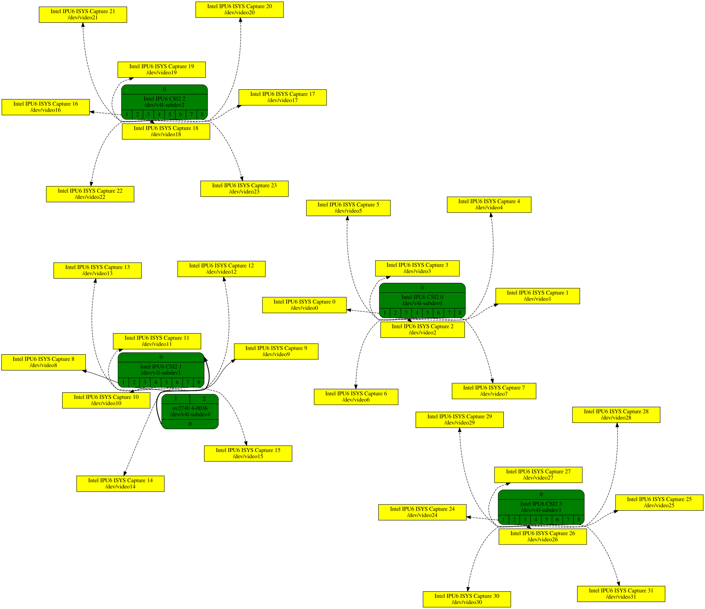

<a id="rst-intel-image-processing-unit-6-ipu6-input-system-driver"></a>

<!-- SPDX-License-Identifier: GPL-2.0 -->

<!-- This data file has been placed in the public domain. -->

<!-- Derived from the Unicode character mappings available from
<http://www.w3.org/2003/entities/xml/>.
Processed by unicode2rstsubs.py, part of Docutils:
<https://docutils.sourceforge.io>. -->

Copyright © 2023--2024 Intel Corporation

<a id="rst-introduction"></a>

## Introduction

This file documents the Intel IPU6 (6th generation Image Processing Unit) Input System (MIPI CSI2 receiver) drivers located under drivers/media/pci/intel/ipu6.

The Intel IPU6 can be found in certain Intel SoCs but not in all SKUs:

- Tiger Lake

- Jasper Lake

- Alder Lake

- Raptor Lake

- Meteor Lake

Intel IPU6 is made up of two components - Input System (ISYS) and Processing System (PSYS).

The Input System mainly works as MIPI CSI-2 receiver which receives and processes the image data from the sensors and outputs the frames to memory.

There are 2 driver modules - intel-ipu6 and intel-ipu6-isys. intel-ipu6 is an IPU6 common driver which does PCI configuration, firmware loading and parsing, firmware authentication, DMA mapping and IPU-MMU (internal Memory mapping Unit) configuration. intel_ipu6_isys implements V4L2, Media Controller and V4L2 sub-device interfaces. The IPU6 ISYS driver supports camera sensors connected to the IPU6 ISYS through V4L2 sub-device sensor drivers.

> [!NOTE]
>
> See [Documentation/driver-api/media/drivers/ipu6.rst](~kernel/hardware/driver-api/media-drivers/ipu6) for more information about the IPU6 hardware.

<a id="rst-input-system-driver"></a>

## Input system driver

The Input System driver mainly configures CSI-2 D-PHY, constructs the firmware stream configuration, sends commands to firmware, gets response from hardware and firmware and then returns buffers to user.  The ISYS is represented as several V4L2 sub-devices as well as video nodes.



IPU6 ISYS media graph with multiple streams support

The graph has been produced using the following command:


```none
fdp -Gsplines=true -Tsvg < dot > dot.svg
```

<a id="rst-capturing-frames-with-ipu6-isys"></a>

### Capturing frames with IPU6 ISYS

IPU6 ISYS is used to capture frames from the camera sensors connected to the CSI2 ports. The supported input formats of ISYS are listed in table below:

<!-- tabularcolumns: |p{0.8cm}|p{4.0cm}|p{4.0cm}| -->


<table>
<thead>
<tr>
<th>


IPU6 ISYS supported input formats

</th>
</tr>
</thead>
<tbody>
<tr>
<td>


RGB565, RGB888

</td>
</tr>
<tr>
<td>


UYVY8, YUYV8

</td>
</tr>
<tr>
<td>


RAW8, RAW10, RAW12

</td>
</tr>
</tbody>
</table>

<a id="rst-examples"></a>
<a id="rst-ipu6-isys-capture-examples"></a>

#### Examples

Here is an example of IPU6 ISYS raw capture on Dell XPS 9315 laptop. On this machine, ov01a10 sensor is connected to IPU ISYS CSI-2 port 2, which can generate images at sBGGR10 with resolution 1280x800.

Using the media controller APIs, we can configure ov01a10 sensor by media-ctl <a id="rst-footnote-reference-1"></a>[1](#rst-f1) and yavta <a id="rst-footnote-reference-2"></a>[2](#rst-f2) to transmit frames to IPU6 ISYS.


```none
# Example 1 capture frame from ov01a10 camera sensor
# This example assumes /dev/media0 as the IPU ISYS media device
export MDEV=/dev/media0

# Establish the link for the media devices using media-ctl
media-ctl -d $MDEV -l "\"ov01a10 3-0036\":0 -> \"Intel IPU6 CSI2 2\":0[1]"

# Set the format for the media devices
media-ctl -d $MDEV -V "ov01a10:0 [fmt:SBGGR10/1280x800]"
media-ctl -d $MDEV -V "Intel IPU6 CSI2 2:0 [fmt:SBGGR10/1280x800]"
media-ctl -d $MDEV -V "Intel IPU6 CSI2 2:1 [fmt:SBGGR10/1280x800]"
```

Once the media pipeline is configured, desired sensor specific settings (such as exposure and gain settings) can be set, using the yavta tool.

e.g


```none
# and that ov01a10 sensor is connected to i2c bus 3 with address 0x36
export SDEV=$(media-ctl -d $MDEV -e "ov01a10 3-0036")

yavta -w 0x009e0903 400 $SDEV
yavta -w 0x009e0913 1000 $SDEV
yavta -w 0x009e0911 2000 $SDEV
```

Once the desired sensor settings are set, frame captures can be done as below.

e.g


```none
yavta --data-prefix -u -c10 -n5 -I -s 1280x800 --file=/tmp/frame-#.bin \
        -f SBGGR10 $(media-ctl -d $MDEV -e "Intel IPU6 ISYS Capture 0")
```

With the above command, 10 frames are captured at 1280x800 resolution with sBGGR10 format. The captured frames are available as /tmp/frame-\#.bin files.

Here is another example of IPU6 ISYS RAW and metadata capture from camera sensor ov2740 on Lenovo X1 Yoga laptop.


```none
media-ctl -l "\"ov2740 14-0036\":0 -> \"Intel IPU6 CSI2 1\":0[1]"
media-ctl -l "\"Intel IPU6 CSI2 1\":1 -> \"Intel IPU6 ISYS Capture 0\":0[1]"
media-ctl -l "\"Intel IPU6 CSI2 1\":2 -> \"Intel IPU6 ISYS Capture 1\":0[1]"

# set routing
media-ctl -R "\"Intel IPU6 CSI2 1\" [0/0->1/0[1],0/1->2/1[1]]"

media-ctl -V "\"Intel IPU6 CSI2 1\":0/0 [fmt:SGRBG10/1932x1092]"
media-ctl -V "\"Intel IPU6 CSI2 1\":0/1 [fmt:GENERIC_8/97x1]"
media-ctl -V "\"Intel IPU6 CSI2 1\":1/0 [fmt:SGRBG10/1932x1092]"
media-ctl -V "\"Intel IPU6 CSI2 1\":2/1 [fmt:GENERIC_8/97x1]"

CAPTURE_DEV=$(media-ctl -e "Intel IPU6 ISYS Capture 0")
./yavta --data-prefix -c100 -n5 -I -s1932x1092 --file=/tmp/frame-#.bin \
    -f SGRBG10 ${CAPTURE_DEV}

CAPTURE_META=$(media-ctl -e "Intel IPU6 ISYS Capture 1")
./yavta --data-prefix -c100 -n5 -I -s97x1 -B meta-capture \
    --file=/tmp/meta-#.bin -f GENERIC_8 ${CAPTURE_META}
```

<a id="rst-references"></a>

## References

<a id="rst-f1"></a>


**[1]** [https://git.ideasonboard.org/media-ctl.git](<https://git.ideasonboard.org/media-ctl.git>)

<a id="rst-f2"></a>


**[2]** [https://git.ideasonboard.org/yavta.git](<https://git.ideasonboard.org/yavta.git>)
