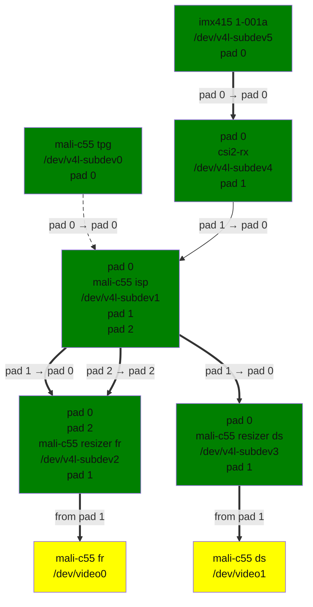

<a id="rst-arm-mali-c55-image-signal-processor-driver"></a>

<!-- SPDX-License-Identifier: GPL-2.0 -->

<a id="rst-introduction"></a>

## Introduction

This file documents the driver for ARM's Mali-C55 Image Signal Processor. The driver is located under drivers/media/platform/arm/mali-c55.

The Mali-C55 ISP receives data in either raw Bayer format or RGB/YUV format from sensors through either a parallel interface or a memory bus before processing it and outputting it through an internal DMA engine. Two output pipelines are possible (though one may not be fitted, depending on the implementation). These are referred to as "Full resolution" and "Downscale", but the naming is historic and both pipes are capable of cropping/scaling operations. The full resolution pipe is also capable of outputting RAW data, bypassing much of the ISP's processing. The downscale pipe cannot output RAW data. An integrated test pattern generator can be used to drive the ISP and produce image data in the absence of a connected camera sensor. The driver module is named mali_c55, and is enabled through the CONFIG_VIDEO_MALI_C55 config option.

The driver implements V4L2, Media Controller and V4L2 Subdevice interfaces and expects camera sensors connected to the ISP to have V4L2 subdevice interfaces.

<a id="rst-mali-c55-isp-hardware"></a>

## Mali-C55 ISP hardware

A high level functional view of the Mali-C55 ISP is presented below. The ISP takes input from either a live source or through a DMA engine for memory input, depending on the SoC integration.:


```text
+---------+    +----------+                                     +--------+
| Sensor  |--->| CSI-2 Rx |                "Full Resolution"    |  DMA   |
+---------+    +----------+   |\                 Output    +--->| Writer |
                     |        | \                          |    +--------+
                     |        |  \    +----------+  +------+---> Streaming I/O
+------------+       +------->|   |   |          |  |
|            |                |   |-->| Mali-C55 |--+
| DMA Reader |--------------->|   |   |    ISP   |  |
|            |                |  /    |          |  |      +---> Streaming I/O
+------------+                | /     +----------+  |      |
                              |/                    +------+
                                                           |    +--------+
                                                           +--->|  DMA   |
                                             "Downscaled"       | Writer |
                                                Output          +--------+
```

<a id="rst-media-controller-topology"></a>

## Media Controller Topology

An example of the ISP's topology (as implemented in a system with an IMX415 camera sensor and generic CSI-2 receiver) is below:



mali-c55-graph.dot

The driver has 4 V4L2 subdevices:

- - **`mali_c55 isp`: Responsible for configuring input crop and color space**

    conversion

- `mali_c55 tpg`: The test pattern generator, emulating a camera sensor.

- `mali_c55 resizer fr`: The Full-Resolution pipe resizer

- `mali_c55 resizer ds`: The Downscale pipe resizer

The driver has 3 V4L2 video devices:

- `mali-c55 fr`: The full-resolution pipe's capture device

- `mali-c55 ds`: The downscale pipe's capture device

- `mali-c55 3a stats`: The 3A statistics capture device

Frame sequences are synchronised across to two capture devices, meaning if one pipe is started later than the other the sequence numbers returned in its buffers will match those of the other pipe rather than starting from zero.

<a id="rst-idiosyncrasies"></a>

### Idiosyncrasies

**mali-c55 isp** The `mali-c55 isp` subdevice has a single sink pad to which all sources of data should be connected. The active source is selected by enabling the appropriate media link and disabling all others. The ISP has two source pads, reflecting the different paths through which it can internally route data. Tap points within the ISP allow users to divert data to avoid processing by some or all of the hardware's processing steps. The diagram below is intended only to highlight how the bypassing works and is not a true reflection of those processing steps; for a high-level functional block diagram see ARM's developer page for the ISP <a id="rst-footnote-reference-1"></a>[3](#rst-footnote-3):


```text
+--------------------------------------------------------------+
|                Possible Internal ISP Data Routes             |
|          +------------+  +----------+  +------------+        |
+---+      |            |  |          |  |  Colour    |    +---+
| 0 |--+-->| Processing |->| Demosaic |->|   Space    |--->| 1 |
+---+  |   |            |  |          |  | Conversion |    +---+
|      |   +------------+  +----------+  +------------+        |
|      |                                                   +---+
|      +---------------------------------------------------| 2 |
|                                                          +---+
|                                                              |
+--------------------------------------------------------------+
```


<table>
<thead>
<tr>
<th>


Pad

</th>
<th>


Direction

</th>
<th>


Purpose

</th>
</tr>
</thead>
<tbody>
<tr>
<td>


0

</td>
<td>


sink

</td>
<td>


Data input, connected to the TPG and camera sensors

</td>
</tr>
<tr>
<td>


1

</td>
<td>


source

</td>
<td>


RGB/YUV data, connected to the FR and DS V4L2 subdevices

</td>
</tr>
<tr>
<td>


2

</td>
<td>


source

</td>
<td>


RAW bayer data, connected to the FR V4L2 subdevices

</td>
</tr>
</tbody>
</table>

The ISP is limited to both input and output resolutions between 640x480 and 8192x8192, and this is reflected in the ISP and resizer subdevice's .set_fmt() operations.

**mali-c55 resizer fr** The `mali-c55 resizer fr` subdevice has two \_sink\_ pads to reflect the different insertion points in the hardware (either RAW or demosaiced data):


<table>
<thead>
<tr>
<th>


Pad

</th>
<th>


Direction

</th>
<th>


Purpose

</th>
</tr>
</thead>
<tbody>
<tr>
<td>


0

</td>
<td>


sink

</td>
<td>


Data input connected to the ISP's demosaiced stream.

</td>
</tr>
<tr>
<td>


1

</td>
<td>


source

</td>
<td>


Data output connected to the capture video device

</td>
</tr>
<tr>
<td>


2

</td>
<td>


sink

</td>
<td>


Data input connected to the ISP's raw data stream

</td>
</tr>
</tbody>
</table>

The data source in use is selected through the routing API; two routes each of a single stream are available:


<table>
<thead>
<tr>
<th>


Sink Pad

</th>
<th>


Source Pad

</th>
<th>


Purpose

</th>
</tr>
</thead>
<tbody>
<tr>
<td>


0

</td>
<td>


1

</td>
<td>


Demosaiced data route

</td>
</tr>
<tr>
<td>


2

</td>
<td>


1

</td>
<td>


Raw data route

</td>
</tr>
</tbody>
</table>

If the demosaiced route is active then the FR pipe is only capable of output in RGB/YUV formats. If the raw route is active then the output reflects the input (which may be either Bayer or RGB/YUV data).

<a id="rst-using-the-driver-to-capture-video"></a>

## Using the driver to capture video

Using the media controller APIs we can configure the input source and ISP to capture images in a variety of formats. In the examples below, configuring the media graph is done with the v4l-utils <a id="rst-footnote-reference-2"></a>[1](#rst-footnote-1) package's media-ctl utility. Capturing the images is done with yavta <a id="rst-footnote-reference-3"></a>[2](#rst-footnote-2).

<a id="rst-configuring-the-input-source"></a>

### Configuring the input source

The first step is to set the input source that we wish by enabling the correct media link. Using the example topology above, we can select the TPG as follows:


```none
media-ctl -l "'lte-csi2-rx':1->'mali-c55 isp':0[0]"
media-ctl -l "'mali-c55 tpg':0->'mali-c55 isp':0[1]"
```

<a id="rst-configuring-which-video-devices-will-stream-data"></a>

### Configuring which video devices will stream data

The driver will wait for all video devices to have their VIDIOC_STREAMON ioctl called before it tells the sensor to start streaming. To facilitate this we need to enable links to the video devices that we want to use. In the example below we enable the links to both of the image capture video devices


```none
media-ctl -l "'mali-c55 resizer fr':1->'mali-c55 fr':0[1]"
media-ctl -l "'mali-c55 resizer ds':1->'mali-c55 ds':0[1]"
```

<a id="rst-capturing-bayer-data-from-the-source-and-processing-to-rgb-yuv"></a>

### Capturing bayer data from the source and processing to RGB/YUV

To capture 1920x1080 bayer data from the source and push it through the ISP's full processing pipeline, we configure the data formats appropriately on the source, ISP and resizer subdevices and set the FR resizer's routing to select processed data. The media bus format on the resizer's source pad will be either RGB121212_1X36 or YUV10_1X30, depending on whether you want to capture RGB or YUV. The ISP's debayering block outputs RGB data natively, setting the source pad format to YUV10_1X30 enables the colour space conversion block.

In this example we target RGB565 output, so select RGB121212_1X36 as the resizer source pad's format:


```none
# Set formats on the TPG and ISP
media-ctl -V "'mali-c55 tpg':0[fmt:SRGGB20_1X20/1920x1080]"
media-ctl -V "'mali-c55 isp':0[fmt:SRGGB20_1X20/1920x1080]"
media-ctl -V "'mali-c55 isp':1[fmt:SRGGB20_1X20/1920x1080]"

# Set routing on the FR resizer
media-ctl -R "'mali-c55 resizer fr'[0/0->1/0[1],2/0->1/0[0]]"

# Set format on the resizer, must be done AFTER the routing.
media-ctl -V "'mali-c55 resizer fr':1[fmt:RGB121212_1X36/1920x1080]"
```

The downscale output can also be used to stream data at the same time. In this case since only processed data can be captured through the downscale output no routing need be set:


```none
# Set format on the resizer
media-ctl -V "'mali-c55 resizer ds':1[fmt:RGB121212_1X36/1920x1080]"
```

Following which images can be captured from both the FR and DS output's video devices (simultaneously, if desired):


```none
yavta -f RGB565 -s 1920x1080 -c10 /dev/video0
yavta -f RGB565 -s 1920x1080 -c10 /dev/video1
```

<a id="rst-cropping-the-image"></a>

#### Cropping the image

Both the full resolution and downscale pipes can crop to a minimum resolution of 640x480. To crop the image simply configure the resizer's sink pad's crop and compose rectangles and set the format on the video device:


```none
media-ctl -V "'mali-c55 resizer fr':0[fmt:RGB121212_1X36/1920x1080 crop:(480,270)/640x480 compose:(0,0)/640x480]"
media-ctl -V "'mali-c55 resizer fr':1[fmt:RGB121212_1X36/640x480]"
yavta -f RGB565 -s 640x480 -c10 /dev/video0
```

<a id="rst-downscaling-the-image"></a>

#### Downscaling the image

Both the full resolution and downscale pipes can downscale the image by up to 8x provided the minimum 640x480 output resolution is adhered to. For the best image result the scaling ratio for each direction should be the same. To configure scaling we use the compose rectangle on the resizer's sink pad:


```none
media-ctl -V "'mali-c55 resizer fr':0[fmt:RGB121212_1X36/1920x1080 crop:(0,0)/1920x1080 compose:(0,0)/640x480]"
media-ctl -V "'mali-c55 resizer fr':1[fmt:RGB121212_1X36/640x480]"
yavta -f RGB565 -s 640x480 -c10 /dev/video0
```

<a id="rst-capturing-images-in-yuv-formats"></a>

#### Capturing images in YUV formats

If we need to output YUV data rather than RGB the color space conversion block needs to be active, which is achieved by setting MEDIA_BUS_FMT_YUV10_1X30 on the resizer's source pad. We can then configure a capture format like NV12 (here in its multi-planar variant)


```none
media-ctl -V "'mali-c55 resizer fr':1[fmt:YUV10_1X30/1920x1080]"
yavta -f NV12M -s 1920x1080 -c10 /dev/video0
```

<a id="rst-capturing-rgb-data-from-the-source-and-processing-it-with-the-resizers"></a>

### Capturing RGB data from the source and processing it with the resizers

The Mali-C55 ISP can work with sensors capable of outputting RGB data. In this case although none of the image quality blocks would be used it can still crop/scale the data in the usual way. For this reason RGB data input to the ISP still goes through the ISP subdevice's pad 1 to the resizer.

To achieve this, the ISP's sink pad's format is set to MEDIA_BUS_FMT_RGB202020_1X60 - this reflects the format that data must be in to work with the ISP. Converting the camera sensor's output to that format is the responsibility of external hardware.

In this example we ask the test pattern generator to give us RGB data instead of bayer.


```none
media-ctl -V "'mali-c55 tpg':0[fmt:RGB202020_1X60/1920x1080]"
media-ctl -V "'mali-c55 isp':0[fmt:RGB202020_1X60/1920x1080]"
```

Cropping or scaling the data can be done in exactly the same way as outlined earlier.

<a id="rst-capturing-raw-data-from-the-source-and-outputting-it-unmodified"></a>

### Capturing raw data from the source and outputting it unmodified

The ISP can additionally capture raw data from the source and output it on the full resolution pipe only, completely unmodified. In this case the downscale pipe can still process the data normally and be used at the same time.

To configure raw bypass the FR resizer's subdevice's routing table needs to be configured, followed by formats in the appropriate places:


```none
media-ctl -R "'mali-c55 resizer fr'[0/0->1/0[0],2/0->1/0[1]]"
media-ctl -V "'mali-c55 isp':0[fmt:RGB202020_1X60/1920x1080]"
media-ctl -V "'mali-c55 resizer fr':2[fmt:RGB202020_1X60/1920x1080]"
media-ctl -V "'mali-c55 resizer fr':1[fmt:RGB202020_1X60/1920x1080]"

# Set format on the video device and stream
yavta -f RGB565 -s 1920x1080 -c10 /dev/video0
```

<a id="rst-capturing-isp-statistics"></a>
<a id="rst-mali-c55-3a-stats"></a>

## Capturing ISP Statistics

The ISP is capable of producing statistics for consumption by image processing algorithms running in userspace. These statistics can be captured by queueing buffers to the `mali-c55 3a stats` V4L2 Device whilst the ISP is streaming. Only the [V4L2_META_FMT_MALI_C55_STATS](<~kernel/userspace/userspace-api/media-v4l/metafmt-arm-mali-c55#rst-v4l2-meta-fmt-mali-c55-stats>) format is supported, so no format-setting need be done:


```none
# We assume the media graph has been configured to support RGB565 capture
# from the mali-c55 fr V4L2 Device, which is at /dev/video0. The statistics
# V4L2 device is at /dev/video3

yavta -f RGB565 -s 1920x1080 -c32 /dev/video0 && \
yavta -c10 -F /dev/video3
```

The layout of the buffer is described by `mali_c55_stats_buffer`, but broadly statistics are generated to support three image processing algorithms; AEXP (Auto-Exposure), AWB (Auto-White Balance) and AF (Auto-Focus). These stats can be drawn from various places in the Mali C55 ISP pipeline, known as "tap points". This high-level block diagram is intended to explain where in the processing flow the statistics can be drawn from:


```text
                +--> AEXP-2            +----> AEXP-1          +--> AF-0
                |                      +----> AF-1            |
                |                      |                      |
    +---------+ |   +--------------+   |   +--------------+   |
    |  Input  +-+-->+ Digital Gain +---+-->+ Black Level  +---+---+
    +---------+     +--------------+       +--------------+       |
+-----------------------------------------------------------------+
|
|   +--------------+ +---------+       +----------------+
+-->| Sinter Noise +-+  White  +--+--->|  Lens Shading  +--+---------------+
    |   Reduction  | | Balance |  |    |                |  |               |
    +--------------+ +---------+  |    +----------------+  |               |
                                  +---> AEXP-0 (A)         +--> AEXP-0 (B) |
+--------------------------------------------------------------------------+
|
|   +----------------+      +--------------+  +----------------+
+-->|  Tone mapping  +-+--->| Demosaicing  +->+ Purple Fringe  +-+-----------+
    |                | |    +--------------+  |   Correction   | |           |
    +----------------+ +-> AEXP-IRIDIX        +----------------+ +---> AWB-0 |
+----------------------------------------------------------------------------+
|                    +-------------+        +-------------+
+------------------->|   Colour    +---+--->|    Output   |
                     | Correction  |   |    |  Pipelines  |
                     +-------------+   |    +-------------+
                                       +-->  AWB-1
```

By default all statistics are drawn from the 0th tap point for each algorithm; I.E. AEXP statistics from AEXP-0 (A), AWB statistics from AWB-0 and AF statistics from AF-0. This is configurable for AEXP and AWB statsistics through programming the ISP's parameters.

<a id="rst-programming-isp-parameters"></a>
<a id="rst-mali-c55-3a-params"></a>

## Programming ISP Parameters

The ISP can be programmed with various parameters from userspace to apply to the hardware before and during video stream. This allows userspace to dynamically change values such as black level, white balance and lens shading gains and so on.

The buffer format and how to populate it are described by the [V4L2_META_FMT_MALI_C55_PARAMS](<~kernel/userspace/userspace-api/media-v4l/metafmt-arm-mali-c55#rst-v4l2-meta-fmt-mali-c55-params>) format, which should be set as the data format for the `mali-c55 3a params` video node.

<a id="rst-references"></a>

## References

<a id="rst-footnote-1"></a>


**[1]** [https://git.linuxtv.org/v4l-utils.git/](<https://git.linuxtv.org/v4l-utils.git/>)

<a id="rst-footnote-2"></a>


**[2]** [https://git.ideasonboard.org/yavta.git](<https://git.ideasonboard.org/yavta.git>)

<a id="rst-footnote-3"></a>


**[3]** [https://developer.arm.com/Processors/Mali-C55](<https://developer.arm.com/Processors/Mali-C55>)
