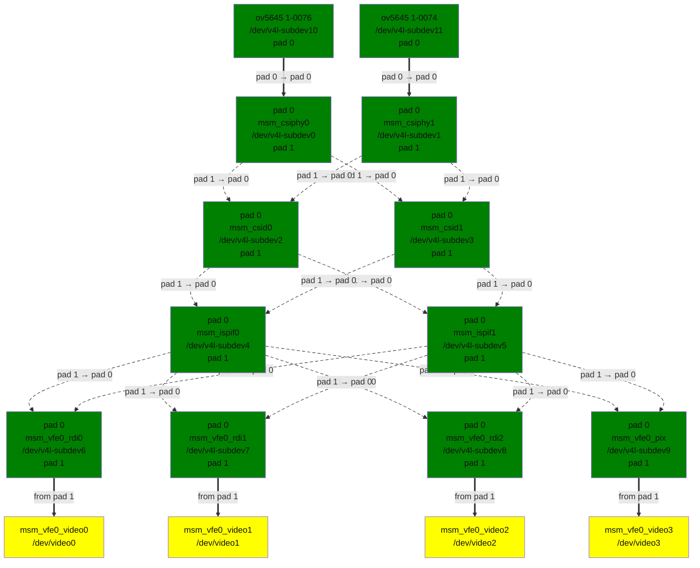

<!-- SPDX-License-Identifier: GPL-2.0 -->

<!-- This data file has been placed in the public domain. -->

<!-- Derived from the Unicode character mappings available from
<http://www.w3.org/2003/entities/xml/>.
Processed by unicode2rstsubs.py, part of Docutils:
<https://docutils.sourceforge.io>. -->

## Introduction

This file documents the Qualcomm Camera Subsystem driver located under drivers/media/platform/qcom/camss.

The current version of the driver supports the Camera Subsystem found on Qualcomm MSM8916/APQ8016 and MSM8996/APQ8096 processors.

The driver implements V4L2, Media controller and V4L2 subdev interfaces. Camera sensor using V4L2 subdev interface in the kernel is supported.

The driver is implemented using as a reference the Qualcomm Camera Subsystem driver for Android as found in Code Linaro [1](#rst-f1) [2](#rst-f2).

## Qualcomm Camera Subsystem hardware

The Camera Subsystem hardware found on 8x16 / 8x96 processors and supported by the driver consists of:

- 2 / 3 CSIPHY modules. They handle the Physical layer of the CSI2 receivers. A separate camera sensor can be connected to each of the CSIPHY module;

- 2 / 4 CSID (CSI Decoder) modules. They handle the Protocol and Application layer of the CSI2 receivers. A CSID can decode data stream from any of the CSIPHY. Each CSID also contains a TG (Test Generator) block which can generate artificial input data for test purposes;

- ISPIF (ISP Interface) module. Handles the routing of the data streams from the CSIDs to the inputs of the VFE;

- 1 / 2 VFE (Video Front End) module(s). Contain a pipeline of image processing hardware blocks. The VFE has different input interfaces. The PIX (Pixel) input interface feeds the input data to the image processing pipeline. The image processing pipeline contains also a scale and crop module at the end. Three RDI (Raw Dump Interface) input interfaces bypass the image processing pipeline. The VFE also contains the AXI bus interface which writes the output data to memory.

## Supported functionality

The current version of the driver supports:

- Input from camera sensor via CSIPHY;

- Generation of test input data by the TG in CSID;

- RDI interface of VFE

  - Raw dump of the input data to memory.

    Supported formats:

    - YUYV/UYVY/YVYU/VYUY (packed YUV 4:2:2 - V4L2_PIX_FMT_YUYV / V4L2_PIX_FMT_UYVY / V4L2_PIX_FMT_YVYU / V4L2_PIX_FMT_VYUY);

    - MIPI RAW8 (8bit Bayer RAW - V4L2_PIX_FMT_SRGGB8 / V4L2_PIX_FMT_SGRBG8 / V4L2_PIX_FMT_SGBRG8 / V4L2_PIX_FMT_SBGGR8);

    - MIPI RAW10 (10bit packed Bayer RAW - V4L2_PIX_FMT_SBGGR10P / V4L2_PIX_FMT_SGBRG10P / V4L2_PIX_FMT_SGRBG10P / V4L2_PIX_FMT_SRGGB10P / V4L2_PIX_FMT_Y10P);

    - MIPI RAW12 (12bit packed Bayer RAW - V4L2_PIX_FMT_SRGGB12P / V4L2_PIX_FMT_SGBRG12P / V4L2_PIX_FMT_SGRBG12P / V4L2_PIX_FMT_SRGGB12P).

    - (8x96 only) MIPI RAW14 (14bit packed Bayer RAW - V4L2_PIX_FMT_SRGGB14P / V4L2_PIX_FMT_SGBRG14P / V4L2_PIX_FMT_SGRBG14P / V4L2_PIX_FMT_SRGGB14P).

  - (8x96 only) Format conversion of the input data.

    Supported input formats:

    - MIPI RAW10 (10bit packed Bayer RAW - V4L2_PIX_FMT_SBGGR10P / V4L2_PIX_FMT_Y10P).

    Supported output formats:

    - Plain16 RAW10 (10bit unpacked Bayer RAW - V4L2_PIX_FMT_SBGGR10 / V4L2_PIX_FMT_Y10).

- PIX interface of VFE

  - Format conversion of the input data.

    Supported input formats:

    - YUYV/UYVY/YVYU/VYUY (packed YUV 4:2:2 - V4L2_PIX_FMT_YUYV / V4L2_PIX_FMT_UYVY / V4L2_PIX_FMT_YVYU / V4L2_PIX_FMT_VYUY).

    Supported output formats:

    - NV12/NV21 (two plane YUV 4:2:0 - V4L2_PIX_FMT_NV12 / V4L2_PIX_FMT_NV21);

    - NV16/NV61 (two plane YUV 4:2:2 - V4L2_PIX_FMT_NV16 / V4L2_PIX_FMT_NV61).

    - (8x96 only) YUYV/UYVY/YVYU/VYUY (packed YUV 4:2:2 - V4L2_PIX_FMT_YUYV / V4L2_PIX_FMT_UYVY / V4L2_PIX_FMT_YVYU / V4L2_PIX_FMT_VYUY).

  - Scaling support. Configuration of the VFE Encoder Scale module for downscalling with ratio up to 16x.

  - Cropping support. Configuration of the VFE Encoder Crop module.

- Concurrent and independent usage of two (8x96: three) data inputs - could be camera sensors and/or TG.

## Driver Architecture and Design

The driver implements the V4L2 subdev interface. With the goal to model the hardware links between the modules and to expose a clean, logical and usable interface, the driver is split into V4L2 sub-devices as follows (8x16 / 8x96):

- 2 / 3 CSIPHY sub-devices - each CSIPHY is represented by a single sub-device;

- 2 / 4 CSID sub-devices - each CSID is represented by a single sub-device;

- 2 / 4 ISPIF sub-devices - ISPIF is represented by a number of sub-devices equal to the number of CSID sub-devices;

- 4 / 8 VFE sub-devices - VFE is represented by a number of sub-devices equal to the number of the input interfaces (3 RDI and 1 PIX for each VFE).

The considerations to split the driver in this particular way are as follows:

- representing CSIPHY and CSID modules by a separate sub-device for each module allows to model the hardware links between these modules;

- representing VFE by a separate sub-devices for each input interface allows to use the input interfaces concurrently and independently as this is supported by the hardware;

- representing ISPIF by a number of sub-devices equal to the number of CSID sub-devices allows to create linear media controller pipelines when using two cameras simultaneously. This avoids branches in the pipelines which otherwise will require a) userspace and b) media framework (e.g. power on/off operations) to  make assumptions about the data flow from a sink pad to a source pad on a single media entity.

Each VFE sub-device is linked to a separate video device node.

The media controller pipeline graph is as follows (with connected two / three OV5645 camera sensors):

qcom_camss_graph.dot

Media pipeline graph 8x16

```mermaid
flowchart TB
  n0["pad 0<br/>msm_csiphy0<br/>/dev/v4l-subdev0<br/>pad 1"]
  n1["pad 0<br/>msm_csid0<br/>/dev/v4l-subdev3<br/>pad 1"]
  n2["pad 0<br/>msm_csid1<br/>/dev/v4l-subdev4<br/>pad 1"]
  n3["pad 0<br/>msm_csid2<br/>/dev/v4l-subdev5<br/>pad 1"]
  n4["pad 0<br/>msm_csid3<br/>/dev/v4l-subdev6<br/>pad 1"]
  n5["pad 0<br/>msm_csiphy1<br/>/dev/v4l-subdev1<br/>pad 1"]
  n6["pad 0<br/>msm_csiphy2<br/>/dev/v4l-subdev2<br/>pad 1"]
  n7["pad 0<br/>msm_ispif0<br/>/dev/v4l-subdev7<br/>pad 1"]
  n8["pad 0<br/>msm_ispif1<br/>/dev/v4l-subdev8<br/>pad 1"]
  n9["pad 0<br/>msm_ispif2<br/>/dev/v4l-subdev9<br/>pad 1"]
  n10["pad 0<br/>msm_ispif3<br/>/dev/v4l-subdev10<br/>pad 1"]
  n11["pad 0<br/>msm_vfe0_rdi0<br/>/dev/v4l-subdev11<br/>pad 1"]
  n12["pad 0<br/>msm_vfe0_rdi1<br/>/dev/v4l-subdev12<br/>pad 1"]
  n13["pad 0<br/>msm_vfe0_rdi2<br/>/dev/v4l-subdev13<br/>pad 1"]
  n14["pad 0<br/>msm_vfe0_pix<br/>/dev/v4l-subdev14<br/>pad 1"]
  n15["pad 0<br/>msm_vfe1_rdi0<br/>/dev/v4l-subdev15<br/>pad 1"]
  n16["pad 0<br/>msm_vfe1_rdi1<br/>/dev/v4l-subdev16<br/>pad 1"]
  n17["pad 0<br/>msm_vfe1_rdi2<br/>/dev/v4l-subdev17<br/>pad 1"]
  n18["pad 0<br/>msm_vfe1_pix<br/>/dev/v4l-subdev18<br/>pad 1"]
  n19["msm_vfe0_video0<br/>/dev/video0"]
  n20["msm_vfe0_video1<br/>/dev/video1"]
  n21["msm_vfe0_video2<br/>/dev/video2"]
  n22["msm_vfe0_video3<br/>/dev/video3"]
  n23["msm_vfe1_video0<br/>/dev/video4"]
  n24["msm_vfe1_video1<br/>/dev/video5"]
  n25["msm_vfe1_video2<br/>/dev/video6"]
  n26["msm_vfe1_video3<br/>/dev/video7"]
  n27["ov5645 3-0039<br/>/dev/v4l-subdev19<br/>pad 0"]
  n28["ov5645 3-003a<br/>/dev/v4l-subdev20<br/>pad 0"]
  n29["ov5645 3-003b<br/>/dev/v4l-subdev21<br/>pad 0"]
  n0 -->|"pad 1 → pad 0"| n1
  n0 -->|"pad 1 → pad 0"| n2
  n0 -->|"pad 1 → pad 0"| n3
  n0 -->|"pad 1 → pad 0"| n4
  n5 -->|"pad 1 → pad 0"| n1
  n5 -->|"pad 1 → pad 0"| n2
  n5 -->|"pad 1 → pad 0"| n3
  n5 -->|"pad 1 → pad 0"| n4
  n6 -->|"pad 1 → pad 0"| n1
  n6 -->|"pad 1 → pad 0"| n2
  n6 -->|"pad 1 → pad 0"| n3
  n6 -->|"pad 1 → pad 0"| n4
  n1 -->|"pad 1 → pad 0"| n7
  n1 -->|"pad 1 → pad 0"| n8
  n1 -->|"pad 1 → pad 0"| n9
  n1 -->|"pad 1 → pad 0"| n10
  n2 -->|"pad 1 → pad 0"| n7
  n2 -->|"pad 1 → pad 0"| n8
  n2 -->|"pad 1 → pad 0"| n9
  n2 -->|"pad 1 → pad 0"| n10
  n3 -->|"pad 1 → pad 0"| n7
  n3 -->|"pad 1 → pad 0"| n8
  n3 -->|"pad 1 → pad 0"| n9
  n3 -->|"pad 1 → pad 0"| n10
  n4 -->|"pad 1 → pad 0"| n7
  n4 -->|"pad 1 → pad 0"| n8
  n4 -->|"pad 1 → pad 0"| n9
  n4 -->|"pad 1 → pad 0"| n10
  n7 -->|"pad 1 → pad 0"| n11
  n7 -->|"pad 1 → pad 0"| n12
  n7 -->|"pad 1 → pad 0"| n13
  n7 -->|"pad 1 → pad 0"| n14
  n7 -->|"pad 1 → pad 0"| n15
  n7 -->|"pad 1 → pad 0"| n16
  n7 -->|"pad 1 → pad 0"| n17
  n7 -->|"pad 1 → pad 0"| n18
  n8 -->|"pad 1 → pad 0"| n11
  n8 -->|"pad 1 → pad 0"| n12
  n8 -->|"pad 1 → pad 0"| n13
  n8 -->|"pad 1 → pad 0"| n14
  n8 -->|"pad 1 → pad 0"| n15
  n8 -->|"pad 1 → pad 0"| n16
  n8 -->|"pad 1 → pad 0"| n17
  n8 -->|"pad 1 → pad 0"| n18
  n9 -->|"pad 1 → pad 0"| n11
  n9 -->|"pad 1 → pad 0"| n12
  n9 -->|"pad 1 → pad 0"| n13
  n9 -->|"pad 1 → pad 0"| n14
  n9 -->|"pad 1 → pad 0"| n15
  n9 -->|"pad 1 → pad 0"| n16
  n9 -->|"pad 1 → pad 0"| n17
  n9 -->|"pad 1 → pad 0"| n18
  n10 -->|"pad 1 → pad 0"| n11
  n10 -->|"pad 1 → pad 0"| n12
  n10 -->|"pad 1 → pad 0"| n13
  n10 -->|"pad 1 → pad 0"| n14
  n10 -->|"pad 1 → pad 0"| n15
  n10 -->|"pad 1 → pad 0"| n16
  n10 -->|"pad 1 → pad 0"| n17
  n10 -->|"pad 1 → pad 0"| n18
  n11 -->|"from pad 1"| n19
  n12 -->|"from pad 1"| n20
  n13 -->|"from pad 1"| n21
  n14 -->|"from pad 1"| n22
  n15 -->|"from pad 1"| n23
  n16 -->|"from pad 1"| n24
  n17 -->|"from pad 1"| n25
  n18 -->|"from pad 1"| n26
  n27 -->|"pad 0 → pad 0"| n5
  n28 -->|"pad 0 → pad 0"| n6
  n29 -->|"pad 0 → pad 0"| n0
  style n0 fill:green,color:#111
  style n1 fill:green,color:#111
  style n2 fill:green,color:#111
  style n3 fill:green,color:#111
  style n4 fill:green,color:#111
  style n5 fill:green,color:#111
  style n6 fill:green,color:#111
  style n7 fill:green,color:#111
  style n8 fill:green,color:#111
  style n9 fill:green,color:#111
  style n10 fill:green,color:#111
  style n11 fill:green,color:#111
  style n12 fill:green,color:#111
  style n13 fill:green,color:#111
  style n14 fill:green,color:#111
  style n15 fill:green,color:#111
  style n16 fill:green,color:#111
  style n17 fill:green,color:#111
  style n18 fill:green,color:#111
  style n19 fill:yellow,color:#111
  style n20 fill:yellow,color:#111
  style n21 fill:yellow,color:#111
  style n22 fill:yellow,color:#111
  style n23 fill:yellow,color:#111
  style n24 fill:yellow,color:#111
  style n25 fill:yellow,color:#111
  style n26 fill:yellow,color:#111
  style n27 fill:green,color:#111
  style n28 fill:green,color:#111
  style n29 fill:green,color:#111
  linkStyle 0 stroke-dasharray:6 4
  linkStyle 1 stroke-dasharray:6 4
  linkStyle 2 stroke-dasharray:6 4
  linkStyle 3 stroke-dasharray:6 4
  linkStyle 4 stroke-dasharray:6 4
  linkStyle 5 stroke-dasharray:6 4
  linkStyle 6 stroke-dasharray:6 4
  linkStyle 7 stroke-dasharray:6 4
  linkStyle 8 stroke-dasharray:6 4
  linkStyle 9 stroke-dasharray:6 4
  linkStyle 10 stroke-dasharray:6 4
  linkStyle 11 stroke-dasharray:6 4
  linkStyle 12 stroke-dasharray:6 4
  linkStyle 13 stroke-dasharray:6 4
  linkStyle 14 stroke-dasharray:6 4
  linkStyle 15 stroke-dasharray:6 4
  linkStyle 16 stroke-dasharray:6 4
  linkStyle 17 stroke-dasharray:6 4
  linkStyle 18 stroke-dasharray:6 4
  linkStyle 19 stroke-dasharray:6 4
  linkStyle 20 stroke-dasharray:6 4
  linkStyle 21 stroke-dasharray:6 4
  linkStyle 22 stroke-dasharray:6 4
  linkStyle 23 stroke-dasharray:6 4
  linkStyle 24 stroke-dasharray:6 4
  linkStyle 25 stroke-dasharray:6 4
  linkStyle 26 stroke-dasharray:6 4
  linkStyle 27 stroke-dasharray:6 4
  linkStyle 28 stroke-dasharray:6 4
  linkStyle 29 stroke-dasharray:6 4
  linkStyle 30 stroke-dasharray:6 4
  linkStyle 31 stroke-dasharray:6 4
  linkStyle 32 stroke-dasharray:6 4
  linkStyle 33 stroke-dasharray:6 4
  linkStyle 34 stroke-dasharray:6 4
  linkStyle 35 stroke-dasharray:6 4
  linkStyle 36 stroke-dasharray:6 4
  linkStyle 37 stroke-dasharray:6 4
  linkStyle 38 stroke-dasharray:6 4
  linkStyle 39 stroke-dasharray:6 4
  linkStyle 40 stroke-dasharray:6 4
  linkStyle 41 stroke-dasharray:6 4
  linkStyle 42 stroke-dasharray:6 4
  linkStyle 43 stroke-dasharray:6 4
  linkStyle 44 stroke-dasharray:6 4
  linkStyle 45 stroke-dasharray:6 4
  linkStyle 46 stroke-dasharray:6 4
  linkStyle 47 stroke-dasharray:6 4
  linkStyle 48 stroke-dasharray:6 4
  linkStyle 49 stroke-dasharray:6 4
  linkStyle 50 stroke-dasharray:6 4
  linkStyle 51 stroke-dasharray:6 4
  linkStyle 52 stroke-dasharray:6 4
  linkStyle 53 stroke-dasharray:6 4
  linkStyle 54 stroke-dasharray:6 4
  linkStyle 55 stroke-dasharray:6 4
  linkStyle 56 stroke-dasharray:6 4
  linkStyle 57 stroke-dasharray:6 4
  linkStyle 58 stroke-dasharray:6 4
  linkStyle 59 stroke-dasharray:6 4
  linkStyle 60 stroke-width:3px
  linkStyle 61 stroke-width:3px
  linkStyle 62 stroke-width:3px
  linkStyle 63 stroke-width:3px
  linkStyle 64 stroke-width:3px
  linkStyle 65 stroke-width:3px
  linkStyle 66 stroke-width:3px
  linkStyle 67 stroke-width:3px
  linkStyle 68 stroke-width:3px
  linkStyle 69 stroke-width:3px
  linkStyle 70 stroke-width:3px
```

qcom_camss_8x96_graph.dot

Media pipeline graph 8x96

## Implementation

Runtime configuration of the hardware (updating settings while streaming) is not required to implement the currently supported functionality. The complete configuration on each hardware module is applied on STREAMON ioctl based on the current active media links, formats and controls set.

The output size of the scaler module in the VFE is configured with the actual compose selection rectangle on the sink pad of the 'msm_vfe0_pix' entity.

The crop output area of the crop module in the VFE is configured with the actual crop selection rectangle on the source pad of the 'msm_vfe0_pix' entity.

## Documentation

APQ8016 Specification: [https://developer.qualcomm.com/download/sd410/snapdragon-410-processor-device-specification.pdf](<https://developer.qualcomm.com/download/sd410/snapdragon-410-processor-device-specification.pdf>) Referenced 2016-11-24.

APQ8096 Specification: [https://developer.qualcomm.com/download/sd820e/qualcomm-snapdragon-820e-processor-apq8096sge-device-specification.pdf](<https://developer.qualcomm.com/download/sd820e/qualcomm-snapdragon-820e-processor-apq8096sge-device-specification.pdf>) Referenced 2018-06-22.

## References

**[1]** [https://git.codelinaro.org/clo/la/kernel/msm-3.10/](<https://git.codelinaro.org/clo/la/kernel/msm-3.10/>)

**[2]** [https://git.codelinaro.org/clo/la/kernel/msm-3.18/](<https://git.codelinaro.org/clo/la/kernel/msm-3.18/>)
