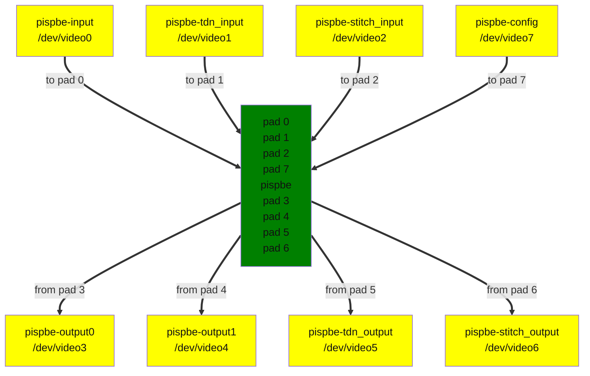

<!-- SPDX-License-Identifier: GPL-2.0 -->

## The PiSP Back End

The PiSP Back End is a memory-to-memory Image Signal Processor (ISP) which reads image data from DRAM memory and performs image processing as specified by the application through the parameters in a configuration buffer, before writing pixel data back to memory through two distinct output channels.

The ISP registers and programming model are documented in the [Raspberry Pi Image Signal Processor (PiSP) Specification document](<https://datasheets.raspberrypi.com/camera/raspberry-pi-image-signal-processor-specification.pdf>)

The PiSP Back End ISP processes images in tiles. The handling of image tessellation and the computation of low-level configuration parameters is realized by a free software library called [libpisp](<https://github.com/raspberrypi/libpisp>).

The full image processing pipeline, which involves capturing RAW Bayer data from an image sensor through a MIPI CSI-2 compatible capture interface, storing them in DRAM memory and processing them in the PiSP Back End to obtain images usable by an application is implemented in [libcamera](<https://libcamera.org>) as part of the Raspberry Pi platform support.

## The pisp-be driver

The Raspberry Pi PiSP Back End (pisp-be) driver is located under drivers/media/platform/raspberrypi/pisp-be. It uses the `V4L2 API` to register a number of video capture and output devices, the `V4L2 subdev API` to register a subdevice for the ISP that connects the video devices in a single media graph realized using the `Media Controller (MC) API`.

The media topology registered by the `pisp-be` driver is represented below:

Diagram of the default media pipeline topology

The media graph registers the following video device nodes:

- pispbe-input: output device for images to be submitted to the ISP for processing.

- pispbe-tdn_input: output device for temporal denoise.

- pispbe-stitch_input: output device for image stitching (HDR).

- pispbe-output0: first capture device for processed images.

- pispbe-output1: second capture device for processed images.

- pispbe-tdn_output: capture device for temporal denoise.

- pispbe-stitch_output: capture device for image stitching (HDR).

- pispbe-config: output device for ISP configuration parameters.

### pispbe-input

Images to be processed by the ISP are queued to the `pispbe-input` output device node. For a list of image formats supported as input to the ISP refer to the [Raspberry Pi Image Signal Processor (PiSP) Specification document](<https://datasheets.raspberrypi.com/camera/raspberry-pi-image-signal-processor-specification.pdf>).

### pispbe-tdn_input, pispbe-tdn_output

The `pispbe-tdn_input` output video device receives images to be processed by the temporal denoise block which are captured from the `pispbe-tdn_output` capture video device. Userspace is responsible for maintaining queues on both devices, and ensuring that buffers completed on the output are queued to the input.

### pispbe-stitch_input, pispbe-stitch_output

To realize HDR (high dynamic range) image processing the image stitching and tonemapping blocks are used. The `pispbe-stitch_output` writes images to memory and the `pispbe-stitch_input` receives the previously written frame to process it along with the current input image. Userspace is responsible for maintaining queues on both devices, and ensuring that buffers completed on the output are queued to the input.

### pispbe-output0, pispbe-output1

The two capture devices write to memory the pixel data as processed by the ISP.

### pispbe-config

The `pispbe-config` output video devices receives a buffer of configuration parameters that define the desired image processing to be performed by the ISP.

The format of the ISP configuration parameter is defined by `pisp_be_tiles_config` C structure and the meaning of each parameter is described in the [Raspberry Pi Image Signal Processor (PiSP) Specification document](<https://datasheets.raspberrypi.com/camera/raspberry-pi-image-signal-processor-specification.pdf>).

## ISP configuration

The ISP configuration is described solely by the content of the parameters buffer. The only parameter that userspace needs to configure using the V4L2 API is the image format on the output and capture video devices for validation of the content of the parameters buffer.

