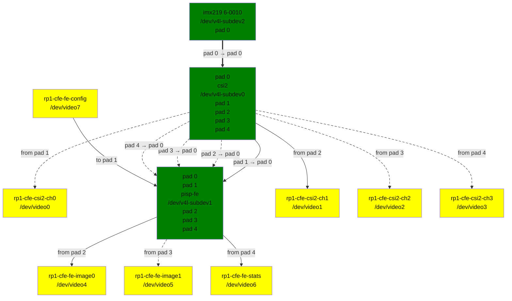

<!-- SPDX-License-Identifier: GPL-2.0 -->

## The PiSP Camera Front End

The PiSP Camera Front End (CFE) is a module which combines a CSI-2 receiver with a simple ISP, called the Front End (FE).

The CFE has four DMA engines and can write frames from four separate streams received from the CSI-2 to the memory. One of those streams can also be routed directly to the FE, which can do minimal image processing, write two versions (e.g. non-scaled and downscaled versions) of the received frames to memory and provide statistics of the received frames.

The FE registers are documented in the [Raspberry Pi Image Signal Processor (ISP) Specification document](<https://datasheets.raspberrypi.com/camera/raspberry-pi-image-signal-processor-specification.pdf>), and example code for FE can be found in [libpisp](<https://github.com/raspberrypi/libpisp>).

## The rp1-cfe driver

The Raspberry Pi PiSP Camera Front End (rp1-cfe) driver is located under drivers/media/platform/raspberrypi/rp1-cfe. It uses the `V4L2 API` to register a number of video capture and output devices, the `V4L2 subdev API` to register subdevices for the CSI-2 received and the FE that connects the video devices in a single media graph realized using the `Media Controller (MC) API`.

The media topology registered by the `rp1-cfe` driver, in this particular example connected to an imx219 sensor, is the following one:

Diagram of an example media pipeline topology

The media graph contains the following video device nodes:

- rp1-cfe-csi2-ch0: capture device for the first CSI-2 stream

- rp1-cfe-csi2-ch1: capture device for the second CSI-2 stream

- rp1-cfe-csi2-ch2: capture device for the third CSI-2 stream

- rp1-cfe-csi2-ch3: capture device for the fourth CSI-2 stream

- rp1-cfe-fe-image0: capture device for the first FE output

- rp1-cfe-fe-image1: capture device for the second FE output

- rp1-cfe-fe-stats: capture device for the FE statistics

- rp1-cfe-fe-config: output device for FE configuration

### rp1-cfe-csi2-chX

The rp1-cfe-csi2-chX capture devices are normal V4L2 capture devices which can be used to capture video frames or metadata received from the CSI-2.

### rp1-cfe-fe-image0, rp1-cfe-fe-image1

The rp1-cfe-fe-image0 and rp1-cfe-fe-image1 capture devices are used to write the processed frames to memory.

### rp1-cfe-fe-stats

The format of the FE statistics buffer is defined by `pisp_statistics` C structure and the meaning of each parameter is described in the `PiSP specification` document.

### rp1-cfe-fe-config

The format of the FE configuration buffer is defined by `pisp_fe_config` C structure and the meaning of each parameter is described in the `PiSP specification` document.
