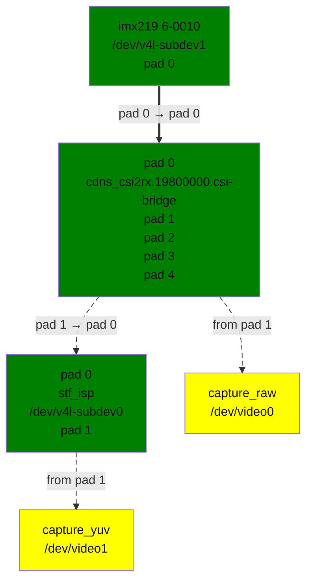

<a id="rst-starfive-camera-subsystem-driver"></a>

<!-- SPDX-License-Identifier: GPL-2.0 -->

<!-- This data file has been placed in the public domain. -->

<!-- Derived from the Unicode character mappings available from
<http://www.w3.org/2003/entities/xml/>.
Processed by unicode2rstsubs.py, part of Docutils:
<https://docutils.sourceforge.io>. -->

<a id="rst-introduction"></a>

## Introduction

This file documents the driver for the Starfive Camera Subsystem found on Starfive JH7110 SoC. The driver is located under drivers/staging/media/starfive/ camss.

The driver implements V4L2, Media controller and v4l2_subdev interfaces. Camera sensor using V4L2 subdev interface in the kernel is supported.

The driver has been successfully used on the Gstreamer 1.18.5 with v4l2src plugin.

<a id="rst-starfive-camera-subsystem-hardware"></a>

## Starfive Camera Subsystem hardware

The Starfive Camera Subsystem hardware consists of:


```text
                  |\         +---------------+      +-----------+
+----------+      |  \       |               |      |           |
|          |      |   |      |               |      |           |
|   MIPI   |----->|   |----->|      ISP      |----->|           |
|          |      |   |      |               |      |           |
+----------+      |   |      |               |      |  Memory   |
                  |MUX|      +---------------+      | Interface |
+----------+      |   |                             |           |
|          |      |   |---------------------------->|           |
| Parallel |----->|   |                             |           |
|          |      |   |                             |           |
+----------+      |  /                              |           |
                  |/                                +-----------+
```

- MIPI: The MIPI interface, receiving data from a MIPI CSI-2 camera sensor.

- Parallel: The parallel interface,  receiving data from a parallel sensor.

- ISP: The ISP, processing raw Bayer data from an image sensor and producing YUV frames.

<a id="rst-topology"></a>

## Topology

The media controller pipeline graph is as follows:

<a id="rst-starfive-camss-graph"></a>



starfive_camss_graph.dot

The driver has 2 video devices:

- capture_raw: The capture device, capturing image data directly from a sensor.

- capture_yuv: The capture device, capturing YUV frame data processed by the ISP module

The driver has 3 subdevices:

- stf_isp: is responsible for all the isp operations, outputs YUV frames.

- cdns_csi2rx: a CSI-2 bridge supporting up to 4 CSI lanes in input, and 4 different pixel streams in output.

- imx219: an image sensor, image data is sent through MIPI CSI-2.
