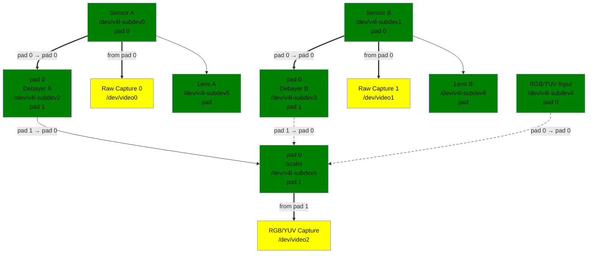

<a id="rst-the-virtual-media-controller-driver-vimc"></a>

<!-- SPDX-License-Identifier: GPL-2.0 -->

The vimc driver emulates complex video hardware using the V4L2 API and the Media API. It has a capture device and three subdevices: sensor, debayer and scaler.

<a id="rst-topology"></a>

## Topology

The topology is hardcoded, although you could modify it in vimc-core and recompile the driver to achieve your own topology. This is the default topology:

<a id="rst-vimc-topology-graph"></a>



Diagram of the default media pipeline topology

Media pipeline graph on vimc

<a id="rst-configuring-the-topology"></a>

### Configuring the topology

Each subdevice will come with its default configuration (pixelformat, height, width, ...). One needs to configure the topology in order to match the configuration on each linked subdevice to stream frames through the pipeline. If the configuration doesn't match, the stream will fail. The `v4l-utils` package is a bundle of user-space applications, that comes with `media-ctl` and `v4l2-ctl` that can be used to configure the vimc configuration. This sequence of commands fits for the default topology:


```bash
media-ctl -d platform:vimc -V '"Sensor A":0[fmt:SBGGR8_1X8/640x480]'
media-ctl -d platform:vimc -V '"Debayer A":0[fmt:SBGGR8_1X8/640x480]'
media-ctl -d platform:vimc -V '"Scaler":0[fmt:RGB888_1X24/640x480]'
media-ctl -d platform:vimc -V '"Scaler":0[crop:(100,50)/400x150]'
media-ctl -d platform:vimc -V '"Scaler":1[fmt:RGB888_1X24/300x700]'
v4l2-ctl -z platform:vimc -d "RGB/YUV Capture" -v width=300,height=700
v4l2-ctl -z platform:vimc -d "Raw Capture 0" -v pixelformat=BA81
```

<a id="rst-subdevices"></a>

## Subdevices

Subdevices define the behavior of an entity in the topology. Depending on the subdevice, the entity can have multiple pads of type source or sink.

- **vimc-sensor:**

  Generates images in several formats using video test pattern generator. Exposes:

  - 1 Pad source

- **vimc-lens:**

  Ancillary lens for a sensor. Supports auto focus control. Linked to a vimc-sensor using an ancillary link. The lens supports FOCUS_ABSOLUTE control.


```bash
media-ctl -p
...
- entity 28: Lens A (0 pad, 0 link)
                type V4L2 subdev subtype Lens flags 0
                device node name /dev/v4l-subdev6
- entity 29: Lens B (0 pad, 0 link)
                type V4L2 subdev subtype Lens flags 0
                device node name /dev/v4l-subdev7
v4l2-ctl -d /dev/v4l-subdev7 -C focus_absolute
focus_absolute: 0
```

- **vimc-debayer:**

  Transforms images in bayer format into a non-bayer format. Exposes:

  - 1 Pad sink

  - 1 Pad source

- **vimc-scaler:**

  Re-size the image to meet the source pad resolution. E.g.: if the sync pad is configured to 360x480 and the source to 1280x720, the image will be stretched to fit the source resolution. Works for any resolution within the vimc limitations (even shrinking the image if necessary). Exposes:

  - 1 Pad sink

  - 1 Pad source

- **vimc-capture:**

  Exposes node /dev/videoX to allow userspace to capture the stream. Exposes:

  - 1 Pad sink

  - 1 Pad source

<a id="rst-module-options"></a>

## Module options

Vimc has a module parameter to configure the driver.

- `allocator=<unsigned int>`

  > memory allocator selection, default is 0. It specifies the way buffers will be allocated.
  >
  > > - 0: vmalloc
  > >
  > > - 1: dma-contig
