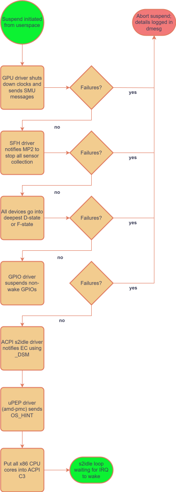
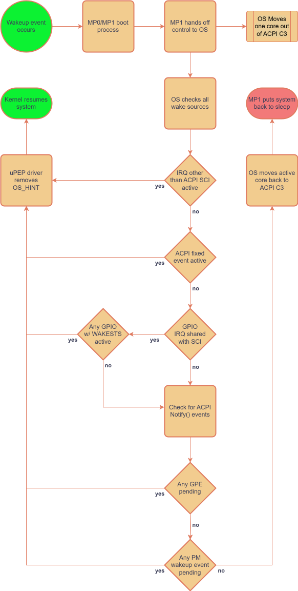

<a id="rst-debugging-amd-zen-systems"></a>

<!-- SPDX-License-Identifier: GPL-2.0 -->

<a id="rst-introduction"></a>

## Introduction

This document describes techniques that are useful for debugging issues with AMD Zen systems.  It is intended for use by developers and technical users to help identify and resolve issues.

<a id="rst-s3-vs-s2idle"></a>

## S3 vs s2idle

On AMD systems, it's not possible to simultaneously support suspend-to-RAM (S3) and suspend-to-idle (s2idle).  To confirm which mode your system supports you can look at `cat /sys/power/mem_sleep`.  If it shows `s2idle [deep]` then *S3* is supported.  If it shows `[s2idle]` then *s2idle* is supported.

On systems that support *S3*, the firmware will be utilized to put all hardware into the appropriate low power state.

On systems that support *s2idle*, the kernel will be responsible for transitioning devices into the appropriate low power state. When all devices are in the appropriate low power state, the hardware will transition into a hardware sleep state.

After a suspend cycle you can tell how much time was spent in a hardware sleep state by looking at `cat /sys/power/suspend_stats/last_hw_sleep`.

This flowchart explains how the AMD s2idle suspend flow works.



This flowchart explains how the amd s2idle resume flow works.



<a id="rst-s2idle-debugging-tool"></a>

## s2idle debugging tool

As there are a lot of places that problems can occur, a debugging tool has been created at [amd-debug-tools](<https://git.kernel.org/pub/scm/linux/kernel/git/superm1/amd-debug-tools.git/about/>)<a id="rst-amd-debug-tools"></a> that can help test for common problems and offer suggestions.

If you have an s2idle issue, it's best to start with this and follow instructions from its findings.  If you continue to have an issue, raise a bug with the report generated from this script to [drm/amd gitlab](<https://gitlab.freedesktop.org/drm/amd/-/issues/new?issuable_template=s2idle_BUG_TEMPLATE>)<a id="rst-drm-amd-gitlab"></a>.

<a id="rst-spurious-s2idle-wakeups-from-an-irq"></a>

## Spurious s2idle wakeups from an IRQ

Spurious wakeups will generally have an IRQ set to `/sys/power/pm_wakeup_irq`. This can be matched to `/proc/interrupts` to determine what device woke the system.

If this isn't enough to debug the problem, then the following sysfs files can be set to add more verbosity to the wakeup process:


```text
# echo 1 | sudo tee /sys/power/pm_debug_messages
# echo 1 | sudo tee /sys/power/pm_print_times
```

After making those changes, the kernel will display messages that can be traced back to kernel s2idle loop code as well as display any active GPIO sources while waking up.

If the wakeup is caused by the ACPI SCI, additional ACPI debugging may be needed.  These commands can enable additional trace data:


```text
# echo enable | sudo tee /sys/module/acpi/parameters/trace_state
# echo 1 | sudo tee /sys/module/acpi/parameters/aml_debug_output
# echo 0x0800000f | sudo tee /sys/module/acpi/parameters/debug_level
# echo 0xffff0000 | sudo tee /sys/module/acpi/parameters/debug_layer
```

<a id="rst-spurious-s2idle-wakeups-from-a-gpio"></a>

## Spurious s2idle wakeups from a GPIO

If a GPIO is active when waking up the system ideally you would look at the schematic to determine what device it is associated with. If the schematic is not available, another tactic is to look at the ACPI \_EVT() entry to determine what device is notified when that GPIO is active.

For a hypothetical example, say that GPIO 59 woke up the system.  You can look at the SSDT to determine what device is notified when GPIO 59 is active.

First convert the GPIO number into hex.


```text
$ python3 -c "print(hex(59))"
0x3b
```

Next determine which ACPI table has the `_EVT` entry. For example:


```text
$ sudo grep EVT /sys/firmware/acpi/tables/SSDT*
grep: /sys/firmware/acpi/tables/SSDT27: binary file matches
```

Decode this table:


```text
$ sudo cp /sys/firmware/acpi/tables/SSDT27 .
$ sudo iasl -d SSDT27
```

Then look at the table and find the matching entry for GPIO 0x3b.


```text
Case (0x3B)
{
    M000 (0x393B)
    M460 ("    Notify (\\_SB.PCI0.GP17.XHC1, 0x02)\n", Zero, Zero, Zero, Zero, Zero, Zero)
    Notify (\_SB.PCI0.GP17.XHC1, 0x02) // Device Wake
}
```

You can see in this case that the device `\_SB.PCI0.GP17.XHC1` is notified when GPIO 59 is active. It's obvious this is an XHCI controller, but to go a step further you can figure out which XHCI controller it is by matching it to ACPI.:


```text
$ grep "PCI0.GP17.XHC1" /sys/bus/acpi/devices/*/path
/sys/bus/acpi/devices/device:2d/path:\_SB_.PCI0.GP17.XHC1
/sys/bus/acpi/devices/device:2e/path:\_SB_.PCI0.GP17.XHC1.RHUB
/sys/bus/acpi/devices/device:2f/path:\_SB_.PCI0.GP17.XHC1.RHUB.PRT1
/sys/bus/acpi/devices/device:30/path:\_SB_.PCI0.GP17.XHC1.RHUB.PRT1.CAM0
/sys/bus/acpi/devices/device:31/path:\_SB_.PCI0.GP17.XHC1.RHUB.PRT1.CAM1
/sys/bus/acpi/devices/device:32/path:\_SB_.PCI0.GP17.XHC1.RHUB.PRT2
/sys/bus/acpi/devices/LNXPOWER:0d/path:\_SB_.PCI0.GP17.XHC1.PWRS
```

Here you can see it matches to `device:2d`. Look at the `physical_node` to determine what PCI device that actually is.


```text
$ ls -l /sys/bus/acpi/devices/device:2d/physical_node
lrwxrwxrwx 1 root root 0 Feb 12 13:22 /sys/bus/acpi/devices/device:2d/physical_node -> ../../../../../pci0000:00/0000:00:08.1/0000:c2:00.4
```

So there you have it: the PCI device associated with this GPIO wakeup was `0000:c2:00.4`.

The `amd_s2idle.py` script will capture most of these artifacts for you.

<a id="rst-s2idle-pm-debug-messages"></a>

## s2idle PM debug messages

During the s2idle flow on AMD systems, the ACPI LPS0 driver is responsible to check all uPEP constraints.  Failing uPEP constraints does not prevent s0i3 entry.  This means that if some constraints are not met, it is possible the kernel may attempt to enter s2idle even if there are some known issues.

To activate PM debugging, either specify `pm_debug_messagess` kernel command-line option at boot or write to `/sys/power/pm_debug_messages`. Unmet constraints will be displayed in the kernel log and can be viewed by logging tools that process kernel ring buffer like `dmesg` or `journalctl`."

If the system freezes on entry/exit before these messages are flushed, a useful debugging tactic is to unbind the `amd_pmc` driver to prevent notification to the platform to start s0i3 entry.  This will stop the system from freezing on entry or exit and let you view all the failed constraints.


```text
cd /sys/bus/platform/drivers/amd_pmc
ls | grep AMD | sudo tee unbind
```

After doing this, run the suspend cycle and look specifically for errors around:


```text
ACPI: LPI: Constraint not met; min power state:%s current power state:%s
```

<a id="rst-historical-examples-of-s2idle-issues"></a>

## Historical examples of s2idle issues

To help understand the types of issues that can occur and how to debug them, here are some historical examples of s2idle issues that have been resolved.

<a id="rst-core-offlining"></a>

### Core offlining

An end user had reported that taking a core offline would prevent the system from properly entering s0i3.  This was debugged using internal AMD tools to capture and display a stream of metrics from the hardware showing what changed when a core was offlined.  It was determined that the hardware didn't get notification the offline cores were in the deepest state, and so it prevented CPU from going into the deepest state. The issue was debugged to a missing command to put cores into C3 upon offline.

[commit d6b88ce2eb9d2 ("ACPI: processor idle: Allow playing dead in C3 state")](<https://git.kernel.org/torvalds/c/d6b88ce2eb9d2>)<a id="rst-commit-d6b88ce2eb9d2-acpi-processor-idle-allow-playing-dead-in-c3-state"></a>

<a id="rst-corruption-after-resume"></a>

### Corruption after resume

A big problem that occurred with Rembrandt was that there was graphical corruption after resume.  This happened because of a misalignment of PSP and driver responsibility.  The PSP will save and restore DMCUB, but the driver assumed it needed to reset DMCUB on resume. This actually was a misalignment for earlier silicon as well, but was not observed.

[commit 79d6b9351f086 ("drm/amd/display: Don't reinitialize DMCUB on s0ix resume")](<https://git.kernel.org/torvalds/c/79d6b9351f086>)<a id="rst-commit-79d6b9351f086-drm-amd-display-don-t-reinitialize-dmcub-on-s0ix-resume"></a>

<a id="rst-back-to-back-suspends-fail"></a>

### Back to Back suspends fail

When using a wakeup source that triggers the IRQ to wakeup, a bug in the pinctrl-amd driver may capture the wrong state of the IRQ and prevent the system going back to sleep properly.

[commit b8c824a869f22 ("pinctrl: amd: Don't save/restore interrupt status and wake status bits")](<https://git.kernel.org/torvalds/c/b8c824a869f22>)<a id="rst-commit-b8c824a869f22-pinctrl-amd-don-t-save-restore-interrupt-status-and-wake-status-bits"></a>

<a id="rst-spurious-timer-based-wakeup-after-5-minutes"></a>

### Spurious timer based wakeup after 5 minutes

The HPET was being used to program the wakeup source for the system, however this was causing a spurious wakeup after 5 minutes.  The correct alarm to use was the ACPI alarm.

[commit 3d762e21d5637 ("rtc: cmos: Use ACPI alarm for non-Intel x86 systems too")](<https://git.kernel.org/torvalds/c/3d762e21d5637>)<a id="rst-commit-3d762e21d5637-rtc-cmos-use-acpi-alarm-for-non-intel-x86-systems-too"></a>

<a id="rst-disk-disappears-after-resume"></a>

### Disk disappears after resume

After resuming from s2idle, the NVME disk would disappear.  This was due to the BIOS not specifying the \_DSD StorageD3Enable property.  This caused the NVME driver not to put the disk into the expected state at suspend and to fail on resume.

[commit e79a10652bbd3 ("ACPI: x86: Force StorageD3Enable on more products")](<https://git.kernel.org/torvalds/c/e79a10652bbd3>)<a id="rst-commit-e79a10652bbd3-acpi-x86-force-storaged3enable-on-more-products"></a>

<a id="rst-spurious-irq1"></a>

### Spurious IRQ1

A number of Renoir, Lucienne, Cezanne, &amp; Barcelo platforms have a platform firmware bug where IRQ1 is triggered during s0i3 resume.

This was fixed in the platform firmware, but a number of systems didn't receive any more platform firmware updates.

[commit 8e60615e89321 ("platform/x86/amd: pmc: Disable IRQ1 wakeup for RN/CZN")](<https://git.kernel.org/torvalds/c/8e60615e89321>)<a id="rst-commit-8e60615e89321-platform-x86-amd-pmc-disable-irq1-wakeup-for-rn-czn"></a>

<a id="rst-hardware-timeout"></a>

### Hardware timeout

The hardware performs many actions besides accepting the values from amd-pmc driver.  As the communication path with the hardware is a mailbox, it's possible that it might not respond quickly enough. This issue manifested as a failure to suspend:


```text
PM: dpm_run_callback(): acpi_subsys_suspend_noirq+0x0/0x50 returns -110
amd_pmc AMDI0005:00: PM: failed to suspend noirq: error -110
```

The timing problem was identified by comparing the values of the idle mask.

[commit 3c3c8e88c8712 ("platform/x86: amd-pmc: Increase the response register timeout")](<https://git.kernel.org/torvalds/c/3c3c8e88c8712>)<a id="rst-commit-3c3c8e88c8712-platform-x86-amd-pmc-increase-the-response-register-timeout"></a>

<a id="rst-failed-to-reach-hardware-sleep-state-with-panel-on"></a>

### Failed to reach hardware sleep state with panel on

On some Strix systems certain panels were observed to block the system from entering a hardware sleep state if the internal panel was on during the sequence.

Even though the panel got turned off during suspend it exposed a timing problem where an interrupt caused the display hardware to wake up and block low power state entry.

[commit 40b8c14936bd2 ("drm/amd/display: Disable unneeded hpd interrupts during dm_init")](<https://git.kernel.org/torvalds/c/40b8c14936bd2>)<a id="rst-commit-40b8c14936bd2-drm-amd-display-disable-unneeded-hpd-interrupts-during-dm-init"></a>

<a id="rst-runtime-power-consumption-issues"></a>

## Runtime power consumption issues

Runtime power consumption is influenced by many factors, including but not limited to the configuration of the PCIe Active State Power Management (ASPM), the display brightness, the EPP policy of the CPU, and the power management of the devices.

<a id="rst-aspm"></a>

### ASPM

For the best runtime power consumption, ASPM should be programmed as intended by the BIOS from the hardware vendor.  To accomplish this the Linux kernel should be compiled with `CONFIG_PCIEASPM_DEFAULT` set to `y` and the sysfs file `/sys/module/pcie_aspm/parameters/policy` should not be modified.

Most notably, if L1.2 is not configured properly for any devices, the SoC will not be able to enter the deepest idle state.

<a id="rst-epp-policy"></a>

### EPP Policy

The `energy_performance_preference` sysfs file can be used to set a bias of efficiency or performance for a CPU.  This has a direct relationship on the battery life when more heavily biased towards performance.

<a id="rst-bios-debug-messages"></a>

## BIOS debug messages

Most OEM machines don't have a serial UART for outputting kernel or BIOS debug messages. However BIOS debug messages are useful for understanding both BIOS bugs and bugs with the Linux kernel drivers that call BIOS AML.

As the BIOS on most OEM AMD systems are based off an AMD reference BIOS, the infrastructure used for exporting debugging messages is often the same as AMD reference BIOS.

<a id="rst-manually-parsing"></a>

### Manually Parsing

There is generally an ACPI method `\M460` that different paths of the AML will call to emit a message to the BIOS serial log. This method takes 7 arguments, with the first being a string and the rest being optional integers:


```text
Method (M460, 7, Serialized)
```

Here is an example of a string that BIOS AML may call out using `\M460`:


```text
M460 ("  OEM-ASL-PCIe Address (0x%X)._REG (%d %d)  PCSA = %d\n", DADR, Arg0, Arg1, PCSA, Zero, Zero)
```

Normally when executed, the `\M460` method would populate the additional arguments into the string.  In order to get these messages from the Linux kernel a hook has been added into ACPICA that can capture the *arguments* sent to `\M460` and print them to the kernel ring buffer. For example the following message could be emitted into kernel ring buffer:


```text
extrace-0174 ex_trace_args         :  "  OEM-ASL-PCIe Address (0x%X)._REG (%d %d)  PCSA = %d\n", ec106000, 2, 1, 1, 0, 0
```

In order to get these messages, you need to compile with `CONFIG_ACPI_DEBUG` and then turn on the following ACPICA tracing parameters. This can be done either on the kernel command line or at runtime:

- `acpi.trace_method_name=\M460`

- `acpi.trace_state=method`

NOTE: These can be very noisy at bootup. If you turn these parameters on the kernel command, please also consider turning up `CONFIG_LOG_BUF_SHIFT` to a larger size such as 17 to avoid losing early boot messages.

<a id="rst-tool-assisted-parsing"></a>

### Tool assisted Parsing

As mentioned above, parsing by hand can be tedious, especially with a lot of messages.  To help with this, a tool has been created at [amd-debug-tools](<https://git.kernel.org/pub/scm/linux/kernel/git/superm1/amd-debug-tools.git/about/>)<a id="rst-amd-debug-tools-1"></a> to help parse the messages.

<a id="rst-random-reboot-issues"></a>

## Random reboot issues

When a random reboot occurs, the high-level reason for the reboot is stored in a register that will persist onto the next boot.

- **There are 6 classes of reasons for the reboot:**

  - Software induced

  - Power state transition

  - Pin induced

  - Hardware induced

  - Remote reset

  - Internal CPU event


<table>
<thead>
<tr>
<th>


Bit

</th>
<th>


Type

</th>
<th>


Reason

</th>
</tr>
</thead>
<tbody>
<tr>
<td>


0

</td>
<td>


Pin

</td>
<td>


thermal pin BP_THERMTRIP_L was tripped

</td>
</tr>
<tr>
<td>


1

</td>
<td>


Pin

</td>
<td>


power button was pressed for 4 seconds

</td>
</tr>
<tr>
<td>


2

</td>
<td>


Pin

</td>
<td>


shutdown pin was tripped

</td>
</tr>
<tr>
<td>


4

</td>
<td>


Remote

</td>
<td>


remote ASF power off command was received

</td>
</tr>
<tr>
<td>


9

</td>
<td>


Internal

</td>
<td>


internal CPU thermal limit was tripped

</td>
</tr>
<tr>
<td>


16

</td>
<td>


Pin

</td>
<td>


system reset pin BP_SYS_RST_L was tripped

</td>
</tr>
<tr>
<td>


17

</td>
<td>


Software

</td>
<td>


software issued PCI reset

</td>
</tr>
<tr>
<td>


18

</td>
<td>


Software

</td>
<td>


software wrote 0x4 to reset control register 0xCF9

</td>
</tr>
<tr>
<td>


19

</td>
<td>


Software

</td>
<td>


software wrote 0x6 to reset control register 0xCF9

</td>
</tr>
<tr>
<td>


20

</td>
<td>


Software

</td>
<td>


software wrote 0xE to reset control register 0xCF9

</td>
</tr>
<tr>
<td>


21

</td>
<td>


ACPI-state

</td>
<td>


ACPI power state transition occurred

</td>
</tr>
<tr>
<td>


22

</td>
<td>


Pin

</td>
<td>


keyboard reset pin KB_RST_L was tripped

</td>
</tr>
<tr>
<td>


23

</td>
<td>


Internal

</td>
<td>


internal CPU shutdown event occurred

</td>
</tr>
<tr>
<td>


24

</td>
<td>


Hardware

</td>
<td>


system failed to boot before failed boot timer expired

</td>
</tr>
<tr>
<td>


25

</td>
<td>


Hardware

</td>
<td>


hardware watchdog timer expired

</td>
</tr>
<tr>
<td>


26

</td>
<td>


Remote

</td>
<td>


remote ASF reset command was received

</td>
</tr>
<tr>
<td>


27

</td>
<td>


Internal

</td>
<td>


an uncorrected error caused a data fabric sync flood event

</td>
</tr>
<tr>
<td>


29

</td>
<td>


Internal

</td>
<td>


FCH and MP1 failed warm reset handshake

</td>
</tr>
<tr>
<td>


30

</td>
<td>


Internal

</td>
<td>


a parity error occurred

</td>
</tr>
<tr>
<td>


31

</td>
<td>


Internal

</td>
<td>


a software sync flood event occurred

</td>
</tr>
</tbody>
</table>

This information is read by the kernel at bootup and printed into the syslog. When a random reboot occurs this message can be helpful to determine the next component to debug.
