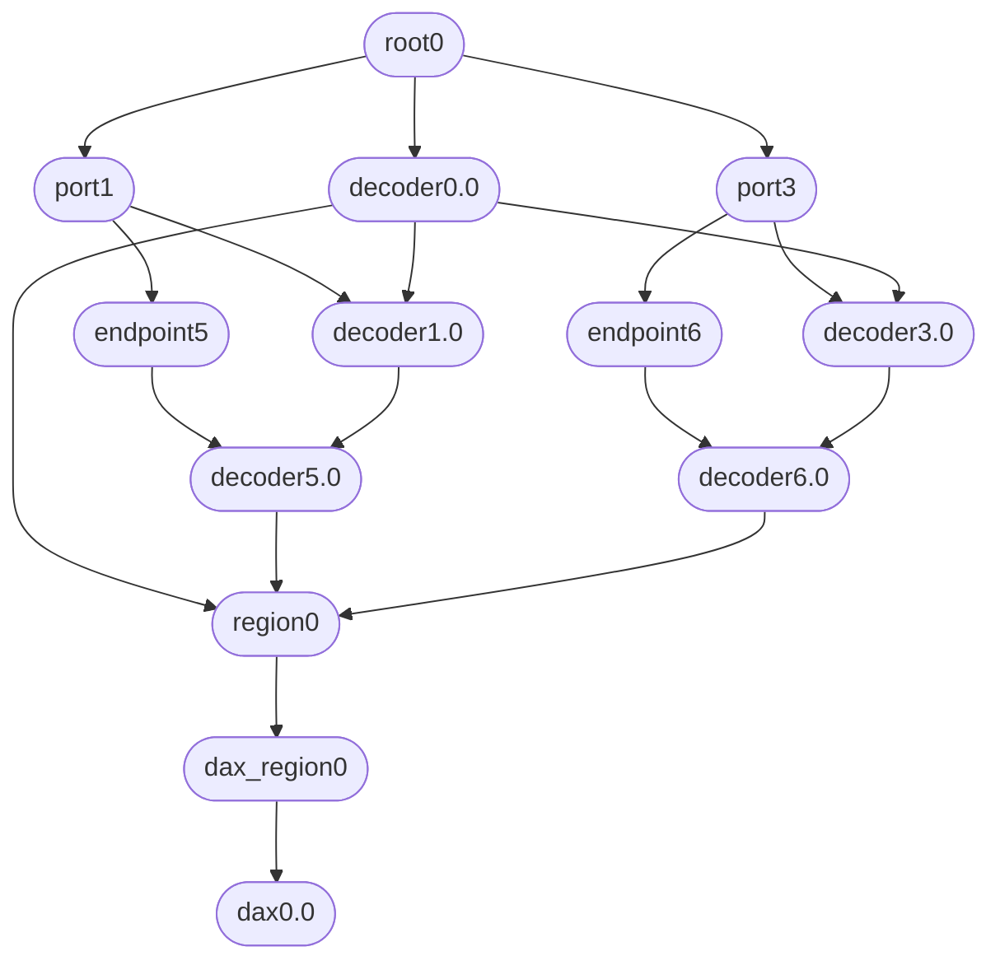
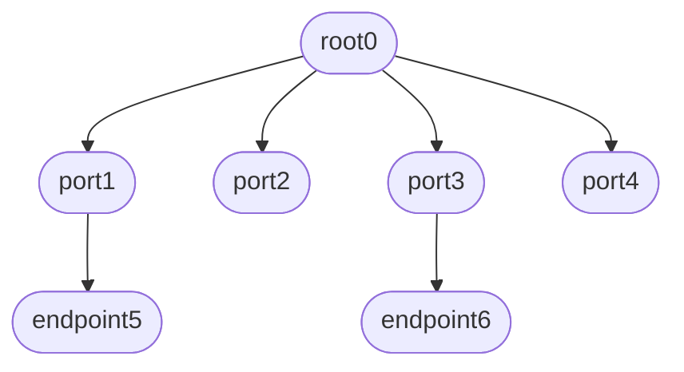
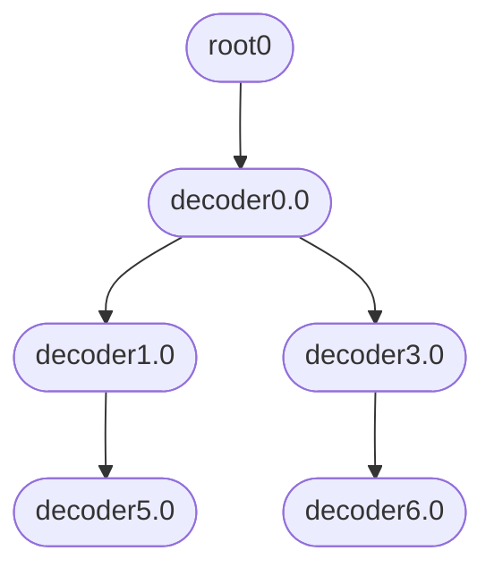
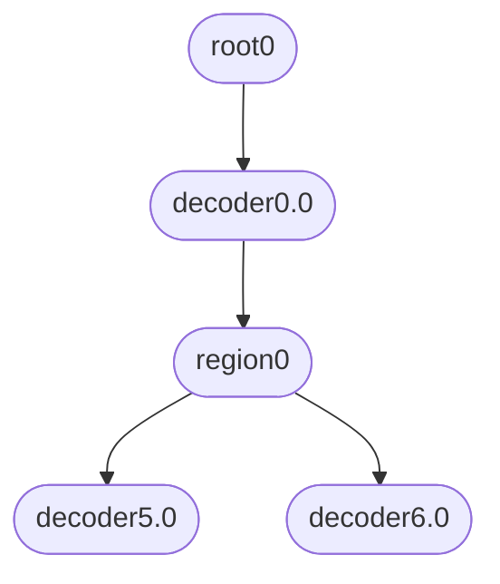

<a id="rst-cxl-driver-operation"></a>

<!-- SPDX-License-Identifier: GPL-2.0 -->

The devices described in this section are present in


```text
/sys/bus/cxl/devices/
/dev/cxl/
```

The `cxl-cli` library, maintained as part of the NDTCL project, may be used to script interactions with these devices.

<a id="rst-drivers"></a>

## Drivers

The CXL driver is split into a number of drivers.

- cxl_core  - fundamental init interface and core object creation

- cxl_port  - initializes root and provides port enumeration interface.

- cxl_acpi  - initializes root decoders and interacts with ACPI data.

- cxl_p/mem - initializes memory devices

- cxl_pci   - uses cxl_port to enumerate the actual fabric hierarchy.

<a id="rst-driver-devices"></a>

## Driver Devices

Here is an example from a single-socket system with 4 host bridges. Two host bridges have a single memory device attached, and the devices are interleaved into a single memory region. The memory region has been converted to dax.


```text
# ls /sys/bus/cxl/devices/
  dax_region0  decoder3.0  decoder6.0  mem0   port3
  decoder0.0   decoder4.0  decoder6.1  mem1   port4
  decoder1.0   decoder5.0  endpoint5   port1  region0
  decoder2.0   decoder5.1  endpoint6   port2  root0
```



Diagraph of CXL fabric with a host-bridge interleave memory region

For this section we'll explore the devices present in this configuration, but we'll explore more configurations in-depth in example configurations below.

<a id="rst-base-devices"></a>

### Base Devices

Most devices in a CXL fabric are a `port` of some kind (because each device mostly routes request from one device to the next, rather than provide a direct service).

<a id="rst-root"></a>

#### Root

The `CXL Root` is logical object created by the `cxl_acpi` driver during `cxl_acpi_probe` - if the `ACPI0017` `Compute Express Link Root Object` Device Class is found.

The Root contains links to:

- `Host Bridge Ports` defined by CHBS in the [CEDT](<~kernel/hardware/driver-api/cxl-platform-acpi/cedt>)

- `Downstream Ports` typically connected to `Host Bridge Ports`.

- `Root Decoders` defined by CFMWS the [CEDT](<~kernel/hardware/driver-api/cxl-platform-acpi/cedt>)


```text
# ls /sys/bus/cxl/devices/root0
  decoder0.0          dport0  dport5    port2  subsystem
  decoders_committed  dport1  modalias  port3  uevent
  devtype             dport4  port1     port4  uport

# cat /sys/bus/cxl/devices/root0/devtype
  cxl_port

# cat port1/devtype
  cxl_port

# cat decoder0.0/devtype
  cxl_decoder_root
```

The root is first `logical port` in the CXL fabric, as presented by the Linux CXL driver.  The `CXL root` is a special type of `switch port`, in that it only has downstream port connections.

<a id="rst-port"></a>

#### Port

A `port` object is better described as a `switch port`.  It may represent a host bridge to the root or an actual switch port on a switch. A `switch port` contains one or more decoders used to route memory requests downstream ports, which may be connected to another `switch port` or an `endpoint port`.


```text
# ls /sys/bus/cxl/devices/port1
  decoder1.0          dport0    driver     parent_dport  uport
  decoders_committed  dport113  endpoint5  subsystem
  devtype             dport2    modalias   uevent

# cat devtype
  cxl_port

# cat decoder1.0/devtype
  cxl_decoder_switch

# cat endpoint5/devtype
  cxl_port
```

CXL `Host Bridges` in the fabric are probed during `cxl_acpi_probe` at the time the `CXL Root` is probed.  The allows for the immediate logical connection to between the root and host bridge.

- The root has a downstream port connection to a host bridge

- The host bridge has an upstream port connection to the root.

- The host bridge has one or more downstream port connections to switch or endpoint ports.

A `Host Bridge` is a special type of CXL `switch port`. It is explicitly defined in the ACPI specification via `ACPI0016` ID.  `Host Bridge` ports will be probed at `acpi_probe` time, while similar ports on an actual switch will be probed later.  Otherwise, switch and host bridge ports look very similar - the both contain switch decoders which route accesses between upstream and downstream ports.

<a id="rst-endpoint"></a>

#### Endpoint

An `endpoint` is a terminal port in the fabric.  This is a `logical device`, and may be one of many `logical devices` presented by a memory device. It is still considered a type of `port` in the fabric.

An `endpoint` contains `endpoint decoders` and the device's Coherent Device Attribute Table (which describes the device's capabilities).


```text
# ls /sys/bus/cxl/devices/endpoint5
  CDAT        decoders_committed  modalias      uevent
  decoder5.0  devtype             parent_dport  uport
  decoder5.1  driver              subsystem

# cat /sys/bus/cxl/devices/endpoint5/devtype
  cxl_port

# cat /sys/bus/cxl/devices/endpoint5/decoder5.0/devtype
  cxl_decoder_endpoint
```

<a id="rst-memory-device-memdev"></a>

#### Memory Device (memdev)

A `memdev` is probed and added by the `cxl_pci` driver in `cxl_pci_probe` and is managed by the `cxl_mem` driver. It primarily provides the `IOCTL` interface to a memory device, via `/dev/cxl/memN`, and exposes various device configuration data.


```text
# ls /sys/bus/cxl/devices/mem0
  dev       firmware_version    payload_max  security   uevent
  driver    label_storage_size  pmem         serial
  firmware  numa_node           ram          subsystem
```

A Memory Device is a discrete base object that is not a port.  While the physical device it belongs to may also host an `endpoint`, the relationship between an `endpoint` and a `memdev` is not captured in sysfs.

<a id="rst-port-relationships"></a>

#### Port Relationships

In our example described above, there are four host bridges attached to the root, and two of the host bridges have one endpoint attached.



Diagraph of CXL fabric with a host-bridge interleave memory region

<a id="rst-decoders"></a>

### Decoders

A `Decoder` is short for a CXL Host-Managed Device Memory (HDM) Decoder. It is a device that routes accesses through the CXL fabric to an endpoint, and at the endpoint translates a `Host Physical` to `Device Physical` Addressing.

The CXL 3.1 specification heavily implies that only endpoint decoders should engage in translation of `Host Physical Address` to `Device Physical Address`.


```text
8.2.4.20 CXL HDM Decoder Capability Structure

IMPLEMENTATION NOTE
CXL Host Bridge and Upstream Switch Port Decode Flow

IMPLEMENTATION NOTE
Device Decode Logic
```

These notes imply that there are two logical groups of decoders.

- Routing Decoder - a decoder which routes accesses but does not translate addresses from HPA to DPA.

- Translating Decoder - a decoder which translates accesses from HPA to DPA for an endpoint to service.

The CXL drivers distinguish 3 decoder types: root, switch, and endpoint. Only endpoint decoders are Translating Decoders, all others are Routing Decoders.

> [!NOTE]
>
> PLATFORM VENDORS BE AWARE
>
> Linux makes a strong assumption that endpoint decoders are the only decoder in the fabric that actively translates HPA to DPA.  Linux assumes routing decoders pass the HPA unchanged to the next decoder in the fabric.
>
> It is therefore assumed that any given decoder in the fabric will have an address range that is a subset of its upstream port decoder. Any deviation from this scheme undefined per the specification.  Linux prioritizes spec-defined / architectural behavior.

Decoders may have one or more `Downstream Targets` if configured to interleave memory accesses.  This will be presented in sysfs via the `target_list` parameter.

<a id="rst-root-decoder"></a>

#### Root Decoder

A `Root Decoder` is logical construct of the physical address and interleave configurations present in the CFMWS field of the [CEDT](<~kernel/hardware/driver-api/cxl-platform-acpi/cedt>). Linux presents this information as a decoder present in the `CXL Root`.  We consider this a `Root Decoder`, though technically it exists on the boundary of the CXL specification and platform-specific CXL root implementations.

Linux considers these logical decoders a type of `Routing Decoder`, and is the first decoder in the CXL fabric to receive a memory access from the platform's memory controllers.

`Root Decoders` are created during `cxl_acpi_probe`.  One root decoder is created per CFMWS entry in the [CEDT](<~kernel/hardware/driver-api/cxl-platform-acpi/cedt>).

The `target_list` parameter is filled by the CFMWS target fields. Targets of a root decoder are `Host Bridges`, which means interleave done at the root decoder level is an `Inter-Host-Bridge Interleave`.

Only root decoders are capable of `Inter-Host-Bridge Interleave`.

Such interleaves must be configured by the platform and described in the ACPI CEDT CFMWS, as the target CXL host bridge UIDs in the CFMWS must match the CXL host bridge UIDs in the CHBS field of the [CEDT](<~kernel/hardware/driver-api/cxl-platform-acpi/cedt>) and the UID field of CXL Host Bridges defined in the [DSDT](<~kernel/hardware/driver-api/cxl-platform-acpi/dsdt>).

Interleave settings in a root decoder describe how to interleave accesses among the *immediate downstream targets*, not the entire interleave set.

The memory range described in the root decoder is used to

1. Create a memory region (`region0` in this example), and

2. Associate the region with an IO Memory Resource (`kernel/resource.c`)


```text
# ls /sys/bus/cxl/devices/decoder0.0/
  cap_pmem           devtype                 region0
  cap_ram            interleave_granularity  size
  cap_type2          interleave_ways         start
  cap_type3          locked                  subsystem
  create_ram_region  modalias                target_list
  delete_region      qos_class               uevent

# cat /sys/bus/cxl/devices/decoder0.0/region0/resource
  0xc050000000
```

The IO Memory Resource is created during early boot when the CFMWS region is identified in the EFI Memory Map or E820 table (on x86).

Root decoders are defined as a separate devtype, but are also a type of `Switch Decoder` due to having downstream targets.


```text
# cat /sys/bus/cxl/devices/decoder0.0/devtype
  cxl_decoder_root
```

<a id="rst-switch-decoder"></a>

#### Switch Decoder

Any non-root, translating decoder is considered a `Switch Decoder`, and will present with the type `cxl_decoder_switch`. Both `Host Bridge` and `CXL Switch` (device) decoders are of type `cxl_decoder_switch`.


```text
# ls /sys/bus/cxl/devices/decoder1.0/
  devtype                 locked    size       target_list
  interleave_granularity  modalias  start      target_type
  interleave_ways         region    subsystem  uevent

# cat /sys/bus/cxl/devices/decoder1.0/devtype
  cxl_decoder_switch

# cat /sys/bus/cxl/devices/decoder1.0/region
  region0
```

A `Switch Decoder` has associations between a region defined by a root decoder and downstream target ports.  Interleaving done within a switch decoder is a multi-downstream-port interleave (or `Intra-Host-Bridge Interleave` for host bridges).

Interleave settings in a switch decoder describe how to interleave accesses among the *immediate downstream targets*, not the entire interleave set.

Switch decoders are created during `cxl_switch_port_probe` in the `cxl_port` driver, and is created based on a PCI device's DVSEC registers.

Switch decoder programming is validated during probe if the platform programs them during boot (See `Auto Decoders` below), or on commit if programmed at runtime (See `Runtime Programming` below).

<a id="rst-endpoint-decoder"></a>

#### Endpoint Decoder

Any decoder attached to a *terminal* point in the CXL fabric (`An Endpoint`) is considered an `Endpoint Decoder`. Endpoint decoders are of type `cxl_decoder_endpoint`.


```text
# ls /sys/bus/cxl/devices/decoder5.0
  devtype                 locked    start
  dpa_resource            modalias  subsystem
  dpa_size                mode      target_type
  interleave_granularity  region    uevent
  interleave_ways         size

# cat /sys/bus/cxl/devices/decoder5.0/devtype
  cxl_decoder_endpoint

# cat /sys/bus/cxl/devices/decoder5.0/region
  region0
```

An `Endpoint Decoder` has an association with a region defined by a root decoder and describes the device-local resource associated with this region.

Unlike root and switch decoders, endpoint decoders translate `Host Physical` to `Device Physical` address ranges.  The interleave settings on an endpoint therefore describe the entire *interleave set*.

`Device Physical Address` regions must be committed in-order. For example, the DPA region starting at 0x80000000 cannot be committed before the DPA region starting at 0x0.

As of Linux v6.15, Linux does not support *imbalanced* interleave setups, all endpoints in an interleave set are expected to have the same interleave settings (granularity and ways must be the same).

Endpoint decoders are created during `cxl_endpoint_port_probe` in the `cxl_port` driver, and is created based on a PCI device's DVSEC registers.

<a id="rst-decoder-relationships"></a>

#### Decoder Relationships

In our example described above, there is one root decoder which routes memory accesses over two host bridges.  Each host bridge has a decoder which routes access to their singular endpoint targets.  Each endpoint has a decoder which translates HPA to DPA and services the memory request.

The driver validates relationships between ports by decoder programming, so we can think of decoders being related in a similarly hierarchical fashion to ports.



Diagraph of CXL root, switch, and endpoint decoders.

<a id="rst-regions"></a>

### Regions

<a id="rst-memory-region"></a>

#### Memory Region

A `Memory Region` is a logical construct that connects a set of CXL ports in the fabric to an IO Memory Resource.  It is ultimately used to expose the memory on these devices to the DAX subsystem via a `DAX Region`.

An example RAM region:


```text
# ls /sys/bus/cxl/devices/region0/
  access0      devtype                 modalias  subsystem  uuid
  access1      driver                  mode      target0
  commit       interleave_granularity  resource  target1
  dax_region0  interleave_ways         size      uevent
```

A memory region can be constructed during endpoint probe, if decoders were programmed by BIOS/EFI (see `Auto Decoders`), or by creating a region manually via a `Root Decoder`'s `create_ram_region` or `create_pmem_region` interfaces.

The interleave settings in a `Memory Region` describe the configuration of the `Interleave Set` - and are what can be expected to be seen in the endpoint interleave settings.



Regions are created based on root decoder configurations. Endpoint decoders
must be programmed with the same interleave settings as the region.

<a id="rst-dax-region"></a>

#### DAX Region

A `DAX Region` is used to convert a CXL `Memory Region` to a DAX device. A DAX device may then be accessed directly via a file descriptor interface, or converted to System RAM via the DAX kmem driver.  See the DAX driver section for more details.


```text
# ls /sys/bus/cxl/devices/dax_region0/
  dax0.0      devtype  modalias   uevent
  dax_region  driver   subsystem
```

<a id="rst-mailbox-interfaces"></a>

### Mailbox Interfaces

A mailbox command interface for each device is exposed in


```text
/dev/cxl/mem0
/dev/cxl/mem1
```

These mailboxes may receive any specification-defined command. Raw commands (custom commands) can only be sent to these interfaces if the build config `CXL_MEM_RAW_COMMANDS` is set.  This is considered a debug and/or development interface, not an officially supported mechanism for creation of vendor-specific commands (see the `fwctl` subsystem for that).

<a id="rst-decoder-programming"></a>

## Decoder Programming

<a id="rst-runtime-programming"></a>

### Runtime Programming

During probe, the only decoders *required* to be programmed are `Root Decoders`. In reality, `Root Decoders` are a logical construct to describe the memory region and interleave configuration at the host bridge level - as described in the ACPI CEDT CFMWS.

All other `Switch` and `Endpoint` decoders may be programmed by the user at runtime - if the platform supports such configurations.

This interaction is what creates a `Software Defined Memory` environment.

See the `cxl-cli` documentation for more information about how to configure CXL decoders at runtime.

<a id="rst-auto-decoders"></a>

### Auto Decoders

Auto Decoders are decoders programmed by BIOS/EFI at boot time, and are almost always locked (cannot be changed).  This is done by a platform which may have a static configuration - or certain quirks which may prevent dynamic runtime changes to the decoders (such as requiring additional controller programming within the CPU complex outside the scope of CXL).

Auto Decoders are probed automatically as long as the devices and memory regions they are associated with probe without issue.  When probing Auto Decoders, the driver's primary responsibility is to ensure the fabric is sane - as-if validating runtime programmed regions and decoders.

If Linux cannot validate auto-decoder configuration, the memory will not be surfaced as a DAX device - and therefore not be exposed to the page allocator - effectively stranding it.

<a id="rst-interleave"></a>

### Interleave

The Linux CXL driver supports `Cross-Link First` interleave. This dictates how interleave is programmed at each decoder step, as the driver validates the relationships between a decoder and it's parent.

For example, in a `Cross-Link First` interleave setup with 16 endpoints attached to 4 host bridges, linux expects the following ways/granularity across the root, host bridge, and endpoints respectively.


<table>
<caption>4x4 cross-link first interleave settings</caption>
<tbody>
<tr>
<td>


decoder

</td>
<td>


ways

</td>
<td>


granularity

</td>
</tr>
<tr>
<td>


root

</td>
<td>


4

</td>
<td>


256

</td>
</tr>
<tr>
<td>


host bridge

</td>
<td>


4

</td>
<td>


1024

</td>
</tr>
<tr>
<td>


endpoint

</td>
<td>


16

</td>
<td>


256

</td>
</tr>
</tbody>
</table>

At the root, every a given access will be routed to the `((HPA / 256) % 4)th` target host bridge. Within a host bridge, every `((HPA / 1024) % 4)th` target endpoint.  Each endpoint translates based on the entire 16 device interleave set.

Unbalanced interleave sets are not supported - decoders at a similar point in the hierarchy (e.g. all host bridge decoders) must have the same ways and granularity configuration.

<a id="rst-at-root"></a>

#### At Root

Root decoder interleave is defined by CFMWS field of the [CEDT](<~kernel/hardware/driver-api/cxl-platform-acpi/cedt>).  The CEDT may actually define multiple CFMWS configurations to describe the same physical capacity, with the intent to allow users to decide at runtime whether to online memory as interleaved or non-interleaved.


```text
           Subtable Type : 01 [CXL Fixed Memory Window Structure]
     Window base address : 0000000100000000
             Window size : 0000000100000000
Interleave Members (2^n) : 00
   Interleave Arithmetic : 00
            First Target : 00000007

           Subtable Type : 01 [CXL Fixed Memory Window Structure]
     Window base address : 0000000200000000
             Window size : 0000000100000000
Interleave Members (2^n) : 00
   Interleave Arithmetic : 00
            First Target : 00000006

           Subtable Type : 01 [CXL Fixed Memory Window Structure]
     Window base address : 0000000300000000
             Window size : 0000000200000000
Interleave Members (2^n) : 01
   Interleave Arithmetic : 00
            First Target : 00000007
             Next Target : 00000006
```

In this example, the CFMWS defines two discrete non-interleaved 4GB regions for each host bridge, and one interleaved 8GB region that targets both. This would result in 3 root decoders presenting in the root.


```text
# ls /sys/bus/cxl/devices/root0/decoder*
  decoder0.0  decoder0.1  decoder0.2

# cat /sys/bus/cxl/devices/decoder0.0/target_list start size
  7
  0x100000000
  0x100000000

# cat /sys/bus/cxl/devices/decoder0.1/target_list start size
  6
  0x200000000
  0x100000000

# cat /sys/bus/cxl/devices/decoder0.2/target_list start size
  7,6
  0x300000000
  0x200000000
```

These decoders are not runtime programmable.  They are used to generate a `Memory Region` to bring this memory online with runtime programmed settings at the `Switch` and `Endpoint` decoders.

<a id="rst-at-host-bridge-or-switch"></a>

#### At Host Bridge or Switch

`Host Bridge` and `Switch` decoders are programmable via the following fields:

- `start` - the HPA region associated with the memory region

- `size` - the size of the region

- `target_list` - the list of downstream ports

- `interleave_ways` - the number downstream ports to interleave across

- `interleave_granularity` - the granularity to interleave at.

Linux expects the `interleave_granularity` of switch decoders to be derived from their upstream port connections. In `Cross-Link First` interleave configurations, the `interleave_granularity` of a decoder is equal to `parent_interleave_granularity * parent_interleave_ways`.

<a id="rst-at-endpoint"></a>

#### At Endpoint

`Endpoint Decoders` are programmed similar to Host Bridge and Switch decoders, with the exception that the ways and granularity are defined by the interleave set (e.g. the interleave settings defined by the associated `Memory Region`).

- `start` - the HPA region associated with the memory region

- `size` - the size of the region

- `interleave_ways` - the number endpoints in the interleave set

- `interleave_granularity` - the granularity to interleave at.

These settings are used by endpoint decoders to *Translate* memory requests from HPA to DPA.  This is why they must be aware of the entire interleave set.

Linux does not support unbalanced interleave configurations.  As a result, all endpoints in an interleave set must have the same ways and granularity.

<a id="rst-example-configurations"></a>

## Example Configurations

- [Single Device](<~kernel/hardware/driver-api/cxl-linux-example-configurations/single-device>)
- [Inter-Host-Bridge Interleave](<~kernel/hardware/driver-api/cxl-linux-example-configurations/hb-interleave>)
- [Intra-Host-Bridge Interleave](<~kernel/hardware/driver-api/cxl-linux-example-configurations/intra-hb-interleave>)
- [Multi-Level Interleave](<~kernel/hardware/driver-api/cxl-linux-example-configurations/multi-interleave>)
