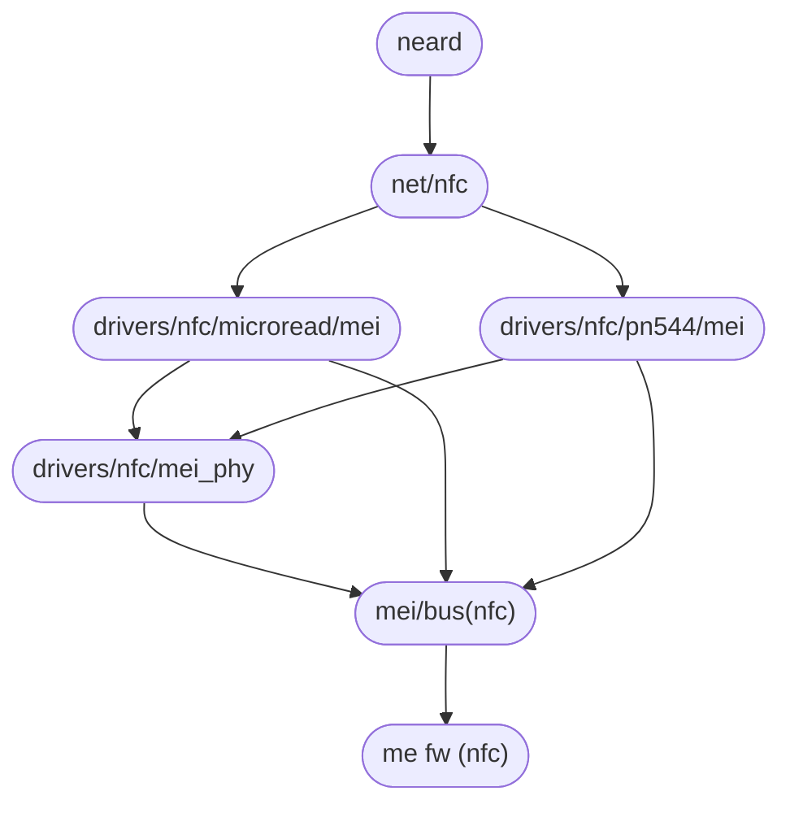

<!-- SPDX-License-Identifier: GPL-2.0 -->

Some Intel 8 and 9 Series chipsets support NFC devices connected behind the Intel Management Engine controller. MEI client bus exposes the NFC chips as NFC phy devices and enables binding with Microread and NXP PN544 NFC device driver from the Linux NFC subsystem.

<strong>MEI NFC</strong> Stack
