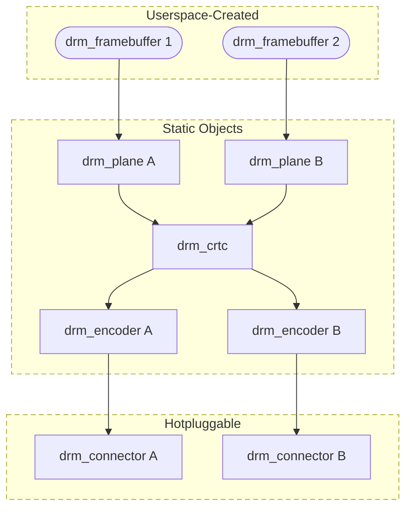
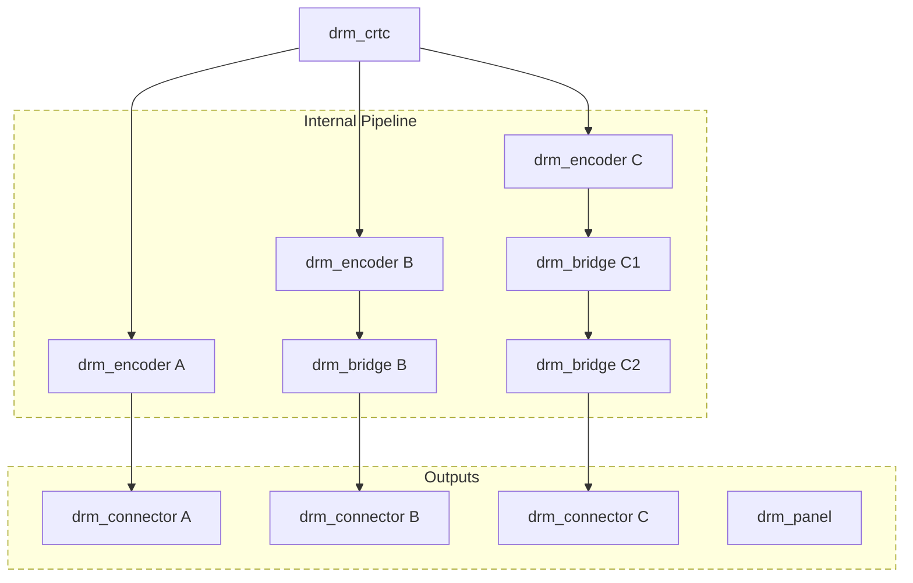
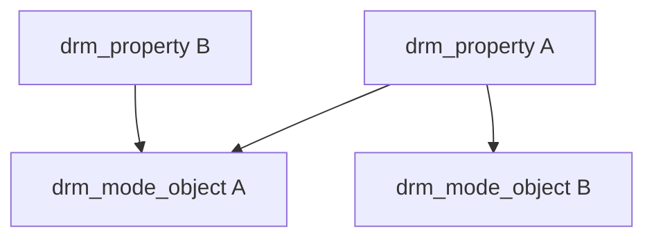
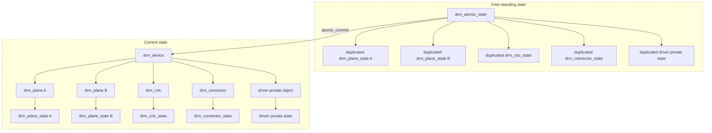

<a id="rst-kernel-mode-setting-kms"></a>

Drivers must initialize the mode setting core by calling drmm\_mode\_config\_init() on the DRM device. The function initializes the `struct drm_device <drm_device>` mode\_config field and never fails. Once done, mode configuration must be setup by initializing the following fields.

- int min\_width, min\_height; int max\_width, max\_height; Minimum and maximum width and height of the frame buffers in pixel units.

- struct drm\_mode\_config\_funcs \*funcs; Mode setting functions.

<a id="rst-overview"></a>

## Overview



KMS Display Pipeline

KMS Display Pipeline Overview

The basic object structure KMS presents to userspace is fairly simple. Framebuffers (represented by `struct drm_framebuffer <drm_framebuffer>`, see [Frame Buffer Abstraction](<#rst-frame-buffer-abstraction>)) feed into planes. Planes are represented by `struct drm_plane <drm_plane>`, see [Plane Abstraction](<#rst-plane-abstraction>) for more details. One or more (or even no) planes feed their pixel data into a CRTC (represented by `struct drm_crtc <drm_crtc>`, see [CRTC Abstraction](<#rst-crtc-abstraction>)) for blending. The precise blending step is explained in more detail in [Plane Composition Properties](<#rst-plane-composition-properties-1>) and related chapters.

For the output routing the first step is encoders (represented by `struct drm_encoder <drm_encoder>`, see [Encoder Abstraction](<#rst-encoder-abstraction>)). Those are really just internal artifacts of the helper libraries used to implement KMS drivers. Besides that they make it unnecessarily more complicated for userspace to figure out which connections between a CRTC and a connector are possible, and what kind of cloning is supported, they serve no purpose in the userspace API. Unfortunately encoders have been exposed to userspace, hence can't remove them at this point.  Furthermore the exposed restrictions are often wrongly set by drivers, and in many cases not powerful enough to express the real restrictions. A CRTC can be connected to multiple encoders, and for an active CRTC there must be at least one encoder.

The final, and real, endpoint in the display chain is the connector (represented by `struct drm_connector <drm_connector>`, see [Connector Abstraction](<#rst-connector-abstraction>)). Connectors can have different possible encoders, but the kernel driver selects which encoder to use for each connector. The use case is DVI, which could switch between an analog and a digital encoder. Encoders can also drive multiple different connectors. There is exactly one active connector for every active encoder.

Internally the output pipeline is a bit more complex and matches today's hardware more closely:



KMS Output Pipeline

KMS Output Pipeline

Internally two additional helper objects come into play. First, to be able to share code for encoders (sometimes on the same SoC, sometimes off-chip) one or more [drm\_bridges](<~kernel/hardware/gpu/drm-kms-helpers#rst-drm-bridges>) (represented by `struct drm_bridge <drm_bridge>`) can be linked to an encoder. This link is static and cannot be changed, which means the cross-bar (if there is any) needs to be mapped between the CRTC and any encoders. Often for drivers with bridges there's no code left at the encoder level. Atomic drivers can leave out all the encoder callbacks to essentially only leave a dummy routing object behind, which is needed for backwards compatibility since encoders are exposed to userspace.

The second object is for panels, represented by `struct drm_panel <drm_panel>`, see [drm\_panel\_helper](<~kernel/hardware/gpu/drm-kms-helpers#rst-drm-panel-helper>). Panels do not have a fixed binding point, but are generally linked to the driver private structure that embeds `struct drm_connector <drm_connector>`.

Note that currently the bridge chaining and interactions with connectors and panels are still in-flux and not really fully sorted out yet.

<a id="rst-kms-core-structures-and-functions"></a>

## KMS Core Structures and Functions

```{kernel-doc} include/drm/drm_mode_config.h
:internal:
```

```{kernel-doc} drivers/gpu/drm/drm_mode_config.c
:export:
```

<a id="rst-modeset-base-object-abstraction"></a>
<a id="rst-kms-base-object-abstraction"></a>

## Modeset Base Object Abstraction



Mode Objects and Properties

Mode Objects and Properties

The base structure for all KMS objects is `struct drm_mode_object <drm_mode_object>`. One of the base services it provides is tracking properties, which are especially important for the atomic IOCTL (see [Atomic Mode Setting](<#rst-atomic-mode-setting>)). The somewhat surprising part here is that properties are not directly instantiated on each object, but free-standing mode objects themselves, represented by `struct drm_property <drm_property>`, which only specify the type and value range of a property. Any given property can be attached multiple times to different objects using drm\_object\_attach\_property().

```{kernel-doc} include/drm/drm_mode_object.h
:internal:
```

```{kernel-doc} drivers/gpu/drm/drm_mode_object.c
:export:
```

<a id="rst-atomic-mode-setting"></a>

## Atomic Mode Setting



Mode Objects and Properties

Mode Objects and Properties

Atomic provides transactional modeset (including planes) updates, but a bit differently from the usual transactional approach of try-commit and rollback:

- Firstly, no hardware changes are allowed when the commit would fail. This allows us to implement the DRM\_MODE\_ATOMIC\_TEST\_ONLY mode, which allows userspace to explore whether certain configurations would work or not.

- This would still allow setting and rollback of just the software state, simplifying conversion of existing drivers. But auditing drivers for correctness of the atomic\_check code becomes really hard with that: Rolling back changes in data structures all over the place is hard to get right.

- Lastly, for backwards compatibility and to support all use-cases, atomic updates need to be incremental and be able to execute in parallel. Hardware doesn't always allow it, but where possible plane updates on different CRTCs should not interfere, and not get stalled due to output routing changing on different CRTCs.

Taken all together there's two consequences for the atomic design:

- The overall state is split up into per-object state structures: `struct drm_plane_state <drm_plane_state>` for planes, `struct drm_crtc_state <drm_crtc_state>` for CRTCs and `struct drm_connector_state <drm_connector_state>` for connectors. These are the only objects with userspace-visible and settable state. For internal state drivers can subclass these structures through embedding, or add entirely new state structures for their globally shared hardware functions, see `struct drm_private_state<drm_private_state>`.

- An atomic update is assembled and validated as an entirely free-standing pile of structures within the `drm_atomic_state <drm_atomic_state>` container. Driver private state structures are also tracked in the same structure; see the next chapter.  Only when a state is committed is it applied to the driver and modeset objects. This way rolling back an update boils down to releasing memory and unreferencing objects like framebuffers.

Locking of atomic state structures is internally using `struct drm_modeset_lock <drm_modeset_lock>`. As a general rule the locking shouldn't be exposed to drivers, instead the right locks should be automatically acquired by any function that duplicates or peeks into a state, like e.g. drm\_atomic\_get\_crtc\_state().  Locking only protects the software data structure, ordering of committing state changes to hardware is sequenced using `struct drm_crtc_commit <drm_crtc_commit>`.

Read on in this chapter, and also in [drm\_atomic\_helper](<~kernel/hardware/gpu/drm-kms-helpers#rst-drm-atomic-helper>) for more detailed coverage of specific topics.

<a id="rst-handling-driver-private-state"></a>

### Handling Driver Private State

```{kernel-doc} drivers/gpu/drm/drm_atomic.c
:doc: handling driver private state
```

<a id="rst-atomic-mode-setting-function-reference"></a>

### Atomic Mode Setting Function Reference

```{kernel-doc} include/drm/drm_atomic.h
:internal:
```

```{kernel-doc} drivers/gpu/drm/drm_atomic.c
:export:
```

<a id="rst-atomic-mode-setting-ioctl-and-uapi-functions"></a>

### Atomic Mode Setting IOCTL and UAPI Functions

```{kernel-doc} drivers/gpu/drm/drm_atomic_uapi.c
:doc: overview
```

```{kernel-doc} drivers/gpu/drm/drm_atomic_uapi.c
:export:
```

<a id="rst-crtc-abstraction"></a>

## CRTC Abstraction

```{kernel-doc} drivers/gpu/drm/drm_crtc.c
:doc: overview
```

<a id="rst-crtc-functions-reference"></a>

### CRTC Functions Reference

```{kernel-doc} include/drm/drm_crtc.h
:internal:
```

```{kernel-doc} drivers/gpu/drm/drm_crtc.c
:export:
```

<a id="rst-color-management-functions-reference"></a>

### Color Management Functions Reference

```{kernel-doc} drivers/gpu/drm/drm_color_mgmt.c
:export:
```

```{kernel-doc} include/drm/drm_color_mgmt.h
:internal:
```

<a id="rst-frame-buffer-abstraction"></a>

## Frame Buffer Abstraction

```{kernel-doc} drivers/gpu/drm/drm_framebuffer.c
:doc: overview
```

<a id="rst-frame-buffer-functions-reference"></a>

### Frame Buffer Functions Reference

```{kernel-doc} include/drm/drm_framebuffer.h
:internal:
```

```{kernel-doc} drivers/gpu/drm/drm_framebuffer.c
:export:
```

<a id="rst-drm-format-handling"></a>

## DRM Format Handling

```{kernel-doc} include/uapi/drm/drm_fourcc.h
:doc: overview
```

<a id="rst-format-functions-reference"></a>

### Format Functions Reference

```{kernel-doc} include/drm/drm_fourcc.h
:internal:
```

```{kernel-doc} drivers/gpu/drm/drm_fourcc.c
:export:
```

<a id="rst-dumb-buffer-objects"></a>
<a id="rst-kms-dumb-buffer-objects"></a>

## Dumb Buffer Objects

```{kernel-doc} drivers/gpu/drm/drm_dumb_buffers.c
:doc: overview
```

<a id="rst-plane-abstraction"></a>

## Plane Abstraction

```{kernel-doc} drivers/gpu/drm/drm_plane.c
:doc: overview
```

<a id="rst-plane-functions-reference"></a>

### Plane Functions Reference

```{kernel-doc} include/drm/drm_plane.h
:internal:
```

```{kernel-doc} drivers/gpu/drm/drm_plane.c
:export:
```

<a id="rst-plane-composition-functions-reference"></a>

### Plane Composition Functions Reference

```{kernel-doc} drivers/gpu/drm/drm_blend.c
:export:
```

<a id="rst-plane-damage-tracking-functions-reference"></a>

### Plane Damage Tracking Functions Reference

```{kernel-doc} drivers/gpu/drm/drm_damage_helper.c
:export:
```

```{kernel-doc} include/drm/drm_damage_helper.h
:internal:
```

<a id="rst-plane-panic-feature"></a>

### Plane Panic Feature

```{kernel-doc} drivers/gpu/drm/drm_panic.c
:doc: overview
```

<a id="rst-plane-panic-functions-reference"></a>

### Plane Panic Functions Reference

```{kernel-doc} include/drm/drm_panic.h
:internal:
```

```{kernel-doc} drivers/gpu/drm/drm_panic.c
:export:
```

<a id="rst-colorop-abstraction"></a>

## Colorop Abstraction

```{kernel-doc} drivers/gpu/drm/drm_colorop.c
:doc: overview
```

<a id="rst-colorop-functions-reference"></a>

### Colorop Functions Reference

```{kernel-doc} include/drm/drm_colorop.h
:internal:
```

```{kernel-doc} drivers/gpu/drm/drm_colorop.c
:export:
```

<a id="rst-display-modes-function-reference"></a>

## Display Modes Function Reference

```{kernel-doc} include/drm/drm_modes.h
:internal:
```

```{kernel-doc} drivers/gpu/drm/drm_modes.c
:export:
```

<a id="rst-connector-abstraction"></a>

## Connector Abstraction

```{kernel-doc} drivers/gpu/drm/drm_connector.c
:doc: overview
```

<a id="rst-connector-functions-reference"></a>

### Connector Functions Reference

```{kernel-doc} include/drm/drm_connector.h
:internal:
```

```{kernel-doc} drivers/gpu/drm/drm_connector.c
:export:
```

<a id="rst-writeback-connectors"></a>

### Writeback Connectors

```{kernel-doc} drivers/gpu/drm/drm_writeback.c
:doc: overview
```

```{kernel-doc} include/drm/drm_writeback.h
:internal:
```

```{kernel-doc} drivers/gpu/drm/drm_writeback.c
:export:
```

<a id="rst-encoder-abstraction"></a>

## Encoder Abstraction

```{kernel-doc} drivers/gpu/drm/drm_encoder.c
:doc: overview
```

<a id="rst-encoder-functions-reference"></a>

### Encoder Functions Reference

```{kernel-doc} include/drm/drm_encoder.h
:internal:
```

```{kernel-doc} drivers/gpu/drm/drm_encoder.c
:export:
```

<a id="rst-kms-locking"></a>

## KMS Locking

```{kernel-doc} drivers/gpu/drm/drm_modeset_lock.c
:doc: kms locking
```

```{kernel-doc} include/drm/drm_modeset_lock.h
:internal:
```

```{kernel-doc} drivers/gpu/drm/drm_modeset_lock.c
:export:
```

<a id="rst-kms-properties"></a>

## KMS Properties

This section of the documentation is primarily aimed at user-space developers. For the driver APIs, see the other sections.

<a id="rst-requirements"></a>

### Requirements

KMS drivers might need to add extra properties to support new features. Each new property introduced in a driver needs to meet a few requirements, in addition to the one mentioned above:

- It must be standardized, documenting:

  - The full, exact, name string;

  - If the property is an enum, all the valid value name strings;

  - What values are accepted, and what these values mean;

  - What the property does and how it can be used;

  - How the property might interact with other, existing properties.

- It must provide a generic helper in the core code to register that property on the object it attaches to.

- Its content must be decoded by the core and provided in the object's associated state structure. That includes anything drivers might want to precompute, like struct drm\_clip\_rect for planes.

- Its initial state must match the behavior prior to the property introduction. This might be a fixed value matching what the hardware does, or it may be inherited from the state the firmware left the system in during boot.

- An IGT test must be submitted where reasonable.

For historical reasons, non-standard, driver-specific properties exist. If a KMS driver wants to add support for one of those properties, the requirements for new properties apply where possible. Additionally, the documented behavior must match the de facto semantics of the existing property to ensure compatibility. Developers of the driver that first added the property should help with those tasks and must ACK the documented behavior if possible.

<a id="rst-property-types-and-blob-property-support"></a>

### Property Types and Blob Property Support

```{kernel-doc} drivers/gpu/drm/drm_property.c
:doc: overview
```

```{kernel-doc} include/drm/drm_property.h
:internal:
```

```{kernel-doc} drivers/gpu/drm/drm_property.c
:export:
```

<a id="rst-standard-connector-properties-1"></a>
<a id="rst-standard-connector-properties"></a>

### Standard Connector Properties

```{kernel-doc} drivers/gpu/drm/drm_connector.c
:doc: standard connector properties
```

<a id="rst-hdmi-specific-connector-properties"></a>

### HDMI Specific Connector Properties

```{kernel-doc} drivers/gpu/drm/drm_connector.c
:doc: HDMI connector properties
```

<a id="rst-analog-tv-specific-connector-properties"></a>

### Analog TV Specific Connector Properties

```{kernel-doc} drivers/gpu/drm/drm_connector.c
:doc: Analog TV Connector Properties
```

<a id="rst-standard-crtc-properties"></a>

### Standard CRTC Properties

```{kernel-doc} drivers/gpu/drm/drm_crtc.c
:doc: standard CRTC properties
```

<a id="rst-standard-plane-properties"></a>

### Standard Plane Properties

```{kernel-doc} drivers/gpu/drm/drm_plane.c
:doc: standard plane properties
```

<a id="rst-plane-composition-properties-1"></a>
<a id="rst-plane-composition-properties"></a>

### Plane Composition Properties

```{kernel-doc} drivers/gpu/drm/drm_blend.c
:doc: overview
```

<a id="rst-damage-tracking-properties-1"></a>
<a id="rst-damage-tracking-properties"></a>

### Damage Tracking Properties

```{kernel-doc} drivers/gpu/drm/drm_plane.c
:doc: damage tracking
```

<a id="rst-color-management-properties"></a>

### Color Management Properties

```{kernel-doc} drivers/gpu/drm/drm_color_mgmt.c
:doc: overview
```

<a id="rst-tile-group-property"></a>

### Tile Group Property

```{kernel-doc} drivers/gpu/drm/drm_connector.c
:doc: Tile group
```

<a id="rst-explicit-fencing-properties"></a>

### Explicit Fencing Properties

```{kernel-doc} drivers/gpu/drm/drm_atomic_uapi.c
:doc: explicit fencing properties
```

<a id="rst-variable-refresh-properties"></a>

### Variable Refresh Properties

```{kernel-doc} drivers/gpu/drm/drm_connector.c
:doc: Variable refresh properties
```

<a id="rst-cursor-hotspot-properties"></a>

### Cursor Hotspot Properties

```{kernel-doc} drivers/gpu/drm/drm_plane.c
:doc: hotspot properties
```

<a id="rst-existing-kms-properties"></a>

### Existing KMS Properties

The following table gives description of drm properties exposed by various modules/drivers. Because this table is very unwieldy, do not add any new properties here. Instead document them in a section above.


```{kernel-include} docs/sources/gpu/kms-properties.csv
:csv:
:header-rows: 1
```

<a id="rst-vertical-blanking"></a>

## Vertical Blanking

```{kernel-doc} drivers/gpu/drm/drm_vblank.c
:doc: vblank handling
```

<a id="rst-vertical-blanking-and-interrupt-handling-functions-reference"></a>

### Vertical Blanking and Interrupt Handling Functions Reference

```{kernel-doc} include/drm/drm_vblank.h
:internal:
```

```{kernel-doc} drivers/gpu/drm/drm_vblank.c
:export:
```

<a id="rst-vertical-blank-work"></a>

## Vertical Blank Work

```{kernel-doc} drivers/gpu/drm/drm_vblank_work.c
:doc: vblank works
```

<a id="rst-vertical-blank-work-functions-reference"></a>

### Vertical Blank Work Functions Reference

```{kernel-doc} include/drm/drm_vblank_work.h
:internal:
```

```{kernel-doc} drivers/gpu/drm/drm_vblank_work.c
:export:
```
