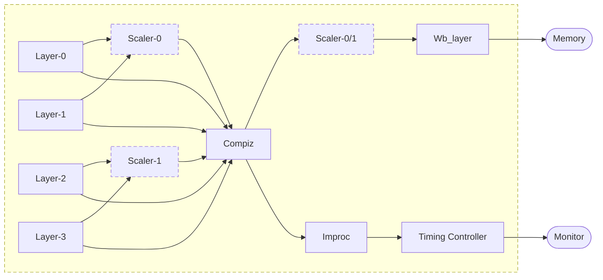
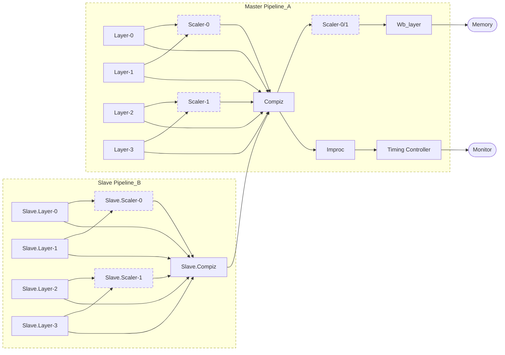
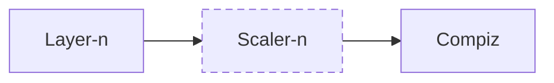
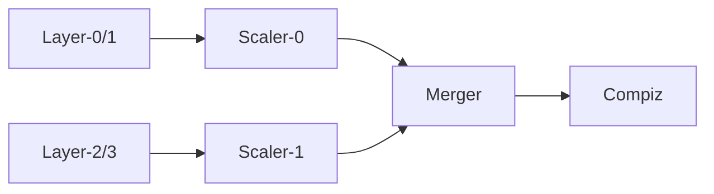
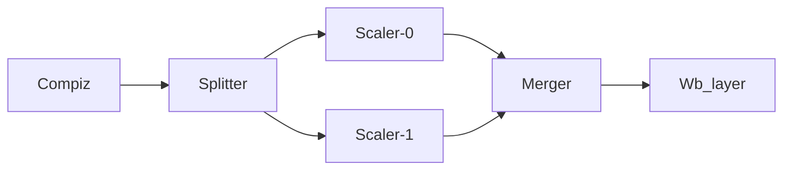

<a id="rst-drm-komeda-arm-display-driver"></a>

<!-- SPDX-License-Identifier: GPL-2.0 -->

The drm/komeda driver supports the Arm display processor D71 and later products, this document gives a brief overview of driver design: how it works and why design it like that.

<a id="rst-overview-of-d71-like-display-ips"></a>

## Overview of D71 like display IPs

From D71, Arm display IP begins to adopt a flexible and modularized architecture. A display pipeline is made up of multiple individual and functional pipeline stages called components, and every component has some specific capabilities that can give the flowed pipeline pixel data a particular processing.

Typical D71 components:

<a id="rst-layer"></a>

### Layer

Layer is the first pipeline stage, which prepares the pixel data for the next stage. It fetches the pixel from memory, decodes it if it's AFBC, rotates the source image, unpacks or converts YUV pixels to the device internal RGB pixels, then adjusts the color_space of pixels if needed.

<a id="rst-scaler"></a>

### Scaler

As its name suggests, scaler takes responsibility for scaling, and D71 also supports image enhancements by scaler. The usage of scaler is very flexible and can be connected to layer output for layer scaling, or connected to compositor and scale the whole display frame and then feed the output data into wb_layer which will then write it into memory.

<a id="rst-compositor-compiz"></a>

### Compositor (compiz)

Compositor blends multiple layers or pixel data flows into one single display frame. its output frame can be fed into post image processor for showing it on the monitor or fed into wb_layer and written to memory at the same time. user can also insert a scaler between compositor and wb_layer to down scale the display frame first and then write to memory.

<a id="rst-writeback-layer-wb-layer"></a>

### Writeback Layer (wb_layer)

Writeback layer does the opposite things of Layer, which connects to compiz and writes the composition result to memory.

<a id="rst-post-image-processor-improc"></a>

### Post image processor (improc)

Post image processor adjusts frame data like gamma and color space to fit the requirements of the monitor.

<a id="rst-timing-controller-timing-ctrlr"></a>

### Timing controller (timing_ctrlr)

Final stage of display pipeline, Timing controller is not for the pixel handling, but only for controlling the display timing.

<a id="rst-merger"></a>

### Merger

D71 scaler mostly only has the half horizontal input/output capabilities compared with Layer, like if Layer supports 4K input size, the scaler only can support 2K input/output in the same time. To achieve the ful frame scaling, D71 introduces Layer Split, which splits the whole image to two half parts and feeds them to two Layers A and B, and does the scaling independently. After scaling the result need to be fed to merger to merge two part images together, and then output merged result to compiz.

<a id="rst-splitter"></a>

### Splitter

Similar to Layer Split, but Splitter is used for writeback, which splits the compiz result to two parts and then feed them to two scalers.

<a id="rst-possible-d71-pipeline-usage"></a>

## Possible D71 Pipeline usage

Benefitting from the modularized architecture, D71 pipelines can be easily adjusted to fit different usages. And D71 has two pipelines, which support two types of working mode:

- Dual display mode Two pipelines work independently and separately to drive two display outputs.

- Single display mode Two pipelines work together to drive only one display output.

  On this mode, pipeline_B doesn't work independently, but outputs its composition result into pipeline_A, and its pixel timing also derived from pipeline_A.timing_ctrlr. The pipeline_B works just like a "slave" of pipeline_A(master)

<a id="rst-single-pipeline-data-flow"></a>

### Single pipeline data flow



Single pipeline data flow

<a id="rst-dual-pipeline-with-slave-enabled"></a>

### Dual pipeline with Slave enabled



Slave pipeline enabled data flow

<a id="rst-sub-pipelines-for-input-and-output"></a>

### Sub-pipelines for input and output

A complete display pipeline can be easily divided into three sub-pipelines according to the in/out usage.

<a id="rst-layer-input-pipeline"></a>

#### Layer(input) pipeline



Layer (input) data flow



Layer Split pipeline

<a id="rst-writeback-output-pipeline"></a>

#### Writeback(output) pipeline


Writeback(output) data flow



Writeback(output) Split data flow

<a id="rst-display-output-pipeline"></a>

#### Display output pipeline


display output data flow

In the following section we'll see these three sub-pipelines will be handled by KMS-plane/wb_conn/crtc respectively.

<a id="rst-komeda-resource-abstraction"></a>

## Komeda Resource abstraction

<a id="rst-struct-komeda-pipeline-component"></a>

### struct komeda_pipeline/component

To fully utilize and easily access/configure the HW, the driver side also uses a similar architecture: Pipeline/Component to describe the HW features and capabilities, and a specific component includes two parts:

- Data flow controlling.

- Specific component capabilities and features.

So the driver defines a common header struct komeda_component to describe the data flow control and all specific components are a subclass of this base structure.

```{kernel-doc} drivers/gpu/drm/arm/display/komeda/komeda_pipeline.h
:internal:
```

<a id="rst-resource-discovery-and-initialization"></a>

## Resource discovery and initialization

Pipeline and component are used to describe how to handle the pixel data. We still need a @struct komeda_dev to describe the whole view of the device, and the control-abilites of device.

We have &amp;komeda_dev, &amp;komeda_pipeline, &amp;komeda_component. Now fill devices with pipelines. Since komeda is not for D71 only but also intended for later products, of course we’d better share as much as possible between different products. To achieve this, split the komeda device into two layers: CORE and CHIP.

- CORE: for common features and capabilities handling.

- CHIP: for register programming and HW specific feature (limitation) handling.

CORE can access CHIP by three chip function structures:

- struct komeda_dev_funcs

- struct komeda_pipeline_funcs

- struct komeda_component_funcs

```{kernel-doc} drivers/gpu/drm/arm/display/komeda/komeda_dev.h
:internal:
```

<a id="rst-format-handling"></a>

## Format handling

```{kernel-doc} drivers/gpu/drm/arm/display/komeda/komeda_format_caps.h
:internal:
```

```{kernel-doc} drivers/gpu/drm/arm/display/komeda/komeda_framebuffer.h
:internal:
```

<a id="rst-attach-komeda-dev-to-drm-kms"></a>

## Attach komeda_dev to DRM-KMS

Komeda abstracts resources by pipeline/component, but DRM-KMS uses crtc/plane/connector. One KMS-obj cannot represent only one single component, since the requirements of a single KMS object cannot simply be achieved by a single component, usually that needs multiple components to fit the requirement. Like set mode, gamma, ctm for KMS all target on CRTC-obj, but komeda needs compiz, improc and timing_ctrlr to work together to fit these requirements. And a KMS-Plane may require multiple komeda resources: layer/scaler/compiz.

So, one KMS-Obj represents a sub-pipeline of komeda resources.

- Plane: [Layer(input) pipeline](<#rst-layer-input-pipeline>)

- Wb_connector: [Writeback(output) pipeline](<#rst-writeback-output-pipeline>)

- Crtc: [Display output pipeline](<#rst-display-output-pipeline>)

So, for komeda, we treat KMS crtc/plane/connector as users of pipeline and component, and at any one time a pipeline/component only can be used by one user. And pipeline/component will be treated as private object of DRM-KMS; the state will be managed by drm_atomic_state as well.

<a id="rst-how-to-map-plane-to-layer-input-pipeline"></a>

### How to map plane to Layer(input) pipeline

Komeda has multiple Layer input pipelines, see: -   [Single pipeline data flow](<#rst-single-pipeline-data-flow>) -   [Dual pipeline with Slave enabled](<#rst-dual-pipeline-with-slave-enabled>)

The easiest way is binding a plane to a fixed Layer pipeline, but consider the komeda capabilities:

- Layer Split, See [Layer(input) pipeline](<#rst-layer-input-pipeline>)

  Layer_Split is quite complicated feature, which splits a big image into two parts and handles it by two layers and two scalers individually. But it imports an edge problem or effect in the middle of the image after the split. To avoid such a problem, it needs a complicated Split calculation and some special configurations to the layer and scaler. We'd better hide such HW related complexity to user mode.

- Slave pipeline, See [Dual pipeline with Slave enabled](<#rst-dual-pipeline-with-slave-enabled>)

  Since the compiz component doesn't output alpha value, the slave pipeline only can be used for bottom layers composition. The komeda driver wants to hide this limitation to the user. The way to do this is to pick a suitable Layer according to plane_state-&gt;zpos.

So for komeda, the KMS-plane doesn't represent a fixed komeda layer pipeline, but multiple Layers with same capabilities. Komeda will select one or more Layers to fit the requirement of one KMS-plane.

<a id="rst-make-component-pipeline-to-be-drm-private-obj"></a>

### Make component/pipeline to be drm_private_obj

Add `drm_private_obj` to `komeda_component`, `komeda_pipeline`


```c
struct komeda_component {
    struct drm_private_obj obj;
    ...
}

struct komeda_pipeline {
    struct drm_private_obj obj;
    ...
}
```

<a id="rst-tracking-component-state-pipeline-state-by-drm-atomic-state"></a>

### Tracking component_state/pipeline_state by drm_atomic_state

Add `drm_private_state` and user to `komeda_component_state`, `komeda_pipeline_state`


```c
struct komeda_component_state {
    struct drm_private_state obj;
    void *binding_user;
    ...
}

struct komeda_pipeline_state {
    struct drm_private_state obj;
    struct drm_crtc *crtc;
    ...
}
```

<a id="rst-komeda-component-validation"></a>

### komeda component validation

Komeda has multiple types of components, but the process of validation are similar, usually including the following steps:


```c
int komeda_xxxx_validate(struct komeda_component_xxx xxx_comp,
            struct komeda_component_output *input_dflow,
            struct drm_plane/crtc/connector *user,
            struct drm_plane/crtc/connector_state, *user_state)
{
     setup 1: check if component is needed, like the scaler is optional depending
              on the user_state; if unneeded, just return, and the caller will
              put the data flow into next stage.
     Setup 2: check user_state with component features and capabilities to see
              if requirements can be met; if not, return fail.
     Setup 3: get component_state from drm_atomic_state, and try set to set
              user to component; fail if component has been assigned to another
              user already.
     Setup 3: configure the component_state, like set its input component,
              convert user_state to component specific state.
     Setup 4: adjust the input_dflow and prepare it for the next stage.
}
```

<a id="rst-komeda-kms-abstraction"></a>

### komeda_kms Abstraction

```{kernel-doc} drivers/gpu/drm/arm/display/komeda/komeda_kms.h
:internal:
```

<a id="rst-komde-kms-functions"></a>

### komde_kms Functions

```{kernel-doc} drivers/gpu/drm/arm/display/komeda/komeda_crtc.c
:internal:
```

```{kernel-doc} drivers/gpu/drm/arm/display/komeda/komeda_plane.c
:internal:
```

<a id="rst-build-komeda-to-be-a-linux-module-driver"></a>

## Build komeda to be a Linux module driver

Now we have two level devices:

- komeda_dev: describes the real display hardware.

- komeda_kms_dev: attaches or connects komeda_dev to DRM-KMS.

All komeda operations are supplied or operated by komeda_dev or komeda_kms_dev, the module driver is only a simple wrapper to pass the Linux command (probe/remove/pm) into komeda_dev or komeda_kms_dev.
