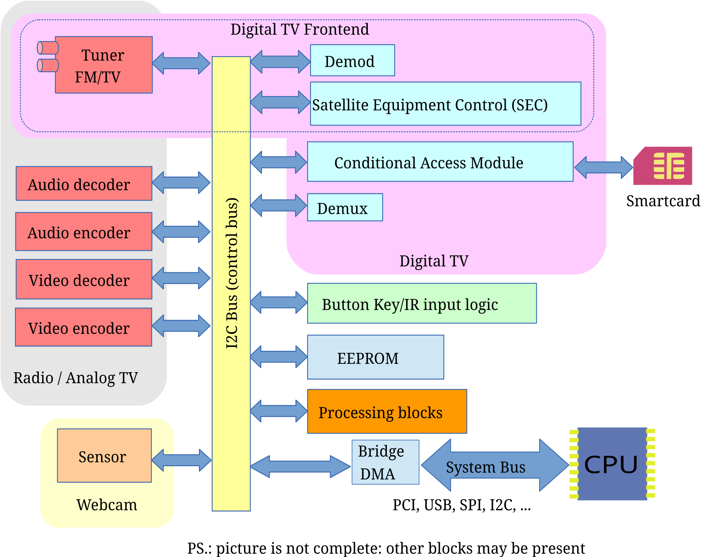

<!-- SPDX-License-Identifier: GPL-2.0 -->

This document covers the Linux Kernel to Userspace API's used by video and radio streaming devices, including video cameras, analog and digital TV receiver cards, AM/FM receiver cards, Software Defined Radio (SDR), streaming capture and output devices, codec devices and remote controllers.

A typical media device hardware is shown at [typical_media_device](<#rst-typical-media-device>).

Typical Media Device

The media infrastructure API was designed to control such devices. It is divided into five parts.

1. The [first part](<~kernel/userspace/userspace-api/media-v4l/v4l2#rst-v4l2spec>) covers radio, video capture and output, cameras, analog TV devices and codecs.

2. The [second part](<~kernel/userspace/userspace-api/media-dvb/dvbapi#rst-dvbapi>) covers the API used for digital TV and Internet reception via one of the several digital tv standards. While it is called as DVB API, in fact it covers several different video standards including DVB-T/T2, DVB-S/S2, DVB-C, ATSC, ISDB-T, ISDB-S, DTMB, etc. The complete list of supported standards can be found at `fe_delivery_system`.

3. The [third part](<~kernel/userspace/userspace-api/media-rc/remote-controllers#rst-remote-controllers>) covers the Remote Controller API.

4. The [fourth part](<~kernel/userspace/userspace-api/media-mediactl/media-controller#rst-media-controller>) covers the Media Controller API.

5. The [fifth part](<~kernel/userspace/userspace-api/media-cec/cec-api#rst-cec>) covers the CEC (Consumer Electronics Control) API.

It should also be noted that a media device may also have audio components, like mixers, PCM capture, PCM playback, etc, which are controlled via ALSA API.  For additional information and for the latest development code, see: [https://linuxtv.org](<https://linuxtv.org>).  For discussing improvements, reporting troubles, sending new drivers, etc, please mail to: [Linux Media Mailing List (LMML)](<http://vger.kernel.org/vger-lists.html#linux-media>).
