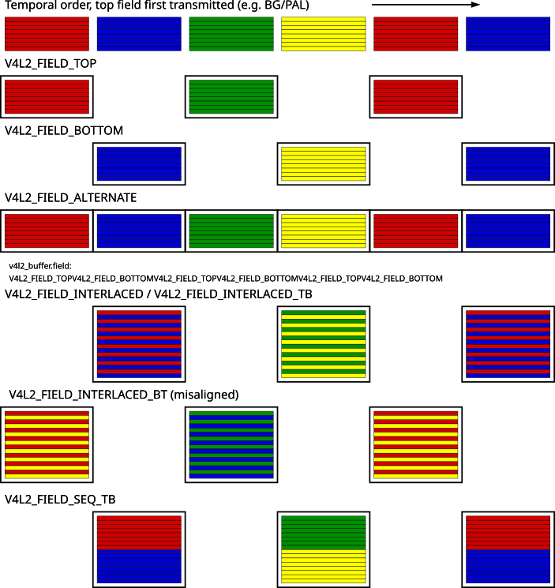
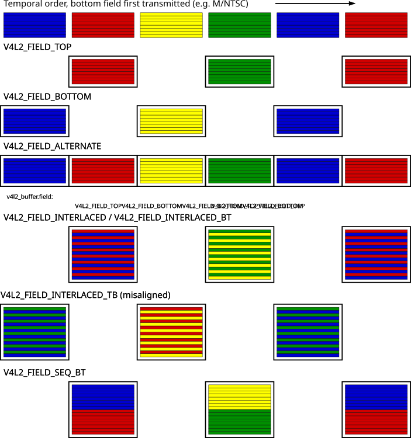

<a id="rst-field-order-1"></a>
<a id="rst-field-order"></a>

<!-- SPDX-License-Identifier: GFDL-1.1-no-invariants-or-later -->

<!-- c:namespace: V4L -->

We have to distinguish between progressive and interlaced video. Progressive video transmits all lines of a video image sequentially. Interlaced video divides an image into two fields, containing only the odd and even lines of the image, respectively. Alternating the so called odd and even field are transmitted, and due to a small delay between fields a cathode ray TV displays the lines interleaved, yielding the original frame. This curious technique was invented because at refresh rates similar to film the image would fade out too quickly. Transmitting fields reduces the flicker without the necessity of doubling the frame rate and with it the bandwidth required for each channel.

It is important to understand a video camera does not expose one frame at a time, merely transmitting the frames separated into fields. The fields are in fact captured at two different instances in time. An object on screen may well move between one field and the next. For applications analysing motion it is of paramount importance to recognize which field of a frame is older, the *temporal order*.

When the driver provides or accepts images field by field rather than interleaved, it is also important applications understand how the fields combine to frames. We distinguish between top (aka odd) and bottom (aka even) fields, the *spatial order*: The first line of the top field is the first line of an interlaced frame, the first line of the bottom field is the second line of that frame.

However because fields were captured one after the other, arguing whether a frame commences with the top or bottom field is pointless. Any two successive top and bottom, or bottom and top fields yield a valid frame. Only when the source was progressive to begin with, e. g. when transferring film to video, two fields may come from the same frame, creating a natural order.

Counter to intuition the top field is not necessarily the older field. Whether the older field contains the top or bottom lines is a convention determined by the video standard. Hence the distinction between temporal and spatial order of fields. The diagrams below should make this clearer.

In V4L it is assumed that all video cameras transmit fields on the media bus in the same order they were captured, so if the top field was captured first (is the older field), the top field is also transmitted first on the bus.

All video capture and output devices must report the current field order. Some drivers may permit the selection of a different order, to this end applications initialize the `field` field of struct `v4l2_pix_format` before calling the [VIDIOC_S_FMT](<~kernel/userspace/userspace-api/media-v4l/vidioc-g-fmt#rst-vidioc-g-fmt>) ioctl. If this is not desired it should have the value `V4L2_FIELD_ANY` (0).

<a id="rst-enum-v4l2-field"></a>

## enum v4l2_field


<a id="c-v4l2_field"></a>

```c
v4l2_field
```

<!-- tabularcolumns: |p{5.8cm}|p{0.6cm}|p{10.9cm}| -->


<table>
<tbody>
<tr>
<td>


`V4L2_FIELD_ANY`

</td>
<td>


0

</td>
<td>


Applications request this field order when any field format is acceptable. Drivers choose depending on hardware capabilities or e.g. the requested image size, and return the actual field order. Drivers must never return `V4L2_FIELD_ANY`. If multiple field orders are possible the driver must choose one of the possible field orders during [VIDIOC_S_FMT](<~kernel/userspace/userspace-api/media-v4l/vidioc-g-fmt#rst-vidioc-g-fmt>) or [VIDIOC_TRY_FMT](<~kernel/userspace/userspace-api/media-v4l/vidioc-g-fmt#rst-vidioc-g-fmt>). struct `v4l2_buffer` `field` can never be `V4L2_FIELD_ANY`.

</td>
</tr>
<tr>
<td>


`V4L2_FIELD_NONE`

</td>
<td>


1

</td>
<td>


Images are in progressive (frame-based) format, not interlaced (field-based).

</td>
</tr>
<tr>
<td>


`V4L2_FIELD_TOP`

</td>
<td>


2

</td>
<td>


Images consist of the top (aka odd) field only.

</td>
</tr>
<tr>
<td>


`V4L2_FIELD_BOTTOM`

</td>
<td>


3

</td>
<td>


Images consist of the bottom (aka even) field only. Applications may wish to prevent a device from capturing interlaced images because they will have "comb" or "feathering" artefacts around moving objects.

</td>
</tr>
<tr>
<td>


`V4L2_FIELD_INTERLACED`

</td>
<td>


4

</td>
<td>


Images contain both fields, interleaved line by line. The temporal order of the fields (whether the top or bottom field is older) depends on the current video standard. In M/NTSC the bottom field is the older field. In all other standards the top field is the older field.

</td>
</tr>
<tr>
<td>


`V4L2_FIELD_SEQ_TB`

</td>
<td>


5

</td>
<td>


Images contain both fields, the top field lines are stored first in memory, immediately followed by the bottom field lines. Fields are always stored in temporal order, the older one first in memory. Image sizes refer to the frame, not fields.

</td>
</tr>
<tr>
<td>


`V4L2_FIELD_SEQ_BT`

</td>
<td>


6

</td>
<td>


Images contain both fields, the bottom field lines are stored first in memory, immediately followed by the top field lines. Fields are always stored in temporal order, the older one first in memory. Image sizes refer to the frame, not fields.

</td>
</tr>
<tr>
<td>


`V4L2_FIELD_ALTERNATE`

</td>
<td>


7

</td>
<td>


The two fields of a frame are passed in separate buffers, in temporal order, i. e. the older one first. To indicate the field parity (whether the current field is a top or bottom field) the driver or application, depending on data direction, must set struct `v4l2_buffer` `field` to `V4L2_FIELD_TOP` or `V4L2_FIELD_BOTTOM`. Any two successive fields pair to build a frame. If fields are successive, without any dropped fields between them (fields can drop individually), can be determined from the struct `v4l2_buffer` `sequence` field. This format cannot be selected when using the read/write I/O method since there is no way to communicate if a field was a top or bottom field.

</td>
</tr>
<tr>
<td>


`V4L2_FIELD_INTERLACED_TB`

</td>
<td>


8

</td>
<td>


Images contain both fields, interleaved line by line, top field first. The top field is the older field.

</td>
</tr>
<tr>
<td>


`V4L2_FIELD_INTERLACED_BT`

</td>
<td>


9

</td>
<td>


Images contain both fields, interleaved line by line, top field first. The bottom field is the older field.

</td>
</tr>
</tbody>
</table>

<a id="rst-field-order-top-field-first-transmitted"></a>
<a id="rst-fieldseq-tb"></a>

## Field Order, Top Field First Transmitted



Field Order, Top Field First Transmitted

<a id="rst-field-order-bottom-field-first-transmitted"></a>
<a id="rst-fieldseq-bt"></a>

## Field Order, Bottom Field First Transmitted



Field Order, Bottom Field First Transmitted
