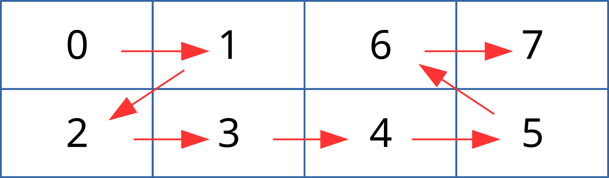
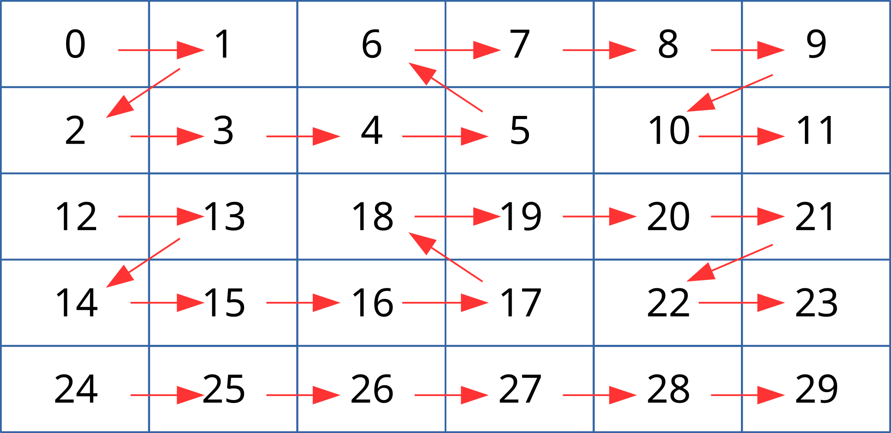
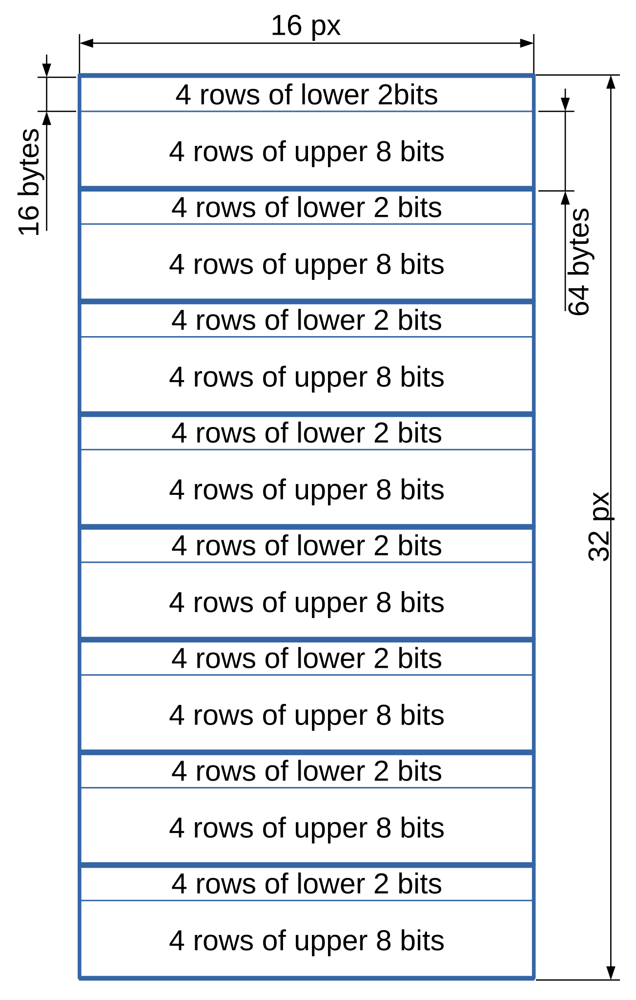

<!-- SPDX-License-Identifier: GFDL-1.1-no-invariants-or-later -->

<!-- c:namespace: V4L -->

<!-- planar-yuv: -->

Planar formats split luma and chroma data in separate memory regions. They exist in two variants:

- Semi-planar formats use two planes. The first plane is the luma plane and stores the Y components. The second plane is the chroma plane and stores the Cb and Cr components interleaved.

- Fully planar formats use three planes to store the Y, Cb and Cr components separately.

Within a plane, components are stored in pixel order, which may be linear or tiled. Padding may be supported at the end of the lines, and the line stride of the chroma planes may be constrained by the line stride of the luma plane.

Some planar formats allow planes to be placed in independent memory locations. They are identified by an 'M' suffix in their name (such as in `V4L2_PIX_FMT_NV12M`). Those formats are intended to be used only in drivers and applications that support the multi-planar API, described in [planar-apis](<~kernel/userspace/userspace-api/media-v4l/planar-apis#rst-planar-apis>). Unless explicitly documented as supporting non-contiguous planes, formats require the planes to follow each other immediately in memory.

## Semi-Planar YUV Formats

These formats are commonly referred to as NV formats (NV12, NV16, ...). They use two planes, and store the luma components in the first plane and the chroma components in the second plane. The Cb and Cr components are interleaved in the chroma plane, with Cb and Cr always stored in pairs. The chroma order is exposed as different formats.

For memory contiguous formats, the number of padding pixels at the end of the chroma lines is identical to the padding of the luma lines. Without horizontal subsampling, the chroma line stride (in bytes) is thus equal to twice the luma line stride. With horizontal subsampling by 2, the chroma line stride is equal to the luma line stride. Vertical subsampling doesn't affect the line stride.

For non-contiguous formats, no constraints are enforced by the format on the relationship between the luma and chroma line padding and stride.

All components are stored with the same number of bits per component.

<!-- Source LaTeX layout: \footnotesize -->

<!-- tabularcolumns: |p{5.2cm}|p{1.0cm}|p{1.5cm}|p{1.9cm}|p{1.2cm}|p{1.8cm}|p{2.7cm}| -->

<table>
<caption>

Overview of Semi-Planar YUV Formats

</caption>
<thead>
<tr>
<th>

Identifier

</th>
<th>

Code

</th>
<th>

Bits per component

</th>
<th>

Subsampling

</th>
<th>

Chroma order [1](#rst-footnote-1)

</th>
<th>

Contiguous [2](#rst-footnote-2)

</th>
<th>

Tiling [3](#rst-footnote-3)

</th>
</tr>
</thead>
<tbody>
<tr>
<td>

V4L2\_PIX\_FMT\_NV12

</td>
<td>

'NV12'

</td>
<td>

8

</td>
<td>

4:2:0

</td>
<td>

Cb, Cr

</td>
<td>

Yes

</td>
<td>

Linear

</td>
</tr>
<tr>
<td>

V4L2\_PIX\_FMT\_NV21

</td>
<td>

'NV21'

</td>
<td>

8

</td>
<td>

4:2:0

</td>
<td>

Cr, Cb

</td>
<td>

Yes

</td>
<td>

Linear

</td>
</tr>
<tr>
<td>

V4L2\_PIX\_FMT\_NV12M

</td>
<td>

'NM12'

</td>
<td>

8

</td>
<td>

4:2:0

</td>
<td>

Cb, Cr

</td>
<td>

No

</td>
<td>

Linear

</td>
</tr>
<tr>
<td>

V4L2\_PIX\_FMT\_NV21M

</td>
<td>

'NM21'

</td>
<td>

8

</td>
<td>

4:2:0

</td>
<td>

Cr, Cb

</td>
<td>

No

</td>
<td>

Linear

</td>
</tr>
<tr>
<td>

V4L2\_PIX\_FMT\_NV12MT

</td>
<td>

'TM12'

</td>
<td>

8

</td>
<td>

4:2:0

</td>
<td>

Cb, Cr

</td>
<td>

No

</td>
<td>

64x32 tiles

Horizontal Z order

</td>
</tr>
<tr>
<td>

V4L2\_PIX\_FMT\_NV12MT\_16X16

</td>
<td>

'VM12'

</td>
<td>

8

</td>
<td>

4:2:2

</td>
<td>

Cb, Cr

</td>
<td>

No

</td>
<td>

16x16 tiles

</td>
</tr>
<tr>
<td>

V4L2\_PIX\_FMT\_P010

</td>
<td>

'P010'

</td>
<td>

10

</td>
<td>

4:2:0

</td>
<td>

Cb, Cr

</td>
<td>

Yes

</td>
<td>

Linear

</td>
</tr>
<tr>
<td>

V4L2\_PIX\_FMT\_P010\_4L4

</td>
<td>

'T010'

</td>
<td>

10

</td>
<td>

4:2:0

</td>
<td>

Cb, Cr

</td>
<td>

Yes

</td>
<td>

4x4 tiles

</td>
</tr>
<tr>
<td>

V4L2\_PIX\_FMT\_P012

</td>
<td>

'P012'

</td>
<td>

12

</td>
<td>

4:2:0

</td>
<td>

Cb, Cr

</td>
<td>

Yes

</td>
<td>

Linear

</td>
</tr>
<tr>
<td>

V4L2\_PIX\_FMT\_P012M

</td>
<td>

'PM12'

</td>
<td>

12

</td>
<td>

4:2:0

</td>
<td>

Cb, Cr

</td>
<td>

No

</td>
<td>

Linear

</td>
</tr>
<tr>
<td>

V4L2\_PIX\_FMT\_NV15

</td>
<td>

'NV15'

</td>
<td>

10

</td>
<td>

4:2:0

</td>
<td>

Cb, Cr

</td>
<td>

Yes

</td>
<td>

Linear

</td>
</tr>
<tr>
<td>

V4L2\_PIX\_FMT\_NV15\_4L4

</td>
<td>

'VT15'

</td>
<td>

15

</td>
<td>

4:2:0

</td>
<td>

Cb, Cr

</td>
<td>

Yes

</td>
<td>

4x4 tiles

</td>
</tr>
<tr>
<td>

V4L2\_PIX\_FMT\_MT2110T

</td>
<td>

'MT2T'

</td>
<td>

15

</td>
<td>

4:2:0

</td>
<td>

Cb, Cr

</td>
<td>

No

</td>
<td>

16x32 / 16x16 tiles tiled low bits

</td>
</tr>
<tr>
<td>

V4L2\_PIX\_FMT\_MT2110R

</td>
<td>

'MT2R'

</td>
<td>

15

</td>
<td>

4:2:0

</td>
<td>

Cb, Cr

</td>
<td>

No

</td>
<td>

16x32 / 16x16 tiles raster low bits

</td>
</tr>
<tr>
<td>

V4L2\_PIX\_FMT\_NV16

</td>
<td>

'NV16'

</td>
<td>

8

</td>
<td>

4:2:2

</td>
<td>

Cb, Cr

</td>
<td>

Yes

</td>
<td>

Linear

</td>
</tr>
<tr>
<td>

V4L2\_PIX\_FMT\_NV61

</td>
<td>

'NV61'

</td>
<td>

8

</td>
<td>

4:2:2

</td>
<td>

Cr, Cb

</td>
<td>

Yes

</td>
<td>

Linear

</td>
</tr>
<tr>
<td>

V4L2\_PIX\_FMT\_NV16M

</td>
<td>

'NM16'

</td>
<td>

8

</td>
<td>

4:2:2

</td>
<td>

Cb, Cr

</td>
<td>

No

</td>
<td>

Linear

</td>
</tr>
<tr>
<td>

V4L2\_PIX\_FMT\_NV61M

</td>
<td>

'NM61'

</td>
<td>

8

</td>
<td>

4:2:2

</td>
<td>

Cr, Cb

</td>
<td>

No

</td>
<td>

Linear

</td>
</tr>
<tr>
<td>

V4L2\_PIX\_FMT\_NV20

</td>
<td>

'NV20'

</td>
<td>

10

</td>
<td>

4:2:2

</td>
<td>

Cb, Cr

</td>
<td>

Yes

</td>
<td>

Linear

</td>
</tr>
<tr>
<td>

V4L2\_PIX\_FMT\_NV24

</td>
<td>

'NV24'

</td>
<td>

8

</td>
<td>

4:4:4

</td>
<td>

Cb, Cr

</td>
<td>

Yes

</td>
<td>

Linear

</td>
</tr>
<tr>
<td>

V4L2\_PIX\_FMT\_NV42

</td>
<td>

'NV42'

</td>
<td>

8

</td>
<td>

4:4:4

</td>
<td>

Cr, Cb

</td>
<td>

Yes

</td>
<td>

Linear

</td>
</tr>
</tbody>
</table>

<!-- Source LaTeX layout: \normalsize -->

**[1]** Order of chroma samples in the second plane

**[2]** Indicates if planes have to be contiguous in memory or can be disjoint

**[3]** Macroblock size in pixels

<strong>Color Sample Location:</strong> Chroma samples are [interstitially sited](<~kernel/userspace/userspace-api/media-v4l/yuv-formats#rst-yuv-chroma-centered>) horizontally.

### NV12, NV21, NV12M and NV21M

Semi-planar YUV 4:2:0 formats. The chroma plane is subsampled by 2 in each direction. Chroma lines contain half the number of pixels and the same number of bytes as luma lines, and the chroma plane contains half the number of lines of the luma plane.

<table>
<caption>

Sample 4x4 NV12 Image

</caption>
<tbody>
<tr>
<td>

start + 0:

</td>
<td>

Y'00

</td>
<td>

Y'01

</td>
<td>

Y'02

</td>
<td>

Y'03

</td>
</tr>
<tr>
<td>

start + 4:

</td>
<td>

Y'10

</td>
<td>

Y'11

</td>
<td>

Y'12

</td>
<td>

Y'13

</td>
</tr>
<tr>
<td>

start + 8:

</td>
<td>

Y'20

</td>
<td>

Y'21

</td>
<td>

Y'22

</td>
<td>

Y'23

</td>
</tr>
<tr>
<td>

start + 12:

</td>
<td>

Y'30

</td>
<td>

Y'31

</td>
<td>

Y'32

</td>
<td>

Y'33

</td>
</tr>
<tr>
<td>

start + 16:

</td>
<td>

Cb00

</td>
<td>

Cr00

</td>
<td>

Cb01

</td>
<td>

Cr01

</td>
</tr>
<tr>
<td>

start + 20:

</td>
<td>

Cb10

</td>
<td>

Cr10

</td>
<td>

Cb11

</td>
<td>

Cr11

</td>
</tr>
</tbody>
</table>

<table>
<caption>

Sample 4x4 NV12M Image

</caption>
<tbody>
<tr>
<td>

start0 + 0:

</td>
<td>

Y'00

</td>
<td>

Y'01

</td>
<td>

Y'02

</td>
<td>

Y'03

</td>
</tr>
<tr>
<td>

start0 + 4:

</td>
<td>

Y'10

</td>
<td>

Y'11

</td>
<td>

Y'12

</td>
<td>

Y'13

</td>
</tr>
<tr>
<td>

start0 + 8:

</td>
<td>

Y'20

</td>
<td>

Y'21

</td>
<td>

Y'22

</td>
<td>

Y'23

</td>
</tr>
<tr>
<td>

start0 + 12:

</td>
<td>

Y'30

</td>
<td>

Y'31

</td>
<td>

Y'32

</td>
<td>

Y'33

</td>
</tr>
<tr>
<td colspan="5">

</td>
</tr>
<tr>
<td>

start1 + 0:

</td>
<td>

Cb00

</td>
<td>

Cr00

</td>
<td>

Cb01

</td>
<td>

Cr01

</td>
</tr>
<tr>
<td>

start1 + 4:

</td>
<td>

Cb10

</td>
<td>

Cr10

</td>
<td>

Cb11

</td>
<td>

Cr11

</td>
</tr>
</tbody>
</table>

### NV15

Semi-planar 10-bit YUV 4:2:0 format similar to NV12, using 10-bit components with no padding between each component. A group of 4 components are stored over 5 bytes in little endian order.

<table>
<caption>

Sample 4x4 NV15 Image (1 byte per cell)

</caption>
<tbody>
<tr>
<td>

start + 0:

</td>
<td>

Y'00[7:0]

</td>
<td>

Y'01[5:0]Y'00[9:8]

</td>
<td>

Y'02[3:0]Y'01[9:6]

</td>
<td>

Y'03[1:0]Y'02[9:4]

</td>
<td>

Y'03[9:2]

</td>
</tr>
<tr>
<td>

start + 5:

</td>
<td>

Y'10[7:0]

</td>
<td>

Y'11[5:0]Y'10[9:8]

</td>
<td>

Y'12[3:0]Y'11[9:6]

</td>
<td>

Y'13[1:0]Y'12[9:4]

</td>
<td>

Y'13[9:2]

</td>
</tr>
<tr>
<td>

start + 10:

</td>
<td>

Y'20[7:0]

</td>
<td>

Y'21[5:0]Y'20[9:8]

</td>
<td>

Y'22[3:0]Y'21[9:6]

</td>
<td>

Y'23[1:0]Y'22[9:4]

</td>
<td>

Y'23[9:2]

</td>
</tr>
<tr>
<td>

start + 15:

</td>
<td>

Y'30[7:0]

</td>
<td>

Y'31[5:0]Y'30[9:8]

</td>
<td>

Y'32[3:0]Y'31[9:6]

</td>
<td>

Y'33[1:0]Y'32[9:4]

</td>
<td>

Y'33[9:2]

</td>
</tr>
<tr>
<td>

start + 20:

</td>
<td>

Cb00[7:0]

</td>
<td>

Cr00[5:0]Cb00[9:8]

</td>
<td>

Cb01[3:0]Cr00[9:6]

</td>
<td>

Cr01[1:0]Cb01[9:4]

</td>
<td>

Cr01[9:2]

</td>
</tr>
<tr>
<td>

start + 25:

</td>
<td>

Cb10[7:0]

</td>
<td>

Cr10[5:0]Cb10[9:8]

</td>
<td>

Cb11[3:0]Cr10[9:6]

</td>
<td>

Cr11[1:0]Cb11[9:4]

</td>
<td>

Cr11[9:2]

</td>
</tr>
</tbody>
</table>

### Tiled NV12

Semi-planar YUV 4:2:0 formats, using macroblock tiling. The chroma plane is subsampled by 2 in each direction. Chroma lines contain half the number of pixels and the same number of bytes as luma lines, and the chroma plane contains half the number of lines of the luma plane. Each tile follows the previous one linearly in memory (from left to right, top to bottom).

`V4L2_PIX_FMT_NV12MT_16X16` is similar to `V4L2_PIX_FMT_NV12M` but stores pixels in 2D 16x16 tiles, and stores tiles linearly in memory. The line stride and image height must be aligned to a multiple of 16. The layouts of the luma and chroma planes are identical.

`V4L2_PIX_FMT_NV12MT` is similar to `V4L2_PIX_FMT_NV12M` but stores pixels in 2D 64x32 tiles, and stores 2x2 groups of tiles in Z-order in memory, alternating Z and mirrored Z shapes horizontally. The line stride must be a multiple of 128 pixels to ensure an integer number of Z shapes. The image height must be a multiple of 32 pixels. If the vertical resolution is an odd number of tiles, the last row of tiles is stored in linear order. The layouts of the luma and chroma planes are identical.

V4L2\_PIX\_FMT\_NV12MT macroblock Z shape memory layout

Example V4L2\_PIX\_FMT\_NV12MT memory layout of tiles

`V4L2_PIX_FMT_NV12_4L4` stores pixels in 4x4 tiles, and stores tiles linearly in memory. The line stride and image height must be aligned to a multiple of 4. The layouts of the luma and chroma planes are identical.

`V4L2_PIX_FMT_NV12_16L16` stores pixels in 16x16 tiles, and stores tiles linearly in memory. The line stride and image height must be aligned to a multiple of 16. The layouts of the luma and chroma planes are identical.

`V4L2_PIX_FMT_NV12_32L32` stores pixels in 32x32 tiles, and stores tiles linearly in memory. The line stride and image height must be aligned to a multiple of 32. The layouts of the luma and chroma planes are identical.

`V4L2_PIX_FMT_NV12M_8L128` is similar to `V4L2_PIX_FMT_NV12M` but stores pixels in 2D 8x128 tiles, and stores tiles linearly in memory. The image height must be aligned to a multiple of 128. The layouts of the luma and chroma planes are identical.

`V4L2_PIX_FMT_NV12_8L128` is similar to `V4L2_PIX_FMT_NV12M_8L128` but stores two planes in one memory.

`V4L2_PIX_FMT_MM21` store luma pixel in 16x32 tiles, and chroma pixels in 16x16 tiles. The line stride must be aligned to a multiple of 16 and the image height must be aligned to a multiple of 32. The number of luma and chroma tiles are identical, even though the tile size differ. The image is formed of two non-contiguous planes.

### Tiled NV15

`V4L2_PIX_FMT_NV15_4L4` Semi-planar 10-bit YUV 4:2:0 formats, using 4x4 tiling. All components are packed without any padding between each other. As a side-effect, each group of 4 components are stored over 5 bytes (YYYY or UVUV = 4 \* 10 bits = 40 bits = 5 bytes).

`V4L2_PIX_FMT_NV12M_10BE_8L128` is similar to `V4L2_PIX_FMT_NV12M` but stores 10 bits pixels in 2D 8x128 tiles, and stores tiles linearly in memory. the data is arranged in big endian order. The image height must be aligned to a multiple of 128. The layouts of the luma and chroma planes are identical. Note the tile size is 8bytes multiplied by 128 bytes, it means that the low bits and high bits of one pixel may be in different tiles. The 10 bit pixels are packed, so 5 bytes contain 4 10-bit pixels layout like this (for luma): byte 0: Y0(bits 9-2) byte 1: Y0(bits 1-0) Y1(bits 9-4) byte 2: Y1(bits 3-0) Y2(bits 9-6) byte 3: Y2(bits 5-0) Y3(bits 9-8) byte 4: Y3(bits 7-0)

`V4L2_PIX_FMT_NV12_10BE_8L128` is similar to `V4L2_PIX_FMT_NV12M_10BE_8L128` but stores two planes in one memory.

`V4L2_PIX_FMT_MT2110T` is one of Mediatek packed 10bit YUV 4:2:0 formats. It is fully packed 10bit 4:2:0 format like NV15 (15 bits per pixel), except that the lower two bits data is stored in separate partitions. The format is composed of 16x32 luma tiles, and 16x16 chroma tiles. Each tiles is 640 bytes long, divided into 8 partitions of 80 bytes.  The first 16 bytes of the partition represent the 2 least significant bits of pixel data. The remaining 64 bytes represent the 8 most significant bits of pixel data.

Layout of MT2110T Chroma Tile

Filtering out the upper part of each partitions results in a valid `V4L2_PIX_FMT_MM21` frame. A partition is a sub-tile of size 16 x 4. The lower two bits is said to be tiled since each bytes contains the lower two bits of the column of for pixel matching the same index. The chroma tiles only have 4 partitions.

<table>
<caption>

MT2110T LSB bits layout

</caption>
<thead>
<tr>
<th>

</th>
<th>

start + 0:

</th>
<th>

start + 1:

</th>
<th>

. . .

</th>
<th>

start+15:

</th>
</tr>
</thead>
<tbody>
<tr>
<th scope="row">

Bits 1:0

</th>
<td>

Y'0:0

</td>
<td>

Y'0:1

</td>
<td>

. . .

</td>
<td>

Y'0:15

</td>
</tr>
<tr>
<th scope="row">

Bit 3:2

</th>
<td>

Y'1:0

</td>
<td>

Y'1:1

</td>
<td>

. . .

</td>
<td>

Y'1:15

</td>
</tr>
<tr>
<th scope="row">

Bits 5:4

</th>
<td>

Y'2:0

</td>
<td>

Y'2:1

</td>
<td>

. . .

</td>
<td>

Y'2:15

</td>
</tr>
<tr>
<th scope="row">

Bits 7:6

</th>
<td>

Y'3:0

</td>
<td>

Y'3:1

</td>
<td>

. . .

</td>
<td>

Y'3:15

</td>
</tr>
</tbody>
</table>

`V4L2_PIX_FMT_MT2110R` is identical to `V4L2_PIX_FMT_MT2110T` except that the least significant two bits layout is in raster order. This means the first byte contains 4 pixels of the first row, with 4 bytes per line.

<table>
<caption>

MT2110R LSB bits layout

</caption>
<thead>
<tr>
<th>

</th>
<th colspan="4">

 Byte 0

</th>
<th>

...

</th>
<th colspan="4">

 Byte 3

</th>
</tr>
<tr>
<th>

</th>
<th>

7:6

</th>
<th>

5:4

</th>
<th>

3:2

</th>
<th>

1:0

</th>
<th>

...

</th>
<th>

7:6

</th>
<th>

5:4

</th>
<th>

3:2

</th>
<th>

1:0

</th>
</tr>
</thead>
<tbody>
<tr>
<th scope="row">

start + 0:

</th>
<td>

Y'0:3

</td>
<td>

Y'0:2

</td>
<td>

Y'0:1

</td>
<td>

Y'0:0

</td>
<td>

...

</td>
<td>

Y'0:15

</td>
<td>

Y'0:14

</td>
<td>

Y'0:13

</td>
<td>

Y'0:12

</td>
</tr>
<tr>
<th scope="row">

start + 4:

</th>
<td>

Y'1:3

</td>
<td>

Y'1:2

</td>
<td>

Y'1:1

</td>
<td>

Y'1:0

</td>
<td>

...

</td>
<td>

Y'1:15

</td>
<td>

Y'1:14

</td>
<td>

Y'1:13

</td>
<td>

Y'1:12

</td>
</tr>
<tr>
<th scope="row">

start + 8:

</th>
<td>

Y'2:3

</td>
<td>

Y'2:2

</td>
<td>

Y'2:1

</td>
<td>

Y'2:0

</td>
<td>

...

</td>
<td>

Y'2:15

</td>
<td>

Y'2:14

</td>
<td>

Y'2:13

</td>
<td>

Y'2:12

</td>
</tr>
<tr>
<th scope="row">

start+12:

</th>
<td>

Y'3:3

</td>
<td>

Y'3:2

</td>
<td>

Y'3:1

</td>
<td>

Y'3:0

</td>
<td>

...

</td>
<td>

Y'3:15

</td>
<td>

Y'3:14

</td>
<td>

Y'3:13

</td>
<td>

Y'3:12

</td>
</tr>
</tbody>
</table>

### NV16, NV61, NV16M and NV61M

Semi-planar YUV 4:2:2 formats. The chroma plane is subsampled by 2 in the horizontal direction. Chroma lines contain half the number of pixels and the same number of bytes as luma lines, and the chroma plane contains the same number of lines as the luma plane.

<table>
<caption>

Sample 4x4 NV16 Image

</caption>
<tbody>
<tr>
<td>

start + 0:

</td>
<td>

Y'00

</td>
<td>

Y'01

</td>
<td>

Y'02

</td>
<td>

Y'03

</td>
</tr>
<tr>
<td>

start + 4:

</td>
<td>

Y'10

</td>
<td>

Y'11

</td>
<td>

Y'12

</td>
<td>

Y'13

</td>
</tr>
<tr>
<td>

start + 8:

</td>
<td>

Y'20

</td>
<td>

Y'21

</td>
<td>

Y'22

</td>
<td>

Y'23

</td>
</tr>
<tr>
<td>

start + 12:

</td>
<td>

Y'30

</td>
<td>

Y'31

</td>
<td>

Y'32

</td>
<td>

Y'33

</td>
</tr>
<tr>
<td>

start + 16:

</td>
<td>

Cb00

</td>
<td>

Cr00

</td>
<td>

Cb01

</td>
<td>

Cr01

</td>
</tr>
<tr>
<td>

start + 20:

</td>
<td>

Cb10

</td>
<td>

Cr10

</td>
<td>

Cb11

</td>
<td>

Cr11

</td>
</tr>
<tr>
<td>

start + 24:

</td>
<td>

Cb20

</td>
<td>

Cr20

</td>
<td>

Cb21

</td>
<td>

Cr21

</td>
</tr>
<tr>
<td>

start + 28:

</td>
<td>

Cb30

</td>
<td>

Cr30

</td>
<td>

Cb31

</td>
<td>

Cr31

</td>
</tr>
</tbody>
</table>

<table>
<caption>

Sample 4x4 NV16M Image

</caption>
<tbody>
<tr>
<td>

start0 + 0:

</td>
<td>

Y'00

</td>
<td>

Y'01

</td>
<td>

Y'02

</td>
<td>

Y'03

</td>
</tr>
<tr>
<td>

start0 + 4:

</td>
<td>

Y'10

</td>
<td>

Y'11

</td>
<td>

Y'12

</td>
<td>

Y'13

</td>
</tr>
<tr>
<td>

start0 + 8:

</td>
<td>

Y'20

</td>
<td>

Y'21

</td>
<td>

Y'22

</td>
<td>

Y'23

</td>
</tr>
<tr>
<td>

start0 + 12:

</td>
<td>

Y'30

</td>
<td>

Y'31

</td>
<td>

Y'32

</td>
<td>

Y'33

</td>
</tr>
<tr>
<td colspan="5">

</td>
</tr>
<tr>
<td>

start1 + 0:

</td>
<td>

Cb00

</td>
<td>

Cr00

</td>
<td>

Cb02

</td>
<td>

Cr02

</td>
</tr>
<tr>
<td>

start1 + 4:

</td>
<td>

Cb10

</td>
<td>

Cr10

</td>
<td>

Cb12

</td>
<td>

Cr12

</td>
</tr>
<tr>
<td>

start1 + 8:

</td>
<td>

Cb20

</td>
<td>

Cr20

</td>
<td>

Cb22

</td>
<td>

Cr22

</td>
</tr>
<tr>
<td>

start1 + 12:

</td>
<td>

Cb30

</td>
<td>

Cr30

</td>
<td>

Cb32

</td>
<td>

Cr32

</td>
</tr>
</tbody>
</table>

### NV20

Semi-planar 10-bit YUV 4:2:2 format similar to NV16, using 10-bit components with no padding between each component. A group of 4 components are stored over 5 bytes in little endian order.

<table>
<caption>

Sample 4x4 NV20 Image (1 byte per cell)

</caption>
<tbody>
<tr>
<td>

start + 0:

</td>
<td>

Y'00[7:0]

</td>
<td>

Y'01[5:0]Y'00[9:8]

</td>
<td>

Y'02[3:0]Y'01[9:6]

</td>
<td>

Y'03[1:0]Y'02[9:4]

</td>
<td>

Y'03[9:2]

</td>
</tr>
<tr>
<td>

start + 5:

</td>
<td>

Y'10[7:0]

</td>
<td>

Y'11[5:0]Y'10[9:8]

</td>
<td>

Y'12[3:0]Y'11[9:6]

</td>
<td>

Y'13[1:0]Y'12[9:4]

</td>
<td>

Y'13[9:2]

</td>
</tr>
<tr>
<td>

start + 10:

</td>
<td>

Y'20[7:0]

</td>
<td>

Y'21[5:0]Y'20[9:8]

</td>
<td>

Y'22[3:0]Y'21[9:6]

</td>
<td>

Y'23[1:0]Y'22[9:4]

</td>
<td>

Y'23[9:2]

</td>
</tr>
<tr>
<td>

start + 15:

</td>
<td>

Y'30[7:0]

</td>
<td>

Y'31[5:0]Y'30[9:8]

</td>
<td>

Y'32[3:0]Y'31[9:6]

</td>
<td>

Y'33[1:0]Y'32[9:4]

</td>
<td>

Y'33[9:2]

</td>
</tr>
<tr>
<td>

start + 20:

</td>
<td>

Cb00[7:0]

</td>
<td>

Cr00[5:0]Cb00[9:8]

</td>
<td>

Cb01[3:0]Cr00[9:6]

</td>
<td>

Cr01[1:0]Cb01[9:4]

</td>
<td>

Cr01[9:2]

</td>
</tr>
<tr>
<td>

start + 25:

</td>
<td>

Cb10[7:0]

</td>
<td>

Cr10[5:0]Cb10[9:8]

</td>
<td>

Cb11[3:0]Cr10[9:6]

</td>
<td>

Cr11[1:0]Cb11[9:4]

</td>
<td>

Cr11[9:2]

</td>
</tr>
<tr>
<td>

start + 30:

</td>
<td>

Cb20[7:0]

</td>
<td>

Cr20[5:0]Cb20[9:8]

</td>
<td>

Cb21[3:0]Cr20[9:6]

</td>
<td>

Cr21[1:0]Cb21[9:4]

</td>
<td>

Cr21[9:2]

</td>
</tr>
<tr>
<td>

start + 35:

</td>
<td>

Cb30[7:0]

</td>
<td>

Cr30[5:0]Cb30[9:8]

</td>
<td>

Cb31[3:0]Cr30[9:6]

</td>
<td>

Cr31[1:0]Cb31[9:4]

</td>
<td>

Cr31[9:2]

</td>
</tr>
</tbody>
</table>

### NV24 and NV42

Semi-planar YUV 4:4:4 formats. The chroma plane is not subsampled. Chroma lines contain the same number of pixels and twice the number of bytes as luma lines, and the chroma plane contains the same number of lines as the luma plane.

<table>
<caption>

Sample 4x4 NV24 Image

</caption>
<tbody>
<tr>
<td>

start + 0:

</td>
<td>

Y'00

</td>
<td>

Y'01

</td>
<td>

Y'02

</td>
<td colspan="5">

Y'03

</td>
</tr>
<tr>
<td>

start + 4:

</td>
<td>

Y'10

</td>
<td>

Y'11

</td>
<td>

Y'12

</td>
<td colspan="5">

Y'13

</td>
</tr>
<tr>
<td>

start + 8:

</td>
<td>

Y'20

</td>
<td>

Y'21

</td>
<td>

Y'22

</td>
<td colspan="5">

Y'23

</td>
</tr>
<tr>
<td>

start + 12:

</td>
<td>

Y'30

</td>
<td>

Y'31

</td>
<td>

Y'32

</td>
<td colspan="5">

Y'33

</td>
</tr>
<tr>
<td>

start + 16:

</td>
<td>

Cb00

</td>
<td>

Cr00

</td>
<td>

Cb01

</td>
<td>

Cr01

</td>
<td>

Cb02

</td>
<td>

Cr02

</td>
<td>

Cb03

</td>
<td>

Cr03

</td>
</tr>
<tr>
<td>

start + 24:

</td>
<td>

Cb10

</td>
<td>

Cr10

</td>
<td>

Cb11

</td>
<td>

Cr11

</td>
<td>

Cb12

</td>
<td>

Cr12

</td>
<td>

Cb13

</td>
<td>

Cr13

</td>
</tr>
<tr>
<td>

start + 32:

</td>
<td>

Cb20

</td>
<td>

Cr20

</td>
<td>

Cb21

</td>
<td>

Cr21

</td>
<td>

Cb22

</td>
<td>

Cr22

</td>
<td>

Cb23

</td>
<td>

Cr23

</td>
</tr>
<tr>
<td>

start + 40:

</td>
<td>

Cb30

</td>
<td>

Cr30

</td>
<td>

Cb31

</td>
<td>

Cr31

</td>
<td>

Cb32

</td>
<td>

Cr32

</td>
<td>

Cb33

</td>
<td>

Cr33

</td>
</tr>
</tbody>
</table>

### P010 and tiled P010

P010 is like NV12 with 10 bits per component, expanded to 16 bits. Data in the 10 high bits, zeros in the 6 low bits, arranged in little endian order.

<table>
<caption>

Sample 4x4 P010 Image

</caption>
<tbody>
<tr>
<td>

start + 0:

</td>
<td>

Y'00

</td>
<td>

Y'01

</td>
<td>

Y'02

</td>
<td>

Y'03

</td>
</tr>
<tr>
<td>

start + 8:

</td>
<td>

Y'10

</td>
<td>

Y'11

</td>
<td>

Y'12

</td>
<td>

Y'13

</td>
</tr>
<tr>
<td>

start + 16:

</td>
<td>

Y'20

</td>
<td>

Y'21

</td>
<td>

Y'22

</td>
<td>

Y'23

</td>
</tr>
<tr>
<td>

start + 24:

</td>
<td>

Y'30

</td>
<td>

Y'31

</td>
<td>

Y'32

</td>
<td>

Y'33

</td>
</tr>
<tr>
<td>

start + 32:

</td>
<td>

Cb00

</td>
<td>

Cr00

</td>
<td>

Cb01

</td>
<td>

Cr01

</td>
</tr>
<tr>
<td>

start + 40:

</td>
<td>

Cb10

</td>
<td>

Cr10

</td>
<td>

Cb11

</td>
<td>

Cr11

</td>
</tr>
</tbody>
</table>

### P012 and P012M

P012 is like NV12 with 12 bits per component, expanded to 16 bits. Data in the 12 high bits, zeros in the 4 low bits, arranged in little endian order.

<table>
<caption>

Sample 4x4 P012 Image

</caption>
<tbody>
<tr>
<td>

start + 0:

</td>
<td>

Y'00

</td>
<td>

Y'01

</td>
<td>

Y'02

</td>
<td>

Y'03

</td>
</tr>
<tr>
<td>

start + 8:

</td>
<td>

Y'10

</td>
<td>

Y'11

</td>
<td>

Y'12

</td>
<td>

Y'13

</td>
</tr>
<tr>
<td>

start + 16:

</td>
<td>

Y'20

</td>
<td>

Y'21

</td>
<td>

Y'22

</td>
<td>

Y'23

</td>
</tr>
<tr>
<td>

start + 24:

</td>
<td>

Y'30

</td>
<td>

Y'31

</td>
<td>

Y'32

</td>
<td>

Y'33

</td>
</tr>
<tr>
<td>

start + 32:

</td>
<td>

Cb00

</td>
<td>

Cr00

</td>
<td>

Cb01

</td>
<td>

Cr01

</td>
</tr>
<tr>
<td>

start + 40:

</td>
<td>

Cb10

</td>
<td>

Cr10

</td>
<td>

Cb11

</td>
<td>

Cr11

</td>
</tr>
</tbody>
</table>

<table>
<caption>

Sample 4x4 P012M Image

</caption>
<tbody>
<tr>
<td>

start0 + 0:

</td>
<td>

Y'00

</td>
<td>

Y'01

</td>
<td>

Y'02

</td>
<td>

Y'03

</td>
</tr>
<tr>
<td>

start0 + 8:

</td>
<td>

Y'10

</td>
<td>

Y'11

</td>
<td>

Y'12

</td>
<td>

Y'13

</td>
</tr>
<tr>
<td>

start0 + 16:

</td>
<td>

Y'20

</td>
<td>

Y'21

</td>
<td>

Y'22

</td>
<td>

Y'23

</td>
</tr>
<tr>
<td>

start0 + 24:

</td>
<td>

Y'30

</td>
<td>

Y'31

</td>
<td>

Y'32

</td>
<td>

Y'33

</td>
</tr>
<tr>
<td colspan="5">

</td>
</tr>
<tr>
<td>

start1 + 0:

</td>
<td>

Cb00

</td>
<td>

Cr00

</td>
<td>

Cb01

</td>
<td>

Cr01

</td>
</tr>
<tr>
<td>

start1 + 8:

</td>
<td>

Cb10

</td>
<td>

Cr10

</td>
<td>

Cb11

</td>
<td>

Cr11

</td>
</tr>
</tbody>
</table>

## Fully Planar YUV Formats

These formats store the Y, Cb and Cr components in three separate planes. The luma plane comes first, and the order of the two chroma planes varies between formats. The two chroma planes always use the same subsampling.

For memory contiguous formats, the number of padding pixels at the end of the chroma lines is identical to the padding of the luma lines. The chroma line stride (in bytes) is thus equal to the luma line stride divided by the horizontal subsampling factor. Vertical subsampling doesn't affect the line stride.

For non-contiguous formats, no constraints are enforced by the format on the relationship between the luma and chroma line padding and stride.

All components are stored with the same number of bits per component.

`V4L2_PIX_FMT_P010_4L4` stores pixels in 4x4 tiles, and stores tiles linearly in memory. The line stride must be aligned to multiple of 8 and image height to a multiple of 4. The layouts of the luma and chroma planes are identical.

<!-- Source LaTeX layout: \small -->

<!-- tabularcolumns: |p{5.0cm}|p{1.1cm}|p{1.5cm}|p{2.2cm}|p{1.2cm}|p{3.7cm}| -->

<table>
<caption>

Overview of Fully Planar YUV Formats

</caption>
<thead>
<tr>
<th>

Identifier

</th>
<th>

Code

</th>
<th>

Bits per component

</th>
<th>

Subsampling

</th>
<th>

Planes order [4](#rst-footnote-4)

</th>
<th>

Contiguous [5](#rst-footnote-5)

</th>
</tr>
</thead>
<tbody>
<tr>
<td>

V4L2\_PIX\_FMT\_YUV410

</td>
<td>

'YUV9'

</td>
<td>

8

</td>
<td>

4:1:0

</td>
<td>

Y, Cb, Cr

</td>
<td>

Yes

</td>
</tr>
<tr>
<td>

V4L2\_PIX\_FMT\_YVU410

</td>
<td>

'YVU9'

</td>
<td>

8

</td>
<td>

4:1:0

</td>
<td>

Y, Cr, Cb

</td>
<td>

Yes

</td>
</tr>
<tr>
<td>

V4L2\_PIX\_FMT\_YUV411P

</td>
<td>

'411P'

</td>
<td>

8

</td>
<td>

4:1:1

</td>
<td>

Y, Cb, Cr

</td>
<td>

Yes

</td>
</tr>
<tr>
<td>

V4L2\_PIX\_FMT\_YUV420M

</td>
<td>

'YM12'

</td>
<td>

8

</td>
<td>

4:2:0

</td>
<td>

Y, Cb, Cr

</td>
<td>

No

</td>
</tr>
<tr>
<td>

V4L2\_PIX\_FMT\_YVU420M

</td>
<td>

'YM21'

</td>
<td>

8

</td>
<td>

4:2:0

</td>
<td>

Y, Cr, Cb

</td>
<td>

No

</td>
</tr>
<tr>
<td>

V4L2\_PIX\_FMT\_YUV420

</td>
<td>

'YU12'

</td>
<td>

8

</td>
<td>

4:2:0

</td>
<td>

Y, Cb, Cr

</td>
<td>

Yes

</td>
</tr>
<tr>
<td>

V4L2\_PIX\_FMT\_YVU420

</td>
<td>

'YV12'

</td>
<td>

8

</td>
<td>

4:2:0

</td>
<td>

Y, Cr, Cb

</td>
<td>

Yes

</td>
</tr>
<tr>
<td>

V4L2\_PIX\_FMT\_YUV422P

</td>
<td>

'422P'

</td>
<td>

8

</td>
<td>

4:2:2

</td>
<td>

Y, Cb, Cr

</td>
<td>

Yes

</td>
</tr>
<tr>
<td>

V4L2\_PIX\_FMT\_YUV422M

</td>
<td>

'YM16'

</td>
<td>

8

</td>
<td>

4:2:2

</td>
<td>

Y, Cb, Cr

</td>
<td>

No

</td>
</tr>
<tr>
<td>

V4L2\_PIX\_FMT\_YVU422M

</td>
<td>

'YM61'

</td>
<td>

8

</td>
<td>

4:2:2

</td>
<td>

Y, Cr, Cb

</td>
<td>

No

</td>
</tr>
<tr>
<td>

V4L2\_PIX\_FMT\_YUV444M

</td>
<td>

'YM24'

</td>
<td>

8

</td>
<td>

4:4:4

</td>
<td>

Y, Cb, Cr

</td>
<td>

No

</td>
</tr>
<tr>
<td>

V4L2\_PIX\_FMT\_YVU444M

</td>
<td>

'YM42'

</td>
<td>

8

</td>
<td>

4:4:4

</td>
<td>

Y, Cr, Cb

</td>
<td>

No

</td>
</tr>
</tbody>
</table>

<!-- Source LaTeX layout: \normalsize -->

**[4]** Order of luma and chroma planes

**[5]** Indicates if planes have to be contiguous in memory or can be disjoint

<strong>Color Sample Location:</strong> Chroma samples are [interstitially sited](<~kernel/userspace/userspace-api/media-v4l/yuv-formats#rst-yuv-chroma-centered>) horizontally.

### YUV410 and YVU410

Planar YUV 4:1:0 formats. The chroma planes are subsampled by 4 in each direction. Chroma lines contain a quarter of the number of pixels and bytes of the luma lines, and the chroma planes contain a quarter of the number of lines of the luma plane.

<table>
<caption>

Sample 4x4 YUV410 Image

</caption>
<tbody>
<tr>
<td>

start + 0:

</td>
<td>

Y'00

</td>
<td>

Y'01

</td>
<td>

Y'02

</td>
<td>

Y'03

</td>
</tr>
<tr>
<td>

start + 4:

</td>
<td>

Y'10

</td>
<td>

Y'11

</td>
<td>

Y'12

</td>
<td>

Y'13

</td>
</tr>
<tr>
<td>

start + 8:

</td>
<td>

Y'20

</td>
<td>

Y'21

</td>
<td>

Y'22

</td>
<td>

Y'23

</td>
</tr>
<tr>
<td>

start + 12:

</td>
<td>

Y'30

</td>
<td>

Y'31

</td>
<td>

Y'32

</td>
<td>

Y'33

</td>
</tr>
<tr>
<td>

start + 16:

</td>
<td colspan="4">

Cr00

</td>
</tr>
<tr>
<td>

start + 17:

</td>
<td colspan="4">

Cb00

</td>
</tr>
</tbody>
</table>

### YUV411P

Planar YUV 4:1:1 formats. The chroma planes are subsampled by 4 in the horizontal direction. Chroma lines contain a quarter of the number of pixels and bytes of the luma lines, and the chroma planes contain the same number of lines as the luma plane.

<table>
<caption>

Sample 4x4 YUV411P Image

</caption>
<tbody>
<tr>
<td>

start + 0:

</td>
<td>

Y'00

</td>
<td>

Y'01

</td>
<td>

Y'02

</td>
<td>

Y'03

</td>
</tr>
<tr>
<td>

start + 4:

</td>
<td>

Y'10

</td>
<td>

Y'11

</td>
<td>

Y'12

</td>
<td>

Y'13

</td>
</tr>
<tr>
<td>

start + 8:

</td>
<td>

Y'20

</td>
<td>

Y'21

</td>
<td>

Y'22

</td>
<td>

Y'23

</td>
</tr>
<tr>
<td>

start + 12:

</td>
<td>

Y'30

</td>
<td>

Y'31

</td>
<td>

Y'32

</td>
<td>

Y'33

</td>
</tr>
<tr>
<td>

start + 16:

</td>
<td colspan="4">

Cb00

</td>
</tr>
<tr>
<td>

start + 17:

</td>
<td colspan="4">

Cb10

</td>
</tr>
<tr>
<td>

start + 18:

</td>
<td colspan="4">

Cb20

</td>
</tr>
<tr>
<td>

start + 19:

</td>
<td colspan="4">

Cb30

</td>
</tr>
<tr>
<td>

start + 20:

</td>
<td colspan="4">

Cr00

</td>
</tr>
<tr>
<td>

start + 21:

</td>
<td colspan="4">

Cr10

</td>
</tr>
<tr>
<td>

start + 22:

</td>
<td colspan="4">

Cr20

</td>
</tr>
<tr>
<td>

start + 23:

</td>
<td colspan="4">

Cr30

</td>
</tr>
</tbody>
</table>

### YUV420, YVU420, YUV420M and YVU420M

Planar YUV 4:2:0 formats. The chroma planes are subsampled by 2 in each direction. Chroma lines contain half of the number of pixels and bytes of the luma lines, and the chroma planes contain half of the number of lines of the luma plane.

<table>
<caption>

Sample 4x4 YUV420 Image

</caption>
<tbody>
<tr>
<td>

start + 0:

</td>
<td>

Y'00

</td>
<td>

Y'01

</td>
<td>

Y'02

</td>
<td>

Y'03

</td>
</tr>
<tr>
<td>

start + 4:

</td>
<td>

Y'10

</td>
<td>

Y'11

</td>
<td>

Y'12

</td>
<td>

Y'13

</td>
</tr>
<tr>
<td>

start + 8:

</td>
<td>

Y'20

</td>
<td>

Y'21

</td>
<td>

Y'22

</td>
<td>

Y'23

</td>
</tr>
<tr>
<td>

start + 12:

</td>
<td>

Y'30

</td>
<td>

Y'31

</td>
<td>

Y'32

</td>
<td>

Y'33

</td>
</tr>
<tr>
<td>

start + 16:

</td>
<td>

Cr00

</td>
<td colspan="3">

Cr01

</td>
</tr>
<tr>
<td>

start + 18:

</td>
<td>

Cr10

</td>
<td colspan="3">

Cr11

</td>
</tr>
<tr>
<td>

start + 20:

</td>
<td>

Cb00

</td>
<td colspan="3">

Cb01

</td>
</tr>
<tr>
<td>

start + 22:

</td>
<td>

Cb10

</td>
<td colspan="3">

Cb11

</td>
</tr>
</tbody>
</table>

<table>
<caption>

Sample 4x4 YUV420M Image

</caption>
<tbody>
<tr>
<td>

start0 + 0:

</td>
<td>

Y'00

</td>
<td>

Y'01

</td>
<td>

Y'02

</td>
<td>

Y'03

</td>
</tr>
<tr>
<td>

start0 + 4:

</td>
<td>

Y'10

</td>
<td>

Y'11

</td>
<td>

Y'12

</td>
<td>

Y'13

</td>
</tr>
<tr>
<td>

start0 + 8:

</td>
<td>

Y'20

</td>
<td>

Y'21

</td>
<td>

Y'22

</td>
<td>

Y'23

</td>
</tr>
<tr>
<td>

start0 + 12:

</td>
<td>

Y'30

</td>
<td>

Y'31

</td>
<td>

Y'32

</td>
<td>

Y'33

</td>
</tr>
<tr>
<td colspan="5">

</td>
</tr>
<tr>
<td>

start1 + 0:

</td>
<td>

Cb00

</td>
<td colspan="3">

Cb01

</td>
</tr>
<tr>
<td>

start1 + 2:

</td>
<td>

Cb10

</td>
<td colspan="3">

Cb11

</td>
</tr>
<tr>
<td colspan="5">

</td>
</tr>
<tr>
<td>

start2 + 0:

</td>
<td>

Cr00

</td>
<td colspan="3">

Cr01

</td>
</tr>
<tr>
<td>

start2 + 2:

</td>
<td>

Cr10

</td>
<td colspan="3">

Cr11

</td>
</tr>
</tbody>
</table>

### YUV422P, YUV422M and YVU422M

Planar YUV 4:2:2 formats. The chroma planes are subsampled by 2 in the horizontal direction. Chroma lines contain half of the number of pixels and bytes of the luma lines, and the chroma planes contain the same number of lines as the luma plane.

<table>
<caption>

Sample 4x4 YUV422P Image

</caption>
<tbody>
<tr>
<td>

start + 0:

</td>
<td>

Y'00

</td>
<td>

Y'01

</td>
<td>

Y'02

</td>
<td>

Y'03

</td>
</tr>
<tr>
<td>

start + 4:

</td>
<td>

Y'10

</td>
<td>

Y'11

</td>
<td>

Y'12

</td>
<td>

Y'13

</td>
</tr>
<tr>
<td>

start + 8:

</td>
<td>

Y'20

</td>
<td>

Y'21

</td>
<td>

Y'22

</td>
<td>

Y'23

</td>
</tr>
<tr>
<td>

start + 12:

</td>
<td>

Y'30

</td>
<td>

Y'31

</td>
<td>

Y'32

</td>
<td>

Y'33

</td>
</tr>
<tr>
<td>

start + 16:

</td>
<td>

Cb00

</td>
<td colspan="3">

Cb01

</td>
</tr>
<tr>
<td>

start + 18:

</td>
<td>

Cb10

</td>
<td colspan="3">

Cb11

</td>
</tr>
<tr>
<td>

start + 20:

</td>
<td>

Cb20

</td>
<td colspan="3">

Cb21

</td>
</tr>
<tr>
<td>

start + 22:

</td>
<td>

Cb30

</td>
<td colspan="3">

Cb31

</td>
</tr>
<tr>
<td>

start + 24:

</td>
<td>

Cr00

</td>
<td colspan="3">

Cr01

</td>
</tr>
<tr>
<td>

start + 26:

</td>
<td>

Cr10

</td>
<td colspan="3">

Cr11

</td>
</tr>
<tr>
<td>

start + 28:

</td>
<td>

Cr20

</td>
<td colspan="3">

Cr21

</td>
</tr>
<tr>
<td>

start + 30:

</td>
<td>

Cr30

</td>
<td colspan="3">

Cr31

</td>
</tr>
</tbody>
</table>

<table>
<caption>

Sample 4x4 YUV422M Image

</caption>
<tbody>
<tr>
<td>

start0 + 0:

</td>
<td>

Y'00

</td>
<td>

Y'01

</td>
<td>

Y'02

</td>
<td>

Y'03

</td>
</tr>
<tr>
<td>

start0 + 4:

</td>
<td>

Y'10

</td>
<td>

Y'11

</td>
<td>

Y'12

</td>
<td>

Y'13

</td>
</tr>
<tr>
<td>

start0 + 8:

</td>
<td>

Y'20

</td>
<td>

Y'21

</td>
<td>

Y'22

</td>
<td>

Y'23

</td>
</tr>
<tr>
<td>

start0 + 12:

</td>
<td>

Y'30

</td>
<td>

Y'31

</td>
<td>

Y'32

</td>
<td>

Y'33

</td>
</tr>
<tr>
<td colspan="5">

</td>
</tr>
<tr>
<td>

start1 + 0:

</td>
<td>

Cb00

</td>
<td colspan="3">

Cb01

</td>
</tr>
<tr>
<td>

start1 + 2:

</td>
<td>

Cb10

</td>
<td colspan="3">

Cb11

</td>
</tr>
<tr>
<td>

start1 + 4:

</td>
<td>

Cb20

</td>
<td colspan="3">

Cb21

</td>
</tr>
<tr>
<td>

start1 + 6:

</td>
<td>

Cb30

</td>
<td colspan="3">

Cb31

</td>
</tr>
<tr>
<td colspan="5">

</td>
</tr>
<tr>
<td>

start2 + 0:

</td>
<td>

Cr00

</td>
<td colspan="3">

Cr01

</td>
</tr>
<tr>
<td>

start2 + 2:

</td>
<td>

Cr10

</td>
<td colspan="3">

Cr11

</td>
</tr>
<tr>
<td>

start2 + 4:

</td>
<td>

Cr20

</td>
<td colspan="3">

Cr21

</td>
</tr>
<tr>
<td>

start2 + 6:

</td>
<td>

Cr30

</td>
<td colspan="3">

Cr31

</td>
</tr>
</tbody>
</table>

### YUV444M and YVU444M

Planar YUV 4:4:4 formats. The chroma planes are no subsampled. Chroma lines contain the same number of pixels and bytes of the luma lines, and the chroma planes contain the same number of lines as the luma plane.

<table>
<caption>

Sample 4x4 YUV444M Image

</caption>
<tbody>
<tr>
<td>

start0 + 0:

</td>
<td>

Y'00

</td>
<td>

Y'01

</td>
<td>

Y'02

</td>
<td>

Y'03

</td>
</tr>
<tr>
<td>

start0 + 4:

</td>
<td>

Y'10

</td>
<td>

Y'11

</td>
<td>

Y'12

</td>
<td>

Y'13

</td>
</tr>
<tr>
<td>

start0 + 8:

</td>
<td>

Y'20

</td>
<td>

Y'21

</td>
<td>

Y'22

</td>
<td>

Y'23

</td>
</tr>
<tr>
<td>

start0 + 12:

</td>
<td>

Y'30

</td>
<td>

Y'31

</td>
<td>

Y'32

</td>
<td>

Y'33

</td>
</tr>
<tr>
<td colspan="5">

</td>
</tr>
<tr>
<td>

start1 + 0:

</td>
<td>

Cb00

</td>
<td>

Cb01

</td>
<td>

Cb02

</td>
<td>

Cb03

</td>
</tr>
<tr>
<td>

start1 + 4:

</td>
<td>

Cb10

</td>
<td>

Cb11

</td>
<td>

Cb12

</td>
<td>

Cb13

</td>
</tr>
<tr>
<td>

start1 + 8:

</td>
<td>

Cb20

</td>
<td>

Cb21

</td>
<td>

Cb22

</td>
<td>

Cb23

</td>
</tr>
<tr>
<td>

start1 + 12:

</td>
<td>

Cb20

</td>
<td>

Cb21

</td>
<td>

Cb32

</td>
<td>

Cb33

</td>
</tr>
<tr>
<td colspan="5">

</td>
</tr>
<tr>
<td>

start2 + 0:

</td>
<td>

Cr00

</td>
<td>

Cr01

</td>
<td>

Cr02

</td>
<td>

Cr03

</td>
</tr>
<tr>
<td>

start2 + 4:

</td>
<td>

Cr10

</td>
<td>

Cr11

</td>
<td>

Cr12

</td>
<td>

Cr13

</td>
</tr>
<tr>
<td>

start2 + 8:

</td>
<td>

Cr20

</td>
<td>

Cr21

</td>
<td>

Cr22

</td>
<td>

Cr23

</td>
</tr>
<tr>
<td>

start2 + 12:

</td>
<td>

Cr30

</td>
<td>

Cr31

</td>
<td>

Cr32

</td>
<td>

Cr33

</td>
</tr>
</tbody>
</table>
