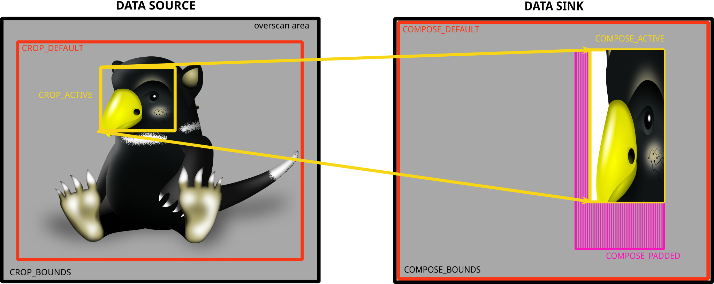

<!-- SPDX-License-Identifier: GFDL-1.1-no-invariants-or-later -->

<!-- c:namespace: V4L -->

Cropping and composing targets

Targets used by a cropping, composing and scaling process

See [v4l2-selection-targets](<https://git.kernel.org/pub/scm/linux/kernel/git/stable/linux.git/tree/Documentation/userspace-api/media/v4l/v4l2-selection-targets.rst?id=9021cc14f7d98b4a1d2c932f52c5343d4d0f6b92>) for more information.
