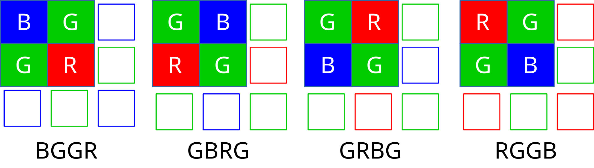

<a id="rst-media-bus-formats"></a>
<a id="rst-v4l2-mbus-format"></a>

<!-- SPDX-License-Identifier: GFDL-1.1-no-invariants-or-later -->

<!-- c:namespace: V4L -->

<a id="c-v4l2_mbus_framefmt"></a>


```c
v4l2_mbus_framefmt
```

<!-- tabularcolumns: |p{2.0cm}|p{4.0cm}|p{11.3cm}| -->


<table>
<caption>

struct v4l2\_mbus\_framefmt

</caption>
<tbody>
<tr>
<td>


\_\_u32

</td>
<td>


`width`

</td>
<td>


Image width in pixels.

</td>
</tr>
<tr>
<td>


\_\_u32

</td>
<td>


`height`

</td>
<td>


Image height in pixels. If `field` is one of `V4L2_FIELD_TOP`, `V4L2_FIELD_BOTTOM` or `V4L2_FIELD_ALTERNATE` then height refers to the number of lines in the field, otherwise it refers to the number of lines in the frame (which is twice the field height for interlaced formats).

</td>
</tr>
<tr>
<td>


\_\_u32

</td>
<td>


`code`

</td>
<td>


Format code, from enum [v4l2\_mbus\_pixelcode](<#rst-v4l2-mbus-pixelcode>).

</td>
</tr>
<tr>
<td>


\_\_u32

</td>
<td>


`field`

</td>
<td>


Field order, from enum `v4l2_field`. See [field-order](<~kernel/userspace/userspace-api/media-v4l/field-order#rst-field-order>) for details. Zero for metadata mbus codes.

</td>
</tr>
<tr>
<td>


\_\_u32

</td>
<td>


`colorspace`

</td>
<td>


Image colorspace, from enum `v4l2_colorspace`. Must be set by the driver for subdevices. If the application sets the flag `V4L2_MBUS_FRAMEFMT_SET_CSC` then the application can set this field on the source pad to request a specific colorspace for the media bus data. If the driver cannot handle the requested conversion, it will return another supported colorspace. The driver indicates that colorspace conversion is supported by setting the flag V4L2\_SUBDEV\_MBUS\_CODE\_CSC\_COLORSPACE in the corresponding struct `v4l2_subdev_mbus_code_enum` during enumeration. See [v4l2-subdev-mbus-code-flags](<~kernel/userspace/userspace-api/media-v4l/vidioc-subdev-enum-mbus-code#rst-v4l2-subdev-mbus-code-flags>). Zero for metadata mbus codes.

</td>
</tr>
<tr>
<td>


union \{

</td>
<td colspan="2">


(anonymous)

</td>
</tr>
<tr>
<td>


\_\_u16

</td>
<td>


`ycbcr_enc`

</td>
<td>


Y'CbCr encoding, from enum `v4l2_ycbcr_encoding`. This information supplements the `colorspace` and must be set by the driver for subdevices, see [colorspaces](<~kernel/userspace/userspace-api/media-v4l/colorspaces#rst-colorspaces-1>). If the application sets the flag `V4L2_MBUS_FRAMEFMT_SET_CSC` then the application can set this field on a source pad to request a specific Y'CbCr encoding for the media bus data. If the driver cannot handle the requested conversion, it will return another supported encoding. This field is ignored for HSV media bus formats. The driver indicates that ycbcr\_enc conversion is supported by setting the flag V4L2\_SUBDEV\_MBUS\_CODE\_CSC\_YCBCR\_ENC in the corresponding struct `v4l2_subdev_mbus_code_enum` during enumeration. See [v4l2-subdev-mbus-code-flags](<~kernel/userspace/userspace-api/media-v4l/vidioc-subdev-enum-mbus-code#rst-v4l2-subdev-mbus-code-flags>). Zero for metadata mbus codes.

</td>
</tr>
<tr>
<td>


\_\_u16

</td>
<td>


`hsv_enc`

</td>
<td>


HSV encoding, from enum `v4l2_hsv_encoding`. This information supplements the `colorspace` and must be set by the driver for subdevices, see [colorspaces](<~kernel/userspace/userspace-api/media-v4l/colorspaces#rst-colorspaces-1>). If the application sets the flag `V4L2_MBUS_FRAMEFMT_SET_CSC` then the application can set this field on a source pad to request a specific HSV encoding for the media bus data. If the driver cannot handle the requested conversion, it will return another supported encoding. This field is ignored for Y'CbCr media bus formats. The driver indicates that hsv\_enc conversion is supported by setting the flag V4L2\_SUBDEV\_MBUS\_CODE\_CSC\_HSV\_ENC in the corresponding struct `v4l2_subdev_mbus_code_enum` during enumeration. See [v4l2-subdev-mbus-code-flags](<~kernel/userspace/userspace-api/media-v4l/vidioc-subdev-enum-mbus-code#rst-v4l2-subdev-mbus-code-flags>). Zero for metadata mbus codes.

</td>
</tr>
<tr>
<td>


\}

</td>
<td colspan="2">


</td>
</tr>
<tr>
<td>


\_\_u16

</td>
<td>


`quantization`

</td>
<td>


Quantization range, from enum `v4l2_quantization`. This information supplements the `colorspace` and must be set by the driver for subdevices, see [colorspaces](<~kernel/userspace/userspace-api/media-v4l/colorspaces#rst-colorspaces-1>). If the application sets the flag `V4L2_MBUS_FRAMEFMT_SET_CSC` then the application can set this field on a source pad to request a specific quantization for the media bus data. If the driver cannot handle the requested conversion, it will return another supported quantization. The driver indicates that quantization conversion is supported by setting the flag V4L2\_SUBDEV\_MBUS\_CODE\_CSC\_QUANTIZATION in the corresponding struct `v4l2_subdev_mbus_code_enum` during enumeration. See [v4l2-subdev-mbus-code-flags](<~kernel/userspace/userspace-api/media-v4l/vidioc-subdev-enum-mbus-code#rst-v4l2-subdev-mbus-code-flags>). Zero for metadata mbus codes.

</td>
</tr>
<tr>
<td>


\_\_u16

</td>
<td>


`xfer_func`

</td>
<td>


Transfer function, from enum `v4l2_xfer_func`. This information supplements the `colorspace` and must be set by the driver for subdevices, see [colorspaces](<~kernel/userspace/userspace-api/media-v4l/colorspaces#rst-colorspaces-1>). If the application sets the flag `V4L2_MBUS_FRAMEFMT_SET_CSC` then the application can set this field on a source pad to request a specific transfer function for the media bus data. If the driver cannot handle the requested conversion, it will return another supported transfer function. The driver indicates that the transfer function conversion is supported by setting the flag V4L2\_SUBDEV\_MBUS\_CODE\_CSC\_XFER\_FUNC in the corresponding struct `v4l2_subdev_mbus_code_enum` during enumeration. See [v4l2-subdev-mbus-code-flags](<~kernel/userspace/userspace-api/media-v4l/vidioc-subdev-enum-mbus-code#rst-v4l2-subdev-mbus-code-flags>). Zero for metadata mbus codes.

</td>
</tr>
<tr>
<td>


\_\_u16

</td>
<td>


`flags`

</td>
<td>


flags See:  :ref:v4l2-mbus-framefmt-flags

</td>
</tr>
<tr>
<td>


\_\_u16

</td>
<td>


`reserved`\[10\]

</td>
<td>


Reserved for future extensions. Applications and drivers must set the array to zero.

</td>
</tr>
</tbody>
</table>

<a id="rst-v4l2-mbus-framefmt-flags"></a>


<!-- tabularcolumns: |p{6.5cm}|p{1.6cm}|p{9.2cm}| -->


<table>
<caption>

v4l2\_mbus\_framefmt Flags

</caption>
<tbody>
<tr>
<td>


`V4L2_MBUS_FRAMEFMT_SET_CSC`

</td>
<td>


0x0001

</td>
<td>


<a id="rst-mbus-framefmt-set-csc"></a>

Set by the application. It is only used for source pads and is ignored for sink pads. If set, then request the subdevice to do colorspace conversion from the received colorspace to the requested colorspace values. If the colorimetry field (`colorspace`, `xfer_func`, `ycbcr_enc`, `hsv_enc` or `quantization`) is set to `*_DEFAULT`, then that colorimetry setting will remain unchanged from what was received. So in order to change the quantization, only the `quantization` field shall be set to non default value (`V4L2_QUANTIZATION_FULL_RANGE` or `V4L2_QUANTIZATION_LIM_RANGE`) and all other colorimetry fields shall be set to `*_DEFAULT`.

To check which conversions are supported by the hardware for the current media bus frame format, see [v4l2-subdev-mbus-code-flags](<~kernel/userspace/userspace-api/media-v4l/vidioc-subdev-enum-mbus-code#rst-v4l2-subdev-mbus-code-flags>).

</td>
</tr>
</tbody>
</table>

<a id="rst-media-bus-pixel-codes"></a>
<a id="rst-v4l2-mbus-pixelcode"></a>

## Media Bus Pixel Codes

The media bus pixel codes describe image formats as flowing over physical buses (both between separate physical components and inside SoC devices). This should not be confused with the V4L2 pixel formats that describe, using four character codes, image formats as stored in memory.

While there is a relationship between image formats on buses and image formats in memory (a raw Bayer image won't be magically converted to JPEG just by storing it to memory), there is no one-to-one correspondence between them.

The media bus pixel codes document parallel formats. Should the pixel data be transported over a serial bus, the media bus pixel code that describes a parallel format that transfers a sample on a single clock cycle is used. For instance, both MEDIA\_BUS\_FMT\_BGR888\_1X24 and MEDIA\_BUS\_FMT\_BGR888\_3X8 are used on parallel busses for transferring an 8 bits per sample BGR data, whereas on serial busses the data in this format is only referred to using MEDIA\_BUS\_FMT\_BGR888\_1X24. This is because there is effectively only a single way to transport that format on the serial busses.

<a id="rst-packed-rgb-formats"></a>

### Packed RGB Formats

Those formats transfer pixel data as red, green and blue components. The format code is made of the following information.

- The red, green and blue components order code, as encoded in a pixel sample. Possible values are RGB and BGR.

- The number of bits per component, for each component. The values can be different for all components. Common values are 555 and 565.

- The number of bus samples per pixel. Pixels that are wider than the bus width must be transferred in multiple samples. Common values are 1 and 2.

- The bus width.

- For formats where the total number of bits per pixel is smaller than the number of bus samples per pixel times the bus width, a padding value stating if the bytes are padded in their most high order bits (PADHI) or low order bits (PADLO). A "C" prefix is used for component-wise padding in the most high order bits (CPADHI) or low order bits (CPADLO) of each separate component.

- For formats where the number of bus samples per pixel is larger than 1, an endianness value stating if the pixel is transferred MSB first (BE) or LSB first (LE).

For instance, a format where pixels are encoded as 5-bits red, 5-bits green and 5-bit blue values padded on the high bit, transferred as 2 8-bit samples per pixel with the most significant bits (padding, red and half of the green value) transferred first will be named `MEDIA_BUS_FMT_RGB555_2X8_PADHI_BE`.

The following tables list existing packed RGB formats.

<!-- HACK: ideally, we would be using adjustbox here. However, Sphinx -->

<!-- is a very bad behaviored guy: if the table has more than 30 cols, -->

<!-- it switches to long table, and there's no way to override it. -->

<!-- tabularcolumns: |p{5.0cm}|p{0.7cm}|p{0.22cm}|p{0.22cm}|p{0.22cm}|p{0.22cm}|p{0.22cm}|p{0.22cm}|p{0.22cm}|p{0.22cm}|p{0.22cm}|p{0.22cm}|p{0.22cm}|p{0.22cm}|p{0.22cm}|p{0.22cm}|p{0.22cm}|p{0.22cm}|p{0.22cm}|p{0.22cm}|p{0.22cm}|p{0.22cm}|p{0.22cm}|p{0.22cm}|p{0.22cm}|p{0.22cm}|p{0.22cm}|p{0.22cm}|p{0.22cm}|p{0.22cm}|p{0.22cm}|p{0.22cm}|p{0.22cm}|p{0.22cm}|p{0.22cm}| -->

<a id="rst-v4l2-mbus-pixelcode-rgb"></a>


<!-- Source LaTeX layout: \begingroup
\tiny
\setlength{\tabcolsep}{2pt} -->


<table>
<caption>

RGB formats

</caption>
<thead>
<tr>
<th>


Identifier

</th>
<th>


Code

</th>
<th>


</th>
<th colspan="32">


 Data organization

</th>
</tr>
<tr>
<th>


</th>
<th>


</th>
<th>


Bit

</th>
<th>


31

</th>
<th>


30

</th>
<th>


29

</th>
<th>


28

</th>
<th>


27

</th>
<th>


26

</th>
<th>


25

</th>
<th>


24

</th>
<th>


23

</th>
<th>


22

</th>
<th>


21

</th>
<th>


20

</th>
<th>


19

</th>
<th>


18

</th>
<th>


17

</th>
<th>


16

</th>
<th>


15

</th>
<th>


14

</th>
<th>


13

</th>
<th>


12

</th>
<th>


11

</th>
<th>


10

</th>
<th>


9

</th>
<th>


8

</th>
<th>


7

</th>
<th>


6

</th>
<th>


5

</th>
<th>


4

</th>
<th>


3

</th>
<th>


2

</th>
<th>


1

</th>
<th>


0

</th>
</tr>
</thead>
<tbody>
<tr>
<td>


MEDIA\_BUS\_FMT\_RGB444\_1X12

</td>
<td>


0x1016

</td>
<td>


</td>
<td>


</td>
<td>


</td>
<td>


</td>
<td>


</td>
<td>


</td>
<td>


</td>
<td>


</td>
<td>


</td>
<td>


</td>
<td>


</td>
<td>


</td>
<td>


</td>
<td>


</td>
<td>


</td>
<td>


</td>
<td>


</td>
<td>


</td>
<td>


</td>
<td>


</td>
<td>


</td>
<td>


r<sub>3</sub>

</td>
<td>


r<sub>2</sub>

</td>
<td>


r<sub>1</sub>

</td>
<td>


r<sub>0</sub>

</td>
<td>


g<sub>3</sub>

</td>
<td>


g<sub>2</sub>

</td>
<td>


g<sub>1</sub>

</td>
<td>


g<sub>0</sub>

</td>
<td>


b<sub>3</sub>

</td>
<td>


b<sub>2</sub>

</td>
<td>


b<sub>1</sub>

</td>
<td>


<a id="rst-media-bus-fmt-rgb444-1x12"></a>

b<sub>0</sub>

</td>
</tr>
<tr>
<td>


MEDIA\_BUS\_FMT\_RGB444\_2X8\_PADHI\_BE

</td>
<td>


0x1001

</td>
<td>


</td>
<td>


</td>
<td>


</td>
<td>


</td>
<td>


</td>
<td>


</td>
<td>


</td>
<td>


</td>
<td>


</td>
<td>


</td>
<td>


</td>
<td>


</td>
<td>


</td>
<td>


</td>
<td>


</td>
<td>


</td>
<td>


</td>
<td>


</td>
<td>


</td>
<td>


</td>
<td>


</td>
<td>


</td>
<td>


</td>
<td>


</td>
<td>


</td>
<td>


0

</td>
<td>


0

</td>
<td>


0

</td>
<td>


0

</td>
<td>


r<sub>3</sub>

</td>
<td>


r<sub>2</sub>

</td>
<td>


r<sub>1</sub>

</td>
<td>


<a id="rst-media-bus-fmt-rgb444-2x8-padhi-be"></a>

r<sub>0</sub>

</td>
</tr>
<tr>
<td>


</td>
<td>


</td>
<td>


</td>
<td>


</td>
<td>


</td>
<td>


</td>
<td>


</td>
<td>


</td>
<td>


</td>
<td>


</td>
<td>


</td>
<td>


</td>
<td>


</td>
<td>


</td>
<td>


</td>
<td>


</td>
<td>


</td>
<td>


</td>
<td>


</td>
<td>


</td>
<td>


</td>
<td>


</td>
<td>


</td>
<td>


</td>
<td>


</td>
<td>


</td>
<td>


</td>
<td>


g<sub>3</sub>

</td>
<td>


g<sub>2</sub>

</td>
<td>


g<sub>1</sub>

</td>
<td>


g<sub>0</sub>

</td>
<td>


b<sub>3</sub>

</td>
<td>


b<sub>2</sub>

</td>
<td>


b<sub>1</sub>

</td>
<td>


b<sub>0</sub>

</td>
</tr>
<tr>
<td>


MEDIA\_BUS\_FMT\_RGB444\_2X8\_PADHI\_LE

</td>
<td>


0x1002

</td>
<td>


</td>
<td>


</td>
<td>


</td>
<td>


</td>
<td>


</td>
<td>


</td>
<td>


</td>
<td>


</td>
<td>


</td>
<td>


</td>
<td>


</td>
<td>


</td>
<td>


</td>
<td>


</td>
<td>


</td>
<td>


</td>
<td>


</td>
<td>


</td>
<td>


</td>
<td>


</td>
<td>


</td>
<td>


</td>
<td>


</td>
<td>


</td>
<td>


</td>
<td>


g<sub>3</sub>

</td>
<td>


g<sub>2</sub>

</td>
<td>


g<sub>1</sub>

</td>
<td>


g<sub>0</sub>

</td>
<td>


b<sub>3</sub>

</td>
<td>


b<sub>2</sub>

</td>
<td>


b<sub>1</sub>

</td>
<td>


<a id="rst-media-bus-fmt-rgb444-2x8-padhi-le"></a>

b<sub>0</sub>

</td>
</tr>
<tr>
<td>


</td>
<td>


</td>
<td>


</td>
<td>


</td>
<td>


</td>
<td>


</td>
<td>


</td>
<td>


</td>
<td>


</td>
<td>


</td>
<td>


</td>
<td>


</td>
<td>


</td>
<td>


</td>
<td>


</td>
<td>


</td>
<td>


</td>
<td>


</td>
<td>


</td>
<td>


</td>
<td>


</td>
<td>


</td>
<td>


</td>
<td>


</td>
<td>


</td>
<td>


</td>
<td>


</td>
<td>


0

</td>
<td>


0

</td>
<td>


0

</td>
<td>


0

</td>
<td>


r<sub>3</sub>

</td>
<td>


r<sub>2</sub>

</td>
<td>


r<sub>1</sub>

</td>
<td>


r<sub>0</sub>

</td>
</tr>
<tr>
<td>


MEDIA\_BUS\_FMT\_RGB555\_2X8\_PADHI\_BE

</td>
<td>


0x1003

</td>
<td>


</td>
<td>


</td>
<td>


</td>
<td>


</td>
<td>


</td>
<td>


</td>
<td>


</td>
<td>


</td>
<td>


</td>
<td>


</td>
<td>


</td>
<td>


</td>
<td>


</td>
<td>


</td>
<td>


</td>
<td>


</td>
<td>


</td>
<td>


</td>
<td>


</td>
<td>


</td>
<td>


</td>
<td>


</td>
<td>


</td>
<td>


</td>
<td>


</td>
<td>


0

</td>
<td>


r<sub>4</sub>

</td>
<td>


r<sub>3</sub>

</td>
<td>


r<sub>2</sub>

</td>
<td>


r<sub>1</sub>

</td>
<td>


r<sub>0</sub>

</td>
<td>


g<sub>4</sub>

</td>
<td>


<a id="rst-media-bus-fmt-rgb555-2x8-padhi-be"></a>

g<sub>3</sub>

</td>
</tr>
<tr>
<td>


</td>
<td>


</td>
<td>


</td>
<td>


</td>
<td>


</td>
<td>


</td>
<td>


</td>
<td>


</td>
<td>


</td>
<td>


</td>
<td>


</td>
<td>


</td>
<td>


</td>
<td>


</td>
<td>


</td>
<td>


</td>
<td>


</td>
<td>


</td>
<td>


</td>
<td>


</td>
<td>


</td>
<td>


</td>
<td>


</td>
<td>


</td>
<td>


</td>
<td>


</td>
<td>


</td>
<td>


g<sub>2</sub>

</td>
<td>


g<sub>1</sub>

</td>
<td>


g<sub>0</sub>

</td>
<td>


b<sub>4</sub>

</td>
<td>


b<sub>3</sub>

</td>
<td>


b<sub>2</sub>

</td>
<td>


b<sub>1</sub>

</td>
<td>


b<sub>0</sub>

</td>
</tr>
<tr>
<td>


MEDIA\_BUS\_FMT\_RGB555\_2X8\_PADHI\_LE

</td>
<td>


0x1004

</td>
<td>


</td>
<td>


</td>
<td>


</td>
<td>


</td>
<td>


</td>
<td>


</td>
<td>


</td>
<td>


</td>
<td>


</td>
<td>


</td>
<td>


</td>
<td>


</td>
<td>


</td>
<td>


</td>
<td>


</td>
<td>


</td>
<td>


</td>
<td>


</td>
<td>


</td>
<td>


</td>
<td>


</td>
<td>


</td>
<td>


</td>
<td>


</td>
<td>


</td>
<td>


g<sub>2</sub>

</td>
<td>


g<sub>1</sub>

</td>
<td>


g<sub>0</sub>

</td>
<td>


b<sub>4</sub>

</td>
<td>


b<sub>3</sub>

</td>
<td>


b<sub>2</sub>

</td>
<td>


b<sub>1</sub>

</td>
<td>


<a id="rst-media-bus-fmt-rgb555-2x8-padhi-le"></a>

b<sub>0</sub>

</td>
</tr>
<tr>
<td>


</td>
<td>


</td>
<td>


</td>
<td>


</td>
<td>


</td>
<td>


</td>
<td>


</td>
<td>


</td>
<td>


</td>
<td>


</td>
<td>


</td>
<td>


</td>
<td>


</td>
<td>


</td>
<td>


</td>
<td>


</td>
<td>


</td>
<td>


</td>
<td>


</td>
<td>


</td>
<td>


</td>
<td>


</td>
<td>


</td>
<td>


</td>
<td>


</td>
<td>


</td>
<td>


</td>
<td>


0

</td>
<td>


r<sub>4</sub>

</td>
<td>


r<sub>3</sub>

</td>
<td>


r<sub>2</sub>

</td>
<td>


r<sub>1</sub>

</td>
<td>


r<sub>0</sub>

</td>
<td>


g<sub>4</sub>

</td>
<td>


g<sub>3</sub>

</td>
</tr>
<tr>
<td>


MEDIA\_BUS\_FMT\_RGB565\_1X16

</td>
<td>


0x1017

</td>
<td>


</td>
<td>


</td>
<td>


</td>
<td>


</td>
<td>


</td>
<td>


</td>
<td>


</td>
<td>


</td>
<td>


</td>
<td>


</td>
<td>


</td>
<td>


</td>
<td>


</td>
<td>


</td>
<td>


</td>
<td>


</td>
<td>


</td>
<td>


r<sub>4</sub>

</td>
<td>


r<sub>3</sub>

</td>
<td>


r<sub>2</sub>

</td>
<td>


r<sub>1</sub>

</td>
<td>


r<sub>0</sub>

</td>
<td>


g<sub>5</sub>

</td>
<td>


g<sub>4</sub>

</td>
<td>


g<sub>3</sub>

</td>
<td>


g<sub>2</sub>

</td>
<td>


g<sub>1</sub>

</td>
<td>


g<sub>0</sub>

</td>
<td>


b<sub>4</sub>

</td>
<td>


b<sub>3</sub>

</td>
<td>


b<sub>2</sub>

</td>
<td>


b<sub>1</sub>

</td>
<td>


<a id="rst-media-bus-fmt-rgb565-1x16"></a>

b<sub>0</sub>

</td>
</tr>
<tr>
<td>


MEDIA\_BUS\_FMT\_BGR565\_2X8\_BE

</td>
<td>


0x1005

</td>
<td>


</td>
<td>


</td>
<td>


</td>
<td>


</td>
<td>


</td>
<td>


</td>
<td>


</td>
<td>


</td>
<td>


</td>
<td>


</td>
<td>


</td>
<td>


</td>
<td>


</td>
<td>


</td>
<td>


</td>
<td>


</td>
<td>


</td>
<td>


</td>
<td>


</td>
<td>


</td>
<td>


</td>
<td>


</td>
<td>


</td>
<td>


</td>
<td>


</td>
<td>


b<sub>4</sub>

</td>
<td>


b<sub>3</sub>

</td>
<td>


b<sub>2</sub>

</td>
<td>


b<sub>1</sub>

</td>
<td>


b<sub>0</sub>

</td>
<td>


g<sub>5</sub>

</td>
<td>


g<sub>4</sub>

</td>
<td>


<a id="rst-media-bus-fmt-bgr565-2x8-be"></a>

g<sub>3</sub>

</td>
</tr>
<tr>
<td>


</td>
<td>


</td>
<td>


</td>
<td>


</td>
<td>


</td>
<td>


</td>
<td>


</td>
<td>


</td>
<td>


</td>
<td>


</td>
<td>


</td>
<td>


</td>
<td>


</td>
<td>


</td>
<td>


</td>
<td>


</td>
<td>


</td>
<td>


</td>
<td>


</td>
<td>


</td>
<td>


</td>
<td>


</td>
<td>


</td>
<td>


</td>
<td>


</td>
<td>


</td>
<td>


</td>
<td>


g<sub>2</sub>

</td>
<td>


g<sub>1</sub>

</td>
<td>


g<sub>0</sub>

</td>
<td>


r<sub>4</sub>

</td>
<td>


r<sub>3</sub>

</td>
<td>


r<sub>2</sub>

</td>
<td>


r<sub>1</sub>

</td>
<td>


r<sub>0</sub>

</td>
</tr>
<tr>
<td>


MEDIA\_BUS\_FMT\_BGR565\_2X8\_LE

</td>
<td>


0x1006

</td>
<td>


</td>
<td>


</td>
<td>


</td>
<td>


</td>
<td>


</td>
<td>


</td>
<td>


</td>
<td>


</td>
<td>


</td>
<td>


</td>
<td>


</td>
<td>


</td>
<td>


</td>
<td>


</td>
<td>


</td>
<td>


</td>
<td>


</td>
<td>


</td>
<td>


</td>
<td>


</td>
<td>


</td>
<td>


</td>
<td>


</td>
<td>


</td>
<td>


</td>
<td>


g<sub>2</sub>

</td>
<td>


g<sub>1</sub>

</td>
<td>


g<sub>0</sub>

</td>
<td>


r<sub>4</sub>

</td>
<td>


r<sub>3</sub>

</td>
<td>


r<sub>2</sub>

</td>
<td>


r<sub>1</sub>

</td>
<td>


<a id="rst-media-bus-fmt-bgr565-2x8-le"></a>

r<sub>0</sub>

</td>
</tr>
<tr>
<td>


</td>
<td>


</td>
<td>


</td>
<td>


</td>
<td>


</td>
<td>


</td>
<td>


</td>
<td>


</td>
<td>


</td>
<td>


</td>
<td>


</td>
<td>


</td>
<td>


</td>
<td>


</td>
<td>


</td>
<td>


</td>
<td>


</td>
<td>


</td>
<td>


</td>
<td>


</td>
<td>


</td>
<td>


</td>
<td>


</td>
<td>


</td>
<td>


</td>
<td>


</td>
<td>


</td>
<td>


b<sub>4</sub>

</td>
<td>


b<sub>3</sub>

</td>
<td>


b<sub>2</sub>

</td>
<td>


b<sub>1</sub>

</td>
<td>


b<sub>0</sub>

</td>
<td>


g<sub>5</sub>

</td>
<td>


g<sub>4</sub>

</td>
<td>


g<sub>3</sub>

</td>
</tr>
<tr>
<td>


MEDIA\_BUS\_FMT\_RGB565\_2X8\_BE

</td>
<td>


0x1007

</td>
<td>


</td>
<td>


</td>
<td>


</td>
<td>


</td>
<td>


</td>
<td>


</td>
<td>


</td>
<td>


</td>
<td>


</td>
<td>


</td>
<td>


</td>
<td>


</td>
<td>


</td>
<td>


</td>
<td>


</td>
<td>


</td>
<td>


</td>
<td>


</td>
<td>


</td>
<td>


</td>
<td>


</td>
<td>


</td>
<td>


</td>
<td>


</td>
<td>


</td>
<td>


r<sub>4</sub>

</td>
<td>


r<sub>3</sub>

</td>
<td>


r<sub>2</sub>

</td>
<td>


r<sub>1</sub>

</td>
<td>


r<sub>0</sub>

</td>
<td>


g<sub>5</sub>

</td>
<td>


g<sub>4</sub>

</td>
<td>


<a id="rst-media-bus-fmt-rgb565-2x8-be"></a>

g<sub>3</sub>

</td>
</tr>
<tr>
<td>


</td>
<td>


</td>
<td>


</td>
<td>


</td>
<td>


</td>
<td>


</td>
<td>


</td>
<td>


</td>
<td>


</td>
<td>


</td>
<td>


</td>
<td>


</td>
<td>


</td>
<td>


</td>
<td>


</td>
<td>


</td>
<td>


</td>
<td>


</td>
<td>


</td>
<td>


</td>
<td>


</td>
<td>


</td>
<td>


</td>
<td>


</td>
<td>


</td>
<td>


</td>
<td>


</td>
<td>


g<sub>2</sub>

</td>
<td>


g<sub>1</sub>

</td>
<td>


g<sub>0</sub>

</td>
<td>


b<sub>4</sub>

</td>
<td>


b<sub>3</sub>

</td>
<td>


b<sub>2</sub>

</td>
<td>


b<sub>1</sub>

</td>
<td>


b<sub>0</sub>

</td>
</tr>
<tr>
<td>


MEDIA\_BUS\_FMT\_RGB565\_2X8\_LE

</td>
<td>


0x1008

</td>
<td>


</td>
<td>


</td>
<td>


</td>
<td>


</td>
<td>


</td>
<td>


</td>
<td>


</td>
<td>


</td>
<td>


</td>
<td>


</td>
<td>


</td>
<td>


</td>
<td>


</td>
<td>


</td>
<td>


</td>
<td>


</td>
<td>


</td>
<td>


</td>
<td>


</td>
<td>


</td>
<td>


</td>
<td>


</td>
<td>


</td>
<td>


</td>
<td>


</td>
<td>


g<sub>2</sub>

</td>
<td>


g<sub>1</sub>

</td>
<td>


g<sub>0</sub>

</td>
<td>


b<sub>4</sub>

</td>
<td>


b<sub>3</sub>

</td>
<td>


b<sub>2</sub>

</td>
<td>


b<sub>1</sub>

</td>
<td>


<a id="rst-media-bus-fmt-rgb565-2x8-le"></a>

b<sub>0</sub>

</td>
</tr>
<tr>
<td>


</td>
<td>


</td>
<td>


</td>
<td>


</td>
<td>


</td>
<td>


</td>
<td>


</td>
<td>


</td>
<td>


</td>
<td>


</td>
<td>


</td>
<td>


</td>
<td>


</td>
<td>


</td>
<td>


</td>
<td>


</td>
<td>


</td>
<td>


</td>
<td>


</td>
<td>


</td>
<td>


</td>
<td>


</td>
<td>


</td>
<td>


</td>
<td>


</td>
<td>


</td>
<td>


</td>
<td>


r<sub>4</sub>

</td>
<td>


r<sub>3</sub>

</td>
<td>


r<sub>2</sub>

</td>
<td>


r<sub>1</sub>

</td>
<td>


r<sub>0</sub>

</td>
<td>


g<sub>5</sub>

</td>
<td>


g<sub>4</sub>

</td>
<td>


g<sub>3</sub>

</td>
</tr>
<tr>
<td>


MEDIA\_BUS\_FMT\_RGB666\_1X18

</td>
<td>


0x1009

</td>
<td>


</td>
<td>


</td>
<td>


</td>
<td>


</td>
<td>


</td>
<td>


</td>
<td>


</td>
<td>


</td>
<td>


</td>
<td>


</td>
<td>


</td>
<td>


</td>
<td>


</td>
<td>


</td>
<td>


</td>
<td>


r<sub>5</sub>

</td>
<td>


r<sub>4</sub>

</td>
<td>


r<sub>3</sub>

</td>
<td>


r<sub>2</sub>

</td>
<td>


r<sub>1</sub>

</td>
<td>


r<sub>0</sub>

</td>
<td>


g<sub>5</sub>

</td>
<td>


g<sub>4</sub>

</td>
<td>


g<sub>3</sub>

</td>
<td>


g<sub>2</sub>

</td>
<td>


g<sub>1</sub>

</td>
<td>


g<sub>0</sub>

</td>
<td>


b<sub>5</sub>

</td>
<td>


b<sub>4</sub>

</td>
<td>


b<sub>3</sub>

</td>
<td>


b<sub>2</sub>

</td>
<td>


b<sub>1</sub>

</td>
<td>


<a id="rst-media-bus-fmt-rgb666-1x18"></a>

b<sub>0</sub>

</td>
</tr>
<tr>
<td>


MEDIA\_BUS\_FMT\_RGB666\_2X9\_BE

</td>
<td>


0x1025

</td>
<td>


</td>
<td>


</td>
<td>


</td>
<td>


</td>
<td>


</td>
<td>


</td>
<td>


</td>
<td>


</td>
<td>


</td>
<td>


</td>
<td>


</td>
<td>


</td>
<td>


</td>
<td>


</td>
<td>


</td>
<td>


</td>
<td>


</td>
<td>


</td>
<td>


</td>
<td>


</td>
<td>


</td>
<td>


</td>
<td>


</td>
<td>


</td>
<td>


r<sub>5</sub>

</td>
<td>


r<sub>4</sub>

</td>
<td>


r<sub>3</sub>

</td>
<td>


r<sub>2</sub>

</td>
<td>


r<sub>1</sub>

</td>
<td>


r<sub>0</sub>

</td>
<td>


g<sub>5</sub>

</td>
<td>


g<sub>4</sub>

</td>
<td>


<a id="rst-media-bus-fmt-rgb666-2x9-be"></a>

g<sub>3</sub>

</td>
</tr>
<tr>
<td>


</td>
<td>


</td>
<td>


</td>
<td>


</td>
<td>


</td>
<td>


</td>
<td>


</td>
<td>


</td>
<td>


</td>
<td>


</td>
<td>


</td>
<td>


</td>
<td>


</td>
<td>


</td>
<td>


</td>
<td>


</td>
<td>


</td>
<td>


</td>
<td>


</td>
<td>


</td>
<td>


</td>
<td>


</td>
<td>


</td>
<td>


</td>
<td>


</td>
<td>


</td>
<td>


g<sub>2</sub>

</td>
<td>


g<sub>1</sub>

</td>
<td>


g<sub>0</sub>

</td>
<td>


b<sub>5</sub>

</td>
<td>


b<sub>4</sub>

</td>
<td>


b<sub>3</sub>

</td>
<td>


b<sub>2</sub>

</td>
<td>


b<sub>1</sub>

</td>
<td>


b<sub>0</sub>

</td>
</tr>
<tr>
<td>


MEDIA\_BUS\_FMT\_BGR666\_1X18

</td>
<td>


0x1023

</td>
<td>


</td>
<td>


</td>
<td>


</td>
<td>


</td>
<td>


</td>
<td>


</td>
<td>


</td>
<td>


</td>
<td>


</td>
<td>


</td>
<td>


</td>
<td>


</td>
<td>


</td>
<td>


</td>
<td>


</td>
<td>


b<sub>5</sub>

</td>
<td>


b<sub>4</sub>

</td>
<td>


b<sub>3</sub>

</td>
<td>


b<sub>2</sub>

</td>
<td>


b<sub>1</sub>

</td>
<td>


b<sub>0</sub>

</td>
<td>


g<sub>5</sub>

</td>
<td>


g<sub>4</sub>

</td>
<td>


g<sub>3</sub>

</td>
<td>


g<sub>2</sub>

</td>
<td>


g<sub>1</sub>

</td>
<td>


g<sub>0</sub>

</td>
<td>


r<sub>5</sub>

</td>
<td>


r<sub>4</sub>

</td>
<td>


r<sub>3</sub>

</td>
<td>


r<sub>2</sub>

</td>
<td>


r<sub>1</sub>

</td>
<td>


<a id="rst-media-bus-fmt-bgr666-1x18"></a>

r<sub>0</sub>

</td>
</tr>
<tr>
<td>


MEDIA\_BUS\_FMT\_RBG888\_1X24

</td>
<td>


0x100e

</td>
<td>


</td>
<td>


</td>
<td>


</td>
<td>


</td>
<td>


</td>
<td>


</td>
<td>


</td>
<td>


</td>
<td>


</td>
<td>


r<sub>7</sub>

</td>
<td>


r<sub>6</sub>

</td>
<td>


r<sub>5</sub>

</td>
<td>


r<sub>4</sub>

</td>
<td>


r<sub>3</sub>

</td>
<td>


r<sub>2</sub>

</td>
<td>


r<sub>1</sub>

</td>
<td>


r<sub>0</sub>

</td>
<td>


b<sub>7</sub>

</td>
<td>


b<sub>6</sub>

</td>
<td>


b<sub>5</sub>

</td>
<td>


b<sub>4</sub>

</td>
<td>


b<sub>3</sub>

</td>
<td>


b<sub>2</sub>

</td>
<td>


b<sub>1</sub>

</td>
<td>


b<sub>0</sub>

</td>
<td>


g<sub>7</sub>

</td>
<td>


g<sub>6</sub>

</td>
<td>


g<sub>5</sub>

</td>
<td>


g<sub>4</sub>

</td>
<td>


g<sub>3</sub>

</td>
<td>


g<sub>2</sub>

</td>
<td>


g<sub>1</sub>

</td>
<td>


<a id="rst-media-bus-fmt-rbg888-1x24"></a>

g<sub>0</sub>

</td>
</tr>
<tr>
<td>


MEDIA\_BUS\_FMT\_RGB666\_1X24\_CPADHI

</td>
<td>


0x1015

</td>
<td>


</td>
<td>


</td>
<td>


</td>
<td>


</td>
<td>


</td>
<td>


</td>
<td>


</td>
<td>


</td>
<td>


</td>
<td>


0

</td>
<td>


0

</td>
<td>


r<sub>5</sub>

</td>
<td>


r<sub>4</sub>

</td>
<td>


r<sub>3</sub>

</td>
<td>


r<sub>2</sub>

</td>
<td>


r<sub>1</sub>

</td>
<td>


r<sub>0</sub>

</td>
<td>


0

</td>
<td>


0

</td>
<td>


g<sub>5</sub>

</td>
<td>


g<sub>4</sub>

</td>
<td>


g<sub>3</sub>

</td>
<td>


g<sub>2</sub>

</td>
<td>


g<sub>1</sub>

</td>
<td>


g<sub>0</sub>

</td>
<td>


0

</td>
<td>


0

</td>
<td>


b<sub>5</sub>

</td>
<td>


b<sub>4</sub>

</td>
<td>


b<sub>3</sub>

</td>
<td>


b<sub>2</sub>

</td>
<td>


b<sub>1</sub>

</td>
<td>


<a id="rst-media-bus-fmt-rgb666-1x24-cpadhi"></a>

b<sub>0</sub>

</td>
</tr>
<tr>
<td>


MEDIA\_BUS\_FMT\_BGR666\_1X24\_CPADHI

</td>
<td>


0x1024

</td>
<td>


</td>
<td>


</td>
<td>


</td>
<td>


</td>
<td>


</td>
<td>


</td>
<td>


</td>
<td>


</td>
<td>


</td>
<td>


0

</td>
<td>


0

</td>
<td>


b<sub>5</sub>

</td>
<td>


b<sub>4</sub>

</td>
<td>


b<sub>3</sub>

</td>
<td>


b<sub>2</sub>

</td>
<td>


b<sub>1</sub>

</td>
<td>


b<sub>0</sub>

</td>
<td>


0

</td>
<td>


0

</td>
<td>


g<sub>5</sub>

</td>
<td>


g<sub>4</sub>

</td>
<td>


g<sub>3</sub>

</td>
<td>


g<sub>2</sub>

</td>
<td>


g<sub>1</sub>

</td>
<td>


g<sub>0</sub>

</td>
<td>


0

</td>
<td>


0

</td>
<td>


r<sub>5</sub>

</td>
<td>


r<sub>4</sub>

</td>
<td>


r<sub>3</sub>

</td>
<td>


r<sub>2</sub>

</td>
<td>


r<sub>1</sub>

</td>
<td>


<a id="rst-media-bus-fmt-bgr666-1x24-cpadhi"></a>

r<sub>0</sub>

</td>
</tr>
<tr>
<td>


MEDIA\_BUS\_FMT\_RGB565\_1X24\_CPADHI

</td>
<td>


0x1022

</td>
<td>


</td>
<td>


</td>
<td>


</td>
<td>


</td>
<td>


</td>
<td>


</td>
<td>


</td>
<td>


</td>
<td>


</td>
<td>


0

</td>
<td>


0

</td>
<td>


0

</td>
<td>


r<sub>4</sub>

</td>
<td>


r<sub>3</sub>

</td>
<td>


r<sub>2</sub>

</td>
<td>


r<sub>1</sub>

</td>
<td>


r<sub>0</sub>

</td>
<td>


0

</td>
<td>


0

</td>
<td>


g<sub>5</sub>

</td>
<td>


g<sub>4</sub>

</td>
<td>


g<sub>3</sub>

</td>
<td>


g<sub>2</sub>

</td>
<td>


g<sub>1</sub>

</td>
<td>


g<sub>0</sub>

</td>
<td>


0

</td>
<td>


0

</td>
<td>


0

</td>
<td>


b<sub>4</sub>

</td>
<td>


b<sub>3</sub>

</td>
<td>


b<sub>2</sub>

</td>
<td>


b<sub>1</sub>

</td>
<td>


<a id="rst-media-bus-fmt-rgb565-1x24-cpadhi"></a>

b<sub>0</sub>

</td>
</tr>
<tr>
<td>


MEDIA\_BUS\_FMT\_BGR888\_1X24

</td>
<td>


0x1013

</td>
<td>


</td>
<td>


</td>
<td>


</td>
<td>


</td>
<td>


</td>
<td>


</td>
<td>


</td>
<td>


</td>
<td>


</td>
<td>


b<sub>7</sub>

</td>
<td>


b<sub>6</sub>

</td>
<td>


b<sub>5</sub>

</td>
<td>


b<sub>4</sub>

</td>
<td>


b<sub>3</sub>

</td>
<td>


b<sub>2</sub>

</td>
<td>


b<sub>1</sub>

</td>
<td>


b<sub>0</sub>

</td>
<td>


g<sub>7</sub>

</td>
<td>


g<sub>6</sub>

</td>
<td>


g<sub>5</sub>

</td>
<td>


g<sub>4</sub>

</td>
<td>


g<sub>3</sub>

</td>
<td>


g<sub>2</sub>

</td>
<td>


g<sub>1</sub>

</td>
<td>


g<sub>0</sub>

</td>
<td>


r<sub>7</sub>

</td>
<td>


r<sub>6</sub>

</td>
<td>


r<sub>5</sub>

</td>
<td>


r<sub>4</sub>

</td>
<td>


r<sub>3</sub>

</td>
<td>


r<sub>2</sub>

</td>
<td>


r<sub>1</sub>

</td>
<td>


<a id="rst-media-bus-fmt-bgr888-1x24"></a>

r<sub>0</sub>

</td>
</tr>
<tr>
<td>


MEDIA\_BUS\_FMT\_BGR888\_3X8

</td>
<td>


0x101b

</td>
<td>


</td>
<td>


</td>
<td>


</td>
<td>


</td>
<td>


</td>
<td>


</td>
<td>


</td>
<td>


</td>
<td>


</td>
<td>


</td>
<td>


</td>
<td>


</td>
<td>


</td>
<td>


</td>
<td>


</td>
<td>


</td>
<td>


</td>
<td>


</td>
<td>


</td>
<td>


</td>
<td>


</td>
<td>


</td>
<td>


</td>
<td>


</td>
<td>


</td>
<td>


b<sub>7</sub>

</td>
<td>


b<sub>6</sub>

</td>
<td>


b<sub>5</sub>

</td>
<td>


b<sub>4</sub>

</td>
<td>


b<sub>3</sub>

</td>
<td>


b<sub>2</sub>

</td>
<td>


b<sub>1</sub>

</td>
<td>


<a id="rst-media-bus-fmt-bgr888-3x8"></a>

b<sub>0</sub>

</td>
</tr>
<tr>
<td>


</td>
<td>


</td>
<td>


</td>
<td>


</td>
<td>


</td>
<td>


</td>
<td>


</td>
<td>


</td>
<td>


</td>
<td>


</td>
<td>


</td>
<td>


</td>
<td>


</td>
<td>


</td>
<td>


</td>
<td>


</td>
<td>


</td>
<td>


</td>
<td>


</td>
<td>


</td>
<td>


</td>
<td>


</td>
<td>


</td>
<td>


</td>
<td>


</td>
<td>


</td>
<td>


</td>
<td>


g<sub>7</sub>

</td>
<td>


g<sub>6</sub>

</td>
<td>


g<sub>5</sub>

</td>
<td>


g<sub>4</sub>

</td>
<td>


g<sub>3</sub>

</td>
<td>


g<sub>2</sub>

</td>
<td>


g<sub>1</sub>

</td>
<td>


g<sub>0</sub>

</td>
</tr>
<tr>
<td>


</td>
<td>


</td>
<td>


</td>
<td>


</td>
<td>


</td>
<td>


</td>
<td>


</td>
<td>


</td>
<td>


</td>
<td>


</td>
<td>


</td>
<td>


</td>
<td>


</td>
<td>


</td>
<td>


</td>
<td>


</td>
<td>


</td>
<td>


</td>
<td>


</td>
<td>


</td>
<td>


</td>
<td>


</td>
<td>


</td>
<td>


</td>
<td>


</td>
<td>


</td>
<td>


</td>
<td>


r<sub>7</sub>

</td>
<td>


r<sub>6</sub>

</td>
<td>


r<sub>5</sub>

</td>
<td>


r<sub>4</sub>

</td>
<td>


r<sub>3</sub>

</td>
<td>


r<sub>2</sub>

</td>
<td>


r<sub>1</sub>

</td>
<td>


r<sub>0</sub>

</td>
</tr>
<tr>
<td>


MEDIA\_BUS\_FMT\_GBR888\_1X24

</td>
<td>


0x1014

</td>
<td>


</td>
<td>


</td>
<td>


</td>
<td>


</td>
<td>


</td>
<td>


</td>
<td>


</td>
<td>


</td>
<td>


</td>
<td>


g<sub>7</sub>

</td>
<td>


g<sub>6</sub>

</td>
<td>


g<sub>5</sub>

</td>
<td>


g<sub>4</sub>

</td>
<td>


g<sub>3</sub>

</td>
<td>


g<sub>2</sub>

</td>
<td>


g<sub>1</sub>

</td>
<td>


g<sub>0</sub>

</td>
<td>


b<sub>7</sub>

</td>
<td>


b<sub>6</sub>

</td>
<td>


b<sub>5</sub>

</td>
<td>


b<sub>4</sub>

</td>
<td>


b<sub>3</sub>

</td>
<td>


b<sub>2</sub>

</td>
<td>


b<sub>1</sub>

</td>
<td>


b<sub>0</sub>

</td>
<td>


r<sub>7</sub>

</td>
<td>


r<sub>6</sub>

</td>
<td>


r<sub>5</sub>

</td>
<td>


r<sub>4</sub>

</td>
<td>


r<sub>3</sub>

</td>
<td>


r<sub>2</sub>

</td>
<td>


r<sub>1</sub>

</td>
<td>


<a id="rst-media-bus-fmt-gbr888-1x24"></a>

r<sub>0</sub>

</td>
</tr>
<tr>
<td>


MEDIA\_BUS\_FMT\_RGB888\_1X24

</td>
<td>


0x100a

</td>
<td>


</td>
<td>


</td>
<td>


</td>
<td>


</td>
<td>


</td>
<td>


</td>
<td>


</td>
<td>


</td>
<td>


</td>
<td>


r<sub>7</sub>

</td>
<td>


r<sub>6</sub>

</td>
<td>


r<sub>5</sub>

</td>
<td>


r<sub>4</sub>

</td>
<td>


r<sub>3</sub>

</td>
<td>


r<sub>2</sub>

</td>
<td>


r<sub>1</sub>

</td>
<td>


r<sub>0</sub>

</td>
<td>


g<sub>7</sub>

</td>
<td>


g<sub>6</sub>

</td>
<td>


g<sub>5</sub>

</td>
<td>


g<sub>4</sub>

</td>
<td>


g<sub>3</sub>

</td>
<td>


g<sub>2</sub>

</td>
<td>


g<sub>1</sub>

</td>
<td>


g<sub>0</sub>

</td>
<td>


b<sub>7</sub>

</td>
<td>


b<sub>6</sub>

</td>
<td>


b<sub>5</sub>

</td>
<td>


b<sub>4</sub>

</td>
<td>


b<sub>3</sub>

</td>
<td>


b<sub>2</sub>

</td>
<td>


b<sub>1</sub>

</td>
<td>


<a id="rst-media-bus-fmt-rgb888-1x24"></a>

b<sub>0</sub>

</td>
</tr>
<tr>
<td>


MEDIA\_BUS\_FMT\_RGB888\_2X12\_BE

</td>
<td>


0x100b

</td>
<td>


</td>
<td>


</td>
<td>


</td>
<td>


</td>
<td>


</td>
<td>


</td>
<td>


</td>
<td>


</td>
<td>


</td>
<td>


</td>
<td>


</td>
<td>


</td>
<td>


</td>
<td>


</td>
<td>


</td>
<td>


</td>
<td>


</td>
<td>


</td>
<td>


</td>
<td>


</td>
<td>


</td>
<td>


r<sub>7</sub>

</td>
<td>


r<sub>6</sub>

</td>
<td>


r<sub>5</sub>

</td>
<td>


r<sub>4</sub>

</td>
<td>


r<sub>3</sub>

</td>
<td>


r<sub>2</sub>

</td>
<td>


r<sub>1</sub>

</td>
<td>


r<sub>0</sub>

</td>
<td>


g<sub>7</sub>

</td>
<td>


g<sub>6</sub>

</td>
<td>


g<sub>5</sub>

</td>
<td>


<a id="rst-media-bus-fmt-rgb888-2x12-be"></a>

g<sub>4</sub>

</td>
</tr>
<tr>
<td>


</td>
<td>


</td>
<td>


</td>
<td>


</td>
<td>


</td>
<td>


</td>
<td>


</td>
<td>


</td>
<td>


</td>
<td>


</td>
<td>


</td>
<td>


</td>
<td>


</td>
<td>


</td>
<td>


</td>
<td>


</td>
<td>


</td>
<td>


</td>
<td>


</td>
<td>


</td>
<td>


</td>
<td>


</td>
<td>


</td>
<td>


g<sub>3</sub>

</td>
<td>


g<sub>2</sub>

</td>
<td>


g<sub>1</sub>

</td>
<td>


g<sub>0</sub>

</td>
<td>


b<sub>7</sub>

</td>
<td>


b<sub>6</sub>

</td>
<td>


b<sub>5</sub>

</td>
<td>


b<sub>4</sub>

</td>
<td>


b<sub>3</sub>

</td>
<td>


b<sub>2</sub>

</td>
<td>


b<sub>1</sub>

</td>
<td>


b<sub>0</sub>

</td>
</tr>
<tr>
<td>


MEDIA\_BUS\_FMT\_RGB888\_2X12\_LE

</td>
<td>


0x100c

</td>
<td>


</td>
<td>


</td>
<td>


</td>
<td>


</td>
<td>


</td>
<td>


</td>
<td>


</td>
<td>


</td>
<td>


</td>
<td>


</td>
<td>


</td>
<td>


</td>
<td>


</td>
<td>


</td>
<td>


</td>
<td>


</td>
<td>


</td>
<td>


</td>
<td>


</td>
<td>


</td>
<td>


</td>
<td>


g<sub>3</sub>

</td>
<td>


g<sub>2</sub>

</td>
<td>


g<sub>1</sub>

</td>
<td>


g<sub>0</sub>

</td>
<td>


b<sub>7</sub>

</td>
<td>


b<sub>6</sub>

</td>
<td>


b<sub>5</sub>

</td>
<td>


b<sub>4</sub>

</td>
<td>


b<sub>3</sub>

</td>
<td>


b<sub>2</sub>

</td>
<td>


b<sub>1</sub>

</td>
<td>


<a id="rst-media-bus-fmt-rgb888-2x12-le"></a>

b<sub>0</sub>

</td>
</tr>
<tr>
<td>


</td>
<td>


</td>
<td>


</td>
<td>


</td>
<td>


</td>
<td>


</td>
<td>


</td>
<td>


</td>
<td>


</td>
<td>


</td>
<td>


</td>
<td>


</td>
<td>


</td>
<td>


</td>
<td>


</td>
<td>


</td>
<td>


</td>
<td>


</td>
<td>


</td>
<td>


</td>
<td>


</td>
<td>


</td>
<td>


</td>
<td>


r<sub>7</sub>

</td>
<td>


r<sub>6</sub>

</td>
<td>


r<sub>5</sub>

</td>
<td>


r<sub>4</sub>

</td>
<td>


r<sub>3</sub>

</td>
<td>


r<sub>2</sub>

</td>
<td>


r<sub>1</sub>

</td>
<td>


r<sub>0</sub>

</td>
<td>


g<sub>7</sub>

</td>
<td>


g<sub>6</sub>

</td>
<td>


g<sub>5</sub>

</td>
<td>


g<sub>4</sub>

</td>
</tr>
<tr>
<td>


MEDIA\_BUS\_FMT\_RGB888\_3X8

</td>
<td>


0x101c

</td>
<td>


</td>
<td>


</td>
<td>


</td>
<td>


</td>
<td>


</td>
<td>


</td>
<td>


</td>
<td>


</td>
<td>


</td>
<td>


</td>
<td>


</td>
<td>


</td>
<td>


</td>
<td>


</td>
<td>


</td>
<td>


</td>
<td>


</td>
<td>


</td>
<td>


</td>
<td>


</td>
<td>


</td>
<td>


</td>
<td>


</td>
<td>


</td>
<td>


</td>
<td>


r<sub>7</sub>

</td>
<td>


r<sub>6</sub>

</td>
<td>


r<sub>5</sub>

</td>
<td>


r<sub>4</sub>

</td>
<td>


r<sub>3</sub>

</td>
<td>


r<sub>2</sub>

</td>
<td>


r<sub>1</sub>

</td>
<td>


<a id="rst-media-bus-fmt-rgb888-3x8"></a>

r<sub>0</sub>

</td>
</tr>
<tr>
<td>


</td>
<td>


</td>
<td>


</td>
<td>


</td>
<td>


</td>
<td>


</td>
<td>


</td>
<td>


</td>
<td>


</td>
<td>


</td>
<td>


</td>
<td>


</td>
<td>


</td>
<td>


</td>
<td>


</td>
<td>


</td>
<td>


</td>
<td>


</td>
<td>


</td>
<td>


</td>
<td>


</td>
<td>


</td>
<td>


</td>
<td>


</td>
<td>


</td>
<td>


</td>
<td>


</td>
<td>


g<sub>7</sub>

</td>
<td>


g<sub>6</sub>

</td>
<td>


g<sub>5</sub>

</td>
<td>


g<sub>4</sub>

</td>
<td>


g<sub>3</sub>

</td>
<td>


g<sub>2</sub>

</td>
<td>


g<sub>1</sub>

</td>
<td>


g<sub>0</sub>

</td>
</tr>
<tr>
<td>


</td>
<td>


</td>
<td>


</td>
<td>


</td>
<td>


</td>
<td>


</td>
<td>


</td>
<td>


</td>
<td>


</td>
<td>


</td>
<td>


</td>
<td>


</td>
<td>


</td>
<td>


</td>
<td>


</td>
<td>


</td>
<td>


</td>
<td>


</td>
<td>


</td>
<td>


</td>
<td>


</td>
<td>


</td>
<td>


</td>
<td>


</td>
<td>


</td>
<td>


</td>
<td>


</td>
<td>


b<sub>7</sub>

</td>
<td>


b<sub>6</sub>

</td>
<td>


b<sub>5</sub>

</td>
<td>


b<sub>4</sub>

</td>
<td>


b<sub>3</sub>

</td>
<td>


b<sub>2</sub>

</td>
<td>


b<sub>1</sub>

</td>
<td>


b<sub>0</sub>

</td>
</tr>
<tr>
<td>


MEDIA\_BUS\_FMT\_RGB666\_1X30-CPADLO

</td>
<td>


0x101e

</td>
<td>


</td>
<td>


</td>
<td>


</td>
<td>


r<sub>5</sub>

</td>
<td>


r<sub>4</sub>

</td>
<td>


r<sub>3</sub>

</td>
<td>


r<sub>2</sub>

</td>
<td>


r<sub>1</sub>

</td>
<td>


r<sub>0</sub>

</td>
<td>


0

</td>
<td>


0

</td>
<td>


0

</td>
<td>


0

</td>
<td>


g<sub>5</sub>

</td>
<td>


g<sub>4</sub>

</td>
<td>


g<sub>3</sub>

</td>
<td>


g<sub>2</sub>

</td>
<td>


g<sub>1</sub>

</td>
<td>


g<sub>0</sub>

</td>
<td>


0

</td>
<td>


0

</td>
<td>


0

</td>
<td>


0

</td>
<td>


b<sub>5</sub>

</td>
<td>


b<sub>4</sub>

</td>
<td>


b<sub>3</sub>

</td>
<td>


b<sub>2</sub>

</td>
<td>


b<sub>1</sub>

</td>
<td>


b<sub>0</sub>

</td>
<td>


0

</td>
<td>


0

</td>
<td>


0

</td>
<td>


<a id="rst-media-bus-fmt-rgb666-1x30-cpadlo"></a>

0

</td>
</tr>
<tr>
<td>


MEDIA\_BUS\_FMT\_RGB888\_1X30-CPADLO

</td>
<td>


0x101f

</td>
<td>


</td>
<td>


</td>
<td>


</td>
<td>


r<sub>7</sub>

</td>
<td>


r<sub>6</sub>

</td>
<td>


r<sub>5</sub>

</td>
<td>


r<sub>4</sub>

</td>
<td>


r<sub>3</sub>

</td>
<td>


r<sub>2</sub>

</td>
<td>


r<sub>1</sub>

</td>
<td>


r<sub>0</sub>

</td>
<td>


0

</td>
<td>


0

</td>
<td>


g<sub>7</sub>

</td>
<td>


g<sub>6</sub>

</td>
<td>


g<sub>5</sub>

</td>
<td>


g<sub>4</sub>

</td>
<td>


g<sub>3</sub>

</td>
<td>


g<sub>2</sub>

</td>
<td>


g<sub>1</sub>

</td>
<td>


g<sub>0</sub>

</td>
<td>


0

</td>
<td>


0

</td>
<td>


b<sub>7</sub>

</td>
<td>


b<sub>6</sub>

</td>
<td>


b<sub>5</sub>

</td>
<td>


b<sub>4</sub>

</td>
<td>


b<sub>3</sub>

</td>
<td>


b<sub>2</sub>

</td>
<td>


b<sub>1</sub>

</td>
<td>


b<sub>0</sub>

</td>
<td>


0

</td>
<td>


<a id="rst-media-bus-fmt-rgb888-1x30-cpadlo"></a>

0

</td>
</tr>
<tr>
<td>


MEDIA\_BUS\_FMT\_ARGB888\_1X32

</td>
<td>


0x100d

</td>
<td>


</td>
<td>


a<sub>7</sub>

</td>
<td>


a<sub>6</sub>

</td>
<td>


a<sub>5</sub>

</td>
<td>


a<sub>4</sub>

</td>
<td>


a<sub>3</sub>

</td>
<td>


a<sub>2</sub>

</td>
<td>


a<sub>1</sub>

</td>
<td>


a<sub>0</sub>

</td>
<td>


r<sub>7</sub>

</td>
<td>


r<sub>6</sub>

</td>
<td>


r<sub>5</sub>

</td>
<td>


r<sub>4</sub>

</td>
<td>


r<sub>3</sub>

</td>
<td>


r<sub>2</sub>

</td>
<td>


r<sub>1</sub>

</td>
<td>


r<sub>0</sub>

</td>
<td>


g<sub>7</sub>

</td>
<td>


g<sub>6</sub>

</td>
<td>


g<sub>5</sub>

</td>
<td>


g<sub>4</sub>

</td>
<td>


g<sub>3</sub>

</td>
<td>


g<sub>2</sub>

</td>
<td>


g<sub>1</sub>

</td>
<td>


g<sub>0</sub>

</td>
<td>


b<sub>7</sub>

</td>
<td>


b<sub>6</sub>

</td>
<td>


b<sub>5</sub>

</td>
<td>


b<sub>4</sub>

</td>
<td>


b<sub>3</sub>

</td>
<td>


b<sub>2</sub>

</td>
<td>


b<sub>1</sub>

</td>
<td>


<a id="rst-media-bus-fmt-argb888-1x32"></a>

b<sub>0</sub>

</td>
</tr>
<tr>
<td>


MEDIA\_BUS\_FMT\_RGB888\_1X32\_PADHI

</td>
<td>


0x100f

</td>
<td>


</td>
<td>


0

</td>
<td>


0

</td>
<td>


0

</td>
<td>


0

</td>
<td>


0

</td>
<td>


0

</td>
<td>


0

</td>
<td>


0

</td>
<td>


r<sub>7</sub>

</td>
<td>


r<sub>6</sub>

</td>
<td>


r<sub>5</sub>

</td>
<td>


r<sub>4</sub>

</td>
<td>


r<sub>3</sub>

</td>
<td>


r<sub>2</sub>

</td>
<td>


r<sub>1</sub>

</td>
<td>


r<sub>0</sub>

</td>
<td>


g<sub>7</sub>

</td>
<td>


g<sub>6</sub>

</td>
<td>


g<sub>5</sub>

</td>
<td>


g<sub>4</sub>

</td>
<td>


g<sub>3</sub>

</td>
<td>


g<sub>2</sub>

</td>
<td>


g<sub>1</sub>

</td>
<td>


g<sub>0</sub>

</td>
<td>


b<sub>7</sub>

</td>
<td>


b<sub>6</sub>

</td>
<td>


b<sub>5</sub>

</td>
<td>


b<sub>4</sub>

</td>
<td>


b<sub>3</sub>

</td>
<td>


b<sub>2</sub>

</td>
<td>


b<sub>1</sub>

</td>
<td>


<a id="rst-media-bus-fmt-rgb888-1x32-padhi"></a>

b<sub>0</sub>

</td>
</tr>
<tr>
<td>


MEDIA\_BUS\_FMT\_RGB101010\_1X30

</td>
<td>


0x1018

</td>
<td>


</td>
<td>


</td>
<td>


</td>
<td>


r<sub>9</sub>

</td>
<td>


r<sub>8</sub>

</td>
<td>


r<sub>7</sub>

</td>
<td>


r<sub>6</sub>

</td>
<td>


r<sub>5</sub>

</td>
<td>


r<sub>4</sub>

</td>
<td>


r<sub>3</sub>

</td>
<td>


r<sub>2</sub>

</td>
<td>


r<sub>1</sub>

</td>
<td>


r<sub>0</sub>

</td>
<td>


g<sub>9</sub>

</td>
<td>


g<sub>8</sub>

</td>
<td>


g<sub>7</sub>

</td>
<td>


g<sub>6</sub>

</td>
<td>


g<sub>5</sub>

</td>
<td>


g<sub>4</sub>

</td>
<td>


g<sub>3</sub>

</td>
<td>


g<sub>2</sub>

</td>
<td>


g<sub>1</sub>

</td>
<td>


g<sub>0</sub>

</td>
<td>


b<sub>9</sub>

</td>
<td>


b<sub>8</sub>

</td>
<td>


b<sub>7</sub>

</td>
<td>


b<sub>6</sub>

</td>
<td>


b<sub>5</sub>

</td>
<td>


b<sub>4</sub>

</td>
<td>


b<sub>3</sub>

</td>
<td>


b<sub>2</sub>

</td>
<td>


b<sub>1</sub>

</td>
<td>


<a id="rst-media-bus-fmt-rgb101010-1x30"></a>

b<sub>0</sub>

</td>
</tr>
</tbody>
</table>

<!-- Source LaTeX layout: \endgroup -->

The following table list existing packed 36bit wide RGB formats.

<!-- tabularcolumns: |p{4.0cm}|p{0.7cm}|p{0.22cm}|p{0.22cm}|p{0.22cm}|p{0.22cm}|p{0.22cm}|p{0.22cm}|p{0.22cm}|p{0.22cm}|p{0.22cm}|p{0.22cm}|p{0.22cm}|p{0.22cm}|p{0.22cm}|p{0.22cm}|p{0.22cm}|p{0.22cm}|p{0.22cm}|p{0.22cm}|p{0.22cm}|p{0.22cm}|p{0.22cm}|p{0.22cm}|p{0.22cm}|p{0.22cm}|p{0.22cm}|p{0.22cm}|p{0.22cm}|p{0.22cm}|p{0.22cm}|p{0.22cm}|p{0.22cm}|p{0.22cm}|p{0.22cm}|p{0.22cm}|p{0.22cm}|p{0.22cm}|p{0.22cm}| -->

<a id="rst-v4l2-mbus-pixelcode-rgb-36"></a>


<!-- Source LaTeX layout: \begingroup
\tiny
\setlength{\tabcolsep}{2pt} -->


<table>
<caption>

36bit RGB formats

</caption>
<thead>
<tr>
<th>


Identifier

</th>
<th>


Code

</th>
<th>


</th>
<th colspan="36">


 Data organization

</th>
</tr>
<tr>
<th>


</th>
<th>


</th>
<th>


Bit

</th>
<th>


35

</th>
<th>


34

</th>
<th>


33

</th>
<th>


32

</th>
<th>


31

</th>
<th>


30

</th>
<th>


29

</th>
<th>


28

</th>
<th>


27

</th>
<th>


26

</th>
<th>


25

</th>
<th>


24

</th>
<th>


23

</th>
<th>


22

</th>
<th>


21

</th>
<th>


20

</th>
<th>


19

</th>
<th>


18

</th>
<th>


17

</th>
<th>


16

</th>
<th>


15

</th>
<th>


14

</th>
<th>


13

</th>
<th>


12

</th>
<th>


11

</th>
<th>


10

</th>
<th>


9

</th>
<th>


8

</th>
<th>


7

</th>
<th>


6

</th>
<th>


5

</th>
<th>


4

</th>
<th>


3

</th>
<th>


2

</th>
<th>


1

</th>
<th>


0

</th>
</tr>
</thead>
<tbody>
<tr>
<td>


MEDIA\_BUS\_FMT\_RGB666\_1X36\_CPADLO

</td>
<td>


0x1020

</td>
<td>


</td>
<td>


r<sub>5</sub>

</td>
<td>


r<sub>4</sub>

</td>
<td>


r<sub>3</sub>

</td>
<td>


r<sub>2</sub>

</td>
<td>


r<sub>1</sub>

</td>
<td>


r<sub>0</sub>

</td>
<td>


0

</td>
<td>


0

</td>
<td>


0

</td>
<td>


0

</td>
<td>


0

</td>
<td>


0

</td>
<td>


g<sub>5</sub>

</td>
<td>


g<sub>4</sub>

</td>
<td>


g<sub>3</sub>

</td>
<td>


g<sub>2</sub>

</td>
<td>


g<sub>1</sub>

</td>
<td>


g<sub>0</sub>

</td>
<td>


0

</td>
<td>


0

</td>
<td>


0

</td>
<td>


0

</td>
<td>


0

</td>
<td>


0

</td>
<td>


b<sub>5</sub>

</td>
<td>


b<sub>4</sub>

</td>
<td>


b<sub>3</sub>

</td>
<td>


b<sub>2</sub>

</td>
<td>


b<sub>1</sub>

</td>
<td>


b<sub>0</sub>

</td>
<td>


0

</td>
<td>


0

</td>
<td>


0

</td>
<td>


0

</td>
<td>


0

</td>
<td>


<a id="rst-media-bus-fmt-rgb666-1x36-cpadlo"></a>

0

</td>
</tr>
<tr>
<td>


MEDIA\_BUS\_FMT\_RGB888\_1X36\_CPADLO

</td>
<td>


0x1021

</td>
<td>


</td>
<td>


r<sub>7</sub>

</td>
<td>


r<sub>6</sub>

</td>
<td>


r<sub>5</sub>

</td>
<td>


r<sub>4</sub>

</td>
<td>


r<sub>3</sub>

</td>
<td>


r<sub>2</sub>

</td>
<td>


r<sub>1</sub>

</td>
<td>


r<sub>0</sub>

</td>
<td>


0

</td>
<td>


0

</td>
<td>


0

</td>
<td>


0

</td>
<td>


g<sub>7</sub>

</td>
<td>


g<sub>6</sub>

</td>
<td>


g<sub>5</sub>

</td>
<td>


g<sub>4</sub>

</td>
<td>


g<sub>3</sub>

</td>
<td>


g<sub>2</sub>

</td>
<td>


g<sub>1</sub>

</td>
<td>


g<sub>0</sub>

</td>
<td>


0

</td>
<td>


0

</td>
<td>


0

</td>
<td>


0

</td>
<td>


b<sub>7</sub>

</td>
<td>


b<sub>6</sub>

</td>
<td>


b<sub>5</sub>

</td>
<td>


b<sub>4</sub>

</td>
<td>


b<sub>3</sub>

</td>
<td>


b<sub>2</sub>

</td>
<td>


b<sub>1</sub>

</td>
<td>


b<sub>0</sub>

</td>
<td>


0

</td>
<td>


0

</td>
<td>


0

</td>
<td>


<a id="rst-media-bus-fmt-rgb888-1x36-cpadlo"></a>

0

</td>
</tr>
<tr>
<td>


MEDIA\_BUS\_FMT\_RGB121212\_1X36

</td>
<td>


0x1019

</td>
<td>


</td>
<td>


r<sub>11</sub>

</td>
<td>


r<sub>10</sub>

</td>
<td>


r<sub>9</sub>

</td>
<td>


r<sub>8</sub>

</td>
<td>


r<sub>7</sub>

</td>
<td>


r<sub>6</sub>

</td>
<td>


r<sub>5</sub>

</td>
<td>


r<sub>4</sub>

</td>
<td>


r<sub>3</sub>

</td>
<td>


r<sub>2</sub>

</td>
<td>


r<sub>1</sub>

</td>
<td>


r<sub>0</sub>

</td>
<td>


g<sub>11</sub>

</td>
<td>


g<sub>10</sub>

</td>
<td>


g<sub>9</sub>

</td>
<td>


g<sub>8</sub>

</td>
<td>


g<sub>7</sub>

</td>
<td>


g<sub>6</sub>

</td>
<td>


g<sub>5</sub>

</td>
<td>


g<sub>4</sub>

</td>
<td>


g<sub>3</sub>

</td>
<td>


g<sub>2</sub>

</td>
<td>


g<sub>1</sub>

</td>
<td>


g<sub>0</sub>

</td>
<td>


b<sub>11</sub>

</td>
<td>


b<sub>10</sub>

</td>
<td>


b<sub>9</sub>

</td>
<td>


b<sub>8</sub>

</td>
<td>


b<sub>7</sub>

</td>
<td>


b<sub>6</sub>

</td>
<td>


b<sub>5</sub>

</td>
<td>


b<sub>4</sub>

</td>
<td>


b<sub>3</sub>

</td>
<td>


b<sub>2</sub>

</td>
<td>


b<sub>1</sub>

</td>
<td>


<a id="rst-media-bus-fmt-rgb121212-1x36"></a>

b<sub>0</sub>

</td>
</tr>
</tbody>
</table>

<!-- Source LaTeX layout: \endgroup -->

The following table list existing packed 48bit wide RGB formats.

<!-- tabularcolumns: |p{4.0cm}|p{0.7cm}|p{0.22cm}|p{0.22cm}|p{0.22cm}|p{0.22cm}|p{0.22cm}|p{0.22cm}|p{0.22cm}|p{0.22cm}|p{0.22cm}|p{0.22cm}|p{0.22cm}|p{0.22cm}|p{0.22cm}|p{0.22cm}|p{0.22cm}|p{0.22cm}|p{0.22cm}|p{0.22cm}|p{0.22cm}|p{0.22cm}|p{0.22cm}|p{0.22cm}|p{0.22cm}|p{0.22cm}|p{0.22cm}|p{0.22cm}|p{0.22cm}|p{0.22cm}|p{0.22cm}|p{0.22cm}|p{0.22cm}|p{0.22cm}|p{0.22cm}| -->

<a id="rst-v4l2-mbus-pixelcode-rgb-48"></a>


<!-- Source LaTeX layout: \begingroup
\tiny
\setlength{\tabcolsep}{2pt} -->


<table>
<caption>

48bit RGB formats

</caption>
<thead>
<tr>
<th>


Identifier

</th>
<th>


Code

</th>
<th>


</th>
<th colspan="32">


 Data organization

</th>
</tr>
<tr>
<th>


</th>
<th>


</th>
<th>


Bit

</th>
<th>


</th>
<th>


</th>
<th>


</th>
<th>


</th>
<th>


</th>
<th>


</th>
<th>


</th>
<th>


</th>
<th>


</th>
<th>


</th>
<th>


</th>
<th>


</th>
<th>


</th>
<th>


</th>
<th>


</th>
<th>


</th>
<th>


47

</th>
<th>


46

</th>
<th>


45

</th>
<th>


44

</th>
<th>


43

</th>
<th>


42

</th>
<th>


41

</th>
<th>


40

</th>
<th>


39

</th>
<th>


38

</th>
<th>


37

</th>
<th>


36

</th>
<th>


35

</th>
<th>


34

</th>
<th>


33

</th>
<th>


32

</th>
</tr>
<tr>
<th>


</th>
<th>


</th>
<th>


</th>
<th>


31

</th>
<th>


30

</th>
<th>


29

</th>
<th>


28

</th>
<th>


27

</th>
<th>


26

</th>
<th>


25

</th>
<th>


24

</th>
<th>


23

</th>
<th>


22

</th>
<th>


21

</th>
<th>


20

</th>
<th>


19

</th>
<th>


18

</th>
<th>


17

</th>
<th>


16

</th>
<th>


15

</th>
<th>


14

</th>
<th>


13

</th>
<th>


12

</th>
<th>


11

</th>
<th>


10

</th>
<th>


9

</th>
<th>


8

</th>
<th>


7

</th>
<th>


6

</th>
<th>


5

</th>
<th>


4

</th>
<th>


3

</th>
<th>


2

</th>
<th>


1

</th>
<th>


0

</th>
</tr>
</thead>
<tbody>
<tr>
<td>


MEDIA\_BUS\_FMT\_RGB161616\_1X48

</td>
<td>


0x101a

</td>
<td>


</td>
<td>


</td>
<td>


</td>
<td>


</td>
<td>


</td>
<td>


</td>
<td>


</td>
<td>


</td>
<td>


</td>
<td>


</td>
<td>


</td>
<td>


</td>
<td>


</td>
<td>


</td>
<td>


</td>
<td>


</td>
<td>


</td>
<td>


r<sub>15</sub>

</td>
<td>


r<sub>14</sub>

</td>
<td>


r<sub>13</sub>

</td>
<td>


r<sub>12</sub>

</td>
<td>


r<sub>11</sub>

</td>
<td>


r<sub>10</sub>

</td>
<td>


r<sub>9</sub>

</td>
<td>


r<sub>8</sub>

</td>
<td>


r<sub>7</sub>

</td>
<td>


r<sub>6</sub>

</td>
<td>


r<sub>5</sub>

</td>
<td>


r<sub>4</sub>

</td>
<td>


r<sub>3</sub>

</td>
<td>


r<sub>2</sub>

</td>
<td>


r<sub>1</sub>

</td>
<td>


<a id="rst-media-bus-fmt-rgb161616-1x48"></a>

r<sub>0</sub>

</td>
</tr>
<tr>
<td>


</td>
<td>


</td>
<td>


</td>
<td>


g<sub>15</sub>

</td>
<td>


g<sub>14</sub>

</td>
<td>


g<sub>13</sub>

</td>
<td>


g<sub>12</sub>

</td>
<td>


g<sub>11</sub>

</td>
<td>


g<sub>10</sub>

</td>
<td>


g<sub>9</sub>

</td>
<td>


g<sub>8</sub>

</td>
<td>


g<sub>7</sub>

</td>
<td>


g<sub>6</sub>

</td>
<td>


g<sub>5</sub>

</td>
<td>


g<sub>4</sub>

</td>
<td>


g<sub>3</sub>

</td>
<td>


g<sub>2</sub>

</td>
<td>


g<sub>1</sub>

</td>
<td>


g<sub>0</sub>

</td>
<td>


b<sub>15</sub>

</td>
<td>


b<sub>14</sub>

</td>
<td>


b<sub>13</sub>

</td>
<td>


b<sub>12</sub>

</td>
<td>


b<sub>11</sub>

</td>
<td>


b<sub>10</sub>

</td>
<td>


b<sub>9</sub>

</td>
<td>


b<sub>8</sub>

</td>
<td>


b<sub>7</sub>

</td>
<td>


b<sub>6</sub>

</td>
<td>


b<sub>5</sub>

</td>
<td>


b<sub>4</sub>

</td>
<td>


b<sub>3</sub>

</td>
<td>


b<sub>2</sub>

</td>
<td>


b<sub>1</sub>

</td>
<td>


b<sub>0</sub>

</td>
</tr>
</tbody>
</table>

<!-- Source LaTeX layout: \endgroup -->

The following table list existing packed 60bit wide RGB formats.

<!-- tabularcolumns: |p{4.0cm}|p{0.7cm}|p{0.22cm}|p{0.22cm}|p{0.22cm}|p{0.22cm}|p{0.22cm}|p{0.22cm}|p{0.22cm}|p{0.22cm}|p{0.22cm}|p{0.22cm}|p{0.22cm}|p{0.22cm}|p{0.22cm}|p{0.22cm}|p{0.22cm}|p{0.22cm}|p{0.22cm}|p{0.22cm}|p{0.22cm}|p{0.22cm}|p{0.22cm}|p{0.22cm}|p{0.22cm}|p{0.22cm}|p{0.22cm}|p{0.22cm}|p{0.22cm}|p{0.22cm}|p{0.22cm}|p{0.22cm}|p{0.22cm}|p{0.22cm}|p{0.22cm}| -->

<a id="rst-v4l2-mbus-pixelcode-rgb-60"></a>


<!-- Source LaTeX layout: \begingroup
\tiny
\setlength{\tabcolsep}{2pt} -->


<table>
<caption>

60bit RGB formats

</caption>
<thead>
<tr>
<th>


Identifier

</th>
<th>


Code

</th>
<th>


</th>
<th colspan="32">


 Data organization

</th>
</tr>
<tr>
<th>


</th>
<th>


</th>
<th>


Bit

</th>
<th>


</th>
<th>


</th>
<th>


</th>
<th>


</th>
<th>


59

</th>
<th>


58

</th>
<th>


57

</th>
<th>


56

</th>
<th>


55

</th>
<th>


54

</th>
<th>


53

</th>
<th>


52

</th>
<th>


51

</th>
<th>


50

</th>
<th>


49

</th>
<th>


48

</th>
<th>


47

</th>
<th>


46

</th>
<th>


45

</th>
<th>


44

</th>
<th>


43

</th>
<th>


42

</th>
<th>


41

</th>
<th>


40

</th>
<th>


39

</th>
<th>


38

</th>
<th>


37

</th>
<th>


36

</th>
<th>


35

</th>
<th>


34

</th>
<th>


33

</th>
<th>


32

</th>
</tr>
<tr>
<th>


</th>
<th>


</th>
<th>


</th>
<th>


31

</th>
<th>


30

</th>
<th>


29

</th>
<th>


28

</th>
<th>


27

</th>
<th>


26

</th>
<th>


25

</th>
<th>


24

</th>
<th>


23

</th>
<th>


22

</th>
<th>


21

</th>
<th>


20

</th>
<th>


19

</th>
<th>


18

</th>
<th>


17

</th>
<th>


16

</th>
<th>


15

</th>
<th>


14

</th>
<th>


13

</th>
<th>


12

</th>
<th>


11

</th>
<th>


10

</th>
<th>


9

</th>
<th>


8

</th>
<th>


7

</th>
<th>


6

</th>
<th>


5

</th>
<th>


4

</th>
<th>


3

</th>
<th>


2

</th>
<th>


1

</th>
<th>


0

</th>
</tr>
</thead>
<tbody>
<tr>
<td>


MEDIA\_BUS\_FMT\_RGB202020\_1X60

</td>
<td>


0x1026

</td>
<td>


</td>
<td>


</td>
<td>


</td>
<td>


</td>
<td>


</td>
<td>


r<sub>19</sub>

</td>
<td>


r<sub>18</sub>

</td>
<td>


r<sub>17</sub>

</td>
<td>


r<sub>16</sub>

</td>
<td>


r<sub>15</sub>

</td>
<td>


r<sub>14</sub>

</td>
<td>


r<sub>13</sub>

</td>
<td>


r<sub>12</sub>

</td>
<td>


r<sub>11</sub>

</td>
<td>


r<sub>10</sub>

</td>
<td>


r<sub>9</sub>

</td>
<td>


r<sub>8</sub>

</td>
<td>


r<sub>7</sub>

</td>
<td>


r<sub>6</sub>

</td>
<td>


r<sub>5</sub>

</td>
<td>


r<sub>4</sub>

</td>
<td>


r<sub>3</sub>

</td>
<td>


r<sub>2</sub>

</td>
<td>


r<sub>1</sub>

</td>
<td>


r<sub>0</sub>

</td>
<td>


g<sub>19</sub>

</td>
<td>


g<sub>18</sub>

</td>
<td>


g<sub>17</sub>

</td>
<td>


g<sub>16</sub>

</td>
<td>


g<sub>15</sub>

</td>
<td>


g<sub>14</sub>

</td>
<td>


g<sub>13</sub>

</td>
<td>


<a id="rst-media-bus-fmt-rgb202020-1x60"></a>

g<sub>12</sub>

</td>
</tr>
<tr>
<td>


</td>
<td>


</td>
<td>


</td>
<td>


g<sub>11</sub>

</td>
<td>


g<sub>10</sub>

</td>
<td>


g<sub>9</sub>

</td>
<td>


g<sub>8</sub>

</td>
<td>


g<sub>7</sub>

</td>
<td>


g<sub>6</sub>

</td>
<td>


g<sub>5</sub>

</td>
<td>


g<sub>4</sub>

</td>
<td>


g<sub>3</sub>

</td>
<td>


g<sub>2</sub>

</td>
<td>


g<sub>1</sub>

</td>
<td>


g<sub>0</sub>

</td>
<td>


b<sub>19</sub>

</td>
<td>


b<sub>18</sub>

</td>
<td>


b<sub>17</sub>

</td>
<td>


b<sub>16</sub>

</td>
<td>


b<sub>15</sub>

</td>
<td>


b<sub>14</sub>

</td>
<td>


b<sub>13</sub>

</td>
<td>


b<sub>12</sub>

</td>
<td>


b<sub>11</sub>

</td>
<td>


b<sub>10</sub>

</td>
<td>


b<sub>9</sub>

</td>
<td>


b<sub>8</sub>

</td>
<td>


b<sub>7</sub>

</td>
<td>


b<sub>6</sub>

</td>
<td>


b<sub>5</sub>

</td>
<td>


b<sub>4</sub>

</td>
<td>


b<sub>3</sub>

</td>
<td>


b<sub>2</sub>

</td>
<td>


b<sub>1</sub>

</td>
<td>


b<sub>0</sub>

</td>
</tr>
</tbody>
</table>

<!-- Source LaTeX layout: \endgroup -->

On LVDS buses, usually each sample is transferred serialized in seven time slots per pixel clock, on three (18-bit) or four (24-bit) or five (30-bit) differential data pairs at the same time. The remaining bits are used for control signals as defined by SPWG/PSWG/VESA or JEIDA standards. The 24-bit RGB format serialized in seven time slots on four lanes using JEIDA defined bit mapping will be named `MEDIA_BUS_FMT_RGB888_1X7X4_JEIDA`, for example.

<!-- Source LaTeX layout: \small -->

<a id="rst-v4l2-mbus-pixelcode-rgb-lvds"></a>


<table>
<caption>

LVDS RGB formats

</caption>
<thead>
<tr>
<th>


Identifier

</th>
<th>


Code

</th>
<th>


</th>
<th>


</th>
<th colspan="5">


 Data organization

</th>
</tr>
<tr>
<th>


</th>
<th>


</th>
<th>


Timeslot

</th>
<th>


Lane

</th>
<th>


4

</th>
<th>


3

</th>
<th>


2

</th>
<th>


1

</th>
<th>


0

</th>
</tr>
</thead>
<tbody>
<tr>
<td>


MEDIA\_BUS\_FMT\_RGB666\_1X7X3\_SPWG

</td>
<td>


0x1010

</td>
<td>


0

</td>
<td>


</td>
<td>


</td>
<td>


</td>
<td>


d

</td>
<td>


b<sub>1</sub>

</td>
<td>


<a id="rst-media-bus-fmt-rgb666-1x7x3-spwg"></a>

g<sub>0</sub>

</td>
</tr>
<tr>
<td>


</td>
<td>


</td>
<td>


1

</td>
<td>


</td>
<td>


</td>
<td>


</td>
<td>


d

</td>
<td>


b<sub>0</sub>

</td>
<td>


r<sub>5</sub>

</td>
</tr>
<tr>
<td>


</td>
<td>


</td>
<td>


2

</td>
<td>


</td>
<td>


</td>
<td>


</td>
<td>


d

</td>
<td>


g<sub>5</sub>

</td>
<td>


r<sub>4</sub>

</td>
</tr>
<tr>
<td>


</td>
<td>


</td>
<td>


3

</td>
<td>


</td>
<td>


</td>
<td>


</td>
<td>


b<sub>5</sub>

</td>
<td>


g<sub>4</sub>

</td>
<td>


r<sub>3</sub>

</td>
</tr>
<tr>
<td>


</td>
<td>


</td>
<td>


4

</td>
<td>


</td>
<td>


</td>
<td>


</td>
<td>


b<sub>4</sub>

</td>
<td>


g<sub>3</sub>

</td>
<td>


r<sub>2</sub>

</td>
</tr>
<tr>
<td>


</td>
<td>


</td>
<td>


5

</td>
<td>


</td>
<td>


</td>
<td>


</td>
<td>


b<sub>3</sub>

</td>
<td>


g<sub>2</sub>

</td>
<td>


r<sub>1</sub>

</td>
</tr>
<tr>
<td>


</td>
<td>


</td>
<td>


6

</td>
<td>


</td>
<td>


</td>
<td>


</td>
<td>


b<sub>2</sub>

</td>
<td>


g<sub>1</sub>

</td>
<td>


r<sub>0</sub>

</td>
</tr>
<tr>
<td>


MEDIA\_BUS\_FMT\_RGB888\_1X7X4\_SPWG

</td>
<td>


0x1011

</td>
<td>


0

</td>
<td>


</td>
<td>


</td>
<td>


d

</td>
<td>


d

</td>
<td>


b<sub>1</sub>

</td>
<td>


<a id="rst-media-bus-fmt-rgb888-1x7x4-spwg"></a>

g<sub>0</sub>

</td>
</tr>
<tr>
<td>


</td>
<td>


</td>
<td>


1

</td>
<td>


</td>
<td>


</td>
<td>


b<sub>7</sub>

</td>
<td>


d

</td>
<td>


b<sub>0</sub>

</td>
<td>


r<sub>5</sub>

</td>
</tr>
<tr>
<td>


</td>
<td>


</td>
<td>


2

</td>
<td>


</td>
<td>


</td>
<td>


b<sub>6</sub>

</td>
<td>


d

</td>
<td>


g<sub>5</sub>

</td>
<td>


r<sub>4</sub>

</td>
</tr>
<tr>
<td>


</td>
<td>


</td>
<td>


3

</td>
<td>


</td>
<td>


</td>
<td>


g<sub>7</sub>

</td>
<td>


b<sub>5</sub>

</td>
<td>


g<sub>4</sub>

</td>
<td>


r<sub>3</sub>

</td>
</tr>
<tr>
<td>


</td>
<td>


</td>
<td>


4

</td>
<td>


</td>
<td>


</td>
<td>


g<sub>6</sub>

</td>
<td>


b<sub>4</sub>

</td>
<td>


g<sub>3</sub>

</td>
<td>


r<sub>2</sub>

</td>
</tr>
<tr>
<td>


</td>
<td>


</td>
<td>


5

</td>
<td>


</td>
<td>


</td>
<td>


r<sub>7</sub>

</td>
<td>


b<sub>3</sub>

</td>
<td>


g<sub>2</sub>

</td>
<td>


r<sub>1</sub>

</td>
</tr>
<tr>
<td>


</td>
<td>


</td>
<td>


6

</td>
<td>


</td>
<td>


</td>
<td>


r<sub>6</sub>

</td>
<td>


b<sub>2</sub>

</td>
<td>


g<sub>1</sub>

</td>
<td>


r<sub>0</sub>

</td>
</tr>
<tr>
<td>


MEDIA\_BUS\_FMT\_RGB888\_1X7X4\_JEIDA

</td>
<td>


0x1012

</td>
<td>


0

</td>
<td>


</td>
<td>


</td>
<td>


d

</td>
<td>


d

</td>
<td>


b<sub>3</sub>

</td>
<td>


<a id="rst-media-bus-fmt-rgb888-1x7x4-jeida"></a>

g<sub>2</sub>

</td>
</tr>
<tr>
<td>


</td>
<td>


</td>
<td>


1

</td>
<td>


</td>
<td>


</td>
<td>


b<sub>1</sub>

</td>
<td>


d

</td>
<td>


b<sub>2</sub>

</td>
<td>


r<sub>7</sub>

</td>
</tr>
<tr>
<td>


</td>
<td>


</td>
<td>


2

</td>
<td>


</td>
<td>


</td>
<td>


b<sub>0</sub>

</td>
<td>


d

</td>
<td>


g<sub>7</sub>

</td>
<td>


r<sub>6</sub>

</td>
</tr>
<tr>
<td>


</td>
<td>


</td>
<td>


3

</td>
<td>


</td>
<td>


</td>
<td>


g<sub>1</sub>

</td>
<td>


b<sub>7</sub>

</td>
<td>


g<sub>6</sub>

</td>
<td>


r<sub>5</sub>

</td>
</tr>
<tr>
<td>


</td>
<td>


</td>
<td>


4

</td>
<td>


</td>
<td>


</td>
<td>


g<sub>0</sub>

</td>
<td>


b<sub>6</sub>

</td>
<td>


g<sub>5</sub>

</td>
<td>


r<sub>4</sub>

</td>
</tr>
<tr>
<td>


</td>
<td>


</td>
<td>


5

</td>
<td>


</td>
<td>


</td>
<td>


r<sub>1</sub>

</td>
<td>


b<sub>5</sub>

</td>
<td>


g<sub>4</sub>

</td>
<td>


r<sub>3</sub>

</td>
</tr>
<tr>
<td>


</td>
<td>


</td>
<td>


6

</td>
<td>


</td>
<td>


</td>
<td>


r<sub>0</sub>

</td>
<td>


b<sub>4</sub>

</td>
<td>


g<sub>3</sub>

</td>
<td>


r<sub>2</sub>

</td>
</tr>
<tr>
<td>


MEDIA\_BUS\_FMT\_RGB101010\_1X7X5\_SPWG

</td>
<td>


0x1026

</td>
<td>


0

</td>
<td>


</td>
<td>


d

</td>
<td>


d

</td>
<td>


d

</td>
<td>


b<sub>1</sub>

</td>
<td>


<a id="rst-media-bus-fmt-rgb101010-1x7x5-spwg"></a>

g<sub>0</sub>

</td>
</tr>
<tr>
<td>


</td>
<td>


</td>
<td>


1

</td>
<td>


</td>
<td>


b<sub>9</sub>

</td>
<td>


b<sub>7</sub>

</td>
<td>


d

</td>
<td>


b<sub>0</sub>

</td>
<td>


r<sub>5</sub>

</td>
</tr>
<tr>
<td>


</td>
<td>


</td>
<td>


2

</td>
<td>


</td>
<td>


b<sub>8</sub>

</td>
<td>


b<sub>6</sub>

</td>
<td>


d

</td>
<td>


g<sub>5</sub>

</td>
<td>


r<sub>4</sub>

</td>
</tr>
<tr>
<td>


</td>
<td>


</td>
<td>


3

</td>
<td>


</td>
<td>


g<sub>9</sub>

</td>
<td>


g<sub>7</sub>

</td>
<td>


b<sub>5</sub>

</td>
<td>


g<sub>4</sub>

</td>
<td>


r<sub>3</sub>

</td>
</tr>
<tr>
<td>


</td>
<td>


</td>
<td>


4

</td>
<td>


</td>
<td>


g<sub>8</sub>

</td>
<td>


g<sub>6</sub>

</td>
<td>


b<sub>4</sub>

</td>
<td>


g<sub>3</sub>

</td>
<td>


r<sub>2</sub>

</td>
</tr>
<tr>
<td>


</td>
<td>


</td>
<td>


5

</td>
<td>


</td>
<td>


r<sub>9</sub>

</td>
<td>


r<sub>7</sub>

</td>
<td>


b<sub>3</sub>

</td>
<td>


g<sub>2</sub>

</td>
<td>


r<sub>1</sub>

</td>
</tr>
<tr>
<td>


</td>
<td>


</td>
<td>


6

</td>
<td>


</td>
<td>


r<sub>8</sub>

</td>
<td>


r<sub>6</sub>

</td>
<td>


b<sub>2</sub>

</td>
<td>


g<sub>1</sub>

</td>
<td>


r<sub>0</sub>

</td>
</tr>
<tr>
<td>


MEDIA\_BUS\_FMT\_RGB101010\_1X7X5\_JEIDA

</td>
<td>


0x1027

</td>
<td>


0

</td>
<td>


</td>
<td>


d

</td>
<td>


d

</td>
<td>


d

</td>
<td>


b<sub>5</sub>

</td>
<td>


<a id="rst-media-bus-fmt-rgb101010-1x7x5-jeida"></a>

g<sub>4</sub>

</td>
</tr>
<tr>
<td>


</td>
<td>


</td>
<td>


1

</td>
<td>


</td>
<td>


b<sub>1</sub>

</td>
<td>


b<sub>3</sub>

</td>
<td>


d

</td>
<td>


b<sub>4</sub>

</td>
<td>


r<sub>9</sub>

</td>
</tr>
<tr>
<td>


</td>
<td>


</td>
<td>


2

</td>
<td>


</td>
<td>


b<sub>0</sub>

</td>
<td>


b<sub>2</sub>

</td>
<td>


d

</td>
<td>


g<sub>9</sub>

</td>
<td>


r<sub>8</sub>

</td>
</tr>
<tr>
<td>


</td>
<td>


</td>
<td>


3

</td>
<td>


</td>
<td>


g<sub>1</sub>

</td>
<td>


g<sub>3</sub>

</td>
<td>


b<sub>9</sub>

</td>
<td>


g<sub>8</sub>

</td>
<td>


r<sub>7</sub>

</td>
</tr>
<tr>
<td>


</td>
<td>


</td>
<td>


4

</td>
<td>


</td>
<td>


g<sub>0</sub>

</td>
<td>


g<sub>2</sub>

</td>
<td>


b<sub>8</sub>

</td>
<td>


g<sub>7</sub>

</td>
<td>


r<sub>6</sub>

</td>
</tr>
<tr>
<td>


</td>
<td>


</td>
<td>


5

</td>
<td>


</td>
<td>


r<sub>1</sub>

</td>
<td>


r<sub>3</sub>

</td>
<td>


b<sub>7</sub>

</td>
<td>


g<sub>6</sub>

</td>
<td>


r<sub>5</sub>

</td>
</tr>
<tr>
<td>


</td>
<td>


</td>
<td>


6

</td>
<td>


</td>
<td>


r<sub>0</sub>

</td>
<td>


r<sub>2</sub>

</td>
<td>


b<sub>6</sub>

</td>
<td>


g<sub>5</sub>

</td>
<td>


r<sub>4</sub>

</td>
</tr>
</tbody>
</table>

<!-- Source LaTeX layout: \normalsize -->

<a id="rst-bayer-formats"></a>

### Bayer Formats

Those formats transfer pixel data as red, green and blue components. The format code is made of the following information.

- The red, green and blue components order code, as encoded in a pixel sample. The possible values are shown in [bayer-patterns](<#rst-bayer-patterns>).

- The number of bits per pixel component. All components are transferred on the same number of bits. Common values are 8, 10 and 12.

- The compression (optional). If the pixel components are ALAW- or DPCM-compressed, a mention of the compression scheme and the number of bits per compressed pixel component.

- The number of bus samples per pixel. Pixels that are wider than the bus width must be transferred in multiple samples. Common values are 1 and 2.

- The bus width.

- For formats where the total number of bits per pixel is smaller than the number of bus samples per pixel times the bus width, a padding value stating if the bytes are padded in their most high order bits (PADHI) or low order bits (PADLO).

- For formats where the number of bus samples per pixel is larger than 1, an endianness value stating if the pixel is transferred MSB first (BE) or LSB first (LE).

For instance, a format with uncompressed 10-bit Bayer components arranged in a red, green, green, blue pattern transferred as 2 8-bit samples per pixel with the least significant bits transferred first will be named `MEDIA_BUS_FMT_SRGGB10_2X8_PADHI_LE`.

<a id="rst-bayer-patterns"></a>



Bayer Patterns

The following table lists existing packed Bayer formats. The data organization is given as an example for the first pixel only.

<!-- HACK: ideally, we would be using adjustbox here. However, Sphinx -->

<!-- is a very bad behaviored guy: if the table has more than 30 cols, -->

<!-- it switches to long table, and there's no way to override it. -->

<!-- Source LaTeX layout: \begingroup
\tiny
\setlength{\tabcolsep}{2pt} -->

<!-- tabularcolumns: |p{6.0cm}|p{0.7cm}|p{0.3cm}|p{0.22cm}|p{0.22cm}|p{0.22cm}|p{0.22cm}|p{0.22cm}|p{0.22cm}|p{0.22cm}|p{0.22cm}|p{0.22cm}|p{0.22cm}|p{0.22cm}|p{0.22cm}|p{0.22cm}|p{0.22cm}|p{0.22cm}|p{0.22cm}|p{0.22cm}|p{0.22cm}|p{0.22cm}|p{0.22cm}| -->

<a id="rst-v4l2-mbus-pixelcode-bayer"></a>


<!-- cssclass: longtable -->


<table>
<caption>

Bayer Formats

</caption>
<thead>
<tr>
<th>


Identifier

</th>
<th>


Code

</th>
<th>


</th>
<th colspan="20">


 Data organization

</th>
</tr>
<tr>
<th>


</th>
<th>


</th>
<th>


Bit

</th>
<th>


19

</th>
<th>


18

</th>
<th>


17

</th>
<th>


16

</th>
<th>


15

</th>
<th>


14

</th>
<th>


13

</th>
<th>


12

</th>
<th>


11

</th>
<th>


10

</th>
<th>


9

</th>
<th>


8

</th>
<th>


7

</th>
<th>


6

</th>
<th>


5

</th>
<th>


4

</th>
<th>


3

</th>
<th>


2

</th>
<th>


1

</th>
<th>


0

</th>
</tr>
</thead>
<tbody>
<tr>
<td>


MEDIA\_BUS\_FMT\_SBGGR8\_1X8

</td>
<td>


0x3001

</td>
<td>


</td>
<td>


</td>
<td>


</td>
<td>


</td>
<td>


</td>
<td>


</td>
<td>


</td>
<td>


</td>
<td>


</td>
<td>


</td>
<td>


</td>
<td>


</td>
<td>


</td>
<td>


b<sub>7</sub>

</td>
<td>


b<sub>6</sub>

</td>
<td>


b<sub>5</sub>

</td>
<td>


b<sub>4</sub>

</td>
<td>


b<sub>3</sub>

</td>
<td>


b<sub>2</sub>

</td>
<td>


b<sub>1</sub>

</td>
<td>


<a id="rst-media-bus-fmt-sbggr8-1x8"></a>

b<sub>0</sub>

</td>
</tr>
<tr>
<td>


MEDIA\_BUS\_FMT\_SGBRG8\_1X8

</td>
<td>


0x3013

</td>
<td>


</td>
<td>


</td>
<td>


</td>
<td>


</td>
<td>


</td>
<td>


</td>
<td>


</td>
<td>


</td>
<td>


</td>
<td>


</td>
<td>


</td>
<td>


</td>
<td>


</td>
<td>


g<sub>7</sub>

</td>
<td>


g<sub>6</sub>

</td>
<td>


g<sub>5</sub>

</td>
<td>


g<sub>4</sub>

</td>
<td>


g<sub>3</sub>

</td>
<td>


g<sub>2</sub>

</td>
<td>


g<sub>1</sub>

</td>
<td>


<a id="rst-media-bus-fmt-sgbrg8-1x8"></a>

g<sub>0</sub>

</td>
</tr>
<tr>
<td>


MEDIA\_BUS\_FMT\_SGRBG8\_1X8

</td>
<td>


0x3002

</td>
<td>


</td>
<td>


</td>
<td>


</td>
<td>


</td>
<td>


</td>
<td>


</td>
<td>


</td>
<td>


</td>
<td>


</td>
<td>


</td>
<td>


</td>
<td>


</td>
<td>


</td>
<td>


g<sub>7</sub>

</td>
<td>


g<sub>6</sub>

</td>
<td>


g<sub>5</sub>

</td>
<td>


g<sub>4</sub>

</td>
<td>


g<sub>3</sub>

</td>
<td>


g<sub>2</sub>

</td>
<td>


g<sub>1</sub>

</td>
<td>


<a id="rst-media-bus-fmt-sgrbg8-1x8"></a>

g<sub>0</sub>

</td>
</tr>
<tr>
<td>


MEDIA\_BUS\_FMT\_SRGGB8\_1X8

</td>
<td>


0x3014

</td>
<td>


</td>
<td>


</td>
<td>


</td>
<td>


</td>
<td>


</td>
<td>


</td>
<td>


</td>
<td>


</td>
<td>


</td>
<td>


</td>
<td>


</td>
<td>


</td>
<td>


</td>
<td>


r<sub>7</sub>

</td>
<td>


r<sub>6</sub>

</td>
<td>


r<sub>5</sub>

</td>
<td>


r<sub>4</sub>

</td>
<td>


r<sub>3</sub>

</td>
<td>


r<sub>2</sub>

</td>
<td>


r<sub>1</sub>

</td>
<td>


<a id="rst-media-bus-fmt-srggb8-1x8"></a>

r<sub>0</sub>

</td>
</tr>
<tr>
<td>


MEDIA\_BUS\_FMT\_SBGGR10\_ALAW8\_1X8

</td>
<td>


0x3015

</td>
<td>


</td>
<td>


</td>
<td>


</td>
<td>


</td>
<td>


</td>
<td>


</td>
<td>


</td>
<td>


</td>
<td>


</td>
<td>


</td>
<td>


</td>
<td>


</td>
<td>


</td>
<td>


b<sub>7</sub>

</td>
<td>


b<sub>6</sub>

</td>
<td>


b<sub>5</sub>

</td>
<td>


b<sub>4</sub>

</td>
<td>


b<sub>3</sub>

</td>
<td>


b<sub>2</sub>

</td>
<td>


b<sub>1</sub>

</td>
<td>


<a id="rst-media-bus-fmt-sbggr10-alaw8-1x8"></a>

b<sub>0</sub>

</td>
</tr>
<tr>
<td>


MEDIA\_BUS\_FMT\_SGBRG10\_ALAW8\_1X8

</td>
<td>


0x3016

</td>
<td>


</td>
<td>


</td>
<td>


</td>
<td>


</td>
<td>


</td>
<td>


</td>
<td>


</td>
<td>


</td>
<td>


</td>
<td>


</td>
<td>


</td>
<td>


</td>
<td>


</td>
<td>


g<sub>7</sub>

</td>
<td>


g<sub>6</sub>

</td>
<td>


g<sub>5</sub>

</td>
<td>


g<sub>4</sub>

</td>
<td>


g<sub>3</sub>

</td>
<td>


g<sub>2</sub>

</td>
<td>


g<sub>1</sub>

</td>
<td>


<a id="rst-media-bus-fmt-sgbrg10-alaw8-1x8"></a>

g<sub>0</sub>

</td>
</tr>
<tr>
<td>


MEDIA\_BUS\_FMT\_SGRBG10\_ALAW8\_1X8

</td>
<td>


0x3017

</td>
<td>


</td>
<td>


</td>
<td>


</td>
<td>


</td>
<td>


</td>
<td>


</td>
<td>


</td>
<td>


</td>
<td>


</td>
<td>


</td>
<td>


</td>
<td>


</td>
<td>


</td>
<td>


g<sub>7</sub>

</td>
<td>


g<sub>6</sub>

</td>
<td>


g<sub>5</sub>

</td>
<td>


g<sub>4</sub>

</td>
<td>


g<sub>3</sub>

</td>
<td>


g<sub>2</sub>

</td>
<td>


g<sub>1</sub>

</td>
<td>


<a id="rst-media-bus-fmt-sgrbg10-alaw8-1x8"></a>

g<sub>0</sub>

</td>
</tr>
<tr>
<td>


MEDIA\_BUS\_FMT\_SRGGB10\_ALAW8\_1X8

</td>
<td>


0x3018

</td>
<td>


</td>
<td>


</td>
<td>


</td>
<td>


</td>
<td>


</td>
<td>


</td>
<td>


</td>
<td>


</td>
<td>


</td>
<td>


</td>
<td>


</td>
<td>


</td>
<td>


</td>
<td>


r<sub>7</sub>

</td>
<td>


r<sub>6</sub>

</td>
<td>


r<sub>5</sub>

</td>
<td>


r<sub>4</sub>

</td>
<td>


r<sub>3</sub>

</td>
<td>


r<sub>2</sub>

</td>
<td>


r<sub>1</sub>

</td>
<td>


<a id="rst-media-bus-fmt-srggb10-alaw8-1x8"></a>

r<sub>0</sub>

</td>
</tr>
<tr>
<td>


MEDIA\_BUS\_FMT\_SBGGR10\_DPCM8\_1X8

</td>
<td>


0x300b

</td>
<td>


</td>
<td>


</td>
<td>


</td>
<td>


</td>
<td>


</td>
<td>


</td>
<td>


</td>
<td>


</td>
<td>


</td>
<td>


</td>
<td>


</td>
<td>


</td>
<td>


</td>
<td>


b<sub>7</sub>

</td>
<td>


b<sub>6</sub>

</td>
<td>


b<sub>5</sub>

</td>
<td>


b<sub>4</sub>

</td>
<td>


b<sub>3</sub>

</td>
<td>


b<sub>2</sub>

</td>
<td>


b<sub>1</sub>

</td>
<td>


<a id="rst-media-bus-fmt-sbggr10-dpcm8-1x8"></a>

b<sub>0</sub>

</td>
</tr>
<tr>
<td>


MEDIA\_BUS\_FMT\_SGBRG10\_DPCM8\_1X8

</td>
<td>


0x300c

</td>
<td>


</td>
<td>


</td>
<td>


</td>
<td>


</td>
<td>


</td>
<td>


</td>
<td>


</td>
<td>


</td>
<td>


</td>
<td>


</td>
<td>


</td>
<td>


</td>
<td>


</td>
<td>


g<sub>7</sub>

</td>
<td>


g<sub>6</sub>

</td>
<td>


g<sub>5</sub>

</td>
<td>


g<sub>4</sub>

</td>
<td>


g<sub>3</sub>

</td>
<td>


g<sub>2</sub>

</td>
<td>


g<sub>1</sub>

</td>
<td>


<a id="rst-media-bus-fmt-sgbrg10-dpcm8-1x8"></a>

g<sub>0</sub>

</td>
</tr>
<tr>
<td>


MEDIA\_BUS\_FMT\_SGRBG10\_DPCM8\_1X8

</td>
<td>


0x3009

</td>
<td>


</td>
<td>


</td>
<td>


</td>
<td>


</td>
<td>


</td>
<td>


</td>
<td>


</td>
<td>


</td>
<td>


</td>
<td>


</td>
<td>


</td>
<td>


</td>
<td>


</td>
<td>


g<sub>7</sub>

</td>
<td>


g<sub>6</sub>

</td>
<td>


g<sub>5</sub>

</td>
<td>


g<sub>4</sub>

</td>
<td>


g<sub>3</sub>

</td>
<td>


g<sub>2</sub>

</td>
<td>


g<sub>1</sub>

</td>
<td>


<a id="rst-media-bus-fmt-sgrbg10-dpcm8-1x8"></a>

g<sub>0</sub>

</td>
</tr>
<tr>
<td>


MEDIA\_BUS\_FMT\_SRGGB10\_DPCM8\_1X8

</td>
<td>


0x300d

</td>
<td>


</td>
<td>


</td>
<td>


</td>
<td>


</td>
<td>


</td>
<td>


</td>
<td>


</td>
<td>


</td>
<td>


</td>
<td>


</td>
<td>


</td>
<td>


</td>
<td>


</td>
<td>


r<sub>7</sub>

</td>
<td>


r<sub>6</sub>

</td>
<td>


r<sub>5</sub>

</td>
<td>


r<sub>4</sub>

</td>
<td>


r<sub>3</sub>

</td>
<td>


r<sub>2</sub>

</td>
<td>


r<sub>1</sub>

</td>
<td>


<a id="rst-media-bus-fmt-srggb10-dpcm8-1x8"></a>

r<sub>0</sub>

</td>
</tr>
<tr>
<td>


MEDIA\_BUS\_FMT\_SBGGR10\_2X8\_PADHI\_BE

</td>
<td>


0x3003

</td>
<td>


</td>
<td>


</td>
<td>


</td>
<td>


</td>
<td>


</td>
<td>


</td>
<td>


</td>
<td>


</td>
<td>


</td>
<td>


</td>
<td>


</td>
<td>


</td>
<td>


</td>
<td>


0

</td>
<td>


0

</td>
<td>


0

</td>
<td>


0

</td>
<td>


0

</td>
<td>


0

</td>
<td>


b<sub>9</sub>

</td>
<td>


<a id="rst-media-bus-fmt-sbggr10-2x8-padhi-be"></a>

b<sub>8</sub>

</td>
</tr>
<tr>
<td>


</td>
<td>


</td>
<td>


</td>
<td>


</td>
<td>


</td>
<td>


</td>
<td>


</td>
<td>


</td>
<td>


</td>
<td>


</td>
<td>


</td>
<td>


</td>
<td>


</td>
<td>


</td>
<td>


</td>
<td>


b<sub>7</sub>

</td>
<td>


b<sub>6</sub>

</td>
<td>


b<sub>5</sub>

</td>
<td>


b<sub>4</sub>

</td>
<td>


b<sub>3</sub>

</td>
<td>


b<sub>2</sub>

</td>
<td>


b<sub>1</sub>

</td>
<td>


b<sub>0</sub>

</td>
</tr>
<tr>
<td>


MEDIA\_BUS\_FMT\_SBGGR10\_2X8\_PADHI\_LE

</td>
<td>


0x3004

</td>
<td>


</td>
<td>


</td>
<td>


</td>
<td>


</td>
<td>


</td>
<td>


</td>
<td>


</td>
<td>


</td>
<td>


</td>
<td>


</td>
<td>


</td>
<td>


</td>
<td>


</td>
<td>


b<sub>7</sub>

</td>
<td>


b<sub>6</sub>

</td>
<td>


b<sub>5</sub>

</td>
<td>


b<sub>4</sub>

</td>
<td>


b<sub>3</sub>

</td>
<td>


b<sub>2</sub>

</td>
<td>


b<sub>1</sub>

</td>
<td>


<a id="rst-media-bus-fmt-sbggr10-2x8-padhi-le"></a>

b<sub>0</sub>

</td>
</tr>
<tr>
<td>


</td>
<td>


</td>
<td>


</td>
<td>


</td>
<td>


</td>
<td>


</td>
<td>


</td>
<td>


</td>
<td>


</td>
<td>


</td>
<td>


</td>
<td>


</td>
<td>


</td>
<td>


</td>
<td>


</td>
<td>


0

</td>
<td>


0

</td>
<td>


0

</td>
<td>


0

</td>
<td>


0

</td>
<td>


0

</td>
<td>


b<sub>9</sub>

</td>
<td>


b<sub>8</sub>

</td>
</tr>
<tr>
<td>


MEDIA\_BUS\_FMT\_SBGGR10\_2X8\_PADLO\_BE

</td>
<td>


0x3005

</td>
<td>


</td>
<td>


</td>
<td>


</td>
<td>


</td>
<td>


</td>
<td>


</td>
<td>


</td>
<td>


</td>
<td>


</td>
<td>


</td>
<td>


</td>
<td>


</td>
<td>


</td>
<td>


b<sub>9</sub>

</td>
<td>


b<sub>8</sub>

</td>
<td>


b<sub>7</sub>

</td>
<td>


b<sub>6</sub>

</td>
<td>


b<sub>5</sub>

</td>
<td>


b<sub>4</sub>

</td>
<td>


b<sub>3</sub>

</td>
<td>


<a id="rst-media-bus-fmt-sbggr10-2x8-padlo-be"></a>

b<sub>2</sub>

</td>
</tr>
<tr>
<td>


</td>
<td>


</td>
<td>


</td>
<td>


</td>
<td>


</td>
<td>


</td>
<td>


</td>
<td>


</td>
<td>


</td>
<td>


</td>
<td>


</td>
<td>


</td>
<td>


</td>
<td>


</td>
<td>


</td>
<td>


b<sub>1</sub>

</td>
<td>


b<sub>0</sub>

</td>
<td>


0

</td>
<td>


0

</td>
<td>


0

</td>
<td>


0

</td>
<td>


0

</td>
<td>


0

</td>
</tr>
<tr>
<td>


MEDIA\_BUS\_FMT\_SBGGR10\_2X8\_PADLO\_LE

</td>
<td>


0x3006

</td>
<td>


</td>
<td>


</td>
<td>


</td>
<td>


</td>
<td>


</td>
<td>


</td>
<td>


</td>
<td>


</td>
<td>


</td>
<td>


</td>
<td>


</td>
<td>


</td>
<td>


</td>
<td>


b<sub>1</sub>

</td>
<td>


b<sub>0</sub>

</td>
<td>


0

</td>
<td>


0

</td>
<td>


0

</td>
<td>


0

</td>
<td>


0

</td>
<td>


<a id="rst-media-bus-fmt-sbggr10-2x8-padlo-le"></a>

0

</td>
</tr>
<tr>
<td>


</td>
<td>


</td>
<td>


</td>
<td>


</td>
<td>


</td>
<td>


</td>
<td>


</td>
<td>


</td>
<td>


</td>
<td>


</td>
<td>


</td>
<td>


</td>
<td>


</td>
<td>


</td>
<td>


</td>
<td>


b<sub>9</sub>

</td>
<td>


b<sub>8</sub>

</td>
<td>


b<sub>7</sub>

</td>
<td>


b<sub>6</sub>

</td>
<td>


b<sub>5</sub>

</td>
<td>


b<sub>4</sub>

</td>
<td>


b<sub>3</sub>

</td>
<td>


b<sub>2</sub>

</td>
</tr>
<tr>
<td>


MEDIA\_BUS\_FMT\_SBGGR10\_1X10

</td>
<td>


0x3007

</td>
<td>


</td>
<td>


</td>
<td>


</td>
<td>


</td>
<td>


</td>
<td>


</td>
<td>


</td>
<td>


</td>
<td>


</td>
<td>


</td>
<td>


</td>
<td>


b<sub>9</sub>

</td>
<td>


b<sub>8</sub>

</td>
<td>


b<sub>7</sub>

</td>
<td>


b<sub>6</sub>

</td>
<td>


b<sub>5</sub>

</td>
<td>


b<sub>4</sub>

</td>
<td>


b<sub>3</sub>

</td>
<td>


b<sub>2</sub>

</td>
<td>


b<sub>1</sub>

</td>
<td>


<a id="rst-media-bus-fmt-sbggr10-1x10"></a>

b<sub>0</sub>

</td>
</tr>
<tr>
<td>


MEDIA\_BUS\_FMT\_SGBRG10\_1X10

</td>
<td>


0x300e

</td>
<td>


</td>
<td>


</td>
<td>


</td>
<td>


</td>
<td>


</td>
<td>


</td>
<td>


</td>
<td>


</td>
<td>


</td>
<td>


</td>
<td>


</td>
<td>


g<sub>9</sub>

</td>
<td>


g<sub>8</sub>

</td>
<td>


g<sub>7</sub>

</td>
<td>


g<sub>6</sub>

</td>
<td>


g<sub>5</sub>

</td>
<td>


g<sub>4</sub>

</td>
<td>


g<sub>3</sub>

</td>
<td>


g<sub>2</sub>

</td>
<td>


g<sub>1</sub>

</td>
<td>


<a id="rst-media-bus-fmt-sgbrg10-1x10"></a>

g<sub>0</sub>

</td>
</tr>
<tr>
<td>


MEDIA\_BUS\_FMT\_SGRBG10\_1X10

</td>
<td>


0x300a

</td>
<td>


</td>
<td>


</td>
<td>


</td>
<td>


</td>
<td>


</td>
<td>


</td>
<td>


</td>
<td>


</td>
<td>


</td>
<td>


</td>
<td>


</td>
<td>


g<sub>9</sub>

</td>
<td>


g<sub>8</sub>

</td>
<td>


g<sub>7</sub>

</td>
<td>


g<sub>6</sub>

</td>
<td>


g<sub>5</sub>

</td>
<td>


g<sub>4</sub>

</td>
<td>


g<sub>3</sub>

</td>
<td>


g<sub>2</sub>

</td>
<td>


g<sub>1</sub>

</td>
<td>


<a id="rst-media-bus-fmt-sgrbg10-1x10"></a>

g<sub>0</sub>

</td>
</tr>
<tr>
<td>


MEDIA\_BUS\_FMT\_SRGGB10\_1X10

</td>
<td>


0x300f

</td>
<td>


</td>
<td>


</td>
<td>


</td>
<td>


</td>
<td>


</td>
<td>


</td>
<td>


</td>
<td>


</td>
<td>


</td>
<td>


</td>
<td>


</td>
<td>


r<sub>9</sub>

</td>
<td>


r<sub>8</sub>

</td>
<td>


r<sub>7</sub>

</td>
<td>


r<sub>6</sub>

</td>
<td>


r<sub>5</sub>

</td>
<td>


r<sub>4</sub>

</td>
<td>


r<sub>3</sub>

</td>
<td>


r<sub>2</sub>

</td>
<td>


r<sub>1</sub>

</td>
<td>


<a id="rst-media-bus-fmt-srggb10-1x10"></a>

r<sub>0</sub>

</td>
</tr>
<tr>
<td>


MEDIA\_BUS\_FMT\_SBGGR12\_1X12

</td>
<td>


0x3008

</td>
<td>


</td>
<td>


</td>
<td>


</td>
<td>


</td>
<td>


</td>
<td>


</td>
<td>


</td>
<td>


</td>
<td>


</td>
<td>


b<sub>11</sub>

</td>
<td>


b<sub>10</sub>

</td>
<td>


b<sub>9</sub>

</td>
<td>


b<sub>8</sub>

</td>
<td>


b<sub>7</sub>

</td>
<td>


b<sub>6</sub>

</td>
<td>


b<sub>5</sub>

</td>
<td>


b<sub>4</sub>

</td>
<td>


b<sub>3</sub>

</td>
<td>


b<sub>2</sub>

</td>
<td>


b<sub>1</sub>

</td>
<td>


<a id="rst-media-bus-fmt-sbggr12-1x12"></a>

b<sub>0</sub>

</td>
</tr>
<tr>
<td>


MEDIA\_BUS\_FMT\_SGBRG12\_1X12

</td>
<td>


0x3010

</td>
<td>


</td>
<td>


</td>
<td>


</td>
<td>


</td>
<td>


</td>
<td>


</td>
<td>


</td>
<td>


</td>
<td>


</td>
<td>


g<sub>11</sub>

</td>
<td>


g<sub>10</sub>

</td>
<td>


g<sub>9</sub>

</td>
<td>


g<sub>8</sub>

</td>
<td>


g<sub>7</sub>

</td>
<td>


g<sub>6</sub>

</td>
<td>


g<sub>5</sub>

</td>
<td>


g<sub>4</sub>

</td>
<td>


g<sub>3</sub>

</td>
<td>


g<sub>2</sub>

</td>
<td>


g<sub>1</sub>

</td>
<td>


<a id="rst-media-bus-fmt-sgbrg12-1x12"></a>

g<sub>0</sub>

</td>
</tr>
<tr>
<td>


MEDIA\_BUS\_FMT\_SGRBG12\_1X12

</td>
<td>


0x3011

</td>
<td>


</td>
<td>


</td>
<td>


</td>
<td>


</td>
<td>


</td>
<td>


</td>
<td>


</td>
<td>


</td>
<td>


</td>
<td>


g<sub>11</sub>

</td>
<td>


g<sub>10</sub>

</td>
<td>


g<sub>9</sub>

</td>
<td>


g<sub>8</sub>

</td>
<td>


g<sub>7</sub>

</td>
<td>


g<sub>6</sub>

</td>
<td>


g<sub>5</sub>

</td>
<td>


g<sub>4</sub>

</td>
<td>


g<sub>3</sub>

</td>
<td>


g<sub>2</sub>

</td>
<td>


g<sub>1</sub>

</td>
<td>


<a id="rst-media-bus-fmt-sgrbg12-1x12"></a>

g<sub>0</sub>

</td>
</tr>
<tr>
<td>


MEDIA\_BUS\_FMT\_SRGGB12\_1X12

</td>
<td>


0x3012

</td>
<td>


</td>
<td>


</td>
<td>


</td>
<td>


</td>
<td>


</td>
<td>


</td>
<td>


</td>
<td>


</td>
<td>


</td>
<td>


r<sub>11</sub>

</td>
<td>


r<sub>10</sub>

</td>
<td>


r<sub>9</sub>

</td>
<td>


r<sub>8</sub>

</td>
<td>


r<sub>7</sub>

</td>
<td>


r<sub>6</sub>

</td>
<td>


r<sub>5</sub>

</td>
<td>


r<sub>4</sub>

</td>
<td>


r<sub>3</sub>

</td>
<td>


r<sub>2</sub>

</td>
<td>


r<sub>1</sub>

</td>
<td>


<a id="rst-media-bus-fmt-srggb12-1x12"></a>

r<sub>0</sub>

</td>
</tr>
<tr>
<td>


MEDIA\_BUS\_FMT\_SBGGR14\_1X14

</td>
<td>


0x3019

</td>
<td>


</td>
<td>


</td>
<td>


</td>
<td>


</td>
<td>


</td>
<td>


</td>
<td>


</td>
<td>


b<sub>13</sub>

</td>
<td>


b<sub>12</sub>

</td>
<td>


b<sub>11</sub>

</td>
<td>


b<sub>10</sub>

</td>
<td>


b<sub>9</sub>

</td>
<td>


b<sub>8</sub>

</td>
<td>


b<sub>7</sub>

</td>
<td>


b<sub>6</sub>

</td>
<td>


b<sub>5</sub>

</td>
<td>


b<sub>4</sub>

</td>
<td>


b<sub>3</sub>

</td>
<td>


b<sub>2</sub>

</td>
<td>


b<sub>1</sub>

</td>
<td>


<a id="rst-media-bus-fmt-sbggr14-1x14"></a>

b<sub>0</sub>

</td>
</tr>
<tr>
<td>


MEDIA\_BUS\_FMT\_SGBRG14\_1X14

</td>
<td>


0x301a

</td>
<td>


</td>
<td>


</td>
<td>


</td>
<td>


</td>
<td>


</td>
<td>


</td>
<td>


</td>
<td>


g<sub>13</sub>

</td>
<td>


g<sub>12</sub>

</td>
<td>


g<sub>11</sub>

</td>
<td>


g<sub>10</sub>

</td>
<td>


g<sub>9</sub>

</td>
<td>


g<sub>8</sub>

</td>
<td>


g<sub>7</sub>

</td>
<td>


g<sub>6</sub>

</td>
<td>


g<sub>5</sub>

</td>
<td>


g<sub>4</sub>

</td>
<td>


g<sub>3</sub>

</td>
<td>


g<sub>2</sub>

</td>
<td>


g<sub>1</sub>

</td>
<td>


<a id="rst-media-bus-fmt-sgbrg14-1x14"></a>

g<sub>0</sub>

</td>
</tr>
<tr>
<td>


MEDIA\_BUS\_FMT\_SGRBG14\_1X14

</td>
<td>


0x301b

</td>
<td>


</td>
<td>


</td>
<td>


</td>
<td>


</td>
<td>


</td>
<td>


</td>
<td>


</td>
<td>


g<sub>13</sub>

</td>
<td>


g<sub>12</sub>

</td>
<td>


g<sub>11</sub>

</td>
<td>


g<sub>10</sub>

</td>
<td>


g<sub>9</sub>

</td>
<td>


g<sub>8</sub>

</td>
<td>


g<sub>7</sub>

</td>
<td>


g<sub>6</sub>

</td>
<td>


g<sub>5</sub>

</td>
<td>


g<sub>4</sub>

</td>
<td>


g<sub>3</sub>

</td>
<td>


g<sub>2</sub>

</td>
<td>


g<sub>1</sub>

</td>
<td>


<a id="rst-media-bus-fmt-sgrbg14-1x14"></a>

g<sub>0</sub>

</td>
</tr>
<tr>
<td>


MEDIA\_BUS\_FMT\_SRGGB14\_1X14

</td>
<td>


0x301c

</td>
<td>


</td>
<td>


</td>
<td>


</td>
<td>


</td>
<td>


</td>
<td>


</td>
<td>


</td>
<td>


r<sub>13</sub>

</td>
<td>


r<sub>12</sub>

</td>
<td>


r<sub>11</sub>

</td>
<td>


r<sub>10</sub>

</td>
<td>


r<sub>9</sub>

</td>
<td>


r<sub>8</sub>

</td>
<td>


r<sub>7</sub>

</td>
<td>


r<sub>6</sub>

</td>
<td>


r<sub>5</sub>

</td>
<td>


r<sub>4</sub>

</td>
<td>


r<sub>3</sub>

</td>
<td>


r<sub>2</sub>

</td>
<td>


r<sub>1</sub>

</td>
<td>


<a id="rst-media-bus-fmt-srggb14-1x14"></a>

r<sub>0</sub>

</td>
</tr>
<tr>
<td>


MEDIA\_BUS\_FMT\_SBGGR16\_1X16

</td>
<td>


0x301d

</td>
<td>


</td>
<td>


</td>
<td>


</td>
<td>


</td>
<td>


</td>
<td>


b<sub>15</sub>

</td>
<td>


b<sub>14</sub>

</td>
<td>


b<sub>13</sub>

</td>
<td>


b<sub>12</sub>

</td>
<td>


b<sub>11</sub>

</td>
<td>


b<sub>10</sub>

</td>
<td>


b<sub>9</sub>

</td>
<td>


b<sub>8</sub>

</td>
<td>


b<sub>7</sub>

</td>
<td>


b<sub>6</sub>

</td>
<td>


b<sub>5</sub>

</td>
<td>


b<sub>4</sub>

</td>
<td>


b<sub>3</sub>

</td>
<td>


b<sub>2</sub>

</td>
<td>


b<sub>1</sub>

</td>
<td>


<a id="rst-media-bus-fmt-sbggr16-1x16"></a>

b<sub>0</sub>

</td>
</tr>
<tr>
<td>


MEDIA\_BUS\_FMT\_SGBRG16\_1X16

</td>
<td>


0x301e

</td>
<td>


</td>
<td>


</td>
<td>


</td>
<td>


</td>
<td>


</td>
<td>


g<sub>15</sub>

</td>
<td>


g<sub>14</sub>

</td>
<td>


g<sub>13</sub>

</td>
<td>


g<sub>12</sub>

</td>
<td>


g<sub>11</sub>

</td>
<td>


g<sub>10</sub>

</td>
<td>


g<sub>9</sub>

</td>
<td>


g<sub>8</sub>

</td>
<td>


g<sub>7</sub>

</td>
<td>


g<sub>6</sub>

</td>
<td>


g<sub>5</sub>

</td>
<td>


g<sub>4</sub>

</td>
<td>


g<sub>3</sub>

</td>
<td>


g<sub>2</sub>

</td>
<td>


g<sub>1</sub>

</td>
<td>


<a id="rst-media-bus-fmt-sgbrg16-1x16"></a>

g<sub>0</sub>

</td>
</tr>
<tr>
<td>


MEDIA\_BUS\_FMT\_SGRBG16\_1X16

</td>
<td>


0x301f

</td>
<td>


</td>
<td>


</td>
<td>


</td>
<td>


</td>
<td>


</td>
<td>


g<sub>15</sub>

</td>
<td>


g<sub>14</sub>

</td>
<td>


g<sub>13</sub>

</td>
<td>


g<sub>12</sub>

</td>
<td>


g<sub>11</sub>

</td>
<td>


g<sub>10</sub>

</td>
<td>


g<sub>9</sub>

</td>
<td>


g<sub>8</sub>

</td>
<td>


g<sub>7</sub>

</td>
<td>


g<sub>6</sub>

</td>
<td>


g<sub>5</sub>

</td>
<td>


g<sub>4</sub>

</td>
<td>


g<sub>3</sub>

</td>
<td>


g<sub>2</sub>

</td>
<td>


g<sub>1</sub>

</td>
<td>


<a id="rst-media-bus-fmt-sgrbg16-1x16"></a>

g<sub>0</sub>

</td>
</tr>
<tr>
<td>


MEDIA\_BUS\_FMT\_SRGGB16\_1X16

</td>
<td>


0x3020

</td>
<td>


</td>
<td>


</td>
<td>


</td>
<td>


</td>
<td>


</td>
<td>


r<sub>15</sub>

</td>
<td>


r<sub>14</sub>

</td>
<td>


r<sub>13</sub>

</td>
<td>


r<sub>12</sub>

</td>
<td>


r<sub>11</sub>

</td>
<td>


r<sub>10</sub>

</td>
<td>


r<sub>9</sub>

</td>
<td>


r<sub>8</sub>

</td>
<td>


r<sub>7</sub>

</td>
<td>


r<sub>6</sub>

</td>
<td>


r<sub>5</sub>

</td>
<td>


r<sub>4</sub>

</td>
<td>


r<sub>3</sub>

</td>
<td>


r<sub>2</sub>

</td>
<td>


r<sub>1</sub>

</td>
<td>


<a id="rst-media-bus-fmt-srggb16-1x16"></a>

r<sub>0</sub>

</td>
</tr>
<tr>
<td>


MEDIA\_BUS\_FMT\_SBGGR20\_1X20

</td>
<td>


0x3021

</td>
<td>


</td>
<td>


b<sub>19</sub>

</td>
<td>


b<sub>18</sub>

</td>
<td>


b<sub>17</sub>

</td>
<td>


b<sub>16</sub>

</td>
<td>


b<sub>15</sub>

</td>
<td>


b<sub>14</sub>

</td>
<td>


b<sub>13</sub>

</td>
<td>


b<sub>12</sub>

</td>
<td>


b<sub>11</sub>

</td>
<td>


b<sub>10</sub>

</td>
<td>


b<sub>9</sub>

</td>
<td>


b<sub>8</sub>

</td>
<td>


b<sub>7</sub>

</td>
<td>


b<sub>6</sub>

</td>
<td>


b<sub>5</sub>

</td>
<td>


b<sub>4</sub>

</td>
<td>


b<sub>3</sub>

</td>
<td>


b<sub>2</sub>

</td>
<td>


b<sub>1</sub>

</td>
<td>


<a id="rst-media-bus-fmt-sbggr20-1x20"></a>

b<sub>0</sub>

</td>
</tr>
<tr>
<td>


MEDIA\_BUS\_FMT\_SGBRG20\_1X20

</td>
<td>


0x3022

</td>
<td>


</td>
<td>


g<sub>19</sub>

</td>
<td>


g<sub>18</sub>

</td>
<td>


g<sub>17</sub>

</td>
<td>


g<sub>16</sub>

</td>
<td>


g<sub>15</sub>

</td>
<td>


g<sub>14</sub>

</td>
<td>


g<sub>13</sub>

</td>
<td>


g<sub>12</sub>

</td>
<td>


g<sub>11</sub>

</td>
<td>


g<sub>10</sub>

</td>
<td>


g<sub>9</sub>

</td>
<td>


g<sub>8</sub>

</td>
<td>


g<sub>7</sub>

</td>
<td>


g<sub>6</sub>

</td>
<td>


g<sub>5</sub>

</td>
<td>


g<sub>4</sub>

</td>
<td>


g<sub>3</sub>

</td>
<td>


g<sub>2</sub>

</td>
<td>


g<sub>1</sub>

</td>
<td>


<a id="rst-media-bus-fmt-sgbrg20-1x20"></a>

g<sub>0</sub>

</td>
</tr>
<tr>
<td>


MEDIA\_BUS\_FMT\_SGRBG20\_1X20

</td>
<td>


0x3023

</td>
<td>


</td>
<td>


g<sub>19</sub>

</td>
<td>


g<sub>18</sub>

</td>
<td>


g<sub>17</sub>

</td>
<td>


g<sub>16</sub>

</td>
<td>


g<sub>15</sub>

</td>
<td>


g<sub>14</sub>

</td>
<td>


g<sub>13</sub>

</td>
<td>


g<sub>12</sub>

</td>
<td>


g<sub>11</sub>

</td>
<td>


g<sub>10</sub>

</td>
<td>


g<sub>9</sub>

</td>
<td>


g<sub>8</sub>

</td>
<td>


g<sub>7</sub>

</td>
<td>


g<sub>6</sub>

</td>
<td>


g<sub>5</sub>

</td>
<td>


g<sub>4</sub>

</td>
<td>


g<sub>3</sub>

</td>
<td>


g<sub>2</sub>

</td>
<td>


g<sub>1</sub>

</td>
<td>


<a id="rst-media-bus-fmt-sgrbg20-1x20"></a>

g<sub>0</sub>

</td>
</tr>
<tr>
<td>


MEDIA\_BUS\_FMT\_SRGGB20\_1X20

</td>
<td>


0x3024

</td>
<td>


</td>
<td>


r<sub>19</sub>

</td>
<td>


r<sub>18</sub>

</td>
<td>


r<sub>17</sub>

</td>
<td>


r<sub>16</sub>

</td>
<td>


r<sub>15</sub>

</td>
<td>


r<sub>14</sub>

</td>
<td>


r<sub>13</sub>

</td>
<td>


r<sub>12</sub>

</td>
<td>


r<sub>11</sub>

</td>
<td>


r<sub>10</sub>

</td>
<td>


r<sub>9</sub>

</td>
<td>


r<sub>8</sub>

</td>
<td>


r<sub>7</sub>

</td>
<td>


r<sub>6</sub>

</td>
<td>


r<sub>5</sub>

</td>
<td>


r<sub>4</sub>

</td>
<td>


r<sub>3</sub>

</td>
<td>


r<sub>2</sub>

</td>
<td>


r<sub>1</sub>

</td>
<td>


<a id="rst-media-bus-fmt-srggb20-1x20"></a>

r<sub>0</sub>

</td>
</tr>
</tbody>
</table>

<!-- Source LaTeX layout: \endgroup -->

<a id="rst-packed-yuv-formats"></a>

### Packed YUV Formats

Those data formats transfer pixel data as (possibly downsampled) Y, U and V components. Some formats include dummy bits in some of their samples and are collectively referred to as "YDYC" (Y-Dummy-Y-Chroma) formats. One cannot rely on the values of these dummy bits as those are undefined.

The format code is made of the following information.

- The Y, U and V components order code, as transferred on the bus. Possible values are YUYV, UYVY, YVYU and VYUY for formats with no dummy bit, and YDYUYDYV, YDYVYDYU, YUYDYVYD and YVYDYUYD for YDYC formats.

- The number of bits per pixel component. All components are transferred on the same number of bits. Common values are 8, 10 and 12.

- The number of bus samples per pixel. Pixels that are wider than the bus width must be transferred in multiple samples. Common values are 0.5 (encoded as 0\_5; in this case two pixels are transferred per bus sample), 1, 1.5 (encoded as 1\_5) and 2.

- The bus width. When the bus width is larger than the number of bits per pixel component, several components are packed in a single bus sample. The components are ordered as specified by the order code, with components on the left of the code transferred in the high order bits. Common values are 8 and 16.

For instance, a format where pixels are encoded as 8-bit YUV values downsampled to 4:2:2 and transferred as 2 8-bit bus samples per pixel in the U, Y, V, Y order will be named `MEDIA_BUS_FMT_UYVY8_2X8`.

[v4l2-mbus-pixelcode-yuv8](<#rst-v4l2-mbus-pixelcode-yuv8>) lists existing packed YUV formats and describes the organization of each pixel data in each sample. When a format pattern is split across multiple samples each of the samples in the pattern is described.

The role of each bit transferred over the bus is identified by one of the following codes.

- y<sub>x</sub> for luma component bit number x

- u<sub>x</sub> for blue chroma component bit number x

- v<sub>x</sub> for red chroma component bit number x

- a<sub>x</sub> for alpha component bit number x

- for non-available bits (for positions higher than the bus width)

- d for dummy bits

<!-- HACK: ideally, we would be using adjustbox here. However, this -->

<!-- will never work for this table, as, even with tiny font, it is -->

<!-- to big for a single page. So, we need to manually adjust the -->

<!-- size. -->

<!-- Source LaTeX layout: \begingroup
\tiny
\setlength{\tabcolsep}{2pt} -->

<!-- tabularcolumns: |p{5.0cm}|p{0.7cm}|p{0.22cm}|p{0.22cm}|p{0.22cm}|p{0.22cm}|p{0.22cm}|p{0.22cm}|p{0.22cm}|p{0.22cm}|p{0.22cm}|p{0.22cm}|p{0.22cm}|p{0.22cm}|p{0.22cm}|p{0.22cm}|p{0.22cm}|p{0.22cm}|p{0.22cm}|p{0.22cm}|p{0.22cm}|p{0.22cm}|p{0.22cm}|p{0.22cm}|p{0.22cm}|p{0.22cm}|p{0.22cm}|p{0.22cm}|p{0.22cm}|p{0.22cm}|p{0.22cm}|p{0.22cm}|p{0.22cm}|p{0.22cm}|p{0.22cm}| -->

<a id="rst-v4l2-mbus-pixelcode-yuv8"></a>


<table>
<caption>

YUV Formats

</caption>
<thead>
<tr>
<th>


Identifier

</th>
<th>


Code

</th>
<th>


</th>
<th colspan="32">


 Data organization

</th>
</tr>
<tr>
<th>


</th>
<th>


</th>
<th>


Bit

</th>
<th>


31

</th>
<th>


30

</th>
<th>


29

</th>
<th>


28

</th>
<th>


27

</th>
<th>


26

</th>
<th>


25

</th>
<th>


24

</th>
<th>


23

</th>
<th>


22

</th>
<th>


21

</th>
<th>


10

</th>
<th>


19

</th>
<th>


18

</th>
<th>


17

</th>
<th>


16

</th>
<th>


15

</th>
<th>


14

</th>
<th>


13

</th>
<th>


12

</th>
<th>


11

</th>
<th>


10

</th>
<th>


9

</th>
<th>


8

</th>
<th>


7

</th>
<th>


6

</th>
<th>


5

</th>
<th>


4

</th>
<th>


3

</th>
<th>


2

</th>
<th>


1

</th>
<th>


0

</th>
</tr>
</thead>
<tbody>
<tr>
<td>


MEDIA\_BUS\_FMT\_Y8\_1X8

</td>
<td>


0x2001

</td>
<td>


</td>
<td>


</td>
<td>


</td>
<td>


</td>
<td>


</td>
<td>


</td>
<td>


</td>
<td>


</td>
<td>


</td>
<td>


</td>
<td>


</td>
<td>


</td>
<td>


</td>
<td>


</td>
<td>


</td>
<td>


</td>
<td>


</td>
<td>


</td>
<td>


</td>
<td>


</td>
<td>


</td>
<td>


</td>
<td>


</td>
<td>


</td>
<td>


</td>
<td>


y<sub>7</sub>

</td>
<td>


y<sub>6</sub>

</td>
<td>


y<sub>5</sub>

</td>
<td>


y<sub>4</sub>

</td>
<td>


y<sub>3</sub>

</td>
<td>


y<sub>2</sub>

</td>
<td>


y<sub>1</sub>

</td>
<td>


<a id="rst-media-bus-fmt-y8-1x8"></a>

y<sub>0</sub>

</td>
</tr>
<tr>
<td>


MEDIA\_BUS\_FMT\_UV8\_1X8

</td>
<td>


0x2015

</td>
<td>


</td>
<td>


</td>
<td>


</td>
<td>


</td>
<td>


</td>
<td>


</td>
<td>


</td>
<td>


</td>
<td>


</td>
<td>


</td>
<td>


</td>
<td>


</td>
<td>


</td>
<td>


</td>
<td>


</td>
<td>


</td>
<td>


</td>
<td>


</td>
<td>


</td>
<td>


</td>
<td>


</td>
<td>


</td>
<td>


</td>
<td>


</td>
<td>


</td>
<td>


u<sub>7</sub>

</td>
<td>


u<sub>6</sub>

</td>
<td>


u<sub>5</sub>

</td>
<td>


u<sub>4</sub>

</td>
<td>


u<sub>3</sub>

</td>
<td>


u<sub>2</sub>

</td>
<td>


u<sub>1</sub>

</td>
<td>


<a id="rst-media-bus-fmt-uv8-1x8"></a>

u<sub>0</sub>

</td>
</tr>
<tr>
<td>


</td>
<td>


</td>
<td>


</td>
<td>


</td>
<td>


</td>
<td>


</td>
<td>


</td>
<td>


</td>
<td>


</td>
<td>


</td>
<td>


</td>
<td>


</td>
<td>


</td>
<td>


</td>
<td>


</td>
<td>


</td>
<td>


</td>
<td>


</td>
<td>


</td>
<td>


</td>
<td>


</td>
<td>


</td>
<td>


</td>
<td>


</td>
<td>


</td>
<td>


</td>
<td>


</td>
<td>


v<sub>7</sub>

</td>
<td>


v<sub>6</sub>

</td>
<td>


v<sub>5</sub>

</td>
<td>


v<sub>4</sub>

</td>
<td>


v<sub>3</sub>

</td>
<td>


v<sub>2</sub>

</td>
<td>


v<sub>1</sub>

</td>
<td>


v<sub>0</sub>

</td>
</tr>
<tr>
<td>


MEDIA\_BUS\_FMT\_UYVY8\_1\_5X8

</td>
<td>


0x2002

</td>
<td>


</td>
<td>


</td>
<td>


</td>
<td>


</td>
<td>


</td>
<td>


</td>
<td>


</td>
<td>


</td>
<td>


</td>
<td>


</td>
<td>


</td>
<td>


</td>
<td>


</td>
<td>


</td>
<td>


</td>
<td>


</td>
<td>


</td>
<td>


</td>
<td>


</td>
<td>


</td>
<td>


</td>
<td>


</td>
<td>


</td>
<td>


</td>
<td>


</td>
<td>


u<sub>7</sub>

</td>
<td>


u<sub>6</sub>

</td>
<td>


u<sub>5</sub>

</td>
<td>


u<sub>4</sub>

</td>
<td>


u<sub>3</sub>

</td>
<td>


u<sub>2</sub>

</td>
<td>


u<sub>1</sub>

</td>
<td>


<a id="rst-media-bus-fmt-uyvy8-1-5x8"></a>

u<sub>0</sub>

</td>
</tr>
<tr>
<td>


</td>
<td>


</td>
<td>


</td>
<td>


</td>
<td>


</td>
<td>


</td>
<td>


</td>
<td>


</td>
<td>


</td>
<td>


</td>
<td>


</td>
<td>


</td>
<td>


</td>
<td>


</td>
<td>


</td>
<td>


</td>
<td>


</td>
<td>


</td>
<td>


</td>
<td>


</td>
<td>


</td>
<td>


</td>
<td>


</td>
<td>


</td>
<td>


</td>
<td>


</td>
<td>


</td>
<td>


y<sub>7</sub>

</td>
<td>


y<sub>6</sub>

</td>
<td>


y<sub>5</sub>

</td>
<td>


y<sub>4</sub>

</td>
<td>


y<sub>3</sub>

</td>
<td>


y<sub>2</sub>

</td>
<td>


y<sub>1</sub>

</td>
<td>


y<sub>0</sub>

</td>
</tr>
<tr>
<td>


</td>
<td>


</td>
<td>


</td>
<td>


</td>
<td>


</td>
<td>


</td>
<td>


</td>
<td>


</td>
<td>


</td>
<td>


</td>
<td>


</td>
<td>


</td>
<td>


</td>
<td>


</td>
<td>


</td>
<td>


</td>
<td>


</td>
<td>


</td>
<td>


</td>
<td>


</td>
<td>


</td>
<td>


</td>
<td>


</td>
<td>


</td>
<td>


</td>
<td>


</td>
<td>


</td>
<td>


y<sub>7</sub>

</td>
<td>


y<sub>6</sub>

</td>
<td>


y<sub>5</sub>

</td>
<td>


y<sub>4</sub>

</td>
<td>


y<sub>3</sub>

</td>
<td>


y<sub>2</sub>

</td>
<td>


y<sub>1</sub>

</td>
<td>


y<sub>0</sub>

</td>
</tr>
<tr>
<td>


</td>
<td>


</td>
<td>


</td>
<td>


</td>
<td>


</td>
<td>


</td>
<td>


</td>
<td>


</td>
<td>


</td>
<td>


</td>
<td>


</td>
<td>


</td>
<td>


</td>
<td>


</td>
<td>


</td>
<td>


</td>
<td>


</td>
<td>


</td>
<td>


</td>
<td>


</td>
<td>


</td>
<td>


</td>
<td>


</td>
<td>


</td>
<td>


</td>
<td>


</td>
<td>


</td>
<td>


v<sub>7</sub>

</td>
<td>


v<sub>6</sub>

</td>
<td>


v<sub>5</sub>

</td>
<td>


v<sub>4</sub>

</td>
<td>


v<sub>3</sub>

</td>
<td>


v<sub>2</sub>

</td>
<td>


v<sub>1</sub>

</td>
<td>


v<sub>0</sub>

</td>
</tr>
<tr>
<td>


</td>
<td>


</td>
<td>


</td>
<td>


</td>
<td>


</td>
<td>


</td>
<td>


</td>
<td>


</td>
<td>


</td>
<td>


</td>
<td>


</td>
<td>


</td>
<td>


</td>
<td>


</td>
<td>


</td>
<td>


</td>
<td>


</td>
<td>


</td>
<td>


</td>
<td>


</td>
<td>


</td>
<td>


</td>
<td>


</td>
<td>


</td>
<td>


</td>
<td>


</td>
<td>


</td>
<td>


y<sub>7</sub>

</td>
<td>


y<sub>6</sub>

</td>
<td>


y<sub>5</sub>

</td>
<td>


y<sub>4</sub>

</td>
<td>


y<sub>3</sub>

</td>
<td>


y<sub>2</sub>

</td>
<td>


y<sub>1</sub>

</td>
<td>


y<sub>0</sub>

</td>
</tr>
<tr>
<td>


</td>
<td>


</td>
<td>


</td>
<td>


</td>
<td>


</td>
<td>


</td>
<td>


</td>
<td>


</td>
<td>


</td>
<td>


</td>
<td>


</td>
<td>


</td>
<td>


</td>
<td>


</td>
<td>


</td>
<td>


</td>
<td>


</td>
<td>


</td>
<td>


</td>
<td>


</td>
<td>


</td>
<td>


</td>
<td>


</td>
<td>


</td>
<td>


</td>
<td>


</td>
<td>


</td>
<td>


y<sub>7</sub>

</td>
<td>


y<sub>6</sub>

</td>
<td>


y<sub>5</sub>

</td>
<td>


y<sub>4</sub>

</td>
<td>


y<sub>3</sub>

</td>
<td>


y<sub>2</sub>

</td>
<td>


y<sub>1</sub>

</td>
<td>


y<sub>0</sub>

</td>
</tr>
<tr>
<td>


MEDIA\_BUS\_FMT\_VYUY8\_1\_5X8

</td>
<td>


0x2003

</td>
<td>


</td>
<td>


</td>
<td>


</td>
<td>


</td>
<td>


</td>
<td>


</td>
<td>


</td>
<td>


</td>
<td>


</td>
<td>


</td>
<td>


</td>
<td>


</td>
<td>


</td>
<td>


</td>
<td>


</td>
<td>


</td>
<td>


</td>
<td>


</td>
<td>


</td>
<td>


</td>
<td>


</td>
<td>


</td>
<td>


</td>
<td>


</td>
<td>


</td>
<td>


v<sub>7</sub>

</td>
<td>


v<sub>6</sub>

</td>
<td>


v<sub>5</sub>

</td>
<td>


v<sub>4</sub>

</td>
<td>


v<sub>3</sub>

</td>
<td>


v<sub>2</sub>

</td>
<td>


v<sub>1</sub>

</td>
<td>


<a id="rst-media-bus-fmt-vyuy8-1-5x8"></a>

v<sub>0</sub>

</td>
</tr>
<tr>
<td>


</td>
<td>


</td>
<td>


</td>
<td>


</td>
<td>


</td>
<td>


</td>
<td>


</td>
<td>


</td>
<td>


</td>
<td>


</td>
<td>


</td>
<td>


</td>
<td>


</td>
<td>


</td>
<td>


</td>
<td>


</td>
<td>


</td>
<td>


</td>
<td>


</td>
<td>


</td>
<td>


</td>
<td>


</td>
<td>


</td>
<td>


</td>
<td>


</td>
<td>


</td>
<td>


</td>
<td>


y<sub>7</sub>

</td>
<td>


y<sub>6</sub>

</td>
<td>


y<sub>5</sub>

</td>
<td>


y<sub>4</sub>

</td>
<td>


y<sub>3</sub>

</td>
<td>


y<sub>2</sub>

</td>
<td>


y<sub>1</sub>

</td>
<td>


y<sub>0</sub>

</td>
</tr>
<tr>
<td>


</td>
<td>


</td>
<td>


</td>
<td>


</td>
<td>


</td>
<td>


</td>
<td>


</td>
<td>


</td>
<td>


</td>
<td>


</td>
<td>


</td>
<td>


</td>
<td>


</td>
<td>


</td>
<td>


</td>
<td>


</td>
<td>


</td>
<td>


</td>
<td>


</td>
<td>


</td>
<td>


</td>
<td>


</td>
<td>


</td>
<td>


</td>
<td>


</td>
<td>


</td>
<td>


</td>
<td>


y<sub>7</sub>

</td>
<td>


y<sub>6</sub>

</td>
<td>


y<sub>5</sub>

</td>
<td>


y<sub>4</sub>

</td>
<td>


y<sub>3</sub>

</td>
<td>


y<sub>2</sub>

</td>
<td>


y<sub>1</sub>

</td>
<td>


y<sub>0</sub>

</td>
</tr>
<tr>
<td>


</td>
<td>


</td>
<td>


</td>
<td>


</td>
<td>


</td>
<td>


</td>
<td>


</td>
<td>


</td>
<td>


</td>
<td>


</td>
<td>


</td>
<td>


</td>
<td>


</td>
<td>


</td>
<td>


</td>
<td>


</td>
<td>


</td>
<td>


</td>
<td>


</td>
<td>


</td>
<td>


</td>
<td>


</td>
<td>


</td>
<td>


</td>
<td>


</td>
<td>


</td>
<td>


</td>
<td>


u<sub>7</sub>

</td>
<td>


u<sub>6</sub>

</td>
<td>


u<sub>5</sub>

</td>
<td>


u<sub>4</sub>

</td>
<td>


u<sub>3</sub>

</td>
<td>


u<sub>2</sub>

</td>
<td>


u<sub>1</sub>

</td>
<td>


u<sub>0</sub>

</td>
</tr>
<tr>
<td>


</td>
<td>


</td>
<td>


</td>
<td>


</td>
<td>


</td>
<td>


</td>
<td>


</td>
<td>


</td>
<td>


</td>
<td>


</td>
<td>


</td>
<td>


</td>
<td>


</td>
<td>


</td>
<td>


</td>
<td>


</td>
<td>


</td>
<td>


</td>
<td>


</td>
<td>


</td>
<td>


</td>
<td>


</td>
<td>


</td>
<td>


</td>
<td>


</td>
<td>


</td>
<td>


</td>
<td>


y<sub>7</sub>

</td>
<td>


y<sub>6</sub>

</td>
<td>


y<sub>5</sub>

</td>
<td>


y<sub>4</sub>

</td>
<td>


y<sub>3</sub>

</td>
<td>


y<sub>2</sub>

</td>
<td>


y<sub>1</sub>

</td>
<td>


y<sub>0</sub>

</td>
</tr>
<tr>
<td>


</td>
<td>


</td>
<td>


</td>
<td>


</td>
<td>


</td>
<td>


</td>
<td>


</td>
<td>


</td>
<td>


</td>
<td>


</td>
<td>


</td>
<td>


</td>
<td>


</td>
<td>


</td>
<td>


</td>
<td>


</td>
<td>


</td>
<td>


</td>
<td>


</td>
<td>


</td>
<td>


</td>
<td>


</td>
<td>


</td>
<td>


</td>
<td>


</td>
<td>


</td>
<td>


</td>
<td>


y<sub>7</sub>

</td>
<td>


y<sub>6</sub>

</td>
<td>


y<sub>5</sub>

</td>
<td>


y<sub>4</sub>

</td>
<td>


y<sub>3</sub>

</td>
<td>


y<sub>2</sub>

</td>
<td>


y<sub>1</sub>

</td>
<td>


y<sub>0</sub>

</td>
</tr>
<tr>
<td>


MEDIA\_BUS\_FMT\_YUYV8\_1\_5X8

</td>
<td>


0x2004

</td>
<td>


</td>
<td>


</td>
<td>


</td>
<td>


</td>
<td>


</td>
<td>


</td>
<td>


</td>
<td>


</td>
<td>


</td>
<td>


</td>
<td>


</td>
<td>


</td>
<td>


</td>
<td>


</td>
<td>


</td>
<td>


</td>
<td>


</td>
<td>


</td>
<td>


</td>
<td>


</td>
<td>


</td>
<td>


</td>
<td>


</td>
<td>


</td>
<td>


</td>
<td>


y<sub>7</sub>

</td>
<td>


y<sub>6</sub>

</td>
<td>


y<sub>5</sub>

</td>
<td>


y<sub>4</sub>

</td>
<td>


y<sub>3</sub>

</td>
<td>


y<sub>2</sub>

</td>
<td>


y<sub>1</sub>

</td>
<td>


<a id="rst-media-bus-fmt-yuyv8-1-5x8"></a>

y<sub>0</sub>

</td>
</tr>
<tr>
<td>


</td>
<td>


</td>
<td>


</td>
<td>


</td>
<td>


</td>
<td>


</td>
<td>


</td>
<td>


</td>
<td>


</td>
<td>


</td>
<td>


</td>
<td>


</td>
<td>


</td>
<td>


</td>
<td>


</td>
<td>


</td>
<td>


</td>
<td>


</td>
<td>


</td>
<td>


</td>
<td>


</td>
<td>


</td>
<td>


</td>
<td>


</td>
<td>


</td>
<td>


</td>
<td>


</td>
<td>


y<sub>7</sub>

</td>
<td>


y<sub>6</sub>

</td>
<td>


y<sub>5</sub>

</td>
<td>


y<sub>4</sub>

</td>
<td>


y<sub>3</sub>

</td>
<td>


y<sub>2</sub>

</td>
<td>


y<sub>1</sub>

</td>
<td>


y<sub>0</sub>

</td>
</tr>
<tr>
<td>


</td>
<td>


</td>
<td>


</td>
<td>


</td>
<td>


</td>
<td>


</td>
<td>


</td>
<td>


</td>
<td>


</td>
<td>


</td>
<td>


</td>
<td>


</td>
<td>


</td>
<td>


</td>
<td>


</td>
<td>


</td>
<td>


</td>
<td>


</td>
<td>


</td>
<td>


</td>
<td>


</td>
<td>


</td>
<td>


</td>
<td>


</td>
<td>


</td>
<td>


</td>
<td>


</td>
<td>


u<sub>7</sub>

</td>
<td>


u<sub>6</sub>

</td>
<td>


u<sub>5</sub>

</td>
<td>


u<sub>4</sub>

</td>
<td>


u<sub>3</sub>

</td>
<td>


u<sub>2</sub>

</td>
<td>


u<sub>1</sub>

</td>
<td>


u<sub>0</sub>

</td>
</tr>
<tr>
<td>


</td>
<td>


</td>
<td>


</td>
<td>


</td>
<td>


</td>
<td>


</td>
<td>


</td>
<td>


</td>
<td>


</td>
<td>


</td>
<td>


</td>
<td>


</td>
<td>


</td>
<td>


</td>
<td>


</td>
<td>


</td>
<td>


</td>
<td>


</td>
<td>


</td>
<td>


</td>
<td>


</td>
<td>


</td>
<td>


</td>
<td>


</td>
<td>


</td>
<td>


</td>
<td>


</td>
<td>


y<sub>7</sub>

</td>
<td>


y<sub>6</sub>

</td>
<td>


y<sub>5</sub>

</td>
<td>


y<sub>4</sub>

</td>
<td>


y<sub>3</sub>

</td>
<td>


y<sub>2</sub>

</td>
<td>


y<sub>1</sub>

</td>
<td>


y<sub>0</sub>

</td>
</tr>
<tr>
<td>


</td>
<td>


</td>
<td>


</td>
<td>


</td>
<td>


</td>
<td>


</td>
<td>


</td>
<td>


</td>
<td>


</td>
<td>


</td>
<td>


</td>
<td>


</td>
<td>


</td>
<td>


</td>
<td>


</td>
<td>


</td>
<td>


</td>
<td>


</td>
<td>


</td>
<td>


</td>
<td>


</td>
<td>


</td>
<td>


</td>
<td>


</td>
<td>


</td>
<td>


</td>
<td>


</td>
<td>


y<sub>7</sub>

</td>
<td>


y<sub>6</sub>

</td>
<td>


y<sub>5</sub>

</td>
<td>


y<sub>4</sub>

</td>
<td>


y<sub>3</sub>

</td>
<td>


y<sub>2</sub>

</td>
<td>


y<sub>1</sub>

</td>
<td>


y<sub>0</sub>

</td>
</tr>
<tr>
<td>


</td>
<td>


</td>
<td>


</td>
<td>


</td>
<td>


</td>
<td>


</td>
<td>


</td>
<td>


</td>
<td>


</td>
<td>


</td>
<td>


</td>
<td>


</td>
<td>


</td>
<td>


</td>
<td>


</td>
<td>


</td>
<td>


</td>
<td>


</td>
<td>


</td>
<td>


</td>
<td>


</td>
<td>


</td>
<td>


</td>
<td>


</td>
<td>


</td>
<td>


</td>
<td>


</td>
<td>


v<sub>7</sub>

</td>
<td>


v<sub>6</sub>

</td>
<td>


v<sub>5</sub>

</td>
<td>


v<sub>4</sub>

</td>
<td>


v<sub>3</sub>

</td>
<td>


v<sub>2</sub>

</td>
<td>


v<sub>1</sub>

</td>
<td>


v<sub>0</sub>

</td>
</tr>
<tr>
<td>


MEDIA\_BUS\_FMT\_YVYU8\_1\_5X8

</td>
<td>


0x2005

</td>
<td>


</td>
<td>


</td>
<td>


</td>
<td>


</td>
<td>


</td>
<td>


</td>
<td>


</td>
<td>


</td>
<td>


</td>
<td>


</td>
<td>


</td>
<td>


</td>
<td>


</td>
<td>


</td>
<td>


</td>
<td>


</td>
<td>


</td>
<td>


</td>
<td>


</td>
<td>


</td>
<td>


</td>
<td>


</td>
<td>


</td>
<td>


</td>
<td>


</td>
<td>


y<sub>7</sub>

</td>
<td>


y<sub>6</sub>

</td>
<td>


y<sub>5</sub>

</td>
<td>


y<sub>4</sub>

</td>
<td>


y<sub>3</sub>

</td>
<td>


y<sub>2</sub>

</td>
<td>


y<sub>1</sub>

</td>
<td>


<a id="rst-media-bus-fmt-yvyu8-1-5x8"></a>

y<sub>0</sub>

</td>
</tr>
<tr>
<td>


</td>
<td>


</td>
<td>


</td>
<td>


</td>
<td>


</td>
<td>


</td>
<td>


</td>
<td>


</td>
<td>


</td>
<td>


</td>
<td>


</td>
<td>


</td>
<td>


</td>
<td>


</td>
<td>


</td>
<td>


</td>
<td>


</td>
<td>


</td>
<td>


</td>
<td>


</td>
<td>


</td>
<td>


</td>
<td>


</td>
<td>


</td>
<td>


</td>
<td>


</td>
<td>


</td>
<td>


y<sub>7</sub>

</td>
<td>


y<sub>6</sub>

</td>
<td>


y<sub>5</sub>

</td>
<td>


y<sub>4</sub>

</td>
<td>


y<sub>3</sub>

</td>
<td>


y<sub>2</sub>

</td>
<td>


y<sub>1</sub>

</td>
<td>


y<sub>0</sub>

</td>
</tr>
<tr>
<td>


</td>
<td>


</td>
<td>


</td>
<td>


</td>
<td>


</td>
<td>


</td>
<td>


</td>
<td>


</td>
<td>


</td>
<td>


</td>
<td>


</td>
<td>


</td>
<td>


</td>
<td>


</td>
<td>


</td>
<td>


</td>
<td>


</td>
<td>


</td>
<td>


</td>
<td>


</td>
<td>


</td>
<td>


</td>
<td>


</td>
<td>


</td>
<td>


</td>
<td>


</td>
<td>


</td>
<td>


v<sub>7</sub>

</td>
<td>


v<sub>6</sub>

</td>
<td>


v<sub>5</sub>

</td>
<td>


v<sub>4</sub>

</td>
<td>


v<sub>3</sub>

</td>
<td>


v<sub>2</sub>

</td>
<td>


v<sub>1</sub>

</td>
<td>


v<sub>0</sub>

</td>
</tr>
<tr>
<td>


</td>
<td>


</td>
<td>


</td>
<td>


</td>
<td>


</td>
<td>


</td>
<td>


</td>
<td>


</td>
<td>


</td>
<td>


</td>
<td>


</td>
<td>


</td>
<td>


</td>
<td>


</td>
<td>


</td>
<td>


</td>
<td>


</td>
<td>


</td>
<td>


</td>
<td>


</td>
<td>


</td>
<td>


</td>
<td>


</td>
<td>


</td>
<td>


</td>
<td>


</td>
<td>


</td>
<td>


y<sub>7</sub>

</td>
<td>


y<sub>6</sub>

</td>
<td>


y<sub>5</sub>

</td>
<td>


y<sub>4</sub>

</td>
<td>


y<sub>3</sub>

</td>
<td>


y<sub>2</sub>

</td>
<td>


y<sub>1</sub>

</td>
<td>


y<sub>0</sub>

</td>
</tr>
<tr>
<td>


</td>
<td>


</td>
<td>


</td>
<td>


</td>
<td>


</td>
<td>


</td>
<td>


</td>
<td>


</td>
<td>


</td>
<td>


</td>
<td>


</td>
<td>


</td>
<td>


</td>
<td>


</td>
<td>


</td>
<td>


</td>
<td>


</td>
<td>


</td>
<td>


</td>
<td>


</td>
<td>


</td>
<td>


</td>
<td>


</td>
<td>


</td>
<td>


</td>
<td>


</td>
<td>


</td>
<td>


y<sub>7</sub>

</td>
<td>


y<sub>6</sub>

</td>
<td>


y<sub>5</sub>

</td>
<td>


y<sub>4</sub>

</td>
<td>


y<sub>3</sub>

</td>
<td>


y<sub>2</sub>

</td>
<td>


y<sub>1</sub>

</td>
<td>


y<sub>0</sub>

</td>
</tr>
<tr>
<td>


</td>
<td>


</td>
<td>


</td>
<td>


</td>
<td>


</td>
<td>


</td>
<td>


</td>
<td>


</td>
<td>


</td>
<td>


</td>
<td>


</td>
<td>


</td>
<td>


</td>
<td>


</td>
<td>


</td>
<td>


</td>
<td>


</td>
<td>


</td>
<td>


</td>
<td>


</td>
<td>


</td>
<td>


</td>
<td>


</td>
<td>


</td>
<td>


</td>
<td>


</td>
<td>


</td>
<td>


u<sub>7</sub>

</td>
<td>


u<sub>6</sub>

</td>
<td>


u<sub>5</sub>

</td>
<td>


u<sub>4</sub>

</td>
<td>


u<sub>3</sub>

</td>
<td>


u<sub>2</sub>

</td>
<td>


u<sub>1</sub>

</td>
<td>


u<sub>0</sub>

</td>
</tr>
<tr>
<td>


MEDIA\_BUS\_FMT\_UYVY8\_2X8

</td>
<td>


0x2006

</td>
<td>


</td>
<td>


</td>
<td>


</td>
<td>


</td>
<td>


</td>
<td>


</td>
<td>


</td>
<td>


</td>
<td>


</td>
<td>


</td>
<td>


</td>
<td>


</td>
<td>


</td>
<td>


</td>
<td>


</td>
<td>


</td>
<td>


</td>
<td>


</td>
<td>


</td>
<td>


</td>
<td>


</td>
<td>


</td>
<td>


</td>
<td>


</td>
<td>


</td>
<td>


u<sub>7</sub>

</td>
<td>


u<sub>6</sub>

</td>
<td>


u<sub>5</sub>

</td>
<td>


u<sub>4</sub>

</td>
<td>


u<sub>3</sub>

</td>
<td>


u<sub>2</sub>

</td>
<td>


u<sub>1</sub>

</td>
<td>


<a id="rst-media-bus-fmt-uyvy8-2x8"></a>

u<sub>0</sub>

</td>
</tr>
<tr>
<td>


</td>
<td>


</td>
<td>


</td>
<td>


</td>
<td>


</td>
<td>


</td>
<td>


</td>
<td>


</td>
<td>


</td>
<td>


</td>
<td>


</td>
<td>


</td>
<td>


</td>
<td>


</td>
<td>


</td>
<td>


</td>
<td>


</td>
<td>


</td>
<td>


</td>
<td>


</td>
<td>


</td>
<td>


</td>
<td>


</td>
<td>


</td>
<td>


</td>
<td>


</td>
<td>


</td>
<td>


y<sub>7</sub>

</td>
<td>


y<sub>6</sub>

</td>
<td>


y<sub>5</sub>

</td>
<td>


y<sub>4</sub>

</td>
<td>


y<sub>3</sub>

</td>
<td>


y<sub>2</sub>

</td>
<td>


y<sub>1</sub>

</td>
<td>


y<sub>0</sub>

</td>
</tr>
<tr>
<td>


</td>
<td>


</td>
<td>


</td>
<td>


</td>
<td>


</td>
<td>


</td>
<td>


</td>
<td>


</td>
<td>


</td>
<td>


</td>
<td>


</td>
<td>


</td>
<td>


</td>
<td>


</td>
<td>


</td>
<td>


</td>
<td>


</td>
<td>


</td>
<td>


</td>
<td>


</td>
<td>


</td>
<td>


</td>
<td>


</td>
<td>


</td>
<td>


</td>
<td>


</td>
<td>


</td>
<td>


v<sub>7</sub>

</td>
<td>


v<sub>6</sub>

</td>
<td>


v<sub>5</sub>

</td>
<td>


v<sub>4</sub>

</td>
<td>


v<sub>3</sub>

</td>
<td>


v<sub>2</sub>

</td>
<td>


v<sub>1</sub>

</td>
<td>


v<sub>0</sub>

</td>
</tr>
<tr>
<td>


</td>
<td>


</td>
<td>


</td>
<td>


</td>
<td>


</td>
<td>


</td>
<td>


</td>
<td>


</td>
<td>


</td>
<td>


</td>
<td>


</td>
<td>


</td>
<td>


</td>
<td>


</td>
<td>


</td>
<td>


</td>
<td>


</td>
<td>


</td>
<td>


</td>
<td>


</td>
<td>


</td>
<td>


</td>
<td>


</td>
<td>


</td>
<td>


</td>
<td>


</td>
<td>


</td>
<td>


y<sub>7</sub>

</td>
<td>


y<sub>6</sub>

</td>
<td>


y<sub>5</sub>

</td>
<td>


y<sub>4</sub>

</td>
<td>


y<sub>3</sub>

</td>
<td>


y<sub>2</sub>

</td>
<td>


y<sub>1</sub>

</td>
<td>


y<sub>0</sub>

</td>
</tr>
<tr>
<td>


MEDIA\_BUS\_FMT\_VYUY8\_2X8

</td>
<td>


0x2007

</td>
<td>


</td>
<td>


</td>
<td>


</td>
<td>


</td>
<td>


</td>
<td>


</td>
<td>


</td>
<td>


</td>
<td>


</td>
<td>


</td>
<td>


</td>
<td>


</td>
<td>


</td>
<td>


</td>
<td>


</td>
<td>


</td>
<td>


</td>
<td>


</td>
<td>


</td>
<td>


</td>
<td>


</td>
<td>


</td>
<td>


</td>
<td>


</td>
<td>


</td>
<td>


v<sub>7</sub>

</td>
<td>


v<sub>6</sub>

</td>
<td>


v<sub>5</sub>

</td>
<td>


v<sub>4</sub>

</td>
<td>


v<sub>3</sub>

</td>
<td>


v<sub>2</sub>

</td>
<td>


v<sub>1</sub>

</td>
<td>


<a id="rst-media-bus-fmt-vyuy8-2x8"></a>

v<sub>0</sub>

</td>
</tr>
<tr>
<td>


</td>
<td>


</td>
<td>


</td>
<td>


</td>
<td>


</td>
<td>


</td>
<td>


</td>
<td>


</td>
<td>


</td>
<td>


</td>
<td>


</td>
<td>


</td>
<td>


</td>
<td>


</td>
<td>


</td>
<td>


</td>
<td>


</td>
<td>


</td>
<td>


</td>
<td>


</td>
<td>


</td>
<td>


</td>
<td>


</td>
<td>


</td>
<td>


</td>
<td>


</td>
<td>


</td>
<td>


y<sub>7</sub>

</td>
<td>


y<sub>6</sub>

</td>
<td>


y<sub>5</sub>

</td>
<td>


y<sub>4</sub>

</td>
<td>


y<sub>3</sub>

</td>
<td>


y<sub>2</sub>

</td>
<td>


y<sub>1</sub>

</td>
<td>


y<sub>0</sub>

</td>
</tr>
<tr>
<td>


</td>
<td>


</td>
<td>


</td>
<td>


</td>
<td>


</td>
<td>


</td>
<td>


</td>
<td>


</td>
<td>


</td>
<td>


</td>
<td>


</td>
<td>


</td>
<td>


</td>
<td>


</td>
<td>


</td>
<td>


</td>
<td>


</td>
<td>


</td>
<td>


</td>
<td>


</td>
<td>


</td>
<td>


</td>
<td>


</td>
<td>


</td>
<td>


</td>
<td>


</td>
<td>


</td>
<td>


u<sub>7</sub>

</td>
<td>


u<sub>6</sub>

</td>
<td>


u<sub>5</sub>

</td>
<td>


u<sub>4</sub>

</td>
<td>


u<sub>3</sub>

</td>
<td>


u<sub>2</sub>

</td>
<td>


u<sub>1</sub>

</td>
<td>


u<sub>0</sub>

</td>
</tr>
<tr>
<td>


</td>
<td>


</td>
<td>


</td>
<td>


</td>
<td>


</td>
<td>


</td>
<td>


</td>
<td>


</td>
<td>


</td>
<td>


</td>
<td>


</td>
<td>


</td>
<td>


</td>
<td>


</td>
<td>


</td>
<td>


</td>
<td>


</td>
<td>


</td>
<td>


</td>
<td>


</td>
<td>


</td>
<td>


</td>
<td>


</td>
<td>


</td>
<td>


</td>
<td>


</td>
<td>


</td>
<td>


y<sub>7</sub>

</td>
<td>


y<sub>6</sub>

</td>
<td>


y<sub>5</sub>

</td>
<td>


y<sub>4</sub>

</td>
<td>


y<sub>3</sub>

</td>
<td>


y<sub>2</sub>

</td>
<td>


y<sub>1</sub>

</td>
<td>


y<sub>0</sub>

</td>
</tr>
<tr>
<td>


MEDIA\_BUS\_FMT\_YUYV8\_2X8

</td>
<td>


0x2008

</td>
<td>


</td>
<td>


</td>
<td>


</td>
<td>


</td>
<td>


</td>
<td>


</td>
<td>


</td>
<td>


</td>
<td>


</td>
<td>


</td>
<td>


</td>
<td>


</td>
<td>


</td>
<td>


</td>
<td>


</td>
<td>


</td>
<td>


</td>
<td>


</td>
<td>


</td>
<td>


</td>
<td>


</td>
<td>


</td>
<td>


</td>
<td>


</td>
<td>


</td>
<td>


y<sub>7</sub>

</td>
<td>


y<sub>6</sub>

</td>
<td>


y<sub>5</sub>

</td>
<td>


y<sub>4</sub>

</td>
<td>


y<sub>3</sub>

</td>
<td>


y<sub>2</sub>

</td>
<td>


y<sub>1</sub>

</td>
<td>


<a id="rst-media-bus-fmt-yuyv8-2x8"></a>

y<sub>0</sub>

</td>
</tr>
<tr>
<td>


</td>
<td>


</td>
<td>


</td>
<td>


</td>
<td>


</td>
<td>


</td>
<td>


</td>
<td>


</td>
<td>


</td>
<td>


</td>
<td>


</td>
<td>


</td>
<td>


</td>
<td>


</td>
<td>


</td>
<td>


</td>
<td>


</td>
<td>


</td>
<td>


</td>
<td>


</td>
<td>


</td>
<td>


</td>
<td>


</td>
<td>


</td>
<td>


</td>
<td>


</td>
<td>


</td>
<td>


u<sub>7</sub>

</td>
<td>


u<sub>6</sub>

</td>
<td>


u<sub>5</sub>

</td>
<td>


u<sub>4</sub>

</td>
<td>


u<sub>3</sub>

</td>
<td>


u<sub>2</sub>

</td>
<td>


u<sub>1</sub>

</td>
<td>


u<sub>0</sub>

</td>
</tr>
<tr>
<td>


</td>
<td>


</td>
<td>


</td>
<td>


</td>
<td>


</td>
<td>


</td>
<td>


</td>
<td>


</td>
<td>


</td>
<td>


</td>
<td>


</td>
<td>


</td>
<td>


</td>
<td>


</td>
<td>


</td>
<td>


</td>
<td>


</td>
<td>


</td>
<td>


</td>
<td>


</td>
<td>


</td>
<td>


</td>
<td>


</td>
<td>


</td>
<td>


</td>
<td>


</td>
<td>


</td>
<td>


y<sub>7</sub>

</td>
<td>


y<sub>6</sub>

</td>
<td>


y<sub>5</sub>

</td>
<td>


y<sub>4</sub>

</td>
<td>


y<sub>3</sub>

</td>
<td>


y<sub>2</sub>

</td>
<td>


y<sub>1</sub>

</td>
<td>


y<sub>0</sub>

</td>
</tr>
<tr>
<td>


</td>
<td>


</td>
<td>


</td>
<td>


</td>
<td>


</td>
<td>


</td>
<td>


</td>
<td>


</td>
<td>


</td>
<td>


</td>
<td>


</td>
<td>


</td>
<td>


</td>
<td>


</td>
<td>


</td>
<td>


</td>
<td>


</td>
<td>


</td>
<td>


</td>
<td>


</td>
<td>


</td>
<td>


</td>
<td>


</td>
<td>


</td>
<td>


</td>
<td>


</td>
<td>


</td>
<td>


v<sub>7</sub>

</td>
<td>


v<sub>6</sub>

</td>
<td>


v<sub>5</sub>

</td>
<td>


v<sub>4</sub>

</td>
<td>


v<sub>3</sub>

</td>
<td>


v<sub>2</sub>

</td>
<td>


v<sub>1</sub>

</td>
<td>


v<sub>0</sub>

</td>
</tr>
<tr>
<td>


MEDIA\_BUS\_FMT\_YVYU8\_2X8

</td>
<td>


0x2009

</td>
<td>


</td>
<td>


</td>
<td>


</td>
<td>


</td>
<td>


</td>
<td>


</td>
<td>


</td>
<td>


</td>
<td>


</td>
<td>


</td>
<td>


</td>
<td>


</td>
<td>


</td>
<td>


</td>
<td>


</td>
<td>


</td>
<td>


</td>
<td>


</td>
<td>


</td>
<td>


</td>
<td>


</td>
<td>


</td>
<td>


</td>
<td>


</td>
<td>


</td>
<td>


y<sub>7</sub>

</td>
<td>


y<sub>6</sub>

</td>
<td>


y<sub>5</sub>

</td>
<td>


y<sub>4</sub>

</td>
<td>


y<sub>3</sub>

</td>
<td>


y<sub>2</sub>

</td>
<td>


y<sub>1</sub>

</td>
<td>


<a id="rst-media-bus-fmt-yvyu8-2x8"></a>

y<sub>0</sub>

</td>
</tr>
<tr>
<td>


</td>
<td>


</td>
<td>


</td>
<td>


</td>
<td>


</td>
<td>


</td>
<td>


</td>
<td>


</td>
<td>


</td>
<td>


</td>
<td>


</td>
<td>


</td>
<td>


</td>
<td>


</td>
<td>


</td>
<td>


</td>
<td>


</td>
<td>


</td>
<td>


</td>
<td>


</td>
<td>


</td>
<td>


</td>
<td>


</td>
<td>


</td>
<td>


</td>
<td>


</td>
<td>


</td>
<td>


v<sub>7</sub>

</td>
<td>


v<sub>6</sub>

</td>
<td>


v<sub>5</sub>

</td>
<td>


v<sub>4</sub>

</td>
<td>


v<sub>3</sub>

</td>
<td>


v<sub>2</sub>

</td>
<td>


v<sub>1</sub>

</td>
<td>


v<sub>0</sub>

</td>
</tr>
<tr>
<td>


</td>
<td>


</td>
<td>


</td>
<td>


</td>
<td>


</td>
<td>


</td>
<td>


</td>
<td>


</td>
<td>


</td>
<td>


</td>
<td>


</td>
<td>


</td>
<td>


</td>
<td>


</td>
<td>


</td>
<td>


</td>
<td>


</td>
<td>


</td>
<td>


</td>
<td>


</td>
<td>


</td>
<td>


</td>
<td>


</td>
<td>


</td>
<td>


</td>
<td>


</td>
<td>


</td>
<td>


y<sub>7</sub>

</td>
<td>


y<sub>6</sub>

</td>
<td>


y<sub>5</sub>

</td>
<td>


y<sub>4</sub>

</td>
<td>


y<sub>3</sub>

</td>
<td>


y<sub>2</sub>

</td>
<td>


y<sub>1</sub>

</td>
<td>


y<sub>0</sub>

</td>
</tr>
<tr>
<td>


</td>
<td>


</td>
<td>


</td>
<td>


</td>
<td>


</td>
<td>


</td>
<td>


</td>
<td>


</td>
<td>


</td>
<td>


</td>
<td>


</td>
<td>


</td>
<td>


</td>
<td>


</td>
<td>


</td>
<td>


</td>
<td>


</td>
<td>


</td>
<td>


</td>
<td>


</td>
<td>


</td>
<td>


</td>
<td>


</td>
<td>


</td>
<td>


</td>
<td>


</td>
<td>


</td>
<td>


u<sub>7</sub>

</td>
<td>


u<sub>6</sub>

</td>
<td>


u<sub>5</sub>

</td>
<td>


u<sub>4</sub>

</td>
<td>


u<sub>3</sub>

</td>
<td>


u<sub>2</sub>

</td>
<td>


u<sub>1</sub>

</td>
<td>


u<sub>0</sub>

</td>
</tr>
<tr>
<td>


MEDIA\_BUS\_FMT\_Y10\_1X10

</td>
<td>


0x200a

</td>
<td>


</td>
<td>


</td>
<td>


</td>
<td>


</td>
<td>


</td>
<td>


</td>
<td>


</td>
<td>


</td>
<td>


</td>
<td>


</td>
<td>


</td>
<td>


</td>
<td>


</td>
<td>


</td>
<td>


</td>
<td>


</td>
<td>


</td>
<td>


</td>
<td>


</td>
<td>


</td>
<td>


</td>
<td>


</td>
<td>


</td>
<td>


y<sub>9</sub>

</td>
<td>


y<sub>8</sub>

</td>
<td>


y<sub>7</sub>

</td>
<td>


y<sub>6</sub>

</td>
<td>


y<sub>5</sub>

</td>
<td>


y<sub>4</sub>

</td>
<td>


y<sub>3</sub>

</td>
<td>


y<sub>2</sub>

</td>
<td>


y<sub>1</sub>

</td>
<td>


<a id="rst-media-bus-fmt-y10-1x10"></a>

y<sub>0</sub>

</td>
</tr>
<tr>
<td>


MEDIA\_BUS\_FMT\_Y10\_2X8\_PADHI\_LE

</td>
<td>


0x202c

</td>
<td>


</td>
<td>


</td>
<td>


</td>
<td>


</td>
<td>


</td>
<td>


</td>
<td>


</td>
<td>


</td>
<td>


</td>
<td>


</td>
<td>


</td>
<td>


</td>
<td>


</td>
<td>


</td>
<td>


</td>
<td>


</td>
<td>


</td>
<td>


</td>
<td>


</td>
<td>


</td>
<td>


</td>
<td>


</td>
<td>


</td>
<td>


</td>
<td>


</td>
<td>


y<sub>7</sub>

</td>
<td>


y<sub>6</sub>

</td>
<td>


y<sub>5</sub>

</td>
<td>


y<sub>4</sub>

</td>
<td>


y<sub>3</sub>

</td>
<td>


y<sub>2</sub>

</td>
<td>


y<sub>1</sub>

</td>
<td>


<a id="rst-media-bus-fmt-y10-2x8-padhi-le"></a>

y<sub>0</sub>

</td>
</tr>
<tr>
<td>


</td>
<td>


</td>
<td>


</td>
<td>


</td>
<td>


</td>
<td>


</td>
<td>


</td>
<td>


</td>
<td>


</td>
<td>


</td>
<td>


</td>
<td>


</td>
<td>


</td>
<td>


</td>
<td>


</td>
<td>


</td>
<td>


</td>
<td>


</td>
<td>


</td>
<td>


</td>
<td>


</td>
<td>


</td>
<td>


</td>
<td>


</td>
<td>


</td>
<td>


</td>
<td>


</td>
<td>


0

</td>
<td>


0

</td>
<td>


0

</td>
<td>


0

</td>
<td>


0

</td>
<td>


0

</td>
<td>


y<sub>9</sub>

</td>
<td>


y<sub>8</sub>

</td>
</tr>
<tr>
<td>


MEDIA\_BUS\_FMT\_UYVY10\_2X10

</td>
<td>


0x2018

</td>
<td>


</td>
<td>


</td>
<td>


</td>
<td>


</td>
<td>


</td>
<td>


</td>
<td>


</td>
<td>


</td>
<td>


</td>
<td>


</td>
<td>


</td>
<td>


</td>
<td>


</td>
<td>


</td>
<td>


</td>
<td>


</td>
<td>


</td>
<td>


</td>
<td>


</td>
<td>


</td>
<td>


</td>
<td>


</td>
<td>


</td>
<td>


u<sub>9</sub>

</td>
<td>


u<sub>8</sub>

</td>
<td>


u<sub>7</sub>

</td>
<td>


u<sub>6</sub>

</td>
<td>


u<sub>5</sub>

</td>
<td>


u<sub>4</sub>

</td>
<td>


u<sub>3</sub>

</td>
<td>


u<sub>2</sub>

</td>
<td>


u<sub>1</sub>

</td>
<td>


<a id="rst-media-bus-fmt-uyvy10-2x10"></a>

u<sub>0</sub>

</td>
</tr>
<tr>
<td>


</td>
<td>


</td>
<td>


</td>
<td>


</td>
<td>


</td>
<td>


</td>
<td>


</td>
<td>


</td>
<td>


</td>
<td>


</td>
<td>


</td>
<td>


</td>
<td>


</td>
<td>


</td>
<td>


</td>
<td>


</td>
<td>


</td>
<td>


</td>
<td>


</td>
<td>


</td>
<td>


</td>
<td>


</td>
<td>


</td>
<td>


</td>
<td>


</td>
<td>


y<sub>9</sub>

</td>
<td>


y<sub>8</sub>

</td>
<td>


y<sub>7</sub>

</td>
<td>


y<sub>6</sub>

</td>
<td>


y<sub>5</sub>

</td>
<td>


y<sub>4</sub>

</td>
<td>


y<sub>3</sub>

</td>
<td>


y<sub>2</sub>

</td>
<td>


y<sub>1</sub>

</td>
<td>


y<sub>0</sub>

</td>
</tr>
<tr>
<td>


</td>
<td>


</td>
<td>


</td>
<td>


</td>
<td>


</td>
<td>


</td>
<td>


</td>
<td>


</td>
<td>


</td>
<td>


</td>
<td>


</td>
<td>


</td>
<td>


</td>
<td>


</td>
<td>


</td>
<td>


</td>
<td>


</td>
<td>


</td>
<td>


</td>
<td>


</td>
<td>


</td>
<td>


</td>
<td>


</td>
<td>


</td>
<td>


</td>
<td>


v<sub>9</sub>

</td>
<td>


v<sub>8</sub>

</td>
<td>


v<sub>7</sub>

</td>
<td>


v<sub>6</sub>

</td>
<td>


v<sub>5</sub>

</td>
<td>


v<sub>4</sub>

</td>
<td>


v<sub>3</sub>

</td>
<td>


v<sub>2</sub>

</td>
<td>


v<sub>1</sub>

</td>
<td>


v<sub>0</sub>

</td>
</tr>
<tr>
<td>


</td>
<td>


</td>
<td>


</td>
<td>


</td>
<td>


</td>
<td>


</td>
<td>


</td>
<td>


</td>
<td>


</td>
<td>


</td>
<td>


</td>
<td>


</td>
<td>


</td>
<td>


</td>
<td>


</td>
<td>


</td>
<td>


</td>
<td>


</td>
<td>


</td>
<td>


</td>
<td>


</td>
<td>


</td>
<td>


</td>
<td>


</td>
<td>


</td>
<td>


y<sub>9</sub>

</td>
<td>


y<sub>8</sub>

</td>
<td>


y<sub>7</sub>

</td>
<td>


y<sub>6</sub>

</td>
<td>


y<sub>5</sub>

</td>
<td>


y<sub>4</sub>

</td>
<td>


y<sub>3</sub>

</td>
<td>


y<sub>2</sub>

</td>
<td>


y<sub>1</sub>

</td>
<td>


y<sub>0</sub>

</td>
</tr>
<tr>
<td>


MEDIA\_BUS\_FMT\_VYUY10\_2X10

</td>
<td>


0x2019

</td>
<td>


</td>
<td>


</td>
<td>


</td>
<td>


</td>
<td>


</td>
<td>


</td>
<td>


</td>
<td>


</td>
<td>


</td>
<td>


</td>
<td>


</td>
<td>


</td>
<td>


</td>
<td>


</td>
<td>


</td>
<td>


</td>
<td>


</td>
<td>


</td>
<td>


</td>
<td>


</td>
<td>


</td>
<td>


</td>
<td>


</td>
<td>


v<sub>9</sub>

</td>
<td>


v<sub>8</sub>

</td>
<td>


v<sub>7</sub>

</td>
<td>


v<sub>6</sub>

</td>
<td>


v<sub>5</sub>

</td>
<td>


v<sub>4</sub>

</td>
<td>


v<sub>3</sub>

</td>
<td>


v<sub>2</sub>

</td>
<td>


v<sub>1</sub>

</td>
<td>


<a id="rst-media-bus-fmt-vyuy10-2x10"></a>

v<sub>0</sub>

</td>
</tr>
<tr>
<td>


</td>
<td>


</td>
<td>


</td>
<td>


</td>
<td>


</td>
<td>


</td>
<td>


</td>
<td>


</td>
<td>


</td>
<td>


</td>
<td>


</td>
<td>


</td>
<td>


</td>
<td>


</td>
<td>


</td>
<td>


</td>
<td>


</td>
<td>


</td>
<td>


</td>
<td>


</td>
<td>


</td>
<td>


</td>
<td>


</td>
<td>


</td>
<td>


</td>
<td>


y<sub>9</sub>

</td>
<td>


y<sub>8</sub>

</td>
<td>


y<sub>7</sub>

</td>
<td>


y<sub>6</sub>

</td>
<td>


y<sub>5</sub>

</td>
<td>


y<sub>4</sub>

</td>
<td>


y<sub>3</sub>

</td>
<td>


y<sub>2</sub>

</td>
<td>


y<sub>1</sub>

</td>
<td>


y<sub>0</sub>

</td>
</tr>
<tr>
<td>


</td>
<td>


</td>
<td>


</td>
<td>


</td>
<td>


</td>
<td>


</td>
<td>


</td>
<td>


</td>
<td>


</td>
<td>


</td>
<td>


</td>
<td>


</td>
<td>


</td>
<td>


</td>
<td>


</td>
<td>


</td>
<td>


</td>
<td>


</td>
<td>


</td>
<td>


</td>
<td>


</td>
<td>


</td>
<td>


</td>
<td>


</td>
<td>


</td>
<td>


u<sub>9</sub>

</td>
<td>


u<sub>8</sub>

</td>
<td>


u<sub>7</sub>

</td>
<td>


u<sub>6</sub>

</td>
<td>


u<sub>5</sub>

</td>
<td>


u<sub>4</sub>

</td>
<td>


u<sub>3</sub>

</td>
<td>


u<sub>2</sub>

</td>
<td>


u<sub>1</sub>

</td>
<td>


u<sub>0</sub>

</td>
</tr>
<tr>
<td>


</td>
<td>


</td>
<td>


</td>
<td>


</td>
<td>


</td>
<td>


</td>
<td>


</td>
<td>


</td>
<td>


</td>
<td>


</td>
<td>


</td>
<td>


</td>
<td>


</td>
<td>


</td>
<td>


</td>
<td>


</td>
<td>


</td>
<td>


</td>
<td>


</td>
<td>


</td>
<td>


</td>
<td>


</td>
<td>


</td>
<td>


</td>
<td>


</td>
<td>


y<sub>9</sub>

</td>
<td>


y<sub>8</sub>

</td>
<td>


y<sub>7</sub>

</td>
<td>


y<sub>6</sub>

</td>
<td>


y<sub>5</sub>

</td>
<td>


y<sub>4</sub>

</td>
<td>


y<sub>3</sub>

</td>
<td>


y<sub>2</sub>

</td>
<td>


y<sub>1</sub>

</td>
<td>


y<sub>0</sub>

</td>
</tr>
<tr>
<td>


MEDIA\_BUS\_FMT\_YUYV10\_2X10

</td>
<td>


0x200b

</td>
<td>


</td>
<td>


</td>
<td>


</td>
<td>


</td>
<td>


</td>
<td>


</td>
<td>


</td>
<td>


</td>
<td>


</td>
<td>


</td>
<td>


</td>
<td>


</td>
<td>


</td>
<td>


</td>
<td>


</td>
<td>


</td>
<td>


</td>
<td>


</td>
<td>


</td>
<td>


</td>
<td>


</td>
<td>


</td>
<td>


</td>
<td>


y<sub>9</sub>

</td>
<td>


y<sub>8</sub>

</td>
<td>


y<sub>7</sub>

</td>
<td>


y<sub>6</sub>

</td>
<td>


y<sub>5</sub>

</td>
<td>


y<sub>4</sub>

</td>
<td>


y<sub>3</sub>

</td>
<td>


y<sub>2</sub>

</td>
<td>


y<sub>1</sub>

</td>
<td>


<a id="rst-media-bus-fmt-yuyv10-2x10"></a>

y<sub>0</sub>

</td>
</tr>
<tr>
<td>


</td>
<td>


</td>
<td>


</td>
<td>


</td>
<td>


</td>
<td>


</td>
<td>


</td>
<td>


</td>
<td>


</td>
<td>


</td>
<td>


</td>
<td>


</td>
<td>


</td>
<td>


</td>
<td>


</td>
<td>


</td>
<td>


</td>
<td>


</td>
<td>


</td>
<td>


</td>
<td>


</td>
<td>


</td>
<td>


</td>
<td>


</td>
<td>


</td>
<td>


u<sub>9</sub>

</td>
<td>


u<sub>8</sub>

</td>
<td>


u<sub>7</sub>

</td>
<td>


u<sub>6</sub>

</td>
<td>


u<sub>5</sub>

</td>
<td>


u<sub>4</sub>

</td>
<td>


u<sub>3</sub>

</td>
<td>


u<sub>2</sub>

</td>
<td>


u<sub>1</sub>

</td>
<td>


u<sub>0</sub>

</td>
</tr>
<tr>
<td>


</td>
<td>


</td>
<td>


</td>
<td>


</td>
<td>


</td>
<td>


</td>
<td>


</td>
<td>


</td>
<td>


</td>
<td>


</td>
<td>


</td>
<td>


</td>
<td>


</td>
<td>


</td>
<td>


</td>
<td>


</td>
<td>


</td>
<td>


</td>
<td>


</td>
<td>


</td>
<td>


</td>
<td>


</td>
<td>


</td>
<td>


</td>
<td>


</td>
<td>


y<sub>9</sub>

</td>
<td>


y<sub>8</sub>

</td>
<td>


y<sub>7</sub>

</td>
<td>


y<sub>6</sub>

</td>
<td>


y<sub>5</sub>

</td>
<td>


y<sub>4</sub>

</td>
<td>


y<sub>3</sub>

</td>
<td>


y<sub>2</sub>

</td>
<td>


y<sub>1</sub>

</td>
<td>


y<sub>0</sub>

</td>
</tr>
<tr>
<td>


</td>
<td>


</td>
<td>


</td>
<td>


</td>
<td>


</td>
<td>


</td>
<td>


</td>
<td>


</td>
<td>


</td>
<td>


</td>
<td>


</td>
<td>


</td>
<td>


</td>
<td>


</td>
<td>


</td>
<td>


</td>
<td>


</td>
<td>


</td>
<td>


</td>
<td>


</td>
<td>


</td>
<td>


</td>
<td>


</td>
<td>


</td>
<td>


</td>
<td>


v<sub>9</sub>

</td>
<td>


v<sub>8</sub>

</td>
<td>


v<sub>7</sub>

</td>
<td>


v<sub>6</sub>

</td>
<td>


v<sub>5</sub>

</td>
<td>


v<sub>4</sub>

</td>
<td>


v<sub>3</sub>

</td>
<td>


v<sub>2</sub>

</td>
<td>


v<sub>1</sub>

</td>
<td>


v<sub>0</sub>

</td>
</tr>
<tr>
<td>


MEDIA\_BUS\_FMT\_YVYU10\_2X10

</td>
<td>


0x200c

</td>
<td>


</td>
<td>


</td>
<td>


</td>
<td>


</td>
<td>


</td>
<td>


</td>
<td>


</td>
<td>


</td>
<td>


</td>
<td>


</td>
<td>


</td>
<td>


</td>
<td>


</td>
<td>


</td>
<td>


</td>
<td>


</td>
<td>


</td>
<td>


</td>
<td>


</td>
<td>


</td>
<td>


</td>
<td>


</td>
<td>


</td>
<td>


y<sub>9</sub>

</td>
<td>


y<sub>8</sub>

</td>
<td>


y<sub>7</sub>

</td>
<td>


y<sub>6</sub>

</td>
<td>


y<sub>5</sub>

</td>
<td>


y<sub>4</sub>

</td>
<td>


y<sub>3</sub>

</td>
<td>


y<sub>2</sub>

</td>
<td>


y<sub>1</sub>

</td>
<td>


<a id="rst-media-bus-fmt-yvyu10-2x10"></a>

y<sub>0</sub>

</td>
</tr>
<tr>
<td>


</td>
<td>


</td>
<td>


</td>
<td>


</td>
<td>


</td>
<td>


</td>
<td>


</td>
<td>


</td>
<td>


</td>
<td>


</td>
<td>


</td>
<td>


</td>
<td>


</td>
<td>


</td>
<td>


</td>
<td>


</td>
<td>


</td>
<td>


</td>
<td>


</td>
<td>


</td>
<td>


</td>
<td>


</td>
<td>


</td>
<td>


</td>
<td>


</td>
<td>


v<sub>9</sub>

</td>
<td>


v<sub>8</sub>

</td>
<td>


v<sub>7</sub>

</td>
<td>


v<sub>6</sub>

</td>
<td>


v<sub>5</sub>

</td>
<td>


v<sub>4</sub>

</td>
<td>


v<sub>3</sub>

</td>
<td>


v<sub>2</sub>

</td>
<td>


v<sub>1</sub>

</td>
<td>


v<sub>0</sub>

</td>
</tr>
<tr>
<td>


</td>
<td>


</td>
<td>


</td>
<td>


</td>
<td>


</td>
<td>


</td>
<td>


</td>
<td>


</td>
<td>


</td>
<td>


</td>
<td>


</td>
<td>


</td>
<td>


</td>
<td>


</td>
<td>


</td>
<td>


</td>
<td>


</td>
<td>


</td>
<td>


</td>
<td>


</td>
<td>


</td>
<td>


</td>
<td>


</td>
<td>


</td>
<td>


</td>
<td>


y<sub>9</sub>

</td>
<td>


y<sub>8</sub>

</td>
<td>


y<sub>7</sub>

</td>
<td>


y<sub>6</sub>

</td>
<td>


y<sub>5</sub>

</td>
<td>


y<sub>4</sub>

</td>
<td>


y<sub>3</sub>

</td>
<td>


y<sub>2</sub>

</td>
<td>


y<sub>1</sub>

</td>
<td>


y<sub>0</sub>

</td>
</tr>
<tr>
<td>


</td>
<td>


</td>
<td>


</td>
<td>


</td>
<td>


</td>
<td>


</td>
<td>


</td>
<td>


</td>
<td>


</td>
<td>


</td>
<td>


</td>
<td>


</td>
<td>


</td>
<td>


</td>
<td>


</td>
<td>


</td>
<td>


</td>
<td>


</td>
<td>


</td>
<td>


</td>
<td>


</td>
<td>


</td>
<td>


</td>
<td>


</td>
<td>


</td>
<td>


u<sub>9</sub>

</td>
<td>


u<sub>8</sub>

</td>
<td>


u<sub>7</sub>

</td>
<td>


u<sub>6</sub>

</td>
<td>


u<sub>5</sub>

</td>
<td>


u<sub>4</sub>

</td>
<td>


u<sub>3</sub>

</td>
<td>


u<sub>2</sub>

</td>
<td>


u<sub>1</sub>

</td>
<td>


u<sub>0</sub>

</td>
</tr>
<tr>
<td>


MEDIA\_BUS\_FMT\_Y12\_1X12

</td>
<td>


0x2013

</td>
<td>


</td>
<td>


</td>
<td>


</td>
<td>


</td>
<td>


</td>
<td>


</td>
<td>


</td>
<td>


</td>
<td>


</td>
<td>


</td>
<td>


</td>
<td>


</td>
<td>


</td>
<td>


</td>
<td>


</td>
<td>


</td>
<td>


</td>
<td>


</td>
<td>


</td>
<td>


</td>
<td>


</td>
<td>


y<sub>11</sub>

</td>
<td>


y<sub>10</sub>

</td>
<td>


y<sub>9</sub>

</td>
<td>


y<sub>8</sub>

</td>
<td>


y<sub>7</sub>

</td>
<td>


y<sub>6</sub>

</td>
<td>


y<sub>5</sub>

</td>
<td>


y<sub>4</sub>

</td>
<td>


y<sub>3</sub>

</td>
<td>


y<sub>2</sub>

</td>
<td>


y<sub>1</sub>

</td>
<td>


<a id="rst-media-bus-fmt-y12-1x12"></a>

y<sub>0</sub>

</td>
</tr>
<tr>
<td>


MEDIA\_BUS\_FMT\_UYVY12\_2X12

</td>
<td>


0x201c

</td>
<td>


</td>
<td>


</td>
<td>


</td>
<td>


</td>
<td>


</td>
<td>


</td>
<td>


</td>
<td>


</td>
<td>


</td>
<td>


</td>
<td>


</td>
<td>


</td>
<td>


</td>
<td>


</td>
<td>


</td>
<td>


</td>
<td>


</td>
<td>


</td>
<td>


</td>
<td>


</td>
<td>


</td>
<td>


u<sub>11</sub>

</td>
<td>


u<sub>10</sub>

</td>
<td>


u<sub>9</sub>

</td>
<td>


u<sub>8</sub>

</td>
<td>


u<sub>7</sub>

</td>
<td>


u<sub>6</sub>

</td>
<td>


u<sub>5</sub>

</td>
<td>


u<sub>4</sub>

</td>
<td>


u<sub>3</sub>

</td>
<td>


u<sub>2</sub>

</td>
<td>


u<sub>1</sub>

</td>
<td>


<a id="rst-media-bus-fmt-uyvy12-2x12"></a>

u<sub>0</sub>

</td>
</tr>
<tr>
<td>


</td>
<td>


</td>
<td>


</td>
<td>


</td>
<td>


</td>
<td>


</td>
<td>


</td>
<td>


</td>
<td>


</td>
<td>


</td>
<td>


</td>
<td>


</td>
<td>


</td>
<td>


</td>
<td>


</td>
<td>


</td>
<td>


</td>
<td>


</td>
<td>


</td>
<td>


</td>
<td>


</td>
<td>


</td>
<td>


</td>
<td>


y<sub>11</sub>

</td>
<td>


y<sub>10</sub>

</td>
<td>


y<sub>9</sub>

</td>
<td>


y<sub>8</sub>

</td>
<td>


y<sub>7</sub>

</td>
<td>


y<sub>6</sub>

</td>
<td>


y<sub>5</sub>

</td>
<td>


y<sub>4</sub>

</td>
<td>


y<sub>3</sub>

</td>
<td>


y<sub>2</sub>

</td>
<td>


y<sub>1</sub>

</td>
<td>


y<sub>0</sub>

</td>
</tr>
<tr>
<td>


</td>
<td>


</td>
<td>


</td>
<td>


</td>
<td>


</td>
<td>


</td>
<td>


</td>
<td>


</td>
<td>


</td>
<td>


</td>
<td>


</td>
<td>


</td>
<td>


</td>
<td>


</td>
<td>


</td>
<td>


</td>
<td>


</td>
<td>


</td>
<td>


</td>
<td>


</td>
<td>


</td>
<td>


</td>
<td>


</td>
<td>


v<sub>11</sub>

</td>
<td>


v<sub>10</sub>

</td>
<td>


v<sub>9</sub>

</td>
<td>


v<sub>8</sub>

</td>
<td>


v<sub>7</sub>

</td>
<td>


v<sub>6</sub>

</td>
<td>


v<sub>5</sub>

</td>
<td>


v<sub>4</sub>

</td>
<td>


v<sub>3</sub>

</td>
<td>


v<sub>2</sub>

</td>
<td>


v<sub>1</sub>

</td>
<td>


v<sub>0</sub>

</td>
</tr>
<tr>
<td>


</td>
<td>


</td>
<td>


</td>
<td>


</td>
<td>


</td>
<td>


</td>
<td>


</td>
<td>


</td>
<td>


</td>
<td>


</td>
<td>


</td>
<td>


</td>
<td>


</td>
<td>


</td>
<td>


</td>
<td>


</td>
<td>


</td>
<td>


</td>
<td>


</td>
<td>


</td>
<td>


</td>
<td>


</td>
<td>


</td>
<td>


y<sub>11</sub>

</td>
<td>


y<sub>10</sub>

</td>
<td>


y<sub>9</sub>

</td>
<td>


y<sub>8</sub>

</td>
<td>


y<sub>7</sub>

</td>
<td>


y<sub>6</sub>

</td>
<td>


y<sub>5</sub>

</td>
<td>


y<sub>4</sub>

</td>
<td>


y<sub>3</sub>

</td>
<td>


y<sub>2</sub>

</td>
<td>


y<sub>1</sub>

</td>
<td>


y<sub>0</sub>

</td>
</tr>
<tr>
<td>


MEDIA\_BUS\_FMT\_VYUY12\_2X12

</td>
<td>


0x201d

</td>
<td>


</td>
<td>


</td>
<td>


</td>
<td>


</td>
<td>


</td>
<td>


</td>
<td>


</td>
<td>


</td>
<td>


</td>
<td>


</td>
<td>


</td>
<td>


</td>
<td>


</td>
<td>


</td>
<td>


</td>
<td>


</td>
<td>


</td>
<td>


</td>
<td>


</td>
<td>


</td>
<td>


</td>
<td>


v<sub>11</sub>

</td>
<td>


v<sub>10</sub>

</td>
<td>


v<sub>9</sub>

</td>
<td>


v<sub>8</sub>

</td>
<td>


v<sub>7</sub>

</td>
<td>


v<sub>6</sub>

</td>
<td>


v<sub>5</sub>

</td>
<td>


v<sub>4</sub>

</td>
<td>


v<sub>3</sub>

</td>
<td>


v<sub>2</sub>

</td>
<td>


v<sub>1</sub>

</td>
<td>


<a id="rst-media-bus-fmt-vyuy12-2x12"></a>

v<sub>0</sub>

</td>
</tr>
<tr>
<td>


</td>
<td>


</td>
<td>


</td>
<td>


</td>
<td>


</td>
<td>


</td>
<td>


</td>
<td>


</td>
<td>


</td>
<td>


</td>
<td>


</td>
<td>


</td>
<td>


</td>
<td>


</td>
<td>


</td>
<td>


</td>
<td>


</td>
<td>


</td>
<td>


</td>
<td>


</td>
<td>


</td>
<td>


</td>
<td>


</td>
<td>


y<sub>11</sub>

</td>
<td>


y<sub>10</sub>

</td>
<td>


y<sub>9</sub>

</td>
<td>


y<sub>8</sub>

</td>
<td>


y<sub>7</sub>

</td>
<td>


y<sub>6</sub>

</td>
<td>


y<sub>5</sub>

</td>
<td>


y<sub>4</sub>

</td>
<td>


y<sub>3</sub>

</td>
<td>


y<sub>2</sub>

</td>
<td>


y<sub>1</sub>

</td>
<td>


y<sub>0</sub>

</td>
</tr>
<tr>
<td>


</td>
<td>


</td>
<td>


</td>
<td>


</td>
<td>


</td>
<td>


</td>
<td>


</td>
<td>


</td>
<td>


</td>
<td>


</td>
<td>


</td>
<td>


</td>
<td>


</td>
<td>


</td>
<td>


</td>
<td>


</td>
<td>


</td>
<td>


</td>
<td>


</td>
<td>


</td>
<td>


</td>
<td>


</td>
<td>


</td>
<td>


u<sub>11</sub>

</td>
<td>


u<sub>10</sub>

</td>
<td>


u<sub>9</sub>

</td>
<td>


u<sub>8</sub>

</td>
<td>


u<sub>7</sub>

</td>
<td>


u<sub>6</sub>

</td>
<td>


u<sub>5</sub>

</td>
<td>


u<sub>4</sub>

</td>
<td>


u<sub>3</sub>

</td>
<td>


u<sub>2</sub>

</td>
<td>


u<sub>1</sub>

</td>
<td>


u<sub>0</sub>

</td>
</tr>
<tr>
<td>


</td>
<td>


</td>
<td>


</td>
<td>


</td>
<td>


</td>
<td>


</td>
<td>


</td>
<td>


</td>
<td>


</td>
<td>


</td>
<td>


</td>
<td>


</td>
<td>


</td>
<td>


</td>
<td>


</td>
<td>


</td>
<td>


</td>
<td>


</td>
<td>


</td>
<td>


</td>
<td>


</td>
<td>


</td>
<td>


</td>
<td>


y<sub>11</sub>

</td>
<td>


y<sub>10</sub>

</td>
<td>


y<sub>9</sub>

</td>
<td>


y<sub>8</sub>

</td>
<td>


y<sub>7</sub>

</td>
<td>


y<sub>6</sub>

</td>
<td>


y<sub>5</sub>

</td>
<td>


y<sub>4</sub>

</td>
<td>


y<sub>3</sub>

</td>
<td>


y<sub>2</sub>

</td>
<td>


y<sub>1</sub>

</td>
<td>


y<sub>0</sub>

</td>
</tr>
<tr>
<td>


MEDIA\_BUS\_FMT\_YUYV12\_2X12

</td>
<td>


0x201e

</td>
<td>


</td>
<td>


</td>
<td>


</td>
<td>


</td>
<td>


</td>
<td>


</td>
<td>


</td>
<td>


</td>
<td>


</td>
<td>


</td>
<td>


</td>
<td>


</td>
<td>


</td>
<td>


</td>
<td>


</td>
<td>


</td>
<td>


</td>
<td>


</td>
<td>


</td>
<td>


</td>
<td>


</td>
<td>


y<sub>11</sub>

</td>
<td>


y<sub>10</sub>

</td>
<td>


y<sub>9</sub>

</td>
<td>


y<sub>8</sub>

</td>
<td>


y<sub>7</sub>

</td>
<td>


y<sub>6</sub>

</td>
<td>


y<sub>5</sub>

</td>
<td>


y<sub>4</sub>

</td>
<td>


y<sub>3</sub>

</td>
<td>


y<sub>2</sub>

</td>
<td>


y<sub>1</sub>

</td>
<td>


<a id="rst-media-bus-fmt-yuyv12-2x12"></a>

y<sub>0</sub>

</td>
</tr>
<tr>
<td>


</td>
<td>


</td>
<td>


</td>
<td>


</td>
<td>


</td>
<td>


</td>
<td>


</td>
<td>


</td>
<td>


</td>
<td>


</td>
<td>


</td>
<td>


</td>
<td>


</td>
<td>


</td>
<td>


</td>
<td>


</td>
<td>


</td>
<td>


</td>
<td>


</td>
<td>


</td>
<td>


</td>
<td>


</td>
<td>


</td>
<td>


u<sub>11</sub>

</td>
<td>


u<sub>10</sub>

</td>
<td>


u<sub>9</sub>

</td>
<td>


u<sub>8</sub>

</td>
<td>


u<sub>7</sub>

</td>
<td>


u<sub>6</sub>

</td>
<td>


u<sub>5</sub>

</td>
<td>


u<sub>4</sub>

</td>
<td>


u<sub>3</sub>

</td>
<td>


u<sub>2</sub>

</td>
<td>


u<sub>1</sub>

</td>
<td>


u<sub>0</sub>

</td>
</tr>
<tr>
<td>


</td>
<td>


</td>
<td>


</td>
<td>


</td>
<td>


</td>
<td>


</td>
<td>


</td>
<td>


</td>
<td>


</td>
<td>


</td>
<td>


</td>
<td>


</td>
<td>


</td>
<td>


</td>
<td>


</td>
<td>


</td>
<td>


</td>
<td>


</td>
<td>


</td>
<td>


</td>
<td>


</td>
<td>


</td>
<td>


</td>
<td>


y<sub>11</sub>

</td>
<td>


y<sub>10</sub>

</td>
<td>


y<sub>9</sub>

</td>
<td>


y<sub>8</sub>

</td>
<td>


y<sub>7</sub>

</td>
<td>


y<sub>6</sub>

</td>
<td>


y<sub>5</sub>

</td>
<td>


y<sub>4</sub>

</td>
<td>


y<sub>3</sub>

</td>
<td>


y<sub>2</sub>

</td>
<td>


y<sub>1</sub>

</td>
<td>


y<sub>0</sub>

</td>
</tr>
<tr>
<td>


</td>
<td>


</td>
<td>


</td>
<td>


</td>
<td>


</td>
<td>


</td>
<td>


</td>
<td>


</td>
<td>


</td>
<td>


</td>
<td>


</td>
<td>


</td>
<td>


</td>
<td>


</td>
<td>


</td>
<td>


</td>
<td>


</td>
<td>


</td>
<td>


</td>
<td>


</td>
<td>


</td>
<td>


</td>
<td>


</td>
<td>


v<sub>11</sub>

</td>
<td>


v<sub>10</sub>

</td>
<td>


v<sub>9</sub>

</td>
<td>


v<sub>8</sub>

</td>
<td>


v<sub>7</sub>

</td>
<td>


v<sub>6</sub>

</td>
<td>


v<sub>5</sub>

</td>
<td>


v<sub>4</sub>

</td>
<td>


v<sub>3</sub>

</td>
<td>


v<sub>2</sub>

</td>
<td>


v<sub>1</sub>

</td>
<td>


v<sub>0</sub>

</td>
</tr>
<tr>
<td>


MEDIA\_BUS\_FMT\_YVYU12\_2X12

</td>
<td>


0x201f

</td>
<td>


</td>
<td>


</td>
<td>


</td>
<td>


</td>
<td>


</td>
<td>


</td>
<td>


</td>
<td>


</td>
<td>


</td>
<td>


</td>
<td>


</td>
<td>


</td>
<td>


</td>
<td>


</td>
<td>


</td>
<td>


</td>
<td>


</td>
<td>


</td>
<td>


</td>
<td>


</td>
<td>


</td>
<td>


y<sub>11</sub>

</td>
<td>


y<sub>10</sub>

</td>
<td>


y<sub>9</sub>

</td>
<td>


y<sub>8</sub>

</td>
<td>


y<sub>7</sub>

</td>
<td>


y<sub>6</sub>

</td>
<td>


y<sub>5</sub>

</td>
<td>


y<sub>4</sub>

</td>
<td>


y<sub>3</sub>

</td>
<td>


y<sub>2</sub>

</td>
<td>


y<sub>1</sub>

</td>
<td>


<a id="rst-media-bus-fmt-yvyu12-2x12"></a>

y<sub>0</sub>

</td>
</tr>
<tr>
<td>


</td>
<td>


</td>
<td>


</td>
<td>


</td>
<td>


</td>
<td>


</td>
<td>


</td>
<td>


</td>
<td>


</td>
<td>


</td>
<td>


</td>
<td>


</td>
<td>


</td>
<td>


</td>
<td>


</td>
<td>


</td>
<td>


</td>
<td>


</td>
<td>


</td>
<td>


</td>
<td>


</td>
<td>


</td>
<td>


</td>
<td>


v<sub>11</sub>

</td>
<td>


v<sub>10</sub>

</td>
<td>


v<sub>9</sub>

</td>
<td>


v<sub>8</sub>

</td>
<td>


v<sub>7</sub>

</td>
<td>


v<sub>6</sub>

</td>
<td>


v<sub>5</sub>

</td>
<td>


v<sub>4</sub>

</td>
<td>


v<sub>3</sub>

</td>
<td>


v<sub>2</sub>

</td>
<td>


v<sub>1</sub>

</td>
<td>


v<sub>0</sub>

</td>
</tr>
<tr>
<td>


</td>
<td>


</td>
<td>


</td>
<td>


</td>
<td>


</td>
<td>


</td>
<td>


</td>
<td>


</td>
<td>


</td>
<td>


</td>
<td>


</td>
<td>


</td>
<td>


</td>
<td>


</td>
<td>


</td>
<td>


</td>
<td>


</td>
<td>


</td>
<td>


</td>
<td>


</td>
<td>


</td>
<td>


</td>
<td>


</td>
<td>


y<sub>11</sub>

</td>
<td>


y<sub>10</sub>

</td>
<td>


y<sub>9</sub>

</td>
<td>


y<sub>8</sub>

</td>
<td>


y<sub>7</sub>

</td>
<td>


y<sub>6</sub>

</td>
<td>


y<sub>5</sub>

</td>
<td>


y<sub>4</sub>

</td>
<td>


y<sub>3</sub>

</td>
<td>


y<sub>2</sub>

</td>
<td>


y<sub>1</sub>

</td>
<td>


y<sub>0</sub>

</td>
</tr>
<tr>
<td>


</td>
<td>


</td>
<td>


</td>
<td>


</td>
<td>


</td>
<td>


</td>
<td>


</td>
<td>


</td>
<td>


</td>
<td>


</td>
<td>


</td>
<td>


</td>
<td>


</td>
<td>


</td>
<td>


</td>
<td>


</td>
<td>


</td>
<td>


</td>
<td>


</td>
<td>


</td>
<td>


</td>
<td>


</td>
<td>


</td>
<td>


u<sub>11</sub>

</td>
<td>


u<sub>10</sub>

</td>
<td>


u<sub>9</sub>

</td>
<td>


u<sub>8</sub>

</td>
<td>


u<sub>7</sub>

</td>
<td>


u<sub>6</sub>

</td>
<td>


u<sub>5</sub>

</td>
<td>


u<sub>4</sub>

</td>
<td>


u<sub>3</sub>

</td>
<td>


u<sub>2</sub>

</td>
<td>


u<sub>1</sub>

</td>
<td>


u<sub>0</sub>

</td>
</tr>
<tr>
<td>


MEDIA\_BUS\_FMT\_Y14\_1X14

</td>
<td>


0x202d

</td>
<td>


</td>
<td>


</td>
<td>


</td>
<td>


</td>
<td>


</td>
<td>


</td>
<td>


</td>
<td>


</td>
<td>


</td>
<td>


</td>
<td>


</td>
<td>


</td>
<td>


</td>
<td>


</td>
<td>


</td>
<td>


</td>
<td>


</td>
<td>


</td>
<td>


</td>
<td>


y<sub>13</sub>

</td>
<td>


y<sub>12</sub>

</td>
<td>


y<sub>11</sub>

</td>
<td>


y<sub>10</sub>

</td>
<td>


y<sub>9</sub>

</td>
<td>


y<sub>8</sub>

</td>
<td>


y<sub>7</sub>

</td>
<td>


y<sub>6</sub>

</td>
<td>


y<sub>5</sub>

</td>
<td>


y<sub>4</sub>

</td>
<td>


y<sub>3</sub>

</td>
<td>


y<sub>2</sub>

</td>
<td>


y<sub>1</sub>

</td>
<td>


<a id="rst-media-bus-fmt-y14-1x14"></a>

y<sub>0</sub>

</td>
</tr>
<tr>
<td>


MEDIA\_BUS\_FMT\_Y16\_1X16

</td>
<td>


0x202e

</td>
<td>


</td>
<td>


</td>
<td>


</td>
<td>


</td>
<td>


</td>
<td>


</td>
<td>


</td>
<td>


</td>
<td>


</td>
<td>


</td>
<td>


</td>
<td>


</td>
<td>


</td>
<td>


</td>
<td>


</td>
<td>


</td>
<td>


</td>
<td>


y<sub>15</sub>

</td>
<td>


y<sub>14</sub>

</td>
<td>


y<sub>13</sub>

</td>
<td>


y<sub>12</sub>

</td>
<td>


y<sub>11</sub>

</td>
<td>


y<sub>10</sub>

</td>
<td>


y<sub>9</sub>

</td>
<td>


y<sub>8</sub>

</td>
<td>


y<sub>7</sub>

</td>
<td>


y<sub>6</sub>

</td>
<td>


y<sub>5</sub>

</td>
<td>


y<sub>4</sub>

</td>
<td>


y<sub>3</sub>

</td>
<td>


y<sub>2</sub>

</td>
<td>


y<sub>1</sub>

</td>
<td>


<a id="rst-media-bus-fmt-y16-1x16"></a>

y<sub>0</sub>

</td>
</tr>
<tr>
<td>


MEDIA\_BUS\_FMT\_UYVY8\_1X16

</td>
<td>


0x200f

</td>
<td>


</td>
<td>


</td>
<td>


</td>
<td>


</td>
<td>


</td>
<td>


</td>
<td>


</td>
<td>


</td>
<td>


</td>
<td>


</td>
<td>


</td>
<td>


</td>
<td>


</td>
<td>


</td>
<td>


</td>
<td>


</td>
<td>


</td>
<td>


u<sub>7</sub>

</td>
<td>


u<sub>6</sub>

</td>
<td>


u<sub>5</sub>

</td>
<td>


u<sub>4</sub>

</td>
<td>


u<sub>3</sub>

</td>
<td>


u<sub>2</sub>

</td>
<td>


u<sub>1</sub>

</td>
<td>


u<sub>0</sub>

</td>
<td>


y<sub>7</sub>

</td>
<td>


y<sub>6</sub>

</td>
<td>


y<sub>5</sub>

</td>
<td>


y<sub>4</sub>

</td>
<td>


y<sub>3</sub>

</td>
<td>


y<sub>2</sub>

</td>
<td>


y<sub>1</sub>

</td>
<td>


<a id="rst-media-bus-fmt-uyvy8-1x16"></a>

y<sub>0</sub>

</td>
</tr>
<tr>
<td>


</td>
<td>


</td>
<td>


</td>
<td>


</td>
<td>


</td>
<td>


</td>
<td>


</td>
<td>


</td>
<td>


</td>
<td>


</td>
<td>


</td>
<td>


</td>
<td>


</td>
<td>


</td>
<td>


</td>
<td>


</td>
<td>


</td>
<td>


</td>
<td>


</td>
<td>


v<sub>7</sub>

</td>
<td>


v<sub>6</sub>

</td>
<td>


v<sub>5</sub>

</td>
<td>


v<sub>4</sub>

</td>
<td>


v<sub>3</sub>

</td>
<td>


v<sub>2</sub>

</td>
<td>


v<sub>1</sub>

</td>
<td>


v<sub>0</sub>

</td>
<td>


y<sub>7</sub>

</td>
<td>


y<sub>6</sub>

</td>
<td>


y<sub>5</sub>

</td>
<td>


y<sub>4</sub>

</td>
<td>


y<sub>3</sub>

</td>
<td>


y<sub>2</sub>

</td>
<td>


y<sub>1</sub>

</td>
<td>


y<sub>0</sub>

</td>
</tr>
<tr>
<td>


MEDIA\_BUS\_FMT\_VYUY8\_1X16

</td>
<td>


0x2010

</td>
<td>


</td>
<td>


</td>
<td>


</td>
<td>


</td>
<td>


</td>
<td>


</td>
<td>


</td>
<td>


</td>
<td>


</td>
<td>


</td>
<td>


</td>
<td>


</td>
<td>


</td>
<td>


</td>
<td>


</td>
<td>


</td>
<td>


</td>
<td>


v<sub>7</sub>

</td>
<td>


v<sub>6</sub>

</td>
<td>


v<sub>5</sub>

</td>
<td>


v<sub>4</sub>

</td>
<td>


v<sub>3</sub>

</td>
<td>


v<sub>2</sub>

</td>
<td>


v<sub>1</sub>

</td>
<td>


v<sub>0</sub>

</td>
<td>


y<sub>7</sub>

</td>
<td>


y<sub>6</sub>

</td>
<td>


y<sub>5</sub>

</td>
<td>


y<sub>4</sub>

</td>
<td>


y<sub>3</sub>

</td>
<td>


y<sub>2</sub>

</td>
<td>


y<sub>1</sub>

</td>
<td>


<a id="rst-media-bus-fmt-vyuy8-1x16"></a>

y<sub>0</sub>

</td>
</tr>
<tr>
<td>


</td>
<td>


</td>
<td>


</td>
<td>


</td>
<td>


</td>
<td>


</td>
<td>


</td>
<td>


</td>
<td>


</td>
<td>


</td>
<td>


</td>
<td>


</td>
<td>


</td>
<td>


</td>
<td>


</td>
<td>


</td>
<td>


</td>
<td>


</td>
<td>


</td>
<td>


u<sub>7</sub>

</td>
<td>


u<sub>6</sub>

</td>
<td>


u<sub>5</sub>

</td>
<td>


u<sub>4</sub>

</td>
<td>


u<sub>3</sub>

</td>
<td>


u<sub>2</sub>

</td>
<td>


u<sub>1</sub>

</td>
<td>


u<sub>0</sub>

</td>
<td>


y<sub>7</sub>

</td>
<td>


y<sub>6</sub>

</td>
<td>


y<sub>5</sub>

</td>
<td>


y<sub>4</sub>

</td>
<td>


y<sub>3</sub>

</td>
<td>


y<sub>2</sub>

</td>
<td>


y<sub>1</sub>

</td>
<td>


y<sub>0</sub>

</td>
</tr>
<tr>
<td>


MEDIA\_BUS\_FMT\_YUYV8\_1X16

</td>
<td>


0x2011

</td>
<td>


</td>
<td>


</td>
<td>


</td>
<td>


</td>
<td>


</td>
<td>


</td>
<td>


</td>
<td>


</td>
<td>


</td>
<td>


</td>
<td>


</td>
<td>


</td>
<td>


</td>
<td>


</td>
<td>


</td>
<td>


</td>
<td>


</td>
<td>


y<sub>7</sub>

</td>
<td>


y<sub>6</sub>

</td>
<td>


y<sub>5</sub>

</td>
<td>


y<sub>4</sub>

</td>
<td>


y<sub>3</sub>

</td>
<td>


y<sub>2</sub>

</td>
<td>


y<sub>1</sub>

</td>
<td>


y<sub>0</sub>

</td>
<td>


u<sub>7</sub>

</td>
<td>


u<sub>6</sub>

</td>
<td>


u<sub>5</sub>

</td>
<td>


u<sub>4</sub>

</td>
<td>


u<sub>3</sub>

</td>
<td>


u<sub>2</sub>

</td>
<td>


u<sub>1</sub>

</td>
<td>


<a id="rst-media-bus-fmt-yuyv8-1x16"></a>

u<sub>0</sub>

</td>
</tr>
<tr>
<td>


</td>
<td>


</td>
<td>


</td>
<td>


</td>
<td>


</td>
<td>


</td>
<td>


</td>
<td>


</td>
<td>


</td>
<td>


</td>
<td>


</td>
<td>


</td>
<td>


</td>
<td>


</td>
<td>


</td>
<td>


</td>
<td>


</td>
<td>


</td>
<td>


</td>
<td>


y<sub>7</sub>

</td>
<td>


y<sub>6</sub>

</td>
<td>


y<sub>5</sub>

</td>
<td>


y<sub>4</sub>

</td>
<td>


y<sub>3</sub>

</td>
<td>


y<sub>2</sub>

</td>
<td>


y<sub>1</sub>

</td>
<td>


y<sub>0</sub>

</td>
<td>


v<sub>7</sub>

</td>
<td>


v<sub>6</sub>

</td>
<td>


v<sub>5</sub>

</td>
<td>


v<sub>4</sub>

</td>
<td>


v<sub>3</sub>

</td>
<td>


v<sub>2</sub>

</td>
<td>


v<sub>1</sub>

</td>
<td>


v<sub>0</sub>

</td>
</tr>
<tr>
<td>


MEDIA\_BUS\_FMT\_YVYU8\_1X16

</td>
<td>


0x2012

</td>
<td>


</td>
<td>


</td>
<td>


</td>
<td>


</td>
<td>


</td>
<td>


</td>
<td>


</td>
<td>


</td>
<td>


</td>
<td>


</td>
<td>


</td>
<td>


</td>
<td>


</td>
<td>


</td>
<td>


</td>
<td>


</td>
<td>


</td>
<td>


y<sub>7</sub>

</td>
<td>


y<sub>6</sub>

</td>
<td>


y<sub>5</sub>

</td>
<td>


y<sub>4</sub>

</td>
<td>


y<sub>3</sub>

</td>
<td>


y<sub>2</sub>

</td>
<td>


y<sub>1</sub>

</td>
<td>


y<sub>0</sub>

</td>
<td>


v<sub>7</sub>

</td>
<td>


v<sub>6</sub>

</td>
<td>


v<sub>5</sub>

</td>
<td>


v<sub>4</sub>

</td>
<td>


v<sub>3</sub>

</td>
<td>


v<sub>2</sub>

</td>
<td>


v<sub>1</sub>

</td>
<td>


<a id="rst-media-bus-fmt-yvyu8-1x16"></a>

v<sub>0</sub>

</td>
</tr>
<tr>
<td>


</td>
<td>


</td>
<td>


</td>
<td>


</td>
<td>


</td>
<td>


</td>
<td>


</td>
<td>


</td>
<td>


</td>
<td>


</td>
<td>


</td>
<td>


</td>
<td>


</td>
<td>


</td>
<td>


</td>
<td>


</td>
<td>


</td>
<td>


</td>
<td>


</td>
<td>


y<sub>7</sub>

</td>
<td>


y<sub>6</sub>

</td>
<td>


y<sub>5</sub>

</td>
<td>


y<sub>4</sub>

</td>
<td>


y<sub>3</sub>

</td>
<td>


y<sub>2</sub>

</td>
<td>


y<sub>1</sub>

</td>
<td>


y<sub>0</sub>

</td>
<td>


u<sub>7</sub>

</td>
<td>


u<sub>6</sub>

</td>
<td>


u<sub>5</sub>

</td>
<td>


u<sub>4</sub>

</td>
<td>


u<sub>3</sub>

</td>
<td>


u<sub>2</sub>

</td>
<td>


u<sub>1</sub>

</td>
<td>


u<sub>0</sub>

</td>
</tr>
<tr>
<td>


MEDIA\_BUS\_FMT\_YDYUYDYV8\_1X16

</td>
<td>


0x2014

</td>
<td>


</td>
<td>


</td>
<td>


</td>
<td>


</td>
<td>


</td>
<td>


</td>
<td>


</td>
<td>


</td>
<td>


</td>
<td>


</td>
<td>


</td>
<td>


</td>
<td>


</td>
<td>


</td>
<td>


</td>
<td>


</td>
<td>


</td>
<td>


y<sub>7</sub>

</td>
<td>


y<sub>6</sub>

</td>
<td>


y<sub>5</sub>

</td>
<td>


y<sub>4</sub>

</td>
<td>


y<sub>3</sub>

</td>
<td>


y<sub>2</sub>

</td>
<td>


y<sub>1</sub>

</td>
<td>


y<sub>0</sub>

</td>
<td>


d

</td>
<td>


d

</td>
<td>


d

</td>
<td>


d

</td>
<td>


d

</td>
<td>


d

</td>
<td>


d

</td>
<td>


<a id="rst-media-bus-fmt-ydyuydyv8-1x16"></a>

d

</td>
</tr>
<tr>
<td>


</td>
<td>


</td>
<td>


</td>
<td>


</td>
<td>


</td>
<td>


</td>
<td>


</td>
<td>


</td>
<td>


</td>
<td>


</td>
<td>


</td>
<td>


</td>
<td>


</td>
<td>


</td>
<td>


</td>
<td>


</td>
<td>


</td>
<td>


</td>
<td>


</td>
<td>


y<sub>7</sub>

</td>
<td>


y<sub>6</sub>

</td>
<td>


y<sub>5</sub>

</td>
<td>


y<sub>4</sub>

</td>
<td>


y<sub>3</sub>

</td>
<td>


y<sub>2</sub>

</td>
<td>


y<sub>1</sub>

</td>
<td>


y<sub>0</sub>

</td>
<td>


u<sub>7</sub>

</td>
<td>


u<sub>6</sub>

</td>
<td>


u<sub>5</sub>

</td>
<td>


u<sub>4</sub>

</td>
<td>


u<sub>3</sub>

</td>
<td>


u<sub>2</sub>

</td>
<td>


u<sub>1</sub>

</td>
<td>


u<sub>0</sub>

</td>
</tr>
<tr>
<td>


</td>
<td>


</td>
<td>


</td>
<td>


</td>
<td>


</td>
<td>


</td>
<td>


</td>
<td>


</td>
<td>


</td>
<td>


</td>
<td>


</td>
<td>


</td>
<td>


</td>
<td>


</td>
<td>


</td>
<td>


</td>
<td>


</td>
<td>


</td>
<td>


</td>
<td>


y<sub>7</sub>

</td>
<td>


y<sub>6</sub>

</td>
<td>


y<sub>5</sub>

</td>
<td>


y<sub>4</sub>

</td>
<td>


y<sub>3</sub>

</td>
<td>


y<sub>2</sub>

</td>
<td>


y<sub>1</sub>

</td>
<td>


y<sub>0</sub>

</td>
<td>


d

</td>
<td>


d

</td>
<td>


d

</td>
<td>


d

</td>
<td>


d

</td>
<td>


d

</td>
<td>


d

</td>
<td>


d

</td>
</tr>
<tr>
<td>


</td>
<td>


</td>
<td>


</td>
<td>


</td>
<td>


</td>
<td>


</td>
<td>


</td>
<td>


</td>
<td>


</td>
<td>


</td>
<td>


</td>
<td>


</td>
<td>


</td>
<td>


</td>
<td>


</td>
<td>


</td>
<td>


</td>
<td>


</td>
<td>


</td>
<td>


y<sub>7</sub>

</td>
<td>


y<sub>6</sub>

</td>
<td>


y<sub>5</sub>

</td>
<td>


y<sub>4</sub>

</td>
<td>


y<sub>3</sub>

</td>
<td>


y<sub>2</sub>

</td>
<td>


y<sub>1</sub>

</td>
<td>


y<sub>0</sub>

</td>
<td>


v<sub>7</sub>

</td>
<td>


v<sub>6</sub>

</td>
<td>


v<sub>5</sub>

</td>
<td>


v<sub>4</sub>

</td>
<td>


v<sub>3</sub>

</td>
<td>


v<sub>2</sub>

</td>
<td>


v<sub>1</sub>

</td>
<td>


v<sub>0</sub>

</td>
</tr>
<tr>
<td>


MEDIA\_BUS\_FMT\_UYVY10\_1X20

</td>
<td>


0x201a

</td>
<td>


</td>
<td>


</td>
<td>


</td>
<td>


</td>
<td>


</td>
<td>


</td>
<td>


</td>
<td>


</td>
<td>


</td>
<td>


</td>
<td>


</td>
<td>


</td>
<td>


</td>
<td>


u<sub>9</sub>

</td>
<td>


u<sub>8</sub>

</td>
<td>


u<sub>7</sub>

</td>
<td>


u<sub>6</sub>

</td>
<td>


u<sub>5</sub>

</td>
<td>


u<sub>4</sub>

</td>
<td>


u<sub>3</sub>

</td>
<td>


u<sub>2</sub>

</td>
<td>


u<sub>1</sub>

</td>
<td>


u<sub>0</sub>

</td>
<td>


y<sub>9</sub>

</td>
<td>


y<sub>8</sub>

</td>
<td>


y<sub>7</sub>

</td>
<td>


y<sub>6</sub>

</td>
<td>


y<sub>5</sub>

</td>
<td>


y<sub>4</sub>

</td>
<td>


y<sub>3</sub>

</td>
<td>


y<sub>2</sub>

</td>
<td>


y<sub>1</sub>

</td>
<td>


<a id="rst-media-bus-fmt-uyvy10-1x20"></a>

y<sub>0</sub>

</td>
</tr>
<tr>
<td>


</td>
<td>


</td>
<td>


</td>
<td>


</td>
<td>


</td>
<td>


</td>
<td>


</td>
<td>


</td>
<td>


</td>
<td>


</td>
<td>


</td>
<td>


</td>
<td>


</td>
<td>


</td>
<td>


</td>
<td>


v<sub>9</sub>

</td>
<td>


v<sub>8</sub>

</td>
<td>


v<sub>7</sub>

</td>
<td>


v<sub>6</sub>

</td>
<td>


v<sub>5</sub>

</td>
<td>


v<sub>4</sub>

</td>
<td>


v<sub>3</sub>

</td>
<td>


v<sub>2</sub>

</td>
<td>


v<sub>1</sub>

</td>
<td>


v<sub>0</sub>

</td>
<td>


y<sub>9</sub>

</td>
<td>


y<sub>8</sub>

</td>
<td>


y<sub>7</sub>

</td>
<td>


y<sub>6</sub>

</td>
<td>


y<sub>5</sub>

</td>
<td>


y<sub>4</sub>

</td>
<td>


y<sub>3</sub>

</td>
<td>


y<sub>2</sub>

</td>
<td>


y<sub>1</sub>

</td>
<td>


y<sub>0</sub>

</td>
</tr>
<tr>
<td>


MEDIA\_BUS\_FMT\_VYUY10\_1X20

</td>
<td>


0x201b

</td>
<td>


</td>
<td>


</td>
<td>


</td>
<td>


</td>
<td>


</td>
<td>


</td>
<td>


</td>
<td>


</td>
<td>


</td>
<td>


</td>
<td>


</td>
<td>


</td>
<td>


</td>
<td>


v<sub>9</sub>

</td>
<td>


v<sub>8</sub>

</td>
<td>


v<sub>7</sub>

</td>
<td>


v<sub>6</sub>

</td>
<td>


v<sub>5</sub>

</td>
<td>


v<sub>4</sub>

</td>
<td>


v<sub>3</sub>

</td>
<td>


v<sub>2</sub>

</td>
<td>


v<sub>1</sub>

</td>
<td>


v<sub>0</sub>

</td>
<td>


y<sub>9</sub>

</td>
<td>


y<sub>8</sub>

</td>
<td>


y<sub>7</sub>

</td>
<td>


y<sub>6</sub>

</td>
<td>


y<sub>5</sub>

</td>
<td>


y<sub>4</sub>

</td>
<td>


y<sub>3</sub>

</td>
<td>


y<sub>2</sub>

</td>
<td>


y<sub>1</sub>

</td>
<td>


<a id="rst-media-bus-fmt-vyuy10-1x20"></a>

y<sub>0</sub>

</td>
</tr>
<tr>
<td>


</td>
<td>


</td>
<td>


</td>
<td>


</td>
<td>


</td>
<td>


</td>
<td>


</td>
<td>


</td>
<td>


</td>
<td>


</td>
<td>


</td>
<td>


</td>
<td>


</td>
<td>


</td>
<td>


</td>
<td>


u<sub>9</sub>

</td>
<td>


u<sub>8</sub>

</td>
<td>


u<sub>7</sub>

</td>
<td>


u<sub>6</sub>

</td>
<td>


u<sub>5</sub>

</td>
<td>


u<sub>4</sub>

</td>
<td>


u<sub>3</sub>

</td>
<td>


u<sub>2</sub>

</td>
<td>


u<sub>1</sub>

</td>
<td>


u<sub>0</sub>

</td>
<td>


y<sub>9</sub>

</td>
<td>


y<sub>8</sub>

</td>
<td>


y<sub>7</sub>

</td>
<td>


y<sub>6</sub>

</td>
<td>


y<sub>5</sub>

</td>
<td>


y<sub>4</sub>

</td>
<td>


y<sub>3</sub>

</td>
<td>


y<sub>2</sub>

</td>
<td>


y<sub>1</sub>

</td>
<td>


y<sub>0</sub>

</td>
</tr>
<tr>
<td>


MEDIA\_BUS\_FMT\_YUYV10\_1X20

</td>
<td>


0x200d

</td>
<td>


</td>
<td>


</td>
<td>


</td>
<td>


</td>
<td>


</td>
<td>


</td>
<td>


</td>
<td>


</td>
<td>


</td>
<td>


</td>
<td>


</td>
<td>


</td>
<td>


</td>
<td>


y<sub>9</sub>

</td>
<td>


y<sub>8</sub>

</td>
<td>


y<sub>7</sub>

</td>
<td>


y<sub>6</sub>

</td>
<td>


y<sub>5</sub>

</td>
<td>


y<sub>4</sub>

</td>
<td>


y<sub>3</sub>

</td>
<td>


y<sub>2</sub>

</td>
<td>


y<sub>1</sub>

</td>
<td>


y<sub>0</sub>

</td>
<td>


u<sub>9</sub>

</td>
<td>


u<sub>8</sub>

</td>
<td>


u<sub>7</sub>

</td>
<td>


u<sub>6</sub>

</td>
<td>


u<sub>5</sub>

</td>
<td>


u<sub>4</sub>

</td>
<td>


u<sub>3</sub>

</td>
<td>


u<sub>2</sub>

</td>
<td>


u<sub>1</sub>

</td>
<td>


<a id="rst-media-bus-fmt-yuyv10-1x20"></a>

u<sub>0</sub>

</td>
</tr>
<tr>
<td>


</td>
<td>


</td>
<td>


</td>
<td>


</td>
<td>


</td>
<td>


</td>
<td>


</td>
<td>


</td>
<td>


</td>
<td>


</td>
<td>


</td>
<td>


</td>
<td>


</td>
<td>


</td>
<td>


</td>
<td>


y<sub>9</sub>

</td>
<td>


y<sub>8</sub>

</td>
<td>


y<sub>7</sub>

</td>
<td>


y<sub>6</sub>

</td>
<td>


y<sub>5</sub>

</td>
<td>


y<sub>4</sub>

</td>
<td>


y<sub>3</sub>

</td>
<td>


y<sub>2</sub>

</td>
<td>


y<sub>1</sub>

</td>
<td>


y<sub>0</sub>

</td>
<td>


v<sub>9</sub>

</td>
<td>


v<sub>8</sub>

</td>
<td>


v<sub>7</sub>

</td>
<td>


v<sub>6</sub>

</td>
<td>


v<sub>5</sub>

</td>
<td>


v<sub>4</sub>

</td>
<td>


v<sub>3</sub>

</td>
<td>


v<sub>2</sub>

</td>
<td>


v<sub>1</sub>

</td>
<td>


v<sub>0</sub>

</td>
</tr>
<tr>
<td>


MEDIA\_BUS\_FMT\_YVYU10\_1X20

</td>
<td>


0x200e

</td>
<td>


</td>
<td>


</td>
<td>


</td>
<td>


</td>
<td>


</td>
<td>


</td>
<td>


</td>
<td>


</td>
<td>


</td>
<td>


</td>
<td>


</td>
<td>


</td>
<td>


</td>
<td>


y<sub>9</sub>

</td>
<td>


y<sub>8</sub>

</td>
<td>


y<sub>7</sub>

</td>
<td>


y<sub>6</sub>

</td>
<td>


y<sub>5</sub>

</td>
<td>


y<sub>4</sub>

</td>
<td>


y<sub>3</sub>

</td>
<td>


y<sub>2</sub>

</td>
<td>


y<sub>1</sub>

</td>
<td>


y<sub>0</sub>

</td>
<td>


v<sub>9</sub>

</td>
<td>


v<sub>8</sub>

</td>
<td>


v<sub>7</sub>

</td>
<td>


v<sub>6</sub>

</td>
<td>


v<sub>5</sub>

</td>
<td>


v<sub>4</sub>

</td>
<td>


v<sub>3</sub>

</td>
<td>


v<sub>2</sub>

</td>
<td>


v<sub>1</sub>

</td>
<td>


<a id="rst-media-bus-fmt-yvyu10-1x20"></a>

v<sub>0</sub>

</td>
</tr>
<tr>
<td>


</td>
<td>


</td>
<td>


</td>
<td>


</td>
<td>


</td>
<td>


</td>
<td>


</td>
<td>


</td>
<td>


</td>
<td>


</td>
<td>


</td>
<td>


</td>
<td>


</td>
<td>


</td>
<td>


</td>
<td>


y<sub>9</sub>

</td>
<td>


y<sub>8</sub>

</td>
<td>


y<sub>7</sub>

</td>
<td>


y<sub>6</sub>

</td>
<td>


y<sub>5</sub>

</td>
<td>


y<sub>4</sub>

</td>
<td>


y<sub>3</sub>

</td>
<td>


y<sub>2</sub>

</td>
<td>


y<sub>1</sub>

</td>
<td>


y<sub>0</sub>

</td>
<td>


u<sub>9</sub>

</td>
<td>


u<sub>8</sub>

</td>
<td>


u<sub>7</sub>

</td>
<td>


u<sub>6</sub>

</td>
<td>


u<sub>5</sub>

</td>
<td>


u<sub>4</sub>

</td>
<td>


u<sub>3</sub>

</td>
<td>


u<sub>2</sub>

</td>
<td>


u<sub>1</sub>

</td>
<td>


u<sub>0</sub>

</td>
</tr>
<tr>
<td>


MEDIA\_BUS\_FMT\_VUY8\_1X24

</td>
<td>


0x201a

</td>
<td>


</td>
<td>


</td>
<td>


</td>
<td>


</td>
<td>


</td>
<td>


</td>
<td>


</td>
<td>


</td>
<td>


</td>
<td>


v<sub>7</sub>

</td>
<td>


v<sub>6</sub>

</td>
<td>


v<sub>5</sub>

</td>
<td>


v<sub>4</sub>

</td>
<td>


v<sub>3</sub>

</td>
<td>


v<sub>2</sub>

</td>
<td>


v<sub>1</sub>

</td>
<td>


v<sub>0</sub>

</td>
<td>


u<sub>7</sub>

</td>
<td>


u<sub>6</sub>

</td>
<td>


u<sub>5</sub>

</td>
<td>


u<sub>4</sub>

</td>
<td>


u<sub>3</sub>

</td>
<td>


u<sub>2</sub>

</td>
<td>


u<sub>1</sub>

</td>
<td>


u<sub>0</sub>

</td>
<td>


y<sub>7</sub>

</td>
<td>


y<sub>6</sub>

</td>
<td>


y<sub>5</sub>

</td>
<td>


y<sub>4</sub>

</td>
<td>


y<sub>3</sub>

</td>
<td>


y<sub>2</sub>

</td>
<td>


y<sub>1</sub>

</td>
<td>


<a id="rst-media-bus-fmt-vuy8-1x24"></a>

y<sub>0</sub>

</td>
</tr>
<tr>
<td>


MEDIA\_BUS\_FMT\_YUV8\_1X24

</td>
<td>


0x2025

</td>
<td>


</td>
<td>


</td>
<td>


</td>
<td>


</td>
<td>


</td>
<td>


</td>
<td>


</td>
<td>


</td>
<td>


</td>
<td>


y<sub>7</sub>

</td>
<td>


y<sub>6</sub>

</td>
<td>


y<sub>5</sub>

</td>
<td>


y<sub>4</sub>

</td>
<td>


y<sub>3</sub>

</td>
<td>


y<sub>2</sub>

</td>
<td>


y<sub>1</sub>

</td>
<td>


y<sub>0</sub>

</td>
<td>


u<sub>7</sub>

</td>
<td>


u<sub>6</sub>

</td>
<td>


u<sub>5</sub>

</td>
<td>


u<sub>4</sub>

</td>
<td>


u<sub>3</sub>

</td>
<td>


u<sub>2</sub>

</td>
<td>


u<sub>1</sub>

</td>
<td>


u<sub>0</sub>

</td>
<td>


v<sub>7</sub>

</td>
<td>


v<sub>6</sub>

</td>
<td>


v<sub>5</sub>

</td>
<td>


v<sub>4</sub>

</td>
<td>


v<sub>3</sub>

</td>
<td>


v<sub>2</sub>

</td>
<td>


v<sub>1</sub>

</td>
<td>


<a id="rst-media-bus-fmt-yuv8-1x24"></a>

v<sub>0</sub>

</td>
</tr>
<tr>
<td>


MEDIA\_BUS\_FMT\_UYYVYY8\_0\_5X24

</td>
<td>


0x2026

</td>
<td>


</td>
<td>


</td>
<td>


</td>
<td>


</td>
<td>


</td>
<td>


</td>
<td>


</td>
<td>


</td>
<td>


</td>
<td>


u<sub>7</sub>

</td>
<td>


u<sub>6</sub>

</td>
<td>


u<sub>5</sub>

</td>
<td>


u<sub>4</sub>

</td>
<td>


u<sub>3</sub>

</td>
<td>


u<sub>2</sub>

</td>
<td>


u<sub>1</sub>

</td>
<td>


u<sub>0</sub>

</td>
<td>


y<sub>7</sub>

</td>
<td>


y<sub>6</sub>

</td>
<td>


y<sub>5</sub>

</td>
<td>


y<sub>4</sub>

</td>
<td>


y<sub>3</sub>

</td>
<td>


y<sub>2</sub>

</td>
<td>


y<sub>1</sub>

</td>
<td>


y<sub>0</sub>

</td>
<td>


y<sub>7</sub>

</td>
<td>


y<sub>6</sub>

</td>
<td>


y<sub>5</sub>

</td>
<td>


y<sub>4</sub>

</td>
<td>


y<sub>3</sub>

</td>
<td>


y<sub>2</sub>

</td>
<td>


y<sub>1</sub>

</td>
<td>


<a id="rst-media-bus-fmt-uyyvyy8-0-5x24"></a>

y<sub>0</sub>

</td>
</tr>
<tr>
<td>


</td>
<td>


</td>
<td>


</td>
<td>


</td>
<td>


</td>
<td>


</td>
<td>


</td>
<td>


</td>
<td>


</td>
<td>


</td>
<td>


</td>
<td>


v<sub>7</sub>

</td>
<td>


v<sub>6</sub>

</td>
<td>


v<sub>5</sub>

</td>
<td>


v<sub>4</sub>

</td>
<td>


v<sub>3</sub>

</td>
<td>


v<sub>2</sub>

</td>
<td>


v<sub>1</sub>

</td>
<td>


v<sub>0</sub>

</td>
<td>


y<sub>7</sub>

</td>
<td>


y<sub>6</sub>

</td>
<td>


y<sub>5</sub>

</td>
<td>


y<sub>4</sub>

</td>
<td>


y<sub>3</sub>

</td>
<td>


y<sub>2</sub>

</td>
<td>


y<sub>1</sub>

</td>
<td>


y<sub>0</sub>

</td>
<td>


y<sub>7</sub>

</td>
<td>


y<sub>6</sub>

</td>
<td>


y<sub>5</sub>

</td>
<td>


y<sub>4</sub>

</td>
<td>


y<sub>3</sub>

</td>
<td>


y<sub>2</sub>

</td>
<td>


y<sub>1</sub>

</td>
<td>


y<sub>0</sub>

</td>
</tr>
<tr>
<td>


MEDIA\_BUS\_FMT\_UYVY12\_1X24

</td>
<td>


0x2020

</td>
<td>


</td>
<td>


</td>
<td>


</td>
<td>


</td>
<td>


</td>
<td>


</td>
<td>


</td>
<td>


</td>
<td>


</td>
<td>


u<sub>11</sub>

</td>
<td>


u<sub>10</sub>

</td>
<td>


u<sub>9</sub>

</td>
<td>


u<sub>8</sub>

</td>
<td>


u<sub>7</sub>

</td>
<td>


u<sub>6</sub>

</td>
<td>


u<sub>5</sub>

</td>
<td>


u<sub>4</sub>

</td>
<td>


u<sub>3</sub>

</td>
<td>


u<sub>2</sub>

</td>
<td>


u<sub>1</sub>

</td>
<td>


u<sub>0</sub>

</td>
<td>


y<sub>11</sub>

</td>
<td>


y<sub>10</sub>

</td>
<td>


y<sub>9</sub>

</td>
<td>


y<sub>8</sub>

</td>
<td>


y<sub>7</sub>

</td>
<td>


y<sub>6</sub>

</td>
<td>


y<sub>5</sub>

</td>
<td>


y<sub>4</sub>

</td>
<td>


y<sub>3</sub>

</td>
<td>


y<sub>2</sub>

</td>
<td>


y<sub>1</sub>

</td>
<td>


<a id="rst-media-bus-fmt-uyvy12-1x24"></a>

y<sub>0</sub>

</td>
</tr>
<tr>
<td>


</td>
<td>


</td>
<td>


</td>
<td>


</td>
<td>


</td>
<td>


</td>
<td>


</td>
<td>


</td>
<td>


</td>
<td>


</td>
<td>


</td>
<td>


v<sub>11</sub>

</td>
<td>


v<sub>10</sub>

</td>
<td>


v<sub>9</sub>

</td>
<td>


v<sub>8</sub>

</td>
<td>


v<sub>7</sub>

</td>
<td>


v<sub>6</sub>

</td>
<td>


v<sub>5</sub>

</td>
<td>


v<sub>4</sub>

</td>
<td>


v<sub>3</sub>

</td>
<td>


v<sub>2</sub>

</td>
<td>


v<sub>1</sub>

</td>
<td>


v<sub>0</sub>

</td>
<td>


y<sub>11</sub>

</td>
<td>


y<sub>10</sub>

</td>
<td>


y<sub>9</sub>

</td>
<td>


y<sub>8</sub>

</td>
<td>


y<sub>7</sub>

</td>
<td>


y<sub>6</sub>

</td>
<td>


y<sub>5</sub>

</td>
<td>


y<sub>4</sub>

</td>
<td>


y<sub>3</sub>

</td>
<td>


y<sub>2</sub>

</td>
<td>


y<sub>1</sub>

</td>
<td>


y<sub>0</sub>

</td>
</tr>
<tr>
<td>


MEDIA\_BUS\_FMT\_VYUY12\_1X24

</td>
<td>


0x2021

</td>
<td>


</td>
<td>


</td>
<td>


</td>
<td>


</td>
<td>


</td>
<td>


</td>
<td>


</td>
<td>


</td>
<td>


</td>
<td>


v<sub>11</sub>

</td>
<td>


v<sub>10</sub>

</td>
<td>


v<sub>9</sub>

</td>
<td>


v<sub>8</sub>

</td>
<td>


v<sub>7</sub>

</td>
<td>


v<sub>6</sub>

</td>
<td>


v<sub>5</sub>

</td>
<td>


v<sub>4</sub>

</td>
<td>


v<sub>3</sub>

</td>
<td>


v<sub>2</sub>

</td>
<td>


v<sub>1</sub>

</td>
<td>


v<sub>0</sub>

</td>
<td>


y<sub>11</sub>

</td>
<td>


y<sub>10</sub>

</td>
<td>


y<sub>9</sub>

</td>
<td>


y<sub>8</sub>

</td>
<td>


y<sub>7</sub>

</td>
<td>


y<sub>6</sub>

</td>
<td>


y<sub>5</sub>

</td>
<td>


y<sub>4</sub>

</td>
<td>


y<sub>3</sub>

</td>
<td>


y<sub>2</sub>

</td>
<td>


y<sub>1</sub>

</td>
<td>


<a id="rst-media-bus-fmt-vyuy12-1x24"></a>

y<sub>0</sub>

</td>
</tr>
<tr>
<td>


</td>
<td>


</td>
<td>


</td>
<td>


</td>
<td>


</td>
<td>


</td>
<td>


</td>
<td>


</td>
<td>


</td>
<td>


</td>
<td>


</td>
<td>


u<sub>11</sub>

</td>
<td>


u<sub>10</sub>

</td>
<td>


u<sub>9</sub>

</td>
<td>


u<sub>8</sub>

</td>
<td>


u<sub>7</sub>

</td>
<td>


u<sub>6</sub>

</td>
<td>


u<sub>5</sub>

</td>
<td>


u<sub>4</sub>

</td>
<td>


u<sub>3</sub>

</td>
<td>


u<sub>2</sub>

</td>
<td>


u<sub>1</sub>

</td>
<td>


u<sub>0</sub>

</td>
<td>


y<sub>11</sub>

</td>
<td>


y<sub>10</sub>

</td>
<td>


y<sub>9</sub>

</td>
<td>


y<sub>8</sub>

</td>
<td>


y<sub>7</sub>

</td>
<td>


y<sub>6</sub>

</td>
<td>


y<sub>5</sub>

</td>
<td>


y<sub>4</sub>

</td>
<td>


y<sub>3</sub>

</td>
<td>


y<sub>2</sub>

</td>
<td>


y<sub>1</sub>

</td>
<td>


y<sub>0</sub>

</td>
</tr>
<tr>
<td>


MEDIA\_BUS\_FMT\_YUYV12\_1X24

</td>
<td>


0x2022

</td>
<td>


</td>
<td>


</td>
<td>


</td>
<td>


</td>
<td>


</td>
<td>


</td>
<td>


</td>
<td>


</td>
<td>


</td>
<td>


y<sub>11</sub>

</td>
<td>


y<sub>10</sub>

</td>
<td>


y<sub>9</sub>

</td>
<td>


y<sub>8</sub>

</td>
<td>


y<sub>7</sub>

</td>
<td>


y<sub>6</sub>

</td>
<td>


y<sub>5</sub>

</td>
<td>


y<sub>4</sub>

</td>
<td>


y<sub>3</sub>

</td>
<td>


y<sub>2</sub>

</td>
<td>


y<sub>1</sub>

</td>
<td>


y<sub>0</sub>

</td>
<td>


u<sub>11</sub>

</td>
<td>


u<sub>10</sub>

</td>
<td>


u<sub>9</sub>

</td>
<td>


u<sub>8</sub>

</td>
<td>


u<sub>7</sub>

</td>
<td>


u<sub>6</sub>

</td>
<td>


u<sub>5</sub>

</td>
<td>


u<sub>4</sub>

</td>
<td>


u<sub>3</sub>

</td>
<td>


u<sub>2</sub>

</td>
<td>


u<sub>1</sub>

</td>
<td>


<a id="rst-media-bus-fmt-yuyv12-1x24"></a>

u<sub>0</sub>

</td>
</tr>
<tr>
<td>


</td>
<td>


</td>
<td>


</td>
<td>


</td>
<td>


</td>
<td>


</td>
<td>


</td>
<td>


</td>
<td>


</td>
<td>


</td>
<td>


</td>
<td>


y<sub>11</sub>

</td>
<td>


y<sub>10</sub>

</td>
<td>


y<sub>9</sub>

</td>
<td>


y<sub>8</sub>

</td>
<td>


y<sub>7</sub>

</td>
<td>


y<sub>6</sub>

</td>
<td>


y<sub>5</sub>

</td>
<td>


y<sub>4</sub>

</td>
<td>


y<sub>3</sub>

</td>
<td>


y<sub>2</sub>

</td>
<td>


y<sub>1</sub>

</td>
<td>


y<sub>0</sub>

</td>
<td>


v<sub>11</sub>

</td>
<td>


v<sub>10</sub>

</td>
<td>


v<sub>9</sub>

</td>
<td>


v<sub>8</sub>

</td>
<td>


v<sub>7</sub>

</td>
<td>


v<sub>6</sub>

</td>
<td>


v<sub>5</sub>

</td>
<td>


v<sub>4</sub>

</td>
<td>


v<sub>3</sub>

</td>
<td>


v<sub>2</sub>

</td>
<td>


v<sub>1</sub>

</td>
<td>


v<sub>0</sub>

</td>
</tr>
<tr>
<td>


MEDIA\_BUS\_FMT\_YVYU12\_1X24

</td>
<td>


0x2023

</td>
<td>


</td>
<td>


</td>
<td>


</td>
<td>


</td>
<td>


</td>
<td>


</td>
<td>


</td>
<td>


</td>
<td>


</td>
<td>


y<sub>11</sub>

</td>
<td>


y<sub>10</sub>

</td>
<td>


y<sub>9</sub>

</td>
<td>


y<sub>8</sub>

</td>
<td>


y<sub>7</sub>

</td>
<td>


y<sub>6</sub>

</td>
<td>


y<sub>5</sub>

</td>
<td>


y<sub>4</sub>

</td>
<td>


y<sub>3</sub>

</td>
<td>


y<sub>2</sub>

</td>
<td>


y<sub>1</sub>

</td>
<td>


y<sub>0</sub>

</td>
<td>


v<sub>11</sub>

</td>
<td>


v<sub>10</sub>

</td>
<td>


v<sub>9</sub>

</td>
<td>


v<sub>8</sub>

</td>
<td>


v<sub>7</sub>

</td>
<td>


v<sub>6</sub>

</td>
<td>


v<sub>5</sub>

</td>
<td>


v<sub>4</sub>

</td>
<td>


v<sub>3</sub>

</td>
<td>


v<sub>2</sub>

</td>
<td>


v<sub>1</sub>

</td>
<td>


<a id="rst-media-bus-fmt-yvyu12-1x24"></a>

v<sub>0</sub>

</td>
</tr>
<tr>
<td>


</td>
<td>


</td>
<td>


</td>
<td>


</td>
<td>


</td>
<td>


</td>
<td>


</td>
<td>


</td>
<td>


</td>
<td>


</td>
<td>


</td>
<td>


y<sub>11</sub>

</td>
<td>


y<sub>10</sub>

</td>
<td>


y<sub>9</sub>

</td>
<td>


y<sub>8</sub>

</td>
<td>


y<sub>7</sub>

</td>
<td>


y<sub>6</sub>

</td>
<td>


y<sub>5</sub>

</td>
<td>


y<sub>4</sub>

</td>
<td>


y<sub>3</sub>

</td>
<td>


y<sub>2</sub>

</td>
<td>


y<sub>1</sub>

</td>
<td>


y<sub>0</sub>

</td>
<td>


u<sub>11</sub>

</td>
<td>


u<sub>10</sub>

</td>
<td>


u<sub>9</sub>

</td>
<td>


u<sub>8</sub>

</td>
<td>


u<sub>7</sub>

</td>
<td>


u<sub>6</sub>

</td>
<td>


u<sub>5</sub>

</td>
<td>


u<sub>4</sub>

</td>
<td>


u<sub>3</sub>

</td>
<td>


u<sub>2</sub>

</td>
<td>


u<sub>1</sub>

</td>
<td>


u<sub>0</sub>

</td>
</tr>
<tr>
<td>


MEDIA\_BUS\_FMT\_YUV10\_1X30

</td>
<td>


0x2016

</td>
<td>


</td>
<td>


</td>
<td>


</td>
<td>


y<sub>9</sub>

</td>
<td>


y<sub>8</sub>

</td>
<td>


y<sub>7</sub>

</td>
<td>


y<sub>6</sub>

</td>
<td>


y<sub>5</sub>

</td>
<td>


y<sub>4</sub>

</td>
<td>


y<sub>3</sub>

</td>
<td>


y<sub>2</sub>

</td>
<td>


y<sub>1</sub>

</td>
<td>


y<sub>0</sub>

</td>
<td>


u<sub>9</sub>

</td>
<td>


u<sub>8</sub>

</td>
<td>


u<sub>7</sub>

</td>
<td>


u<sub>6</sub>

</td>
<td>


u<sub>5</sub>

</td>
<td>


u<sub>4</sub>

</td>
<td>


u<sub>3</sub>

</td>
<td>


u<sub>2</sub>

</td>
<td>


u<sub>1</sub>

</td>
<td>


u<sub>0</sub>

</td>
<td>


v<sub>9</sub>

</td>
<td>


v<sub>8</sub>

</td>
<td>


v<sub>7</sub>

</td>
<td>


v<sub>6</sub>

</td>
<td>


v<sub>5</sub>

</td>
<td>


v<sub>4</sub>

</td>
<td>


v<sub>3</sub>

</td>
<td>


v<sub>2</sub>

</td>
<td>


v<sub>1</sub>

</td>
<td>


<a id="rst-media-bus-fmt-yuv10-1x30"></a>

v<sub>0</sub>

</td>
</tr>
<tr>
<td>


MEDIA\_BUS\_FMT\_UYYVYY10\_0\_5X30

</td>
<td>


0x2027

</td>
<td>


</td>
<td>


</td>
<td>


</td>
<td>


u<sub>9</sub>

</td>
<td>


u<sub>8</sub>

</td>
<td>


u<sub>7</sub>

</td>
<td>


u<sub>6</sub>

</td>
<td>


u<sub>5</sub>

</td>
<td>


u<sub>4</sub>

</td>
<td>


u<sub>3</sub>

</td>
<td>


u<sub>2</sub>

</td>
<td>


u<sub>1</sub>

</td>
<td>


u<sub>0</sub>

</td>
<td>


y<sub>9</sub>

</td>
<td>


y<sub>8</sub>

</td>
<td>


y<sub>7</sub>

</td>
<td>


y<sub>6</sub>

</td>
<td>


y<sub>5</sub>

</td>
<td>


y<sub>4</sub>

</td>
<td>


y<sub>3</sub>

</td>
<td>


y<sub>2</sub>

</td>
<td>


y<sub>1</sub>

</td>
<td>


y<sub>0</sub>

</td>
<td>


y<sub>9</sub>

</td>
<td>


y<sub>8</sub>

</td>
<td>


y<sub>7</sub>

</td>
<td>


y<sub>6</sub>

</td>
<td>


y<sub>5</sub>

</td>
<td>


y<sub>4</sub>

</td>
<td>


y<sub>3</sub>

</td>
<td>


y<sub>2</sub>

</td>
<td>


y<sub>1</sub>

</td>
<td>


<a id="rst-media-bus-fmt-uyyvyy10-0-5x30"></a>

y<sub>0</sub>

</td>
</tr>
<tr>
<td>


</td>
<td>


</td>
<td>


</td>
<td>


</td>
<td>


</td>
<td>


v<sub>9</sub>

</td>
<td>


v<sub>8</sub>

</td>
<td>


v<sub>7</sub>

</td>
<td>


v<sub>6</sub>

</td>
<td>


v<sub>5</sub>

</td>
<td>


v<sub>4</sub>

</td>
<td>


v<sub>3</sub>

</td>
<td>


v<sub>2</sub>

</td>
<td>


v<sub>1</sub>

</td>
<td>


v<sub>0</sub>

</td>
<td>


y<sub>9</sub>

</td>
<td>


y<sub>8</sub>

</td>
<td>


y<sub>7</sub>

</td>
<td>


y<sub>6</sub>

</td>
<td>


y<sub>5</sub>

</td>
<td>


y<sub>4</sub>

</td>
<td>


y<sub>3</sub>

</td>
<td>


y<sub>2</sub>

</td>
<td>


y<sub>1</sub>

</td>
<td>


y<sub>0</sub>

</td>
<td>


y<sub>9</sub>

</td>
<td>


y<sub>8</sub>

</td>
<td>


y<sub>7</sub>

</td>
<td>


y<sub>6</sub>

</td>
<td>


y<sub>5</sub>

</td>
<td>


y<sub>4</sub>

</td>
<td>


y<sub>3</sub>

</td>
<td>


y<sub>2</sub>

</td>
<td>


y<sub>1</sub>

</td>
<td>


y<sub>0</sub>

</td>
</tr>
<tr>
<td>


MEDIA\_BUS\_FMT\_AYUV8\_1X32

</td>
<td>


0x2017

</td>
<td>


</td>
<td>


a<sub>7</sub>

</td>
<td>


a<sub>6</sub>

</td>
<td>


a<sub>5</sub>

</td>
<td>


a<sub>4</sub>

</td>
<td>


a<sub>3</sub>

</td>
<td>


a<sub>2</sub>

</td>
<td>


a<sub>1</sub>

</td>
<td>


a<sub>0</sub>

</td>
<td>


y<sub>7</sub>

</td>
<td>


y<sub>6</sub>

</td>
<td>


y<sub>5</sub>

</td>
<td>


y<sub>4</sub>

</td>
<td>


y<sub>3</sub>

</td>
<td>


y<sub>2</sub>

</td>
<td>


y<sub>1</sub>

</td>
<td>


y<sub>0</sub>

</td>
<td>


u<sub>7</sub>

</td>
<td>


u<sub>6</sub>

</td>
<td>


u<sub>5</sub>

</td>
<td>


u<sub>4</sub>

</td>
<td>


u<sub>3</sub>

</td>
<td>


u<sub>2</sub>

</td>
<td>


u<sub>1</sub>

</td>
<td>


u<sub>0</sub>

</td>
<td>


v<sub>7</sub>

</td>
<td>


v<sub>6</sub>

</td>
<td>


v<sub>5</sub>

</td>
<td>


v<sub>4</sub>

</td>
<td>


v<sub>3</sub>

</td>
<td>


v<sub>2</sub>

</td>
<td>


v<sub>1</sub>

</td>
<td>


<a id="rst-media-bus-fmt-ayuv8-1x32"></a>

v<sub>0</sub>

</td>
</tr>
</tbody>
</table>

<!-- Source LaTeX layout: \endgroup -->

The following table list existing packed 36bit wide YUV formats.

<!-- Source LaTeX layout: \begingroup
\tiny
\setlength{\tabcolsep}{2pt} -->

<!-- tabularcolumns: |p{4.1cm}|p{0.7cm}|p{0.22cm}|p{0.22cm}|p{0.22cm}|p{0.22cm}|p{0.22cm}|p{0.22cm}|p{0.22cm}|p{0.22cm}|p{0.22cm}|p{0.22cm}|p{0.22cm}|p{0.22cm}|p{0.22cm}|p{0.22cm}|p{0.22cm}|p{0.22cm}|p{0.22cm}|p{0.22cm}|p{0.22cm}|p{0.22cm}|p{0.22cm}|p{0.22cm}|p{0.22cm}|p{0.22cm}|p{0.22cm}|p{0.22cm}|p{0.22cm}|p{0.22cm}|p{0.22cm}|p{0.22cm}|p{0.22cm}|p{0.22cm}|p{0.22cm}|p{0.22cm}|p{0.22cm}|p{0.22cm}|p{0.22cm}| -->

<a id="rst-v4l2-mbus-pixelcode-yuv8-36bit"></a>


<table>
<caption>

36bit YUV Formats

</caption>
<thead>
<tr>
<th>


Identifier

</th>
<th>


Code

</th>
<th>


</th>
<th colspan="36">


 Data organization

</th>
</tr>
<tr>
<th>


</th>
<th>


</th>
<th>


Bit

</th>
<th>


35

</th>
<th>


34

</th>
<th>


33

</th>
<th>


32

</th>
<th>


31

</th>
<th>


30

</th>
<th>


29

</th>
<th>


28

</th>
<th>


27

</th>
<th>


26

</th>
<th>


25

</th>
<th>


24

</th>
<th>


23

</th>
<th>


22

</th>
<th>


21

</th>
<th>


10

</th>
<th>


19

</th>
<th>


18

</th>
<th>


17

</th>
<th>


16

</th>
<th>


15

</th>
<th>


14

</th>
<th>


13

</th>
<th>


12

</th>
<th>


11

</th>
<th>


10

</th>
<th>


9

</th>
<th>


8

</th>
<th>


7

</th>
<th>


6

</th>
<th>


5

</th>
<th>


4

</th>
<th>


3

</th>
<th>


2

</th>
<th>


1

</th>
<th>


0

</th>
</tr>
</thead>
<tbody>
<tr>
<td>


MEDIA\_BUS\_FMT\_UYYVYY12\_0\_5X36

</td>
<td>


0x2028

</td>
<td>


</td>
<td>


u<sub>11</sub>

</td>
<td>


u<sub>10</sub>

</td>
<td>


u<sub>9</sub>

</td>
<td>


u<sub>8</sub>

</td>
<td>


u<sub>7</sub>

</td>
<td>


u<sub>6</sub>

</td>
<td>


u<sub>5</sub>

</td>
<td>


u<sub>4</sub>

</td>
<td>


u<sub>3</sub>

</td>
<td>


u<sub>2</sub>

</td>
<td>


u<sub>1</sub>

</td>
<td>


u<sub>0</sub>

</td>
<td>


y<sub>11</sub>

</td>
<td>


y<sub>10</sub>

</td>
<td>


y<sub>9</sub>

</td>
<td>


y<sub>8</sub>

</td>
<td>


y<sub>7</sub>

</td>
<td>


y<sub>6</sub>

</td>
<td>


y<sub>5</sub>

</td>
<td>


y<sub>4</sub>

</td>
<td>


y<sub>3</sub>

</td>
<td>


y<sub>2</sub>

</td>
<td>


y<sub>1</sub>

</td>
<td>


y<sub>0</sub>

</td>
<td>


y<sub>11</sub>

</td>
<td>


y<sub>10</sub>

</td>
<td>


y<sub>9</sub>

</td>
<td>


y<sub>8</sub>

</td>
<td>


y<sub>7</sub>

</td>
<td>


y<sub>6</sub>

</td>
<td>


y<sub>5</sub>

</td>
<td>


y<sub>4</sub>

</td>
<td>


y<sub>3</sub>

</td>
<td>


y<sub>2</sub>

</td>
<td>


y<sub>1</sub>

</td>
<td>


<a id="rst-media-bus-fmt-uyyvyy12-0-5x36"></a>

y<sub>0</sub>

</td>
</tr>
<tr>
<td>


</td>
<td>


</td>
<td>


</td>
<td>


v<sub>11</sub>

</td>
<td>


v<sub>10</sub>

</td>
<td>


v<sub>9</sub>

</td>
<td>


v<sub>8</sub>

</td>
<td>


v<sub>7</sub>

</td>
<td>


v<sub>6</sub>

</td>
<td>


v<sub>5</sub>

</td>
<td>


v<sub>4</sub>

</td>
<td>


v<sub>3</sub>

</td>
<td>


v<sub>2</sub>

</td>
<td>


v<sub>1</sub>

</td>
<td>


v<sub>0</sub>

</td>
<td>


y<sub>11</sub>

</td>
<td>


y<sub>10</sub>

</td>
<td>


y<sub>9</sub>

</td>
<td>


y<sub>8</sub>

</td>
<td>


y<sub>7</sub>

</td>
<td>


y<sub>6</sub>

</td>
<td>


y<sub>5</sub>

</td>
<td>


y<sub>4</sub>

</td>
<td>


y<sub>3</sub>

</td>
<td>


y<sub>2</sub>

</td>
<td>


y<sub>1</sub>

</td>
<td>


y<sub>0</sub>

</td>
<td>


y<sub>11</sub>

</td>
<td>


y<sub>10</sub>

</td>
<td>


y<sub>9</sub>

</td>
<td>


y<sub>8</sub>

</td>
<td>


y<sub>7</sub>

</td>
<td>


y<sub>6</sub>

</td>
<td>


y<sub>5</sub>

</td>
<td>


y<sub>4</sub>

</td>
<td>


y<sub>3</sub>

</td>
<td>


y<sub>2</sub>

</td>
<td>


y<sub>1</sub>

</td>
<td>


y<sub>0</sub>

</td>
</tr>
<tr>
<td>


MEDIA\_BUS\_FMT\_YUV12\_1X36

</td>
<td>


0x2029

</td>
<td>


</td>
<td>


y<sub>11</sub>

</td>
<td>


y<sub>10</sub>

</td>
<td>


y<sub>9</sub>

</td>
<td>


y<sub>8</sub>

</td>
<td>


y<sub>7</sub>

</td>
<td>


y<sub>6</sub>

</td>
<td>


y<sub>5</sub>

</td>
<td>


y<sub>4</sub>

</td>
<td>


y<sub>3</sub>

</td>
<td>


y<sub>2</sub>

</td>
<td>


y<sub>1</sub>

</td>
<td>


y<sub>0</sub>

</td>
<td>


u<sub>11</sub>

</td>
<td>


u<sub>10</sub>

</td>
<td>


u<sub>9</sub>

</td>
<td>


u<sub>8</sub>

</td>
<td>


u<sub>7</sub>

</td>
<td>


u<sub>6</sub>

</td>
<td>


u<sub>5</sub>

</td>
<td>


u<sub>4</sub>

</td>
<td>


u<sub>3</sub>

</td>
<td>


u<sub>2</sub>

</td>
<td>


u<sub>1</sub>

</td>
<td>


u<sub>0</sub>

</td>
<td>


v<sub>11</sub>

</td>
<td>


v<sub>10</sub>

</td>
<td>


v<sub>9</sub>

</td>
<td>


v<sub>8</sub>

</td>
<td>


v<sub>7</sub>

</td>
<td>


v<sub>6</sub>

</td>
<td>


v<sub>5</sub>

</td>
<td>


v<sub>4</sub>

</td>
<td>


v<sub>3</sub>

</td>
<td>


v<sub>2</sub>

</td>
<td>


v<sub>1</sub>

</td>
<td>


<a id="rst-media-bus-fmt-yuv12-1x36"></a>

v<sub>0</sub>

</td>
</tr>
</tbody>
</table>

<!-- Source LaTeX layout: \endgroup -->

The following table list existing packed 48bit wide YUV formats.

<!-- Source LaTeX layout: \begingroup
\tiny
\setlength{\tabcolsep}{2pt} -->

<!-- tabularcolumns: |p{5.6cm}|p{0.7cm}|p{0.22cm}|p{0.22cm}|p{0.22cm}|p{0.22cm}|p{0.22cm}|p{0.22cm}|p{0.22cm}|p{0.22cm}|p{0.22cm}|p{0.22cm}|p{0.22cm}|p{0.22cm}|p{0.22cm}|p{0.22cm}|p{0.22cm}|p{0.22cm}|p{0.22cm}|p{0.22cm}|p{0.22cm}|p{0.22cm}|p{0.22cm}|p{0.22cm}|p{0.22cm}|p{0.22cm}|p{0.22cm}|p{0.22cm}|p{0.22cm}|p{0.22cm}|p{0.22cm}|p{0.22cm}|p{0.22cm}|p{0.22cm}|p{0.22cm}| -->

<a id="rst-v4l2-mbus-pixelcode-yuv8-48bit"></a>


<table>
<caption>

48bit YUV Formats

</caption>
<thead>
<tr>
<th>


Identifier

</th>
<th>


Code

</th>
<th>


</th>
<th colspan="32">


 Data organization

</th>
</tr>
<tr>
<th>


</th>
<th>


</th>
<th>


Bit

</th>
<th>


</th>
<th>


</th>
<th>


</th>
<th>


</th>
<th>


</th>
<th>


</th>
<th>


</th>
<th>


</th>
<th>


</th>
<th>


</th>
<th>


</th>
<th>


</th>
<th>


</th>
<th>


</th>
<th>


</th>
<th>


</th>
<th>


47

</th>
<th>


46

</th>
<th>


45

</th>
<th>


44

</th>
<th>


43

</th>
<th>


42

</th>
<th>


41

</th>
<th>


40

</th>
<th>


39

</th>
<th>


38

</th>
<th>


37

</th>
<th>


36

</th>
<th>


35

</th>
<th>


34

</th>
<th>


33

</th>
<th>


32

</th>
</tr>
<tr>
<th>


</th>
<th>


</th>
<th>


</th>
<th>


31

</th>
<th>


30

</th>
<th>


29

</th>
<th>


28

</th>
<th>


27

</th>
<th>


26

</th>
<th>


25

</th>
<th>


24

</th>
<th>


23

</th>
<th>


22

</th>
<th>


21

</th>
<th>


10

</th>
<th>


19

</th>
<th>


18

</th>
<th>


17

</th>
<th>


16

</th>
<th>


15

</th>
<th>


14

</th>
<th>


13

</th>
<th>


12

</th>
<th>


11

</th>
<th>


10

</th>
<th>


9

</th>
<th>


8

</th>
<th>


7

</th>
<th>


6

</th>
<th>


5

</th>
<th>


4

</th>
<th>


3

</th>
<th>


2

</th>
<th>


1

</th>
<th>


0

</th>
</tr>
</thead>
<tbody>
<tr>
<td>


MEDIA\_BUS\_FMT\_YUV16\_1X48

</td>
<td>


0x202a

</td>
<td>


</td>
<td>


</td>
<td>


</td>
<td>


</td>
<td>


</td>
<td>


</td>
<td>


</td>
<td>


</td>
<td>


</td>
<td>


</td>
<td>


</td>
<td>


</td>
<td>


</td>
<td>


</td>
<td>


</td>
<td>


</td>
<td>


</td>
<td>


y<sub>15</sub>

</td>
<td>


y<sub>14</sub>

</td>
<td>


y<sub>13</sub>

</td>
<td>


y<sub>12</sub>

</td>
<td>


y<sub>11</sub>

</td>
<td>


y<sub>10</sub>

</td>
<td>


y<sub>8</sub>

</td>
<td>


y<sub>8</sub>

</td>
<td>


y<sub>7</sub>

</td>
<td>


y<sub>6</sub>

</td>
<td>


y<sub>5</sub>

</td>
<td>


y<sub>4</sub>

</td>
<td>


y<sub>3</sub>

</td>
<td>


y<sub>2</sub>

</td>
<td>


y<sub>1</sub>

</td>
<td>


<a id="rst-media-bus-fmt-yuv16-1x48"></a>

y<sub>0</sub>

</td>
</tr>
<tr>
<td>


</td>
<td>


</td>
<td>


</td>
<td>


u<sub>15</sub>

</td>
<td>


u<sub>14</sub>

</td>
<td>


u<sub>13</sub>

</td>
<td>


u<sub>12</sub>

</td>
<td>


u<sub>11</sub>

</td>
<td>


u<sub>10</sub>

</td>
<td>


u<sub>9</sub>

</td>
<td>


u<sub>8</sub>

</td>
<td>


u<sub>7</sub>

</td>
<td>


u<sub>6</sub>

</td>
<td>


u<sub>5</sub>

</td>
<td>


u<sub>4</sub>

</td>
<td>


u<sub>3</sub>

</td>
<td>


u<sub>2</sub>

</td>
<td>


u<sub>1</sub>

</td>
<td>


u<sub>0</sub>

</td>
<td>


v<sub>15</sub>

</td>
<td>


v<sub>14</sub>

</td>
<td>


v<sub>13</sub>

</td>
<td>


v<sub>12</sub>

</td>
<td>


v<sub>11</sub>

</td>
<td>


v<sub>10</sub>

</td>
<td>


v<sub>9</sub>

</td>
<td>


v<sub>8</sub>

</td>
<td>


v<sub>7</sub>

</td>
<td>


v<sub>6</sub>

</td>
<td>


v<sub>5</sub>

</td>
<td>


v<sub>4</sub>

</td>
<td>


v<sub>3</sub>

</td>
<td>


v<sub>2</sub>

</td>
<td>


v<sub>1</sub>

</td>
<td>


v<sub>0</sub>

</td>
</tr>
<tr>
<td>


MEDIA\_BUS\_FMT\_UYYVYY16\_0\_5X48

</td>
<td>


0x202b

</td>
<td>


</td>
<td>


</td>
<td>


</td>
<td>


</td>
<td>


</td>
<td>


</td>
<td>


</td>
<td>


</td>
<td>


</td>
<td>


</td>
<td>


</td>
<td>


</td>
<td>


</td>
<td>


</td>
<td>


</td>
<td>


</td>
<td>


</td>
<td>


u<sub>15</sub>

</td>
<td>


u<sub>14</sub>

</td>
<td>


u<sub>13</sub>

</td>
<td>


u<sub>12</sub>

</td>
<td>


u<sub>11</sub>

</td>
<td>


u<sub>10</sub>

</td>
<td>


u<sub>9</sub>

</td>
<td>


u<sub>8</sub>

</td>
<td>


u<sub>7</sub>

</td>
<td>


u<sub>6</sub>

</td>
<td>


u<sub>5</sub>

</td>
<td>


u<sub>4</sub>

</td>
<td>


u<sub>3</sub>

</td>
<td>


u<sub>2</sub>

</td>
<td>


u<sub>1</sub>

</td>
<td>


<a id="rst-media-bus-fmt-uyyvyy16-0-5x48"></a>

u<sub>0</sub>

</td>
</tr>
<tr>
<td>


</td>
<td>


</td>
<td>


</td>
<td>


y<sub>15</sub>

</td>
<td>


y<sub>14</sub>

</td>
<td>


y<sub>13</sub>

</td>
<td>


y<sub>12</sub>

</td>
<td>


y<sub>11</sub>

</td>
<td>


y<sub>10</sub>

</td>
<td>


y<sub>9</sub>

</td>
<td>


y<sub>8</sub>

</td>
<td>


y<sub>7</sub>

</td>
<td>


y<sub>6</sub>

</td>
<td>


y<sub>5</sub>

</td>
<td>


y<sub>4</sub>

</td>
<td>


y<sub>3</sub>

</td>
<td>


y<sub>2</sub>

</td>
<td>


y<sub>1</sub>

</td>
<td>


y<sub>0</sub>

</td>
<td>


y<sub>15</sub>

</td>
<td>


y<sub>14</sub>

</td>
<td>


y<sub>13</sub>

</td>
<td>


y<sub>12</sub>

</td>
<td>


y<sub>11</sub>

</td>
<td>


y<sub>10</sub>

</td>
<td>


y<sub>8</sub>

</td>
<td>


y<sub>8</sub>

</td>
<td>


y<sub>7</sub>

</td>
<td>


y<sub>6</sub>

</td>
<td>


y<sub>5</sub>

</td>
<td>


y<sub>4</sub>

</td>
<td>


y<sub>3</sub>

</td>
<td>


y<sub>2</sub>

</td>
<td>


y<sub>1</sub>

</td>
<td>


y<sub>0</sub>

</td>
</tr>
<tr>
<td>


</td>
<td>


</td>
<td>


</td>
<td>


</td>
<td>


</td>
<td>


</td>
<td>


</td>
<td>


</td>
<td>


</td>
<td>


</td>
<td>


</td>
<td>


</td>
<td>


</td>
<td>


</td>
<td>


</td>
<td>


</td>
<td>


</td>
<td>


</td>
<td>


</td>
<td>


v<sub>15</sub>

</td>
<td>


v<sub>14</sub>

</td>
<td>


v<sub>13</sub>

</td>
<td>


v<sub>12</sub>

</td>
<td>


v<sub>11</sub>

</td>
<td>


v<sub>10</sub>

</td>
<td>


v<sub>9</sub>

</td>
<td>


v<sub>8</sub>

</td>
<td>


v<sub>7</sub>

</td>
<td>


v<sub>6</sub>

</td>
<td>


v<sub>5</sub>

</td>
<td>


v<sub>4</sub>

</td>
<td>


v<sub>3</sub>

</td>
<td>


v<sub>2</sub>

</td>
<td>


v<sub>1</sub>

</td>
<td>


v<sub>0</sub>

</td>
</tr>
<tr>
<td>


</td>
<td>


</td>
<td>


</td>
<td>


y<sub>15</sub>

</td>
<td>


y<sub>14</sub>

</td>
<td>


y<sub>13</sub>

</td>
<td>


y<sub>12</sub>

</td>
<td>


y<sub>11</sub>

</td>
<td>


y<sub>10</sub>

</td>
<td>


y<sub>9</sub>

</td>
<td>


y<sub>8</sub>

</td>
<td>


y<sub>7</sub>

</td>
<td>


y<sub>6</sub>

</td>
<td>


y<sub>5</sub>

</td>
<td>


y<sub>4</sub>

</td>
<td>


y<sub>3</sub>

</td>
<td>


y<sub>2</sub>

</td>
<td>


y<sub>1</sub>

</td>
<td>


y<sub>0</sub>

</td>
<td>


y<sub>15</sub>

</td>
<td>


y<sub>14</sub>

</td>
<td>


y<sub>13</sub>

</td>
<td>


y<sub>12</sub>

</td>
<td>


y<sub>11</sub>

</td>
<td>


y<sub>10</sub>

</td>
<td>


y<sub>8</sub>

</td>
<td>


y<sub>8</sub>

</td>
<td>


y<sub>7</sub>

</td>
<td>


y<sub>6</sub>

</td>
<td>


y<sub>5</sub>

</td>
<td>


y<sub>4</sub>

</td>
<td>


y<sub>3</sub>

</td>
<td>


y<sub>2</sub>

</td>
<td>


y<sub>1</sub>

</td>
<td>


y<sub>0</sub>

</td>
</tr>
</tbody>
</table>

<!-- Source LaTeX layout: \endgroup -->

<a id="rst-hsv-hsl-formats"></a>

### HSV/HSL Formats

Those formats transfer pixel data as RGB values in a cylindrical-coordinate system using Hue-Saturation-Value or Hue-Saturation-Lightness components. The format code is made of the following information.

- The hue, saturation, value or lightness and optional alpha components order code, as encoded in a pixel sample. The only currently supported value is AHSV.

- The number of bits per component, for each component. The values can be different for all components. The only currently supported value is 8888.

- The number of bus samples per pixel. Pixels that are wider than the bus width must be transferred in multiple samples. The only currently supported value is 1.

- The bus width.

- For formats where the total number of bits per pixel is smaller than the number of bus samples per pixel times the bus width, a padding value stating if the bytes are padded in their most high order bits (PADHI) or low order bits (PADLO).

- For formats where the number of bus samples per pixel is larger than 1, an endianness value stating if the pixel is transferred MSB first (BE) or LSB first (LE).

The following table lists existing HSV/HSL formats.

<!-- Source LaTeX layout: \begingroup
\tiny
\setlength{\tabcolsep}{2pt} -->

<!-- tabularcolumns: |p{3.9cm}|p{0.73cm}|p{0.22cm}|p{0.22cm}|p{0.22cm}|p{0.22cm}|p{0.22cm}|p{0.22cm}|p{0.22cm}|p{0.22cm}|p{0.22cm}|p{0.22cm}|p{0.22cm}|p{0.22cm}|p{0.22cm}|p{0.22cm}|p{0.22cm}|p{0.22cm}|p{0.22cm}|p{0.22cm}|p{0.22cm}|p{0.22cm}|p{0.22cm}|p{0.22cm}|p{0.22cm}|p{0.22cm}|p{0.22cm}|p{0.22cm}|p{0.22cm}|p{0.22cm}|p{0.22cm}|p{0.22cm}|p{0.22cm}|p{0.22cm}|p{0.22cm}| -->

<a id="rst-v4l2-mbus-pixelcode-hsv"></a>


<table>
<caption>

HSV/HSL formats

</caption>
<thead>
<tr>
<th>


Identifier

</th>
<th>


Code

</th>
<th>


</th>
<th colspan="32">


 Data organization

</th>
</tr>
<tr>
<th>


</th>
<th>


</th>
<th>


Bit

</th>
<th>


31

</th>
<th>


30

</th>
<th>


29

</th>
<th>


28

</th>
<th>


27

</th>
<th>


26

</th>
<th>


25

</th>
<th>


24

</th>
<th>


23

</th>
<th>


22

</th>
<th>


21

</th>
<th>


20

</th>
<th>


19

</th>
<th>


18

</th>
<th>


17

</th>
<th>


16

</th>
<th>


15

</th>
<th>


14

</th>
<th>


13

</th>
<th>


12

</th>
<th>


11

</th>
<th>


10

</th>
<th>


9

</th>
<th>


8

</th>
<th>


7

</th>
<th>


6

</th>
<th>


5

</th>
<th>


4

</th>
<th>


3

</th>
<th>


2

</th>
<th>


1

</th>
<th>


0

</th>
</tr>
</thead>
<tbody>
<tr>
<td>


MEDIA\_BUS\_FMT\_AHSV8888\_1X32

</td>
<td>


0x6001

</td>
<td>


</td>
<td>


a<sub>7</sub>

</td>
<td>


a<sub>6</sub>

</td>
<td>


a<sub>5</sub>

</td>
<td>


a<sub>4</sub>

</td>
<td>


a<sub>3</sub>

</td>
<td>


a<sub>2</sub>

</td>
<td>


a<sub>1</sub>

</td>
<td>


a<sub>0</sub>

</td>
<td>


h<sub>7</sub>

</td>
<td>


h<sub>6</sub>

</td>
<td>


h<sub>5</sub>

</td>
<td>


h<sub>4</sub>

</td>
<td>


h<sub>3</sub>

</td>
<td>


h<sub>2</sub>

</td>
<td>


h<sub>1</sub>

</td>
<td>


h<sub>0</sub>

</td>
<td>


s<sub>7</sub>

</td>
<td>


s<sub>6</sub>

</td>
<td>


s<sub>5</sub>

</td>
<td>


s<sub>4</sub>

</td>
<td>


s<sub>3</sub>

</td>
<td>


s<sub>2</sub>

</td>
<td>


s<sub>1</sub>

</td>
<td>


s<sub>0</sub>

</td>
<td>


v<sub>7</sub>

</td>
<td>


v<sub>6</sub>

</td>
<td>


v<sub>5</sub>

</td>
<td>


v<sub>4</sub>

</td>
<td>


v<sub>3</sub>

</td>
<td>


v<sub>2</sub>

</td>
<td>


v<sub>1</sub>

</td>
<td>


<a id="rst-media-bus-fmt-ahsv8888-1x32"></a>

v<sub>0</sub>

</td>
</tr>
</tbody>
</table>

<!-- Source LaTeX layout: \endgroup -->

<a id="rst-jpeg-compressed-formats"></a>

### JPEG Compressed Formats

Those data formats consist of an ordered sequence of 8-bit bytes obtained from JPEG compression process. Additionally to the `_JPEG` postfix the format code is made of the following information.

- The number of bus samples per entropy encoded byte.

- The bus width.

For instance, for a JPEG baseline process and an 8-bit bus width the format will be named `MEDIA_BUS_FMT_JPEG_1X8`.

The following table lists existing JPEG compressed formats.

<a id="rst-v4l2-mbus-pixelcode-jpeg"></a>


<!-- tabularcolumns: |p{6.0cm}|p{1.4cm}|p{9.9cm}| -->


<table>
<caption>

JPEG Formats

</caption>
<thead>
<tr>
<th>


Identifier

</th>
<th>


Code

</th>
<th>


Remarks

</th>
</tr>
</thead>
<tbody>
<tr>
<td>


MEDIA\_BUS\_FMT\_JPEG\_1X8

</td>
<td>


0x4001

</td>
<td>


<a id="rst-media-bus-fmt-jpeg-1x8"></a>

Besides of its usage for the parallel bus this format is recommended for transmission of JPEG data over MIPI CSI bus using the User Defined 8-bit Data types.

</td>
</tr>
</tbody>
</table>

<a id="rst-vendor-and-device-specific-formats"></a>
<a id="rst-v4l2-mbus-vendor-spec-fmts"></a>

### Vendor and Device Specific Formats

This section lists complex data formats that are either vendor or device specific.

The following table lists the existing vendor and device specific formats.

<a id="rst-v4l2-mbus-pixelcode-vendor-specific"></a>


<!-- tabularcolumns: |p{8.0cm}|p{1.4cm}|p{7.9cm}| -->


<table>
<caption>

Vendor and device specific formats

</caption>
<thead>
<tr>
<th>


Identifier

</th>
<th>


Code

</th>
<th>


Comments

</th>
</tr>
</thead>
<tbody>
<tr>
<td>


MEDIA\_BUS\_FMT\_S5C\_UYVY\_JPEG\_1X8

</td>
<td>


0x5001

</td>
<td>


<a id="rst-media-bus-fmt-s5c-uyvy-jpeg-1x8"></a>

Interleaved raw UYVY and JPEG image format with embedded meta-data used by Samsung S3C73MX camera sensors.

</td>
</tr>
</tbody>
</table>

<a id="rst-metadata-formats"></a>
<a id="rst-v4l2-mbus-metadata-fmts"></a>

### Metadata Formats

This section lists all metadata formats.

The following table lists the existing metadata formats.

<!-- tabularcolumns: |p{8.0cm}|p{1.4cm}|p{7.9cm}| -->


<table>
<caption>

Metadata formats

</caption>
<thead>
<tr>
<th>


Identifier

</th>
<th>


Code

</th>
<th>


Comments

</th>
</tr>
</thead>
<tbody>
<tr>
<td>


MEDIA\_BUS\_FMT\_METADATA\_FIXED

</td>
<td>


0x7001

</td>
<td>


<a id="rst-media-bus-fmt-metadata-fixed"></a>

This format should be used when the same driver handles both sides of the link and the bus format is a fixed metadata format that is not configurable from userspace. Width and height will be set to 0 for this format.

</td>
</tr>
</tbody>
</table>

<a id="rst-generic-serial-metadata-formats"></a>

### Generic Serial Metadata Formats

Generic serial metadata formats are used on serial buses where the actual data content is more or less device specific but the data is transmitted and received by multiple devices that do not process the data in any way, simply writing it to system memory for processing in software at the end of the pipeline.

"b" in an array cell signifies a byte of data, followed by the number of the bit and finally the bit number in subscript. "x" indicates a padding bit.

<a id="rst-media-bus-format-generic-meta"></a>


<!-- cssclass: longtable -->


<table>
<caption>

Generic Serial Metadata Formats

</caption>
<thead>
<tr>
<th>


Identifier

</th>
<th>


Code

</th>
<th>


</th>
<th colspan="24">


 Data organization within bus [Data Unit](<~kernel/userspace/userspace-api/media/glossary#rst-term-data-unit>)

</th>
</tr>
<tr>
<th>


</th>
<th>


</th>
<th>


Bit

</th>
<th>


23

</th>
<th>


22

</th>
<th>


21

</th>
<th>


20

</th>
<th>


19

</th>
<th>


18

</th>
<th>


17

</th>
<th>


16

</th>
<th>


15

</th>
<th>


14

</th>
<th>


13

</th>
<th>


12

</th>
<th>


11

</th>
<th>


10

</th>
<th>


9

</th>
<th>


8

</th>
<th>


7

</th>
<th>


6

</th>
<th>


5

</th>
<th>


4

</th>
<th>


3

</th>
<th>


2

</th>
<th>


1

</th>
<th>


0

</th>
</tr>
</thead>
<tbody>
<tr>
<td>


MEDIA\_BUS\_FMT\_META\_8

</td>
<td>


0x8001

</td>
<td>


</td>
<td>


</td>
<td>


</td>
<td>


</td>
<td>


</td>
<td>


</td>
<td>


</td>
<td>


</td>
<td>


</td>
<td>


</td>
<td>


</td>
<td>


</td>
<td>


</td>
<td>


</td>
<td>


</td>
<td>


</td>
<td>


</td>
<td>


b0<sub>7</sub>

</td>
<td>


b0<sub>6</sub>

</td>
<td>


b0<sub>5</sub>

</td>
<td>


b0<sub>4</sub>

</td>
<td>


b0<sub>3</sub>

</td>
<td>


b0<sub>2</sub>

</td>
<td>


b0<sub>1</sub>

</td>
<td>


<a id="rst-media-bus-fmt-meta-8"></a>

b0<sub>0</sub>

</td>
</tr>
<tr>
<td>


MEDIA\_BUS\_FMT\_META\_10

</td>
<td>


0x8002

</td>
<td>


</td>
<td>


</td>
<td>


</td>
<td>


</td>
<td>


</td>
<td>


</td>
<td>


</td>
<td>


</td>
<td>


</td>
<td>


</td>
<td>


</td>
<td>


</td>
<td>


</td>
<td>


</td>
<td>


</td>
<td>


b0<sub>7</sub>

</td>
<td>


b0<sub>6</sub>

</td>
<td>


b0<sub>5</sub>

</td>
<td>


b0<sub>4</sub>

</td>
<td>


b0<sub>3</sub>

</td>
<td>


b0<sub>2</sub>

</td>
<td>


b0<sub>1</sub>

</td>
<td>


b0<sub>0</sub>

</td>
<td>


x

</td>
<td>


<a id="rst-media-bus-fmt-meta-10"></a>

x

</td>
</tr>
<tr>
<td>


MEDIA\_BUS\_FMT\_META\_12

</td>
<td>


0x8003

</td>
<td>


</td>
<td>


</td>
<td>


</td>
<td>


</td>
<td>


</td>
<td>


</td>
<td>


</td>
<td>


</td>
<td>


</td>
<td>


</td>
<td>


</td>
<td>


</td>
<td>


</td>
<td>


b0<sub>7</sub>

</td>
<td>


b0<sub>6</sub>

</td>
<td>


b0<sub>5</sub>

</td>
<td>


b0<sub>4</sub>

</td>
<td>


b0<sub>3</sub>

</td>
<td>


b0<sub>2</sub>

</td>
<td>


b0<sub>1</sub>

</td>
<td>


b0<sub>0</sub>

</td>
<td>


x

</td>
<td>


x

</td>
<td>


x

</td>
<td>


<a id="rst-media-bus-fmt-meta-12"></a>

x

</td>
</tr>
<tr>
<td>


MEDIA\_BUS\_FMT\_META\_14

</td>
<td>


0x8004

</td>
<td>


</td>
<td>


</td>
<td>


</td>
<td>


</td>
<td>


</td>
<td>


</td>
<td>


</td>
<td>


</td>
<td>


</td>
<td>


</td>
<td>


</td>
<td>


b0<sub>7</sub>

</td>
<td>


b0<sub>6</sub>

</td>
<td>


b0<sub>5</sub>

</td>
<td>


b0<sub>4</sub>

</td>
<td>


b0<sub>3</sub>

</td>
<td>


b0<sub>2</sub>

</td>
<td>


b0<sub>1</sub>

</td>
<td>


b0<sub>0</sub>

</td>
<td>


x

</td>
<td>


x

</td>
<td>


x

</td>
<td>


x

</td>
<td>


x

</td>
<td>


<a id="rst-media-bus-fmt-meta-14"></a>

x

</td>
</tr>
<tr>
<td>


MEDIA\_BUS\_FMT\_META\_16

</td>
<td>


0x8005

</td>
<td>


</td>
<td>


</td>
<td>


</td>
<td>


</td>
<td>


</td>
<td>


</td>
<td>


</td>
<td>


</td>
<td>


</td>
<td>


b0<sub>7</sub>

</td>
<td>


b0<sub>6</sub>

</td>
<td>


b0<sub>5</sub>

</td>
<td>


b0<sub>4</sub>

</td>
<td>


b0<sub>3</sub>

</td>
<td>


b0<sub>2</sub>

</td>
<td>


b0<sub>1</sub>

</td>
<td>


b0<sub>0</sub>

</td>
<td>


x

</td>
<td>


x

</td>
<td>


x

</td>
<td>


x

</td>
<td>


x

</td>
<td>


x

</td>
<td>


x

</td>
<td>


<a id="rst-media-bus-fmt-meta-16"></a>

x

</td>
</tr>
<tr>
<td>


MEDIA\_BUS\_FMT\_META\_20

</td>
<td>


0x8006

</td>
<td>


</td>
<td>


</td>
<td>


</td>
<td>


</td>
<td>


</td>
<td>


b0<sub>7</sub>

</td>
<td>


b0<sub>6</sub>

</td>
<td>


b0<sub>5</sub>

</td>
<td>


b0<sub>4</sub>

</td>
<td>


b0<sub>3</sub>

</td>
<td>


b0<sub>2</sub>

</td>
<td>


b0<sub>1</sub>

</td>
<td>


b0<sub>0</sub>

</td>
<td>


x

</td>
<td>


x

</td>
<td>


x

</td>
<td>


x

</td>
<td>


x

</td>
<td>


x

</td>
<td>


x

</td>
<td>


x

</td>
<td>


x

</td>
<td>


x

</td>
<td>


x

</td>
<td>


<a id="rst-media-bus-fmt-meta-20"></a>

x

</td>
</tr>
<tr>
<td>


MEDIA\_BUS\_FMT\_META\_24

</td>
<td>


0x8007

</td>
<td>


</td>
<td>


b0<sub>7</sub>

</td>
<td>


b0<sub>6</sub>

</td>
<td>


b0<sub>5</sub>

</td>
<td>


b0<sub>4</sub>

</td>
<td>


b0<sub>3</sub>

</td>
<td>


b0<sub>2</sub>

</td>
<td>


b0<sub>1</sub>

</td>
<td>


b0<sub>0</sub>

</td>
<td>


x

</td>
<td>


x

</td>
<td>


x

</td>
<td>


x

</td>
<td>


x

</td>
<td>


x

</td>
<td>


x

</td>
<td>


x

</td>
<td>


x

</td>
<td>


x

</td>
<td>


x

</td>
<td>


x

</td>
<td>


x

</td>
<td>


x

</td>
<td>


x

</td>
<td>


<a id="rst-media-bus-fmt-meta-24"></a>

x

</td>
</tr>
</tbody>
</table>
