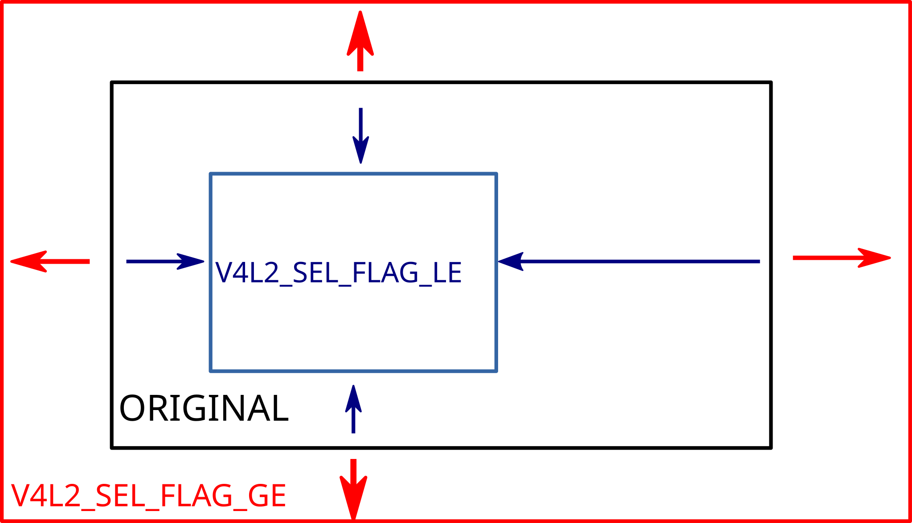

<a id="rst-ioctl-vidioc-g-selection-vidioc-s-selection"></a>
<a id="rst-vidioc-g-selection"></a>

<!-- SPDX-License-Identifier: GFDL-1.1-no-invariants-or-later -->

<!-- c:namespace: V4L -->

<a id="rst-name"></a>

## Name

VIDIOC_G_SELECTION - VIDIOC_S_SELECTION - Get or set one of the selection rectangles

<a id="rst-synopsis"></a>

## Synopsis


<a id="c-VIDIOC_G_SELECTION"></a>

```c
VIDIOC_G_SELECTION
```

`int ioctl(int fd, VIDIOC_G_SELECTION, struct v4l2_selection *argp)`


<a id="c-VIDIOC_S_SELECTION"></a>

```c
VIDIOC_S_SELECTION
```

`int ioctl(int fd, VIDIOC_S_SELECTION, struct v4l2_selection *argp)`

<a id="rst-arguments"></a>

## Arguments

- **`fd`**

  File descriptor returned by `open()`.

- **`argp`**

  Pointer to struct `v4l2_selection`.

<a id="rst-description"></a>

## Description

The ioctls are used to query and configure selection rectangles.

To query the cropping (composing) rectangle set struct `v4l2_selection` `type` field to the respective buffer type. The next step is setting the value of struct `v4l2_selection` `target` field to `V4L2_SEL_TGT_CROP` (`V4L2_SEL_TGT_COMPOSE`). Please refer to table [Common selection definitions](<~kernel/userspace/userspace-api/media-v4l/selections-common#rst-v4l2-selections-common>) or [Cropping, composing and scaling -- the SELECTION API](<~kernel/userspace/userspace-api/media-v4l/selection-api#rst-selection-api>) for additional targets. The `flags` and `reserved` fields of struct `v4l2_selection` are ignored and they must be filled with zeros. The driver fills the rest of the structure or returns EINVAL error code if incorrect buffer type or target was used. If cropping (composing) is not supported then the active rectangle is not mutable and it is always equal to the bounds rectangle. Finally, the struct `v4l2_rect` `r` rectangle is filled with the current cropping (composing) coordinates. The coordinates are expressed in driver-dependent units. The only exception are rectangles for images in raw formats, whose coordinates are always expressed in pixels.

To change the cropping (composing) rectangle set the struct `v4l2_selection` `type` field to the respective buffer type. The next step is setting the value of struct `v4l2_selection` `target` to `V4L2_SEL_TGT_CROP` (`V4L2_SEL_TGT_COMPOSE`). Please refer to table [Common selection definitions](<~kernel/userspace/userspace-api/media-v4l/selections-common#rst-v4l2-selections-common>) or [Cropping, composing and scaling -- the SELECTION API](<~kernel/userspace/userspace-api/media-v4l/selection-api#rst-selection-api>) for additional targets. The struct `v4l2_rect` `r` rectangle need to be set to the desired active area. Field struct `v4l2_selection` `reserved` is ignored and must be filled with zeros. The driver may adjust coordinates of the requested rectangle. An application may introduce constraints to control rounding behaviour. The struct `v4l2_selection` `flags` field must be set to one of the following:

- `0` - The driver can adjust the rectangle size freely and shall choose a crop/compose rectangle as close as possible to the requested one.

- `V4L2_SEL_FLAG_GE` - The driver is not allowed to shrink the rectangle. The original rectangle must lay inside the adjusted one.

- `V4L2_SEL_FLAG_LE` - The driver is not allowed to enlarge the rectangle. The adjusted rectangle must lay inside the original one.

- `V4L2_SEL_FLAG_GE | V4L2_SEL_FLAG_LE` - The driver must choose the size exactly the same as in the requested rectangle.

Please refer to [sel-const-adjust](<#rst-sel-const-adjust>).

The driver may have to adjusts the requested dimensions against hardware limits and other parts as the pipeline, i.e. the bounds given by the capture/output window or TV display. The closest possible values of horizontal and vertical offset and sizes are chosen according to following priority:

1. Satisfy constraints from struct `v4l2_selection` `flags`.

2. Adjust width, height, left, and top to hardware limits and alignments.

3. Keep center of adjusted rectangle as close as possible to the original one.

4. Keep width and height as close as possible to original ones.

5. Keep horizontal and vertical offset as close as possible to original ones.

On success the struct `v4l2_rect` `r` field contains the adjusted rectangle. When the parameters are unsuitable the application may modify the cropping (composing) or image parameters and repeat the cycle until satisfactory parameters have been negotiated. If constraints flags have to be violated at then `ERANGE` is returned. The error indicates that *there exist no rectangle* that satisfies the constraints.

Selection targets and flags are documented in [Common selection definitions](<~kernel/userspace/userspace-api/media-v4l/selections-common#rst-v4l2-selections-common>).

<a id="rst-sel-const-adjust"></a>



Size adjustments with constraint flags.

Behaviour of rectangle adjustment for different constraint flags.


<a id="c-v4l2_selection"></a>

```c
v4l2_selection
```

<!-- tabularcolumns: |p{4.4cm}|p{4.4cm}|p{8.5cm}| -->


<table>
<caption>struct v4l2_selection</caption>
<tbody>
<tr>
<td>


\__u32

</td>
<td>


`type`

</td>
<td>


Type of the buffer (from enum `v4l2_buf_type`).

</td>
</tr>
<tr>
<td>


\__u32

</td>
<td>


`target`

</td>
<td>


Used to select between [cropping and composing rectangles](<~kernel/userspace/userspace-api/media-v4l/selections-common#rst-v4l2-selections-common>).

</td>
</tr>
<tr>
<td>


\__u32

</td>
<td>


`flags`

</td>
<td>


Flags controlling the selection rectangle adjustments, refer to [selection flags](<https://git.kernel.org/pub/scm/linux/kernel/git/stable/linux.git/tree/Documentation/userspace-api/media/v4l/v4l2-selection-flags.rst?id=9021cc14f7d98b4a1d2c932f52c5343d4d0f6b92>).

</td>
</tr>
<tr>
<td>


struct `v4l2_rect`

</td>
<td>


`r`

</td>
<td>


The selection rectangle.

</td>
</tr>
<tr>
<td>


\__u32

</td>
<td>


`reserved[9]`

</td>
<td>


Reserved fields for future use. Drivers and applications must zero this array.

</td>
</tr>
</tbody>
</table>

> [!NOTE]
>
> Unfortunately in the case of multiplanar buffer types (`V4L2_BUF_TYPE_VIDEO_CAPTURE_MPLANE` and `V4L2_BUF_TYPE_VIDEO_OUTPUT_MPLANE`) this API was messed up with regards to how the `v4l2_selection` `type` field should be filled in. Some drivers only accepted the `_MPLANE` buffer type while other drivers only accepted a non-multiplanar buffer type (i.e. without the `_MPLANE` at the end).
>
> Starting with kernel 4.13 both variations are allowed.

<a id="rst-return-value"></a>

## Return Value

On success 0 is returned, on error -1 and the `errno` variable is set appropriately. The generic error codes are described at the [Generic Error Codes](<~kernel/userspace/userspace-api/media/gen-errors#rst-gen-errors-1>) chapter.

- **EINVAL**

  Given buffer type `type` or the selection target `target` is not supported, or the `flags` argument is not valid.

- **ERANGE**

  It is not possible to adjust struct `v4l2_rect` `r` rectangle to satisfy all constraints given in the `flags` argument.

- **ENODATA**

  Selection is not supported for this input or output.

- **EBUSY**

  It is not possible to apply change of the selection rectangle at the moment. Usually because streaming is in progress.
